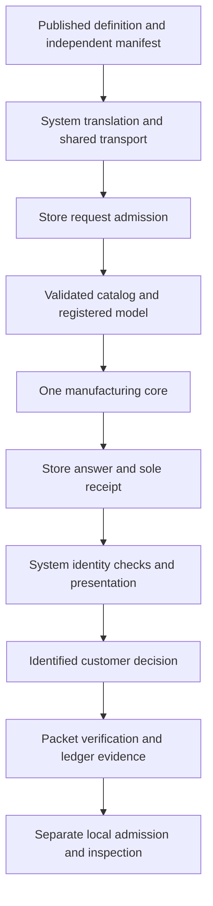

# Store Zero — Complete Technical, Manufacturing and Operational Reference

3D Solutions LLC · 12 October 2026

Store Zero connects a customer's defined woodwork to the material and processing a particular yard can supply. The customer changes dimensions, material and identified features in System. System preserves that definition, identifies every required component and feature, and sends one complete manufacturing inquiry. Store evaluates it afresh against its own catalog, available quantities, registered processing model and economics. Its answer supplies selected parents, required operations, modeled occupied time, budgetary total Q, or the reasons the whole job cannot be supported.

**Machine functions are registered before the customer arrives.** The customer defines required operations and values; System derives their meaning, geometry, features, manifest and revision. Store resolves stock, capability and the manufacturing plan, generates its nominal positioning/processing ledger, and calculates time and Q from that same work. The compilation chain absorbs the supported modeled job's programming burden: accepted-job lowering binds the verified plan to registered machine facts without another person redrawing parts or entering derived coordinates. Specialist work establishes and maintains the reusable mapping; controller-oriented export extends the existing lowerer, while physical commissioning remains local.

The current working software makes that proposition inspectable. All three manufacturing definition classes reach one Store-owned engine. It searches complete feasible parent-stock plans, retains component and feature coverage, sequences declared work, accounts for handling and tool movement, and calculates Q from material, hardware, hourly service and separately charged panel cuts. A manifest independent of the translated demand prevents a dropped requirement from disappearing into a favorable answer. Receipts bind the answer to demand, manifest, Store release, catalog and model. Accepted packets preserve that same chain; verification reevaluates rather than trusting a saved amount.

Current machine evidence is a **modeled operation ledger**, schema `STB-MODELED-OPERATIONS-1`, with evidence class `PREDICTED_OCCUPANCY_ONLY`. Its replay checks identity, sequencing, dimensional moves, tool engagement and the time already priced by Store. It does not constitute a commissioned controller program. The original Project 1 controller-oriented package is historical evidence. Current integration acceptance and generated reference files are separate from that publication; neither specimen defines the runtime architecture.

The commercial chain preserves the same identities through answer, seller offer, customer decision, order, financial state, material allocation, release, execution, inspection, staging and custody. These are separate source-owned decisions. The shared executable gate records and verifies simulated evidence; All five projects explicitly enable a demo seller policy. A click or calculation does not establish physical inventory commitment, payment or inspected components.

The proposed supervised laboratory will establish the physical link: measured fence and support references, retained-face and kerf transforms, stock contact and restraint, actual movement, qualified tools, controller behavior, protective functions and independently inspected output. It will compare the complete service burden and operating cost with existing alternatives. The present software supplies defined inquiries, plans, numbers, identities and refusals against which that work can be tested. **Define it once; nobody downstream should have to redraw it.**

## Contents

<!-- TOC START -->
- [1. Source record and authority](#1-source-record-and-authority)
  - [1.1 Current executable authority](#11-current-executable-authority)
  - [1.2 Registered versions and identity rules](#12-registered-versions-and-identity-rules)
  - [1.3 Reading and verification basis](#13-reading-and-verification-basis)
  - [1.4 Owners and the single answer path](#14-owners-and-the-single-answer-path)
- [2. Invention and issued patents](#2-invention-and-issued-patents)
  - [2.1 The manufacturing architecture](#21-the-manufacturing-architecture)
  - [2.2 Figures and disclosed machine modes](#22-figures-and-disclosed-machine-modes)
  - [2.3 Evidence configurations compared](#23-evidence-configurations-compared)
  - [2.4 Current correspondence evidence keys](#24-current-correspondence-evidence-keys)
  - [2.5 US 9720401 B2 claims 1 through 18](#25-us-9720401-b2-claims-1-through-18)
  - [2.6 US 10768609 B2 claims 1 through 15](#26-us-10768609-b2-claims-1-through-15)
  - [2.7 Registered engineering and per-order preparation](#27-registered-engineering-and-per-order-preparation)
- [3. The complete System-to-Store boundary](#3-the-complete-system-to-store-boundary)
  - [3.1 Idea Intent and Bench](#31-idea-intent-and-bench)
  - [3.2 Three definition classes and discovery](#32-three-definition-classes-and-discovery)
  - [3.3 Protocol 2 admission](#33-protocol-2-admission)
  - [3.4 Independent complete manifest](#34-independent-complete-manifest)
  - [3.5 Complete board request example](#35-complete-board-request-example)
  - [3.6 Cut and sheet contracts](#36-cut-and-sheet-contracts)
  - [3.7 Answer receipt and transport](#37-answer-receipt-and-transport)
  - [3.8 Revision custody and accepted packets](#38-revision-custody-and-accepted-packets)
- [4. Store-owned catalog and inventory](#4-store-owned-catalog-and-inventory)
  - [4.1 Catalog identity and provenance](#41-catalog-identity-and-provenance)
  - [4.2 Board material categories](#42-board-material-categories)
  - [4.3 Sheet and hardware categories](#43-sheet-and-hardware-categories)
  - [4.4 Eligibility and supply decisions](#44-eligibility-and-supply-decisions)
  - [4.5 Discovery and attribution](#45-discovery-and-attribution)
  - [4.6 Complete SKU register](#46-complete-sku-register)
- [5. Manufacturing engine from request to Q](#5-manufacturing-engine-from-request-to-q)
  - [5.1 Compilation and validation](#51-compilation-and-validation)
  - [5.2 Task grouping and operation requirements](#52-task-grouping-and-operation-requirements)
  - [5.3 Candidate eligibility](#53-candidate-eligibility)
  - [5.4 Parent patterns and whole-job search](#54-parent-patterns-and-whole-job-search)
  - [5.5 Ledger state and occupancy](#55-ledger-state-and-occupancy)
  - [5.6 Motion timing](#56-motion-timing)
  - [5.7 Reference and saw operations](#57-reference-and-saw-operations)
  - [5.8 Width preparation and profiles](#58-width-preparation-and-profiles)
  - [5.9 Spot geometry and timing](#59-spot-geometry-and-timing)
  - [5.10 Sheet geometry and compensation](#510-sheet-geometry-and-compensation)
  - [5.11 Retention tabs and split rules](#511-retention-tabs-and-split-rules)
  - [5.12 Panel cuts and returned pieces](#512-panel-cuts-and-returned-pieces)
  - [5.13 Sheet operation time](#513-sheet-operation-time)
  - [5.14 Hardware package selection](#514-hardware-package-selection)
  - [5.15 Whole-job economics and rounding](#515-whole-job-economics-and-rounding)
  - [5.16 Completion and calculation identity](#516-completion-and-calculation-identity)
  - [5.17 Worked calculations and sensitivities](#517-worked-calculations-and-sensitivities)
- [6. Registered machine functions](#6-registered-machine-functions)
  - [6.1 Registered model and units](#61-registered-model-and-units)
  - [6.2 Dimensional parameter register](#62-dimensional-parameter-register)
  - [6.3 Sheet parameter register](#63-sheet-parameter-register)
  - [6.4 Datums and controlled stock movement](#64-datums-and-controlled-stock-movement)
  - [6.5 Kerf faces and reference retention](#65-kerf-faces-and-reference-retention)
  - [6.6 Contact screens and physical restraint](#66-contact-screens-and-physical-restraint)
  - [6.7 Fixed tooling and local lowering](#67-fixed-tooling-and-local-lowering)
  - [6.8 Proposed physical apparatus and commissioning](#68-proposed-physical-apparatus-and-commissioning)
  - [6.9 Historical apparatus and component engineering](#69-historical-apparatus-and-component-engineering)
- [7. Complete Project 1 walkthrough](#7-complete-project-1-walkthrough)
  - [7.1 Specimen sources and identities](#71-specimen-sources-and-identities)
  - [7.2 Customer geometry and System derivation](#72-customer-geometry-and-system-derivation)
  - [7.3 Historical material and parent decision](#73-historical-material-and-parent-decision)
  - [7.4 Historical Store route and Q](#74-historical-store-route-and-q)
  - [7.5 Neutral requirements and local coordinates](#75-neutral-requirements-and-local-coordinates)
  - [7.6 Every historical virtual command](#76-every-historical-virtual-command)
  - [7.7 Controller interpreter and state lifecycle](#77-controller-interpreter-and-state-lifecycle)
  - [7.8 Historical virtual timing reconciliation](#78-historical-virtual-timing-reconciliation)
  - [7.9 Contact face and stroke findings](#79-contact-face-and-stroke-findings)
  - [7.10 Reproduction and fourteen checks](#710-reproduction-and-fourteen-checks)
  - [7.11 Separate current adopted-core comparison](#711-separate-current-adopted-core-comparison)
  - [7.12 Transaction handoffs and resulting record](#712-transaction-handoffs-and-resulting-record)
- [8. Five current public project paths](#8-five-current-public-project-paths)
  - [8.1 Exact inquiry and evaluation basis](#81-exact-inquiry-and-evaluation-basis)
  - [8.2 Start Your Own](#82-start-your-own)
  - [8.3 Alcove](#83-alcove)
  - [8.4 Window Seat](#84-window-seat)
  - [8.5 Outdoor](#85-outdoor)
  - [8.6 Playhouse](#86-playhouse)
  - [8.7 Variations refusals and commercial scope](#87-variations-refusals-and-commercial-scope)
- [9. Lowering packets and virtual evidence](#9-lowering-packets-and-virtual-evidence)
  - [9.1 Accepted packet verification](#91-accepted-packet-verification)
  - [9.2 Current local job](#92-current-local-job)
  - [9.3 Modeled operation records](#93-modeled-operation-records)
  - [9.4 Independent virtual replay](#94-independent-virtual-replay)
  - [9.5 Evidence request and response](#95-evidence-request-and-response)
  - [9.6 Complete reproducible examples](#96-complete-reproducible-examples)
  - [9.7 Source digest and deployment verification](#97-source-digest-and-deployment-verification)
- [10. Commercial sequence and full transaction](#10-commercial-sequence-and-full-transaction)
  - [10.1 Contract ownership and installed scope](#101-contract-ownership-and-installed-scope)
  - [10.2 Event envelope and identity binding](#102-event-envelope-and-identity-binding)
  - [10.3 Answer offer decision and order](#103-answer-offer-decision-and-order)
  - [10.4 Finance reservation capacity and queue](#104-finance-reservation-capacity-and-queue)
  - [10.5 Allocation issue release and local admission](#105-allocation-issue-release-and-local-admission)
  - [10.6 Execution inspection staging and handoff](#106-execution-inspection-staging-and-handoff)
  - [10.7 Idempotency hash chains and concurrency](#107-idempotency-hash-chains-and-concurrency)
  - [10.8 Shared five-project simulation policy](#108-shared-five-project-simulation-policy)
  - [10.9 Intended workflow and executable limits](#109-intended-workflow-and-executable-limits)
  - [10.10 Complete commercial design map and source context](#1010-complete-commercial-design-map-and-source-context)
- [11. Refusal interruption and recovery](#11-refusal-interruption-and-recovery)
  - [11.1 Current result states](#111-current-result-states)
  - [11.2 Admission and manufacturing reason register](#112-admission-and-manufacturing-reason-register)
  - [11.3 Packet evidence and transport failures](#113-packet-evidence-and-transport-failures)
  - [11.4 Commercial holds and exceptions](#114-commercial-holds-and-exceptions)
  - [11.5 Physical interruption datum invalidation and recovery](#115-physical-interruption-datum-invalidation-and-recovery)
- [12. Acceptance inspection and evidence custody](#12-acceptance-inspection-and-evidence-custody)
  - [12.1 Test evidence and proof scope](#121-test-evidence-and-proof-scope)
  - [12.2 Physical component acceptance](#122-physical-component-acceptance)
  - [12.3 Identity labels and remnants](#123-identity-labels-and-remnants)
  - [12.4 Custody and historical reproduction](#124-custody-and-historical-reproduction)
  - [12.5 Release responsibility](#125-release-responsibility)
- [13. Economics and operating implications](#13-economics-and-operating-implications)
  - [13.1 Current declared cost pool](#131-current-declared-cost-pool)
  - [13.2 Productive utilization and service burden](#132-productive-utilization-and-service-burden)
  - [13.3 Complete customer amount and internal cost](#133-complete-customer-amount-and-internal-cost)
  - [13.4 Waste maintenance and alternatives](#134-waste-maintenance-and-alternatives)
  - [13.5 Laboratory and yard validation](#135-laboratory-and-yard-validation)
  - [13.6 Research argument and what Store tests](#136-research-argument-and-what-store-tests)
- [14. Exact source and verification register](#14-exact-source-and-verification-register)
  - [14.1 Store runtime source register](#141-store-runtime-source-register)
  - [14.2 System handoff source register](#142-system-handoff-source-register)
  - [14.3 Historical Evidence — original source inventory](#143-historical-evidence--original-source-inventory)
  - [14.4 Content identities](#144-content-identities)
  - [14.5 Reproduction commands and verification results](#145-reproduction-commands-and-verification-results)
- [15. Evidence custody and development limits](#15-evidence-custody-and-development-limits)
  - [15.1 Architectural migration](#151-architectural-migration)
  - [15.2 Audit issues and resolution status](#152-audit-issues-and-resolution-status)
  - [15.3 Additional source discrepancies](#153-additional-source-discrepancies)
  - [15.4 Protected evidence and future consolidation](#154-protected-evidence-and-future-consolidation)
  - [15.5 Master completion and navigation checks](#155-master-completion-and-navigation-checks)
  - [15.6 Subsequent permanent preservation and repository disposition](#156-subsequent-permanent-preservation-and-repository-disposition)
  - [15.7 Future Work — capability-impact engine](#157-future-work--capability-impact-engine)
- [16. Historical Evidence — superseded Outdoor specimen](#16-historical-evidence--superseded-outdoor-specimen)
<!-- TOC END -->

## 1. Source record and authority

*Authority category: Current System Behavior*

### 1.1 Current executable authority

*Authority category: Current System Behavior*

Store's executable source and contracts govern current manufacturing behavior. System records the inspected Store commit in its candidate, browser runtime, CI checkout and local startup declarations. The deployed Store is `3f813fe060f1eff46a1b3cfdad1ad41465d230e0` at [store-zero-candidate](https://store-zero-candidate-production.up.railway.app/health); its `/health` response supplies the release and shipped-source digest.

Current executable contracts and verified outputs govern descriptions of installed behavior. The original Project 1 publication is historical evidence, not architectural authority. Regenerated reference evidence and revision-bound browser runs demonstrate current behavior for their identified inputs; they do not define that behavior. Consequential changes require affected specifications, masters, shared definitions, Program descriptions and current acceptance evidence to agree. Preserve sealed source bytes and distinguish modeled results, simulated commerce, commissioned execution and inspected output.

### 1.2 Registered versions and identity rules

*Authority category: Current System Behavior*

| Surface | Exact installed identifier | Source |
| --- | --- | --- |
| Request protocol | `STORE-ZERO-REQUEST-2` | [HTTP service](https://github.com/GeorgePlattDemo/store-zero/blob/main/src/service/server.mjs) |
| Definition conversion shapes | `USER_DEFINED_BOARD_V1`, `CUT_PACKAGE_V1`, `SHEET_PACKAGE_V1` | [Definition contracts](https://github.com/GeorgePlattDemo/store-zero/blob/main/src/contracts/definitions.mjs) |
| Neutral manufacturing job | `STORE-MANUFACTURING-JOB-1` | [Manufacturing core](https://github.com/GeorgePlattDemo/store-zero/blob/main/src/evaluation/engine/store-manufacturing-core.mjs) |
| Manufacturing model | `STORE-MANUFACTURING-CORE-0.1` | Core `createModel`; [registered parameters](https://github.com/GeorgePlattDemo/store-zero/blob/main/data/machine/manufacturing-core-0.1.json) |
| Configuration execution class | `DECLARED_OCCUPANCY_EVENT_MODEL` | [Configuration reader](https://github.com/GeorgePlattDemo/store-zero/blob/main/src/machine/configuration.mjs) |
| Catalog | `StoreZeroCallableCatalog`; declared clock `2026-09-10` | [Catalog](https://github.com/GeorgePlattDemo/store-zero/blob/main/data/store-zero-catalog.json) |
| Freshness rule | `STB-STORE-FRESH-EVALUATION-0.1` | [Request and receipt owner](https://github.com/GeorgePlattDemo/store-zero/blob/main/src/requests/store-request.mjs) |
| Accepted packet | `STB-ACCEPTED-JOB-PACKET-2` | [Packet contract](https://github.com/GeorgePlattDemo/store-zero/blob/main/src/contracts/job-packet.mjs) |
| Local job | `STB-LOCAL-MANUFACTURING-JOB-1` | [Lowering](https://github.com/GeorgePlattDemo/store-zero/blob/main/src/machine/lowering.mjs) |
| Operation records | `STB-MODELED-OPERATIONS-1` | [Machine-record contracts](https://github.com/GeorgePlattDemo/store-zero/blob/main/src/contracts/machine-records.mjs) |
| Virtual model | `STB-VIRTUAL-OCCUPANCY-MODEL-1` | [Replay](https://github.com/GeorgePlattDemo/store-zero/blob/main/src/machine/virtual-run.mjs) |
| Evidence protocol | `STORE-ZERO-MACHINE-EVIDENCE-2` | [Evidence entry point](https://github.com/GeorgePlattDemo/store-zero/blob/main/src/machine/evidence.mjs) |
| Commercial record | `STB-COMMERCIAL-EVENT-1` | [Shared executable gate](https://github.com/GeorgePlattDemo/store-zero/blob/main/src/contracts/commercial-sequence.js) |
| Commercial transport | `STORE-ZERO-COMMERCIAL-EVIDENCE-1` | [Commercial request boundary](https://github.com/GeorgePlattDemo/store-zero/blob/main/src/requests/commercial-request.mjs) |
| System owner record | `STB-SYSTEM-RECORD-2` | [System source/pin record](https://github.com/GeorgePlattDemo/new-system/blob/ab09777d6f27d4b70a2193abc8564ebce611746f/src/system/store-candidate.ts) |
| Historical review | `D001 PROJECT1 DIGITAL TRAIL REVIEW 0.2` | [Preserved manuscript](https://github.com/GeorgePlattDemo/store-zero/blob/f7123a73c1ca60aa7eb180a86a1c365eaffe95db/docs/project-1-digital-trail/D001_Project1_Review.md) |
| Historical virtual IR | `D001-VIRTUAL-IR-0.2` | Evidence ZIP `generated/motion-ir.json` |

Version labels identify a declared surface; content hashes establish which bytes or canonical object it contained. The registered model hash covers the full object returned by `createModel(parameters)`. The configuration hash covers the loaded configuration **including that expanded model**. It is not the SHA-256 of the 315-byte JSON parameter file. System records configuration hash `87542b1d56d7e5624d6d85557a0d213b226b9ffc4454d561fd8616379c1e6884` for this baseline. File-byte SHA-256 and Git blob identities are registered in Chapter 14.

### 1.3 Reading and verification basis

*Authority category: Current System Behavior*

Current verification reads executable source, catalog and registered model, request/packet/machine/commercial contracts, independent checks, generated examples and current integration proofs. System's public definition generators, translator and manifest supply the actual requests; Program owns research and proposed physical validation.

Historical patents, original Project 1 manuscript/Word/ZIP and migration recordings retain their exact hashes. Tests check those immutable records separately from current results. A historical reproduction proves its recorded revision; current acceptance proves only its identified implementation and inputs.

### 1.4 Owners and the single answer path

*Authority category: Current System Behavior*

| Owner | Adds authoritative facts | Does not acquire authority by receiving a record |
| --- | --- | --- |
| Customer and System | Controlling requirements, part/feature identities, derivations, revisions, complete manifest, application and owner custody | Store pricing, stock, machine economics or physical readiness |
| Store | Catalog, offered/available material, parent plans, processing constraints, modeled work/time, Q and refusal | Permission to reinterpret customer geometry |
| Responsible seller and financial source | Offer, policy, order acceptance and attributable financial records | Local machine admission or inspected conformance |
| Local implementation | Registered physical configuration, tooling, transforms, material readiness, local permission, controller execution | Customer design changes or substitute Store prices |
| Inspection and fulfillment | Measurements, conformance disposition, physical labels, package inventory and transfer | Proof from model completion alone |
| Program | Investigation, proposed engineering, trials, findings and development rationale | Runtime capability, source-owned commercial acts or operating release |

The current answering path is:



Only Store's request layer issues the receipt. Discovery has its own bounded retrieval path and supplies no job Q. Historical source copies are reproduction inputs, never a fallback for the current answering path. Source digest checks cover shipped `package.json`, `src/` and `data/`; documentation changes do not alter that shipped byte set.

## 2. Invention and issued patents

*Authority category: Current System Behavior*

### 2.1 The manufacturing architecture

*Authority category: Current System Behavior*

[US 9,720,401 B2](https://github.com/GeorgePlattDemo/store-zero/blob/f7123a73c1ca60aa7eb180a86a1c365eaffe95db/docs/patents/US9720401B2.pdf), issued 1 August 2017, and [US 10,768,609 B2](https://github.com/GeorgePlattDemo/store-zero/blob/f7123a73c1ca60aa7eb180a86a1c365eaffe95db/docs/patents/US10768609B2.pdf), issued 8 September 2020, share the title *Method and System for Consumer Home Projects Ordering and Fabrication*. The latter identifies itself as a continuation of application 14/094,074 filed 2 December 2013, which became the first grant. Each issued claim set is read independently; a common disclosure does not make the claims identical.

The disclosed integration begins with a customer's project inquiry, selection or changed requirements. System resolves those choices into component requirements, features, material demand and assembly meaning. Pre-established machine functions make the requirements actionable: Store resolves stock and admitted work; the accepted plan lowers through registered tooling and station references into job-specific instructions. Thus the programmer's routine per-order reconstruction moves into reusable engineering established in advance. The disclosed customer paths include selecting or modifying a database project and developing requirements in the design interface. Material, features, machining time and optional services inform the estimate. Local dimensional or sheet processing, additional components, secondary work, finishing, labels, assembly instructions, staging and pickup complete the described service. Material loading, local readiness, inspection and custody remain explicit activities rather than implied consequences of a generated instruction. The particular vendor components and software mappings are present engineering selections, not inventions attributed to the patents.

Dimensional and sheet processing form two cooperating material streams. A particular order may need only one. Dimensional stock moves along a fence between known operations. The sheet architecture supports direct straight cuts, sheet movement under a fixed longitudinal tooling station, and a separate mode in which a fixed workpiece receives two-axis tool-platform movement. Material retrieval and loading can remain human tasks while positioning and processing follow generated instructions.

The patent disclosure also discusses custom tools, supplier or special-order merchants, optional delivery and assembly, contractor use and local service economics. Those are disclosed possibilities. Store's current fixed tool, declared inventory and bounded operation vocabulary determine what this implementation actually answers. A patent's examples of savings or commercial benefit are propositions; current Q is a declared calculation and the laboratory trial will measure the complete service.

### 2.2 Figures and disclosed machine modes

*Authority category: Historical Evidence*

The drawings in both grants are schematic and explicitly not a dimensioned fabrication drawing. The figure numbers are the drawing-sheet labels, not PDF page indices.

| Figure | Subject | Relevance to this reference |
| --- | --- | --- |
| 1 | Customer input, retailer/project data, controller, tandem machine, raw material and finished components | The complete information-to-component chain |
| 2 | Store interface, mobile/home access, supplier/merchant, stock, operator, tandem cell, secondary work, finishing, labeler and staging | Source-owned transaction and fulfillment responsibilities |
| 3 | Production cell within retail inventory bays | Footprint, manual handling and phased investment proposition |
| 4 | Conveyor, spray and drying arrangement | A separately engineered finishing service, absent from the current core |
| 5 | Dimensional support, fence, manipulating and clamping rollers, saw stations and tooling ways | Datum and station architecture; illustrated three manipulating rollers differ from the two-roller model |
| 6 | Sheet backing plates, bottom/top rollers, rotating yokes, guide rails and tooling platform | Particular physical structure included in independent claims |
| 7 | Tool platform, receiver and pressure-sensing plate | Physical depth reference and tooling interface |
| 8 | Interchangeable tool attachment and contour tooling | Tooling embodiments; no automatic adoption into Store |
| 9 | Computer, communication, I/O and storage | Computer implementation and stored instruction aspects |

In disclosed sheet **mode 1**, operator panel settings control straight cuts. In **mode 2**, the sheet supplies X movement and the tool supplies Y movement at a fixed longitudinal centerline; attachment bridges retain routed shapes for later separation. In **mode 3**, components are pinned/clamped to backing or carrier plates and the tool platform moves in both planar axes for finishing or other precision work. S-001 currently evaluates a bounded routed field and occupancy; it does not implement every one of those physical modes or their protective systems.

### 2.3 Evidence configurations compared

*Authority category: Historical Evidence*

| Configuration | Dimensional arrangement | Sheet arrangement | Evidence stage |
| --- | --- | --- | --- |
| Issued disclosure and claims | Support/fence, manipulating and clamping rollers, saw(s), rigid ways and tool heads; illustrated preferred arrangement has three manipulating rollers | Backing/support, rollers, yokes, rails and moveable tooling platform with disclosed modes | Issued text and schematic disclosure |
| Historical Project 1 review | Nominal saw X=0, spot X=36, rollers X=24/48, measuring wheel X=30; controller-oriented A/S/X/Y/Z sequence | No sheet specimen in this package | Reproduced original Q and executed Node virtual sequence; uncompiled Structured Text |
| Adopted Store core | One nominal saw station X=0, tool X=36, roller screen X=24/48; A/S/C/Y/Z/RZ timing state | Center 48×36 routed field in 96×48 sheet; separate manual full cuts | Implemented declared occupancy/economics model; current replay |
| Program laboratory proposal | Two downstroke saw stations, two manipulating rollers, up to three routing functions, one initial spot station; second spot added if justified | Added when demonstrated demand warrants it | Proposed apparatus and measured acceptance work |

These arrangements cannot be exchanged merely because they use similar tooling words. The adopted core does not have the archived separate right-saw batch path. The laboratory's future station locations and signed-angle transforms must come from its released engineering record. The patents do not supply the core's hourly rate, feed constants, 24-inch screen or tab policy.

### 2.4 Current correspondence evidence keys

*Authority category: Historical Evidence*

The matrices below describe engineering correspondence to issued functions. Each dependent claim includes its inherited limitations. A successful price or hardware test demonstrates that function under its proof scope; it does not establish the full inherited apparatus or method. The issued PDF controls the claim wording.

| Key | Current code and evidence |
| --- | --- |
| I | System [published translator](https://github.com/GeorgePlattDemo/new-system/blob/ab09777d6f27d4b70a2193abc8564ebce611746f/src/system/store/published-wire.ts), [compiler](https://github.com/GeorgePlattDemo/new-system/blob/ab09777d6f27d4b70a2193abc8564ebce611746f/src/system/compile.ts), [manifest](https://github.com/GeorgePlattDemo/new-system/blob/ab09777d6f27d4b70a2193abc8564ebce611746f/src/system/manifest.ts); published-wire and [HTTP integration checks](https://github.com/GeorgePlattDemo/new-system/blob/ab09777d6f27d4b70a2193abc8564ebce611746f/src/system/store/http.integration.test.ts) |
| Q | Store [manufacturing core](https://github.com/GeorgePlattDemo/store-zero/blob/main/src/evaluation/engine/store-manufacturing-core.mjs), [catalog reader](https://github.com/GeorgePlattDemo/store-zero/blob/main/src/evaluation/catalog.mjs), catalog/model data; [21 self-checks](https://github.com/GeorgePlattDemo/store-zero/blob/f7123a73c1ca60aa7eb180a86a1c365eaffe95db/tests/core-self-checks.mjs) and manufacturing test |
| R | [Request/receipt layer](https://github.com/GeorgePlattDemo/store-zero/blob/main/src/requests/store-request.mjs), [definition contract](https://github.com/GeorgePlattDemo/store-zero/blob/main/src/contracts/definitions.mjs), [packet verifier](https://github.com/GeorgePlattDemo/store-zero/blob/main/src/contracts/job-packet.mjs); [protocol 2 tests](https://github.com/GeorgePlattDemo/store-zero/blob/f7123a73c1ca60aa7eb180a86a1c365eaffe95db/tests/protocol2.test.mjs) and contract acceptance |
| V | [Lowering](https://github.com/GeorgePlattDemo/store-zero/blob/main/src/machine/lowering.mjs), [record validation](https://github.com/GeorgePlattDemo/store-zero/blob/main/src/contracts/machine-records.mjs), [virtual replay](https://github.com/GeorgePlattDemo/store-zero/blob/main/src/machine/virtual-run.mjs), [evidence boundary](https://github.com/GeorgePlattDemo/store-zero/blob/main/src/machine/evidence.mjs); current protocol/contract examples |
| C | [Shared commercial gate](https://github.com/GeorgePlattDemo/store-zero/blob/main/src/contracts/commercial-sequence.js), [commercial tests](https://github.com/GeorgePlattDemo/store-zero/blob/f7123a73c1ca60aa7eb180a86a1c365eaffe95db/tests/commercial-sequence.test.mjs); System's byte-identical gate and explicitly simulated source adapters |
| H | [Original Project 1 manuscript](https://github.com/GeorgePlattDemo/store-zero/blob/f7123a73c1ca60aa7eb180a86a1c365eaffe95db/docs/project-1-digital-trail/D001_Project1_Review.md), DOCX, ZIP, seven pinned sources and fourteen reference checks; [historical acceptance](https://github.com/GeorgePlattDemo/store-zero/blob/f7123a73c1ca60aa7eb180a86a1c365eaffe95db/acceptance/project-1/project-1.test.mjs) |

### 2.5 US 9720401 B2 claims 1 through 18

*Authority category: Historical Evidence*

Claim text appears on PDF pages 30–33, printed columns 40–46. Parent is the **immediate** dependency.

| Claim | Parent | Issued function or combination in plain language | Current correspondence | Physical requirement and evidence stage |
| --- | --- | --- | --- | --- |
| 1 | Independent | Customer project/database-or-CAD interface; instructions control tandem dimensional/sheet fabrication; detailed sheet support, plates, rollers, yokes, rails and platform | I/Q/R/V implement selected information and model functions | Claimed physical tandem and sheet structure not established |
| 2 | 1 | Control panel for each machine; manual and computer-controlled modes | Local operating target | No installed panel/mode validation |
| 3 | 1 | Tooling platform accepts selectively installed heads | Registered fixed tool models only | Physical attachment/interface absent from current implementation |
| 4 | 1 | Dimensional support surface, fence, clamp roller, servo manipulation and servo saw | Q/V positioning, saw and contact screens | Installed mechanism/restraint not established |
| 5 | 4 | Fixed rigid vertical/horizontal ways with servo-positioned tool heads | Program candidate engineering | Complete physical ways/tool assembly unbuilt |
| 6 | 5 | Rigid metal base with predrilled element mounting holes | Proposed structural registration | No base manufacture or mounting inspection |
| 7 | 1 | Prefinishing/finishing station | Optional service/disposition context in C | No installed or executed finishing process |
| 8 | 1 | Manual secondary-operations station | C can retain responsibility and disposition | No commissioned physical secondary station |
| 9 | 1 | Component labels and printed assembly instructions | Q identity/label records; source project information in I | Complete print/affix/instruction station absent |
| 10 | Independent | Project interface, price and instructions; tandem structure; home-improvement retail location; CAD/CAM; operator loading and tool-head changes | I/Q/R/V are partial software correspondence | Full physical/retail/method combination and tool changes not demonstrated |
| 11 | 10 | Customer variation produces recalculated estimate | I/Q/R fresh evaluation of changed revisions | Implemented and tested information function; claim 10 inheritance remains |
| 12 | 10 | Acceptance followed by material list and machining instructions | C/R/V simulated decision, material selection and bound ledger | Full actual accepted-order fabrication chain absent |
| 13 | 12 | Transmit instructions to tandem machine | V/H generated virtual artifacts | No commissioned controller transmission |
| 14 | 13 | Labels associated with components and assembly instructions | Q/H identity and label intent | Complete actual print/affix and assembly chain absent |
| 15 | 14 | List additional components not fabricated by either machine | Q hardware selection and I presentation | Implemented tested listing; inherited manufacture/label chain absent |
| 16 | 13 | Remove machined component; label, finish, secondary work and/or package fabricated/additional components | C simulated execution/inspection/custody records | Actual post-machine work not demonstrated |
| 17 | 10 | Claim 10 implemented as stored computer-readable instructions | Software and H artifacts exist | Existence of software does not establish full inherited method |
| 18 | 10 | Estimated price uses pricing database at Store with tandem machine | Q/R Store-owned catalog pricing | Tested price function; real co-located tandem arrangement absent |

### 2.6 US 10768609 B2 claims 1 through 15

*Authority category: Historical Evidence*

Claim text appears on PDF pages 31–33, printed columns 40–44. Claim 1 includes both manufacturing families, fore/aft dimensional end work, sheet curvilinear work and the detailed sheet apparatus.

| Claim | Parent | Issued function or combination in plain language | Current correspondence | Physical requirement and evidence stage |
| --- | --- | --- | --- | --- |
| 1 | Independent | Project/database-or-CAD interaction; estimate and instructions; curvilinear sheet work; dimensional end operations by fore/aft stock movement; detailed sheet apparatus | I/Q/R/V information, stock and modeled processing functions | Complete physical combination not established |
| 2 | 1 | Implementation by retail business entity | Declared reference yard | Operational retailer implementation absent |
| 3 | 1 | Customer variation and revised estimate | I/Q/R fresh changed-definition evaluations | Implemented/tested function; parent apparatus/method absent |
| 4 | 1 | Acceptance, material list and machining instructions | C/R/V simulated decision and bound plan | Complete actual production chain absent |
| 5 | 4 | Transmit instructions; display appropriate stock-loading request and component machining instructions | V/H identified component/material artifacts | Commissioned loading, transmission and execution absent |
| 6 | 5 | Component labels and printed assembly instructions | Q/H identity/label modeling | Full physical label/instruction chain absent |
| 7 | 6 | Listing additional nonfabricated components | Q hardware requirements and I presentation | Tested listing; inherited chain absent |
| 8 | 7 | CAD includes CAM; generated instructions; sequential loading and tool-head changes | Bounded generated/model artifacts | Ordinary per-order head changes outside current fixed-tool model |
| 9 | 8 | Interface permits interaction with both project database and CAD design module | I library and user-defined paths | Claim-wide CAD/CAM and inherited physical combination not established |
| 10 | 5 | Remove component and label/finish/secondary-process/package it | C explicit simulated lifecycle | No observed physical post-machine workflow |
| 11 | 1 | Method embodied in stored computer-readable instructions | Software artifacts exist | Complete inherited method not established by storage |
| 12 | 1 | Pricing database at Store where tandem machine is located | Q/R Store pricing | Physical co-location/tandem requirement absent |
| 13 | 1 | Tandem machine in home-improvement retail store | Proposed local service setting | No installed retail tandem machine |
| 14 | 1 | CAD includes CAM and generates tandem instructions | V/H bounded generated sequence/model | General commissioned CAD/CAM-to-machine path absent |
| 15 | 14 | Operator sequentially loads stock and changes head attachments from CAD/CAM instructions | Proposed loading records and H reference | Actual loading/tool-change execution absent |

### 2.7 Registered engineering and per-order preparation

*Authority category: Current System Behavior*

The disclosed dimensional embodiment places drilling and routing heads on known ways so moving stock can bring features to those tools without installing different heads for routine work. This supports the engineering rationale for reusable station registration. Some issued combinations separately include tool-head changes. Current fixed-tool capability is a chosen narrower operating model, not a reinterpretation of those limitations.

A supported definition provides part geometry, operation and feature identities. Store supplies stock and the evaluated processing plan. Local registration supplies actual machine references, tools, signs, offsets, travel limits, controller mapping and readiness. When those mappings are qualified, software can generate per-job instructions from the definition. Eliminating a professional's ordinary per-order preparation does not eliminate the professional work of building and qualifying the mapping. Unknown capture geometry, unsupported features and invalid physical references must still be resolved or refused.

## 3. The complete System-to-Store boundary

*Authority category: Current System Behavior*

### 3.1 Idea Intent and Bench

*Authority category: Current System Behavior*

Idea carries source material, observations and the customer's intended result. Intent establishes which facts control the job and which wood/tools or requirements are selected. The Bench changes identified values under a project rule and exposes their resulting components and features. The six customer steps begin at Intent; Idea is intake. Those UI steps are System-owned, not Store request types.

A project may use a named derivation such as the X-brace rule, the Window Seat elevation rule, or a published plan's part list. That derivation turns customer values into an identified definition. It must preserve provenance and unresolved facts. A visual layout is not itself manufacturing demand. The Store inquiry contains typed values and a complete expected manifest. Store never derives a project by its title or by reading a picture.

System's public pages use an outer `stb-store-zero-http/1` page wire carrying attempt, project, revision, scope and payload identities. The server [published-wire translator](https://github.com/GeorgePlattDemo/new-system/blob/ab09777d6f27d4b70a2193abc8564ebce611746f/src/system/store/published-wire.ts) maps that wire to Store's protocol 2 request. These are distinct protocol layers. The server's [inspected Store pin](https://github.com/GeorgePlattDemo/new-system/blob/ab09777d6f27d4b70a2193abc8564ebce611746f/src/system/store-candidate.ts) governs; a caller-supplied different pin is rejected with `CALLER_PIN_DOES_NOT_GOVERN`.

### 3.2 Three definition classes and discovery

*Authority category: Current System Behavior*

| Store request type | Meaning and conversion | Important constraints |
| --- | --- | --- |
| `USER_DEFINED_BOARD_V1` | One identified workpiece demand with ordered parts and spots becomes one atomic board group | Explicit material, angle, parallel long-long miter-face geometry, reference cut, counts and required operations; parent minimum retained separately |
| `CUT_PACKAGE_V1` | Neutral dimensional packages and sourced item lines become board and item tasks | Every part identified; angle numeric; angled end meaning explicit; optional width preparation, spot and through-profile requirements |
| `SHEET_PACKAGE_V1` | One sheet and features become a sheet task | Exact sheet dimensions, identified features, retention and all-pieces-returned requirement |
| `OFFERING_LOOKUP` | Deterministic catalog search or exact lookup | No manifest, fabrication plan, machine time, Q or quotation receipt |

`BOARD_SQUARE_V1` and Store-native `ALCOVE_INSERT_V1` are retired and refused. The public Alcove still uses a System-facing insert label; System converts it to `CUT_PACKAGE_V1`. This is not a fourth Store evaluator. The engine's `compileDefinition` preserves the conversion request as `job.source`, adds neutral `boards`, `sheets` and `items`, and validates expected coverage before evaluation.

### 3.3 Protocol 2 admission

*Authority category: Current System Behavior*

The formal job request has exactly four top-level fields: `requestType`, `requestId`, `demand`, `manifest`. Request type and inquiry identity must be valid. Machine-local `spline`, `toolpath`, `gcode`, `controller` or `servoSteps` in the demand are refused. Unknown fields are not ignored. A prior answer, receipt, release or evaluation timestamp cannot be submitted as authority.

The [shape checker](https://github.com/GeorgePlattDemo/store-zero/blob/main/src/contracts/shape.mjs) checks declared JSON types and unknown nested fields. It treats null or absent values as unsupplied; completeness is checked in the core. A numeric-looking string from a UI may be explicitly converted by System before Store submission; Store's contract does not accept that string as a finite number. The same distinction applies to whole quantities.

A missing independent manifest fails before engine execution: `UNRESOLVED`, `INDEPENDENT_SYSTEM_MANIFEST_REQUIRED`, `freshEvaluation:false`, null calculation identity and null receipt. A clean request that reaches the engine can still receive a refusal, unresolved result or unavailable result with a **fresh evaluation receipt**. The receipt identifies that evaluation; it does not guarantee supportability.

### 3.4 Independent complete manifest

*Authority category: Current System Behavior*

System constructs the manifest from the controlling definition before published-wire translation. Store does not create it from whatever happens to arrive after translation. The core checks coverage again after planning. These two comparisons connect original requirements to consumed demand and fulfilled work.

| Manifest field | Required content and check |
| --- | --- |
| `jobId`, `revision` | Exactly equal demand `configurationId`, `configurationVersion` |
| `boardPartIds` | Unique nonblank set of every dimensional part ID |
| `sheetPackageIds` | Unique nonblank set of sheet package IDs; one sheet conversion uses its configuration ID |
| `featureIds` | Every required spot, profile or sheet feature ID, with no duplicate or missing identity |
| `items` | Every sourced `lineId` and positive integer requested quantity; quantities must match |
| `unresolvedRequirements` | Optional array; must be empty for a complete Q |

Set equality ignores list order but rejects duplicated identities; meaningful part order is retained elsewhere. Board and sheet package IDs are checked for uniqueness. The result exposes `manifestCoverage` for parts, sheet packages, features and item lines. `FEATURE_ANSWERED` or `FEATURE_COVERED_BY_PARENT_EDGE_PREPARATION` events carry the feature coverage witness. Hardware grouping preserves the assignments to each source item line.

A manifest proves coverage of what System listed. It cannot prove that System identified every physical installation requirement correctly. For Alcove, a spot summary contradictory to component spots is retained as an unresolved requirement. For Outdoor, the datum correspondence remains a source-meaning issue even when the transmitted manifest is complete.

### 3.5 Complete board request example

*Authority category: Current System Behavior*

The following runnable protocol 2 example states the Start Your Own 16-inch SPF demand. Its inquiry identity `MASTER-SYO-16` is an example identity; dimensions and required operations reproduce the current declared calculation. System remains the runtime issuer of the manifest. This example uses the public-page geometry and omits the redundant end-identity string.

```json
{
  "requestType": "USER_DEFINED_BOARD_V1",
  "requestId": "MASTER-SYO-16",
  "demand": {
    "title": "Start your own",
    "configurationId": "SYO-USER1-XBRACE",
    "configurationVersion": "0.1",
    "classId": "user_defined_board",
    "materialDemand": {"species":"spf","form":"board","nominalT":2,"nominalW":4},
    "definedWorkpieceLengthIn": 60,
    "requiredOps": ["MITER_LIMITED","SPOT_ON_LOCATION"],
    "sawAngleDeg": 30,
    "cutPlane": "miter-face",
    "datumCMethod": "REFERENCE_CUT",
    "endRelation": "parallel",
    "lengthDatum": "long-long-outer-edge",
    "declaredSawCuts": 3,
    "declaredSpotCount": 2,
    "unresolvedConditions": [],
    "parts": [
      {"partId":"PART-1","lengthIn":16,"features":[{"featureId":"SPOT-1","kind":"SPOT_ON_LOCATION","xIn":8,"locationRule":"CENTERED_ON_PART","acrossWidthRule":"CENTERED_ON_WIDE_FACE"}]},
      {"partId":"PART-2","lengthIn":16,"features":[{"featureId":"SPOT-2","kind":"SPOT_ON_LOCATION","xIn":8,"locationRule":"CENTERED_ON_PART","acrossWidthRule":"CENTERED_ON_WIDE_FACE"}]}
    ]
  },
  "manifest": {
    "jobId":"SYO-USER1-XBRACE","revision":"0.1",
    "boardPartIds":["PART-1","PART-2"],"sheetPackageIds":[],
    "featureIds":["SPOT-1","SPOT-2"],"items":[],"unresolvedRequirements":[]
  }
}
```

This inquiry calls the registered core through the sole request layer and returns $8.62 on the baseline catalog. Changing request ID changes the retained source object and therefore calculation input identity even if geometry and Q remain equal. A reproducible example must preserve its whole request, not only the dollar amount.

### 3.6 Cut and sheet contracts

*Authority category: Current System Behavior*

A cut package contains `packageId`, `material`, `endCut`, and nonempty `parts`. Material names species, form `board`, positive nominal thickness and width, and grade when required by offered choices. Square work states `angleDeg:0`; omission is not square. Angled work states angle 0–45, `endRelation:parallel`, `lengthDatum:long-long-outer-edge`, `plane:miter-face`. Finished width must be positive and compatible with actual stock. Two-edge preparation states both positive removals and finished width; Store validates their sum against actual width.

Each part names `partId`, positive `lengthIn`, and optional `spots` and `edgeProfiles`. Spots carry identity, longitudinal coordinate and centered/inset placement, with optional exact diameter/depth constraints. Profiles carry identity, `MILL_LONGITUDINAL_PROFILE`, path length, Y and total depth. A source-specific profile is fulfilled by whole-parent edge preparation only when its path, prepared width and through depth agree exactly under the code's tolerance.

Each item line carries `lineId`, positive integer `qty`, and exactly one selector: `storeSku`, `requirementId`, or structured `requirement`. An exact SKU quantity is a selling-unit/package quantity. A structured fastener requirement's quantity is a piece count; Store chooses enough complete packages. A functional requirement's quantity is the identified offered unit count.

A sheet demand contains `sheet` dimensions and optional species/grade, `features`, `returnAllPieces:true`, and optional Boolean exterior requirement. Current feature kinds are `ARCHED_APERTURE`, `STRAIGHT_SPLIT`, `CROSSCUT`, `RIP`, `PATTERN`. Each kind has its own allowed operands. PATTERN offsets one named aperture; it is not arbitrary controller code or a second priced profile. Custom tab positions remain literal. A custom split without positions remains `UNRESOLVED` with no complete Q.

Complete committed input examples are [cut package](https://github.com/GeorgePlattDemo/store-zero/blob/main/contracts/examples/requests/cut-package.alcove-pine.json), [sheet package](https://github.com/GeorgePlattDemo/store-zero/blob/main/contracts/examples/requests/sheet-package.playhouse.json), and [refused inputs](https://github.com/GeorgePlattDemo/store-zero/blob/main/contracts/examples/requests/refused.json). Their identities and fixtures are distinct from the public starting definitions in Chapter 8.

### 3.7 Answer receipt and transport

*Authority category: Current System Behavior*

A supportable current answer includes `status`, `complete`, `configurationId/version`, `jobId/revision`, `Q`, `totals`, `time`, `selectedStock`, `parents`, `operations`, `optimization`, `model`, physical release/admission fields, physical gaps, coverage, packages/items/pieces/components/labels, calculation identity, `freshEvaluation` and receipt. Aliases are presentation projections of the same evaluated plans, not competing calculations.

`totals` separates material, hardware, hourly `machine_service`, `manual_cut_service`, total Q, manual cut count and hourly rate. `time` carries total seconds/minutes/hours, hourly-billed seconds, fixed-price occupied seconds, category sums and `SERIAL_OCCUPANCY`. Selected stock carries requested quantities, declared available and remaining quantities, dimensions, unit price and offering capability labels. A selection is not an inventory mutation.

The receipt's exact fields are `freshnessRule`, `requestType`, `requestId`, `evaluatedAt`, `authority`, `demandHash`, `manifestHash`, `status`, `calculationIdentity`, `receiptHash`. Authority binds Store revision, canonical catalog hash, manufacturing model ID/hash and machine configuration ID/hash. The receipt hash is SHA-256 over canonical key-sorted JSON of the other receipt fields. Engine code reads no clock; the request boundary supplies the evaluation instant.

HTTP `POST /v1/requests` wraps the answer in `protocol`, `storeRelease`, raw-byte `payloadDigest`, `respondedAt`, `answer`. A business refusal is HTTP 200 with reasons. A transport failure is not a Store refusal or a zero-dollar quote. System verifies protocol, expected release, exact sent bytes, request ID/type, demand/manifest hashes, receipt shape/hash/status/time/authority and calculation identity before presentation. It carries Store numbers rather than recomputing them.

### 3.8 Revision custody and accepted packets

*Authority category: Current System Behavior*

System retains supplied facts, derivation trace, revision, sent bytes, attempts, received response, decision and packet separately. Editing the definition invalidates current-answer use; the earlier answer remains history. Delayed replies must match their original attempt and revision. Reopening an owner record restores its definition and history, not a current price by assertion.

An accepted packet carries schema 2, packet/project identity, definition ID/revision/type/demand/**manifest**/requirements, unchanged Store answer, accepted simulated decision with offer/time identity, and false physical release. Packet definition revision is the owner-record revision; demand `configurationVersion` is the manufacturing configuration revision. They can differ and are carried as separate identities. Store checks demand-manifest configuration identity and receipt binding; System binds its saved decision to the owner revision.

Packet verification rejects malformed, altered, foreign or temporally inconsistent content, and freshly evaluates the same demand and manifest. An edited answer under an unchanged calculation identity is refused. An intact answer whose current calculation/authority changed is stale and must be requoted. Verification establishes consistency, not actor authentication. Detailed packet checks and replay are in Chapter 9; commercial offer/order authority is in Chapter 10.

## 4. Store-owned catalog and inventory

*Authority category: Current System Behavior*

### 4.1 Catalog identity and provenance

*Authority category: Current System Behavior*

The runtime reads [data/store-zero-catalog.json](https://github.com/GeorgePlattDemo/store-zero/blob/main/data/store-zero-catalog.json), validates it, and hashes its entire canonical JSON value for every inquiry. This is the callable supply record, not a live warehouse integration. Its `documentKind` is `StoreZeroCallableCatalog`, stage is 2, declared clock is `2026-09-10`, and price rule is `SZ-MARK-ON-5`. The frozen record contains **183 offerings: 137 boards, 9 sheets and 37 hardware lines**. The clock is metadata carried by this record, not the date on which every source price was observed. Later source CSV filenames carry 2026-09-26; their dates must not be used to relabel the runtime catalog.

The declared material-price relationship is:

$$p_{sell}=\operatorname{round}_{0.01}(p_{reference}(1+0.05)).$$

Five percent is a **mark-on** to reference price. It is not a five-percent gross margin: a $100 reference becomes $105, whose $5 spread is 4.7619% of selling price. Material mark-on and machine-service margin are separate calculations.

Each offering carries SKU, offered flag, form, species/grade where applicable, nominal and actual dimensions, parent length or sheet size, unit, reference and selling price, on-hand and allocated counts, supplier-path label, compatible cell families, supported-operation declarations, limitations, and provenance assertions. The reader checks required shape, prices, finite dimensions and whole nonnegative inventory, and requires `allocated <= onHand`. A supplied test catalog must pass the same validation as the disk catalog. No customer can replace the catalog by putting stock facts in a definition.

The stock language is explicitly **fixture-declared on-hand stock — not a physical count**. `onHand` assertions are synthetic fixtures, allocations are simulated state, material mapping is mapped evidence, compatibility is declared stage-2 capability, and some external list prices are observed evidence. These different assertion bases are retained in discovery. A selected SKU plan does not reserve anything. Actual yard availability requires a seller/inventory-owned count, lot, location, condition and allocation record.

[data/sources/store-zero-price-sheet-2026-09-26.csv](https://github.com/GeorgePlattDemo/store-zero/blob/main/data/sources/store-zero-price-sheet-2026-09-26.csv), [hardware sheet](https://github.com/GeorgePlattDemo/store-zero/blob/main/data/sources/store-zero-hardware-sheet-2026-09-26.csv) and [20 observations](https://github.com/GeorgePlattDemo/store-zero/blob/main/data/sources/store-zero-observations.json) preserve price provenance. They are not additional runtime price calculators. The JSON catalog is the current evaluated supply authority; source CSV rows and observations support attribution.

### 4.2 Board material categories

*Authority category: Current System Behavior*

The board register represents SPF construction stock, treated southern yellow pine, pine/select boards, and the additional species/grades explicitly listed below. The engine matches **species, board form, nominal thickness and nominal width exactly**; grade is exact when specified. It processes the actual width/thickness on the selected row. Nominal 2×4 therefore means the row's actual 1.5×3.5 inches, not a 2×4-inch solid. Nominal 1×8 pine uses 0.75×7.25 inches. Changing nominal width changes material candidates, actual cutting width, potential preparation and price.

Board parents may have different offered lengths and costs. A definition can require a minimum parent length; it does not thereby force Store to buy that exact length. `USER_DEFINED_BOARD_V1` requires all its parts from one parent in the stated order. Cut packages normally allow several parents and deterministic longest-first part ordering. Store pays the **whole selected parent price**, including the retained end and unused material. There is no automatic remnant credit or reuse in this model.

For example, the treated-lumber comparison's 2×4 above-ground definition selects `STB-ZERO-PT-2X4-96-001` at $4.81. The historical specimen selected the preserved older 72-inch parent at $5.15. That specific change is a catalog/evaluation fact, not a universal rule that treated jobs always buy 96 inches. Similarly, a 96-inch pine 1×8 row is $27.67, a 120-inch row is $34.59, and the search must account for usable length and cumulative quantity before deciding which combination to use.

A blank grade is not permission for Store to choose among materially different offered grades. When more than one offered grade matches the other board criteria, the answer is `UNRESOLVED / GRADE_CHOICE_REQUIRED`, with the offered alternatives. System must return a definite material requirement after the customer's choice. Treatment category, strength, exposure and intended structural use remain meaningful customer/design requirements; Store's dimensional costing does not establish their suitability for a building application.

### 4.3 Sheet and hardware categories

*Authority category: Current System Behavior*

Sheet rows cover the declared thickness/species/grade combinations in the register. The adopted S-001 model accepts 96×48-inch parents and thickness from 0.25 to 0.75 inches. The parent size is distinct from the smaller 48×36-inch registered router field. A sheet definition can name species and grade; absent those, multiple offered species/grade combinations yield `SHEET_MATERIAL_CHOICE_REQUIRED`. The default Playhouse inquiry matches the frozen 0.5-inch pine sheet, priced at $26.55. An exterior-rating request additionally requires an eligible catalog grade containing the exterior designation; missing evidence yields `EXTERIOR_RATING_NOT_ESTABLISHED`, rather than a fabricated exterior approval.

Hardware supports three selector forms: an exact Store SKU, a functional `requirementId` such as `ALCOVE-PINS-AND-SCREWS`, or a structured fastener requirement. Structured selection distinguishes wood screw #8, wood screw #10, and 3/8-inch carriage bolt/nut/washer assemblies; it matches length and finish exactly. Finish tiers map to coated, hot-dip-galvanized, stainless, silicon-bronze or zinc-interior. An unstructured historical hardware row can be purchased by exact SKU or its registered functional requirement but cannot acquire missing semantic fastener facts by inference.

A structured requirement's quantity is a number of pieces. Store pools identical selectors across line identities, then buys whole packages: `ceil(total pieces / pieces per package)`. Exact-SKU and functional-kit quantities are package quantities. The plan preserves which item lines are covered and the number of packages, pieces requested and surplus where represented. It selects an eligible package SKU with adequate cumulative inventory; it does not split one structured requirement across different package SKUs in the current plan space.

Catalog `treatedLumberRated` and attribution fields provide compatibility evidence. The engine does not independently prove an exposure-specific corrosion rule merely because a row has such a flag. The customer's required finish, the seller's compatibility admission and physical material acceptance must state the appropriate rule. The Outdoor default explicitly requests coated screws. This is its encoded selection, not a general recommendation for every treated-lumber environment.

### 4.4 Eligibility and supply decisions

*Authority category: Current System Behavior*

**Owner-directed correction, 2026-10-13.** `D001-STOCKED-WOOD-MILLING-2026-10-13` makes longitudinal milling available for every offered board species and grade inside the registered router section envelope. It adds the implemented operation to 65 offering declarations that omitted it; stock quantities, prices, dimensions and all other operations are unchanged. The frozen register in §4.6 remains the identified earlier catalog snapshot. Current inquiry receipts hash the revised runtime catalog. This declaration makes no claim of commissioned material-specific feeds or physical performance.

Selection proceeds through distinct gates:

1. Match the material or hardware selector.
2. Retain offerings with `offered: true`.
3. Establish a finite selling price and declared cell/operation compatibility.
4. Check actual stock dimensions, required finished geometry and any minimum parent length.
5. Generate feasible parent patterns or a feasible sheet route.
6. Enforce `available = onHand - allocated` **cumulatively across the entire job**.
7. Compare complete alternatives by material, hardware, hourly work and separately priced cuts.

Failure at an earlier stage is not an inventory shortfall. No matching species is different from matching stock that is not offered; an unresolved price is different from an offered row with zero available units; a geometrically impossible part is different from a search that exhausts stock. The reason register in chapter 11 preserves these distinctions.

An offering's `supportedOps` is necessary supply metadata, not proof that the engine implements every named operation. Several dimensional rows still list `DRILL` and `MILL_END_PROFILE`; the adopted core does not offer arbitrary through drilling or end-profile machining. The current implementation recognizes the narrower operations explained in chapter 5. Required operations outside that representation are refused. Store does not let optimistic catalog labels create a new process.

### 4.5 Discovery and attribution

*Authority category: Current System Behavior*

`OFFERING_LOOKUP` is discovery, not a manufacturing job, and accepts no manifest. An exact SKU query asks for a row; a search query asks for potential offerings. Search text is limited to 80 characters and results to 20. Text normalization handles case and dimension separators such as `×` and `x`; punctuation/space tokenization and hyphen-derived tokens are applied by [offering-lookup.mjs](https://github.com/GeorgePlattDemo/store-zero/blob/main/src/requests/offering-lookup.mjs). Rank is exact SKU, SKU prefix, then all-token text match. Ties retain catalog order. Only offered rows appear.

A search finding several candidates does not mean one material has been chosen. The answer identifies the catalog hash, release and evaluation time and includes mapped/observed/calculated assertion provenance. It carries no evaluated-job receipt. System owns turning a customer's selection into an exact manufacturing requirement, and a subsequent Store inquiry evaluates that full definition afresh.

### 4.6 Complete SKU register

*Authority category: Current System Behavior*

This is the frozen runtime register, generated directly from the 183 catalog rows. Dimensions are inches. Board dimensions show **actual thickness × actual width × parent length**; sheet dimensions show **thickness × sheet width × sheet length**. Price is USD per catalog unit, usually one parent or one hardware package. `H/A` means declared on-hand/allocated, not inspected yard count. All details and assertions remain independently inspectable in the commit-specific catalog linked above. The operation/cell columns preserve catalog declarations, including broader declarations that are not implemented by the current core.

**Board offerings**

| SKU | Material or description | Actual dimensions or fastener | USD | H/A | Offered | Cells | Declared operations |
|---|---|---|---:|---:|---|---|---|
| STB-ZERO-SPF-2X4-96-001 | spf/construction | 1.5 × 3.5 × 96 | 4.18 | 84/0 | true | D-001 | CROSSCUT, MITER_LIMITED, SPOT_ON_LOCATION, DRILL, MILL_LONGITUDINAL_PROFILE, MILL_END_PROFILE |
| STB-ZERO-SPF-2X4-120-001 | spf/construction | 1.5 × 3.5 × 120 | 5.69 | 48/0 | true | D-001 | CROSSCUT, MITER_LIMITED, SPOT_ON_LOCATION, DRILL, MILL_LONGITUDINAL_PROFILE, MILL_END_PROFILE |
| STB-ZERO-SPF-2X4-144-001 | spf/construction | 1.5 × 3.5 × 144 | 6.8 | 36/0 | true | D-001 | CROSSCUT, MITER_LIMITED, SPOT_ON_LOCATION, DRILL, MILL_LONGITUDINAL_PROFILE, MILL_END_PROFILE |
| STB-ZERO-SPF-2X6-96-001 | spf/construction | 1.5 × 5.5 × 96 | 7.55 | 40/0 | true | D-001 | CROSSCUT, MITER_LIMITED, SPOT_ON_LOCATION, DRILL, MILL_LONGITUDINAL_PROFILE, MILL_END_PROFILE |
| STB-ZERO-SPF-2X4-60-001 | spf/construction | 1.5 × 3.5 × 60 | 2.61 | 60/0 | true | D-001 | CROSSCUT, MITER_LIMITED, SPOT_ON_LOCATION, DRILL, MILL_LONGITUDINAL_PROFILE, MILL_END_PROFILE |
| STB-ZERO-SPF-2X4-72-001 | spf/construction | 1.5 × 3.5 × 72 | 3.13 | 60/0 | true | D-001 | CROSSCUT, MITER_LIMITED, SPOT_ON_LOCATION, DRILL, MILL_LONGITUDINAL_PROFILE, MILL_END_PROFILE |
| STB-ZERO-SPF-2X4-108-001 | spf/construction | 1.5 × 3.5 × 108 | 4.7 | 20/0 | true | D-001 | CROSSCUT, MITER_LIMITED, SPOT_ON_LOCATION, DRILL, MILL_LONGITUDINAL_PROFILE, MILL_END_PROFILE |
| STB-ZERO-SPF-2X4-168-001 | spf/construction | 1.5 × 3.5 × 168 | 7.31 | 12/0 | true | D-001 | CROSSCUT, MITER_LIMITED, SPOT_ON_LOCATION, DRILL, MILL_LONGITUDINAL_PROFILE, MILL_END_PROFILE |
| STB-ZERO-SPF-2X4-192-001 | spf/construction | 1.5 × 3.5 × 192 | 8.36 | 8/0 | true | D-001 | CROSSCUT, MITER_LIMITED, SPOT_ON_LOCATION, DRILL, MILL_LONGITUDINAL_PROFILE, MILL_END_PROFILE |
| STB-ZERO-SPF-2X6-72-001 | spf/construction | 1.5 × 5.5 × 72 | 5.66 | 28/0 | true | D-001 | CROSSCUT, MITER_LIMITED, SPOT_ON_LOCATION, DRILL, MILL_LONGITUDINAL_PROFILE, MILL_END_PROFILE |
| STB-ZERO-SPF-2X6-120-001 | spf/construction | 1.5 × 5.5 × 120 | 9.44 | 22/0 | true | D-001 | CROSSCUT, MITER_LIMITED, SPOT_ON_LOCATION, DRILL, MILL_LONGITUDINAL_PROFILE, MILL_END_PROFILE |
| STB-ZERO-SPF-2X6-144-001 | spf/construction | 1.5 × 5.5 × 144 | 11.33 | 18/0 | true | D-001 | CROSSCUT, MITER_LIMITED, SPOT_ON_LOCATION, DRILL, MILL_LONGITUDINAL_PROFILE, MILL_END_PROFILE |
| STB-ZERO-SPF-2X6-192-001 | spf/construction | 1.5 × 5.5 × 192 | 15.1 | 8/0 | true | D-001 | CROSSCUT, MITER_LIMITED, SPOT_ON_LOCATION, DRILL, MILL_LONGITUDINAL_PROFILE, MILL_END_PROFILE |
| STB-ZERO-SPF-2X8-96-001 | spf/construction | 1.5 × 7.25 × 96 | 9.95 | 24/0 | true | D-001 | CROSSCUT, MITER_LIMITED, SPOT_ON_LOCATION, DRILL, MILL_LONGITUDINAL_PROFILE, MILL_END_PROFILE |
| STB-ZERO-SPF-2X8-120-001 | spf/construction | 1.5 × 7.25 × 120 | 12.44 | 16/0 | true | D-001 | CROSSCUT, MITER_LIMITED, SPOT_ON_LOCATION, DRILL, MILL_LONGITUDINAL_PROFILE, MILL_END_PROFILE |
| STB-ZERO-SPF-2X8-144-001 | spf/construction | 1.5 × 7.25 × 144 | 14.93 | 12/0 | true | D-001 | CROSSCUT, MITER_LIMITED, SPOT_ON_LOCATION, DRILL, MILL_LONGITUDINAL_PROFILE, MILL_END_PROFILE |
| STB-ZERO-SPF-2X8-192-001 | spf/construction | 1.5 × 7.25 × 192 | 19.91 | 6/0 | true | D-001 | CROSSCUT, MITER_LIMITED, SPOT_ON_LOCATION, DRILL, MILL_LONGITUDINAL_PROFILE, MILL_END_PROFILE |
| STB-ZERO-SPF-4X4-96-001 | spf/construction | 3.5 × 3.5 × 96 | 9.2 | 20/0 | false | D-001 | CROSSCUT, MITER_LIMITED |
| STB-ZERO-SPF-4X4-120-001 | spf/construction | 3.5 × 3.5 × 120 | 11.5 | 12/0 | false | D-001 | CROSSCUT, MITER_LIMITED |
| STB-ZERO-SPF-4X4-144-001 | spf/construction | 3.5 × 3.5 × 144 | 13.79 | 10/0 | false | D-001 | CROSSCUT, MITER_LIMITED |
| STB-ZERO-PINE-1X4-72-001 | pine/select | 0.75 × 3.5 × 72 | 8.65 | 30/0 | true | D-001 | CROSSCUT, MITER_LIMITED, SPOT_ON_LOCATION, DRILL, MILL_LONGITUDINAL_PROFILE, MILL_END_PROFILE |
| STB-ZERO-PINE-1X4-96-001 | pine/select | 0.75 × 3.5 × 96 | 11.54 | 36/0 | true | D-001 | CROSSCUT, MITER_LIMITED, SPOT_ON_LOCATION, DRILL, MILL_LONGITUDINAL_PROFILE, MILL_END_PROFILE |
| STB-ZERO-PINE-1X4-120-001 | pine/select | 0.75 × 3.5 × 120 | 14.43 | 18/0 | true | D-001 | CROSSCUT, MITER_LIMITED, SPOT_ON_LOCATION, DRILL, MILL_LONGITUDINAL_PROFILE, MILL_END_PROFILE |
| STB-ZERO-PINE-1X4-144-001 | pine/select | 0.75 × 3.5 × 144 | 17.3 | 10/0 | true | D-001 | CROSSCUT, MITER_LIMITED, SPOT_ON_LOCATION, DRILL, MILL_LONGITUDINAL_PROFILE, MILL_END_PROFILE |
| STB-ZERO-PINE-1X6-72-001 | pine/select | 0.75 × 5.5 × 72 | 15.74 | 30/0 | true | D-001 | CROSSCUT, MITER_LIMITED, SPOT_ON_LOCATION, DRILL, MILL_LONGITUDINAL_PROFILE, MILL_END_PROFILE |
| STB-ZERO-PINE-1X6-96-001 | pine/select | 0.75 × 5.5 × 96 | 20.99 | 36/0 | true | D-001 | CROSSCUT, MITER_LIMITED, SPOT_ON_LOCATION, DRILL, MILL_LONGITUDINAL_PROFILE, MILL_END_PROFILE |
| STB-ZERO-PINE-1X6-120-001 | pine/select | 0.75 × 5.5 × 120 | 26.24 | 18/0 | true | D-001 | CROSSCUT, MITER_LIMITED, SPOT_ON_LOCATION, DRILL, MILL_LONGITUDINAL_PROFILE, MILL_END_PROFILE |
| STB-ZERO-PINE-1X6-144-001 | pine/select | 0.75 × 5.5 × 144 | 31.48 | 10/0 | true | D-001 | CROSSCUT, MITER_LIMITED, SPOT_ON_LOCATION, DRILL, MILL_LONGITUDINAL_PROFILE, MILL_END_PROFILE |
| STB-ZERO-PINE-1X8-72-001 | pine/select | 0.75 × 7.25 × 72 | 20.75 | 30/0 | true | D-001 | CROSSCUT, MITER_LIMITED, SPOT_ON_LOCATION, DRILL, MILL_LONGITUDINAL_PROFILE, MILL_END_PROFILE |
| STB-ZERO-PINE-1X8-96-001 | pine/select | 0.75 × 7.25 × 96 | 27.67 | 36/0 | true | D-001 | CROSSCUT, MITER_LIMITED, SPOT_ON_LOCATION, DRILL, MILL_LONGITUDINAL_PROFILE, MILL_END_PROFILE |
| STB-ZERO-PINE-1X8-120-001 | pine/select | 0.75 × 7.25 × 120 | 34.59 | 18/0 | true | D-001 | CROSSCUT, MITER_LIMITED, SPOT_ON_LOCATION, DRILL, MILL_LONGITUDINAL_PROFILE, MILL_END_PROFILE |
| STB-ZERO-PINE-1X8-144-001 | pine/select | 0.75 × 7.25 × 144 | 41.51 | 10/0 | true | D-001 | CROSSCUT, MITER_LIMITED, SPOT_ON_LOCATION, DRILL, MILL_LONGITUDINAL_PROFILE, MILL_END_PROFILE |
| STB-ZERO-PINEQ-1X4-96-001 | pine/quality | 0.75 × 3.5 × 96 | 6.27 | 50/0 | true | D-001 | CROSSCUT, MITER_LIMITED, SPOT_ON_LOCATION, DRILL |
| STB-ZERO-PINESTD-1X4-96-001 | pine/standard | 0.75 × 3.5 × 96 | 2.87 | 80/0 | true | D-001 | CROSSCUT |
| STB-ZERO-PINEQ-1X8-96-001 | pine/quality | 0.75 × 7.25 × 96 | 12.58 | 22/0 | true | D-001 | CROSSCUT, MITER_LIMITED, SPOT_ON_LOCATION, DRILL |
| STB-ZERO-POP-1X6-72-001 | poplar/select | 0.75 × 5.5 × 72 | 24.14 | 18/0 | true | D-001 | CROSSCUT, MITER_LIMITED, SPOT_ON_LOCATION, DRILL, MILL_LONGITUDINAL_PROFILE, MILL_END_PROFILE |
| STB-ZERO-POP-1X4-96-001 | poplar/select | 0.75 × 3.5 × 96 | 18.89 | 16/0 | true | D-001 | CROSSCUT, MITER_LIMITED, SPOT_ON_LOCATION, DRILL, MILL_LONGITUDINAL_PROFILE, MILL_END_PROFILE |
| STB-ZERO-POP-1X8-120-001 | poplar/select | 0.75 × 7.25 × 120 | 49.04 | 8/0 | true | D-001 | CROSSCUT, MITER_LIMITED, SPOT_ON_LOCATION, DRILL, MILL_LONGITUDINAL_PROFILE |
| STB-ZERO-POP-1X4-72-001 | poplar/select | 0.75 × 3.5 × 72 | 14.16 | 12/0 | true | D-001 | CROSSCUT, MITER_LIMITED, SPOT_ON_LOCATION, DRILL, MILL_LONGITUDINAL_PROFILE, MILL_END_PROFILE |
| STB-ZERO-POP-1X4-120-001 | poplar/select | 0.75 × 3.5 × 120 | 23.61 | 12/0 | true | D-001 | CROSSCUT, MITER_LIMITED, SPOT_ON_LOCATION, DRILL, MILL_LONGITUDINAL_PROFILE, MILL_END_PROFILE |
| STB-ZERO-POP-1X4-144-001 | poplar/select | 0.75 × 3.5 × 144 | 28.33 | 12/0 | true | D-001 | CROSSCUT, MITER_LIMITED, SPOT_ON_LOCATION, DRILL, MILL_LONGITUDINAL_PROFILE, MILL_END_PROFILE |
| STB-ZERO-POP-1X6-96-001 | poplar/select | 0.75 × 5.5 × 96 | 32.18 | 12/0 | true | D-001 | CROSSCUT, MITER_LIMITED, SPOT_ON_LOCATION, DRILL, MILL_LONGITUDINAL_PROFILE, MILL_END_PROFILE |
| STB-ZERO-POP-1X6-120-001 | poplar/select | 0.75 × 5.5 × 120 | 40.24 | 12/0 | true | D-001 | CROSSCUT, MITER_LIMITED, SPOT_ON_LOCATION, DRILL, MILL_LONGITUDINAL_PROFILE, MILL_END_PROFILE |
| STB-ZERO-POP-1X6-144-001 | poplar/select | 0.75 × 5.5 × 144 | 48.28 | 12/0 | true | D-001 | CROSSCUT, MITER_LIMITED, SPOT_ON_LOCATION, DRILL, MILL_LONGITUDINAL_PROFILE, MILL_END_PROFILE |
| STB-ZERO-POP-1X8-72-001 | poplar/select | 0.75 × 7.25 × 72 | 29.42 | 12/0 | true | D-001 | CROSSCUT, MITER_LIMITED, SPOT_ON_LOCATION, DRILL, MILL_LONGITUDINAL_PROFILE, MILL_END_PROFILE |
| STB-ZERO-POP-1X8-96-001 | poplar/select | 0.75 × 7.25 × 96 | 39.23 | 12/0 | true | D-001 | CROSSCUT, MITER_LIMITED, SPOT_ON_LOCATION, DRILL, MILL_LONGITUDINAL_PROFILE, MILL_END_PROFILE |
| STB-ZERO-POP-1X8-144-001 | poplar/select | 0.75 × 7.25 × 144 | 58.84 | 12/0 | true | D-001 | CROSSCUT, MITER_LIMITED, SPOT_ON_LOCATION, DRILL, MILL_LONGITUDINAL_PROFILE, MILL_END_PROFILE |
| STB-ZERO-OAK-1X4-96-001 | oak/select | 0.75 × 3.5 × 96 | 24.14 | 12/0 | true | D-001 | CROSSCUT, MITER_LIMITED, SPOT_ON_LOCATION, DRILL, MILL_END_PROFILE |
| STB-ZERO-OAK-1X6-72-001 | oak/select | 0.75 × 5.5 × 72 | 26.24 | 10/0 | true | D-001 | CROSSCUT, MITER_LIMITED, SPOT_ON_LOCATION, DRILL, MILL_END_PROFILE |
| STB-ZERO-OAK-1X4-72-001 | oak/select | 0.75 × 3.5 × 72 | 18.1 | 8/0 | true | D-001 | CROSSCUT, MITER_LIMITED, SPOT_ON_LOCATION, DRILL, MILL_END_PROFILE |
| STB-ZERO-OAK-1X4-120-001 | oak/select | 0.75 × 3.5 × 120 | 30.18 | 8/0 | true | D-001 | CROSSCUT, MITER_LIMITED, SPOT_ON_LOCATION, DRILL, MILL_END_PROFILE |
| STB-ZERO-OAK-1X6-96-001 | oak/select | 0.75 × 5.5 × 96 | 34.99 | 8/0 | true | D-001 | CROSSCUT, MITER_LIMITED, SPOT_ON_LOCATION, DRILL, MILL_END_PROFILE |
| STB-ZERO-OAK-1X6-120-001 | oak/select | 0.75 × 5.5 × 120 | 43.73 | 8/0 | true | D-001 | CROSSCUT, MITER_LIMITED, SPOT_ON_LOCATION, DRILL, MILL_END_PROFILE |
| STB-ZERO-OAK-1X8-72-001 | oak/select | 0.75 × 7.25 × 72 | 34.59 | 8/0 | true | D-001 | CROSSCUT, MITER_LIMITED, SPOT_ON_LOCATION, DRILL, MILL_END_PROFILE |
| STB-ZERO-OAK-1X8-96-001 | oak/select | 0.75 × 7.25 × 96 | 46.12 | 8/0 | true | D-001 | CROSSCUT, MITER_LIMITED, SPOT_ON_LOCATION, DRILL, MILL_END_PROFILE |
| STB-ZERO-OAK-1X8-120-001 | oak/select | 0.75 × 7.25 × 120 | 57.65 | 8/0 | true | D-001 | CROSSCUT, MITER_LIMITED, SPOT_ON_LOCATION, DRILL, MILL_END_PROFILE |
| STB-ZERO-CHR-1X4-72-001 | cherry/select | 0.75 × 3.5 × 72 | 28.97 | 6/0 | true | D-001 | CROSSCUT, MITER_LIMITED, SPOT_ON_LOCATION, DRILL, MILL_END_PROFILE |
| STB-ZERO-CHR-1X4-96-001 | cherry/select | 0.75 × 3.5 × 96 | 38.62 | 6/0 | true | D-001 | CROSSCUT, MITER_LIMITED, SPOT_ON_LOCATION, DRILL, MILL_END_PROFILE |
| STB-ZERO-CHR-1X6-72-001 | cherry/select | 0.75 × 5.5 × 72 | 41.98 | 6/0 | true | D-001 | CROSSCUT, MITER_LIMITED, SPOT_ON_LOCATION, DRILL, MILL_END_PROFILE |
| STB-ZERO-CHR-1X6-96-001 | cherry/select | 0.75 × 5.5 × 96 | 55.98 | 6/0 | true | D-001 | CROSSCUT, MITER_LIMITED, SPOT_ON_LOCATION, DRILL, MILL_END_PROFILE |
| STB-ZERO-PT-2X4-96-001 | syp-treated/above-ground | 1.5 × 3.5 × 96 | 4.81 | 30/0 | true | D-001 | CROSSCUT, MITER_LIMITED, SPOT_ON_LOCATION |
| STB-ZERO-PT-2X4-120-001 | syp-treated/above-ground | 1.5 × 3.5 × 120 | 6.01 | 18/0 | true | D-001 | CROSSCUT, MITER_LIMITED, SPOT_ON_LOCATION |
| STB-ZERO-PT-2X4-144-001 | syp-treated/above-ground | 1.5 × 3.5 × 144 | 7.21 | 12/0 | true | D-001 | CROSSCUT, MITER_LIMITED, SPOT_ON_LOCATION |
| STB-ZERO-PT-4X4-96-001 | syp-treated/ground-contact | 3.5 × 3.5 × 96 | 9.96 | 10/0 | false | D-001 | CROSSCUT, SPOT_ON_LOCATION |
| STB-ZERO-PT-4X4-120-001 | syp-treated/ground-contact | 3.5 × 3.5 × 120 | 12.45 | 10/0 | false | D-001 | CROSSCUT, SPOT_ON_LOCATION |
| STB-ZERO-PT-4X4-144-001 | syp-treated/ground-contact | 3.5 × 3.5 × 144 | 14.94 | 10/0 | false | D-001 | CROSSCUT, SPOT_ON_LOCATION |
| STB-ZERO-PINE-1X10-96-001 | pine/select | 0.75 × 9.25 × 96 | 35.3 | 8/0 | true | D-001 | CROSSCUT, MITER_LIMITED, SPOT_ON_LOCATION, DRILL, MILL_LONGITUDINAL_PROFILE, MILL_END_PROFILE |
| STB-ZERO-PINE-1X10-120-001 | pine/select | 0.75 × 9.25 × 120 | 44.12 | 8/0 | true | D-001 | CROSSCUT, MITER_LIMITED, SPOT_ON_LOCATION, DRILL, MILL_LONGITUDINAL_PROFILE, MILL_END_PROFILE |
| STB-ZERO-PINE-1X10-144-001 | pine/select | 0.75 × 9.25 × 144 | 52.95 | 8/0 | true | D-001 | CROSSCUT, MITER_LIMITED, SPOT_ON_LOCATION, DRILL, MILL_LONGITUDINAL_PROFILE, MILL_END_PROFILE |
| STB-ZERO-PINE-1X2-72-001 | pine/select | 0.75 × 1.5 × 72 | 1.67 | 20/0 | true | D-001 | CROSSCUT, MITER_LIMITED, SPOT_ON_LOCATION, DRILL |
| STB-ZERO-PINE-1X2-96-001 | pine/select | 0.75 × 1.5 × 96 | 2.23 | 20/0 | true | D-001 | CROSSCUT, MITER_LIMITED, SPOT_ON_LOCATION, DRILL |
| STB-ZERO-PINE-1X3-72-001 | pine/select | 0.75 × 2.5 × 72 | 3.83 | 20/0 | true | D-001 | CROSSCUT, MITER_LIMITED, SPOT_ON_LOCATION, DRILL |
| STB-ZERO-PINE-1X3-96-001 | pine/select | 0.75 × 2.5 × 96 | 5.11 | 20/0 | true | D-001 | CROSSCUT, MITER_LIMITED, SPOT_ON_LOCATION, DRILL |
| STB-ZERO-SPF-2X10-96-001 | spf/construction | 1.5 × 9.25 × 96 | 12.69 | 8/0 | true | D-001 | CROSSCUT, MITER_LIMITED, SPOT_ON_LOCATION, DRILL, MILL_LONGITUDINAL_PROFILE, MILL_END_PROFILE |
| STB-ZERO-SPF-2X10-120-001 | spf/construction | 1.5 × 9.25 × 120 | 15.88 | 8/0 | true | D-001 | CROSSCUT, MITER_LIMITED, SPOT_ON_LOCATION, DRILL, MILL_LONGITUDINAL_PROFILE, MILL_END_PROFILE |
| STB-ZERO-SPF-2X10-144-001 | spf/construction | 1.5 × 9.25 × 144 | 19.05 | 8/0 | true | D-001 | CROSSCUT, MITER_LIMITED, SPOT_ON_LOCATION, DRILL, MILL_LONGITUDINAL_PROFILE, MILL_END_PROFILE |
| STB-ZERO-PTGC-2X6-72-001 | syp-treated/ground-contact | 1.5 × 5.5 × 72 | 11.33 | 24/0 | true | D-001 | CROSSCUT, MITER_LIMITED, SPOT_ON_LOCATION |
| STB-ZERO-PTGC-2X6-96-001 | syp-treated/ground-contact | 1.5 × 5.5 × 96 | 12.57 | 30/0 | true | D-001 | CROSSCUT, MITER_LIMITED, SPOT_ON_LOCATION |
| STB-ZERO-PTGC-2X6-120-001 | syp-treated/ground-contact | 1.5 × 5.5 × 120 | 16.28 | 20/0 | true | D-001 | CROSSCUT, MITER_LIMITED, SPOT_ON_LOCATION |
| STB-ZERO-PTGC-2X6-144-001 | syp-treated/ground-contact | 1.5 × 5.5 × 144 | 20.45 | 20/0 | true | D-001 | CROSSCUT, MITER_LIMITED, SPOT_ON_LOCATION |
| STB-ZERO-PTAG-2X2-96-001 | syp-treated/above-ground | 1.5 × 1.5 × 96 | 5.54 | 40/0 | true | D-001 | CROSSCUT, MITER_LIMITED, SPOT_ON_LOCATION |
| STB-ZERO-PTGC-2X6-168-001 | syp-treated/ground-contact | 1.5 × 5.5 × 168 | 23.72 | 30/0 | true | D-001 | CROSSCUT, MITER_LIMITED, SPOT_ON_LOCATION |
| STB-ZERO-PTGC-2X4-72-001 | syp-treated/ground-contact | 1.5 × 3.5 × 72 | 6.81 | 30/0 | true | D-001 | CROSSCUT, MITER_LIMITED, SPOT_ON_LOCATION |
| STB-ZERO-PTGC-2X4-96-001 | syp-treated/ground-contact | 1.5 × 3.5 × 96 | 7.5 | 30/0 | true | D-001 | CROSSCUT, MITER_LIMITED, SPOT_ON_LOCATION |
| STB-ZERO-PTGC-2X4-120-001 | syp-treated/ground-contact | 1.5 × 3.5 × 120 | 11.41 | 30/0 | true | D-001 | CROSSCUT, MITER_LIMITED, SPOT_ON_LOCATION |
| STB-ZERO-PTGC-2X4-144-001 | syp-treated/ground-contact | 1.5 × 3.5 × 144 | 14.07 | 30/0 | true | D-001 | CROSSCUT, MITER_LIMITED, SPOT_ON_LOCATION |
| STB-ZERO-PTGC-2X4-168-001 | syp-treated/ground-contact | 1.5 × 3.5 × 168 | 17.21 | 30/0 | true | D-001 | CROSSCUT, MITER_LIMITED, SPOT_ON_LOCATION |
| STB-ZERO-PTGC-2X4-192-001 | syp-treated/ground-contact | 1.5 × 3.5 × 192 | 19.15 | 30/0 | true | D-001 | CROSSCUT, MITER_LIMITED, SPOT_ON_LOCATION |
| STB-ZERO-SPF-2X2-96-001 | spf/construction | 1.5 × 1.5 × 96 | 3.3 | 30/0 | true | D-001 | CROSSCUT, MITER_LIMITED, SPOT_ON_LOCATION, MILL_LONGITUDINAL_PROFILE, MILL_END_PROFILE |
| STB-ZERO-SPF-2X6-168-001 | spf/construction | 1.5 × 5.5 × 168 | 13.86 | 30/0 | true | D-001 | CROSSCUT, MITER_LIMITED, SPOT_ON_LOCATION, MILL_LONGITUDINAL_PROFILE, MILL_END_PROFILE |
| STB-ZERO-SPF-2X8-168-001 | spf/construction | 1.5 × 7.25 × 168 | 19.43 | 30/0 | true | D-001 | CROSSCUT, MITER_LIMITED, SPOT_ON_LOCATION, MILL_LONGITUDINAL_PROFILE, MILL_END_PROFILE |
| STB-ZERO-SPF-2X10-168-001 | spf/construction | 1.5 × 9.25 × 168 | 26.78 | 30/0 | true | D-001 | CROSSCUT, MITER_LIMITED, SPOT_ON_LOCATION, MILL_LONGITUDINAL_PROFILE, MILL_END_PROFILE |
| STB-ZERO-SPF-2X10-192-001 | spf/construction | 1.5 × 9.25 × 192 | 35.91 | 30/0 | true | D-001 | CROSSCUT, MITER_LIMITED, SPOT_ON_LOCATION, MILL_LONGITUDINAL_PROFILE, MILL_END_PROFILE |
| STB-ZERO-SPF-2X12-96-001 | spf/construction | 1.5 × 11.25 × 96 | 18.69 | 30/0 | true | D-001 | CROSSCUT, MITER_LIMITED, SPOT_ON_LOCATION, MILL_LONGITUDINAL_PROFILE, MILL_END_PROFILE |
| STB-ZERO-SPF-2X12-120-001 | spf/construction | 1.5 × 11.25 × 120 | 24.05 | 30/0 | true | D-001 | CROSSCUT, MITER_LIMITED, SPOT_ON_LOCATION, MILL_LONGITUDINAL_PROFILE, MILL_END_PROFILE |
| STB-ZERO-SPF-2X12-144-001 | spf/construction | 1.5 × 11.25 × 144 | 29.4 | 30/0 | true | D-001 | CROSSCUT, MITER_LIMITED, SPOT_ON_LOCATION, MILL_LONGITUDINAL_PROFILE, MILL_END_PROFILE |
| STB-ZERO-SPF-2X12-168-001 | spf/construction | 1.5 × 11.25 × 168 | 35.18 | 30/0 | true | D-001 | CROSSCUT, MITER_LIMITED, SPOT_ON_LOCATION, MILL_LONGITUDINAL_PROFILE, MILL_END_PROFILE |
| STB-ZERO-SPF-2X12-192-001 | spf/construction | 1.5 × 11.25 × 192 | 47.15 | 30/0 | true | D-001 | CROSSCUT, MITER_LIMITED, SPOT_ON_LOCATION, MILL_LONGITUDINAL_PROFILE, MILL_END_PROFILE |
| STB-ZERO-PTAG-2X4-72-001 | syp-treated/above-ground | 1.5 × 3.5 × 72 | 5.15 | 30/0 | true | D-001 | CROSSCUT, MITER_LIMITED, SPOT_ON_LOCATION |
| STB-ZERO-PTAG-2X4-168-001 | syp-treated/above-ground | 1.5 × 3.5 × 168 | 12.08 | 30/0 | true | D-001 | CROSSCUT, MITER_LIMITED, SPOT_ON_LOCATION |
| STB-ZERO-PTAG-2X4-192-001 | syp-treated/above-ground | 1.5 × 3.5 × 192 | 15.96 | 30/0 | true | D-001 | CROSSCUT, MITER_LIMITED, SPOT_ON_LOCATION |
| STB-ZERO-PTAG-2X6-72-001 | syp-treated/above-ground | 1.5 × 5.5 × 72 | 7.77 | 30/0 | true | D-001 | CROSSCUT, MITER_LIMITED, SPOT_ON_LOCATION |
| STB-ZERO-PTAG-2X6-96-001 | syp-treated/above-ground | 1.5 × 5.5 × 96 | 10.29 | 30/0 | true | D-001 | CROSSCUT, MITER_LIMITED, SPOT_ON_LOCATION |
| STB-ZERO-PTAG-2X6-120-001 | syp-treated/above-ground | 1.5 × 5.5 × 120 | 13.23 | 30/0 | true | D-001 | CROSSCUT, MITER_LIMITED, SPOT_ON_LOCATION |
| STB-ZERO-PTAG-2X6-144-001 | syp-treated/above-ground | 1.5 × 5.5 × 144 | 16.17 | 30/0 | true | D-001 | CROSSCUT, MITER_LIMITED, SPOT_ON_LOCATION |
| STB-ZERO-PTAG-2X6-168-001 | syp-treated/above-ground | 1.5 × 5.5 × 168 | 19.43 | 30/0 | true | D-001 | CROSSCUT, MITER_LIMITED, SPOT_ON_LOCATION |
| STB-ZERO-PTAG-2X6-192-001 | syp-treated/above-ground | 1.5 × 5.5 × 192 | 25.73 | 30/0 | true | D-001 | CROSSCUT, MITER_LIMITED, SPOT_ON_LOCATION |
| STB-ZERO-PTAG-2X8-96-001 | syp-treated/above-ground | 1.5 × 7.25 × 96 | 14.49 | 30/0 | true | D-001 | CROSSCUT, MITER_LIMITED, SPOT_ON_LOCATION |
| STB-ZERO-PTAG-2X8-120-001 | syp-treated/above-ground | 1.5 × 7.25 × 120 | 18.69 | 30/0 | true | D-001 | CROSSCUT, MITER_LIMITED, SPOT_ON_LOCATION |
| STB-ZERO-PTAG-2X8-144-001 | syp-treated/above-ground | 1.5 × 7.25 × 144 | 22.89 | 30/0 | true | D-001 | CROSSCUT, MITER_LIMITED, SPOT_ON_LOCATION |
| STB-ZERO-PTAG-2X8-192-001 | syp-treated/above-ground | 1.5 × 7.25 × 192 | 36.54 | 30/0 | true | D-001 | CROSSCUT, MITER_LIMITED, SPOT_ON_LOCATION |
| STB-ZERO-PTAG-54X6-96-001 | syp-treated/above-ground-decking | 1 × 5.5 × 96 | 6.83 | 30/0 | true | D-001 | CROSSCUT, MITER_LIMITED, SPOT_ON_LOCATION |
| STB-ZERO-PTAG-54X6-120-001 | syp-treated/above-ground-decking | 1 × 5.5 × 120 | 8.82 | 30/0 | true | D-001 | CROSSCUT, MITER_LIMITED, SPOT_ON_LOCATION |
| STB-ZERO-PTAG-54X6-144-001 | syp-treated/above-ground-decking | 1 × 5.5 × 144 | 10.82 | 30/0 | true | D-001 | CROSSCUT, MITER_LIMITED, SPOT_ON_LOCATION |
| STB-ZERO-PTAG-54X6-192-001 | syp-treated/above-ground-decking | 1 × 5.5 × 192 | 14.91 | 30/0 | true | D-001 | CROSSCUT, MITER_LIMITED, SPOT_ON_LOCATION |
| STB-ZERO-PTGC-2X6-192-001 | syp-treated/ground-contact | 1.5 × 5.5 × 192 | 30.98 | 30/0 | true | D-001 | CROSSCUT, MITER_LIMITED, SPOT_ON_LOCATION |
| STB-ZERO-PTGC-2X8-96-001 | syp-treated/ground-contact | 1.5 × 7.25 × 96 | 17.33 | 30/0 | true | D-001 | CROSSCUT, MITER_LIMITED, SPOT_ON_LOCATION |
| STB-ZERO-PTGC-2X8-120-001 | syp-treated/ground-contact | 1.5 × 7.25 × 120 | 20.58 | 30/0 | true | D-001 | CROSSCUT, MITER_LIMITED, SPOT_ON_LOCATION |
| STB-ZERO-PTGC-2X8-144-001 | syp-treated/ground-contact | 1.5 × 7.25 × 144 | 25.2 | 30/0 | true | D-001 | CROSSCUT, MITER_LIMITED, SPOT_ON_LOCATION |
| STB-ZERO-PTGC-2X8-192-001 | syp-treated/ground-contact | 1.5 × 7.25 × 192 | 33.67 | 30/0 | true | D-001 | CROSSCUT, MITER_LIMITED, SPOT_ON_LOCATION |
| STB-ZERO-PTCT-2X4-96-001 | syp-treated/ground-contact-cedartone | 1.5 × 3.5 × 96 | 10.29 | 30/0 | true | D-001 | CROSSCUT, MITER_LIMITED, SPOT_ON_LOCATION |
| STB-ZERO-PTCT-2X4-120-001 | syp-treated/ground-contact-cedartone | 1.5 × 3.5 × 120 | 14.18 | 30/0 | true | D-001 | CROSSCUT, MITER_LIMITED, SPOT_ON_LOCATION |
| STB-ZERO-PTCT-2X4-144-001 | syp-treated/ground-contact-cedartone | 1.5 × 3.5 × 144 | 17.64 | 30/0 | true | D-001 | CROSSCUT, MITER_LIMITED, SPOT_ON_LOCATION |
| STB-ZERO-PTCT-2X4-192-001 | syp-treated/ground-contact-cedartone | 1.5 × 3.5 × 192 | 23.63 | 30/0 | true | D-001 | CROSSCUT, MITER_LIMITED, SPOT_ON_LOCATION |
| STB-ZERO-PTCT-2X6-96-001 | syp-treated/ground-contact-cedartone | 1.5 × 5.5 × 96 | 16.59 | 30/0 | true | D-001 | CROSSCUT, MITER_LIMITED, SPOT_ON_LOCATION |
| STB-ZERO-PTCT-2X6-120-001 | syp-treated/ground-contact-cedartone | 1.5 × 5.5 × 120 | 21.53 | 30/0 | true | D-001 | CROSSCUT, MITER_LIMITED, SPOT_ON_LOCATION |
| STB-ZERO-PTCT-2X6-144-001 | syp-treated/ground-contact-cedartone | 1.5 × 5.5 × 144 | 26.46 | 30/0 | true | D-001 | CROSSCUT, MITER_LIMITED, SPOT_ON_LOCATION |
| STB-ZERO-PTCT-2X6-192-001 | syp-treated/ground-contact-cedartone | 1.5 × 5.5 × 192 | 35.49 | 30/0 | true | D-001 | CROSSCUT, MITER_LIMITED, SPOT_ON_LOCATION |
| STB-ZERO-WRC-2X4-96-001 | cedar/S4S | 1.5 × 3.5 × 96 | 13.13 | 30/0 | true | D-001 | CROSSCUT, MITER_LIMITED, SPOT_ON_LOCATION, MILL_LONGITUDINAL_PROFILE, MILL_END_PROFILE |
| STB-ZERO-WRC-2X4-120-001 | cedar/S4S | 1.5 × 3.5 × 120 | 17.64 | 30/0 | true | D-001 | CROSSCUT, MITER_LIMITED, SPOT_ON_LOCATION, MILL_LONGITUDINAL_PROFILE, MILL_END_PROFILE |
| STB-ZERO-WRC-2X4-144-001 | cedar/S4S | 1.5 × 3.5 × 144 | 21.95 | 30/0 | true | D-001 | CROSSCUT, MITER_LIMITED, SPOT_ON_LOCATION, MILL_LONGITUDINAL_PROFILE, MILL_END_PROFILE |
| STB-ZERO-WRC-2X6-96-001 | cedar/S4S | 1.5 × 5.5 × 96 | 23.1 | 30/0 | true | D-001 | CROSSCUT, MITER_LIMITED, SPOT_ON_LOCATION, MILL_LONGITUDINAL_PROFILE, MILL_END_PROFILE |
| STB-ZERO-WRC-2X6-120-001 | cedar/S4S | 1.5 × 5.5 × 120 | 30.98 | 30/0 | true | D-001 | CROSSCUT, MITER_LIMITED, SPOT_ON_LOCATION, MILL_LONGITUDINAL_PROFILE, MILL_END_PROFILE |
| STB-ZERO-WRC-2X6-144-001 | cedar/S4S | 1.5 × 5.5 × 144 | 38.33 | 30/0 | true | D-001 | CROSSCUT, MITER_LIMITED, SPOT_ON_LOCATION, MILL_LONGITUDINAL_PROFILE, MILL_END_PROFILE |
| STB-ZERO-WRC-54X6-96-001 | cedar/S4S-decking | 1 × 5.5 × 96 | 15.23 | 30/0 | true | D-001 | CROSSCUT, MITER_LIMITED, SPOT_ON_LOCATION, MILL_LONGITUDINAL_PROFILE, MILL_END_PROFILE |
| STB-ZERO-WRC-54X6-144-001 | cedar/S4S-decking | 1 × 5.5 × 144 | 23.94 | 30/0 | true | D-001 | CROSSCUT, MITER_LIMITED, SPOT_ON_LOCATION, MILL_LONGITUDINAL_PROFILE, MILL_END_PROFILE |
| STB-ZERO-WRC-54X6-192-001 | cedar/S4S-decking | 1 × 5.5 × 192 | 33.08 | 30/0 | true | D-001 | CROSSCUT, MITER_LIMITED, SPOT_ON_LOCATION, MILL_LONGITUDINAL_PROFILE, MILL_END_PROFILE |

**Sheet offerings**

| SKU | Material or description | Actual dimensions or fastener | USD | H/A | Offered | Cells | Declared operations |
|---|---|---|---:|---:|---|---|---|
| STB-ZERO-PLY-050-48X96-001 | pine/sheathing-4ply | 0.5 × 48 × 96 | 26.55 | 18/0 | true | S-001 | CROSSCUT, RIP, ROUTE_PROFILE |
| STB-ZERO-PLY-063-48X96-001 | fir/BCX-sanded | 0.625 × 48 × 96 | 50.28 | 12/0 | true | S-001 | CROSSCUT, RIP, ROUTE_PROFILE |
| STB-ZERO-OSB-075-48X96-001 | osb/square-edge | 0.75 × 48 × 96 | 28.46 | 20/0 | true | S-001 | CROSSCUT, RIP, ROUTE_PROFILE |
| STB-ZERO-PLY-025-48X96-001 | fir/sanded-utility | 0.25 × 48 × 96 | 14.61 | 14/0 | true | S-001 | CROSSCUT, RIP, ROUTE_PROFILE |
| STB-ZERO-PLY-025-48X48-001 | fir/sanded-utility | 0.25 × 48 × 48 | 8.47 | 10/0 | true | S-001 | CROSSCUT, RIP |
| STB-ZERO-PLY-038-48X96-001 | fir/ACX | 0.375 × 48 × 96 | 19.12 | 14/0 | true | S-001 | CROSSCUT, RIP, ROUTE_PROFILE |
| STB-ZERO-PLY-038-48X48-001 | fir/ACX | 0.375 × 48 × 48 | 11.09 | 10/0 | true | S-001 | CROSSCUT, RIP |
| STB-ZERO-PLY-075-48X96-001 | fir/ACX-sanded | 0.75 × 48 × 96 | 57.82 | 14/0 | true | S-001 | CROSSCUT, RIP, ROUTE_PROFILE |
| STB-ZERO-PLY-075-48X48-001 | fir/ACX-sanded | 0.75 × 48 × 48 | 33.54 | 10/0 | true | S-001 | CROSSCUT, RIP |

**Hardware offerings**

| SKU | Material or description | Actual dimensions or fastener | USD | H/A | Offered | Cells | Declared operations |
|---|---|---|---:|---:|---|---|---|
| STB-ZERO-HW-SHELFPIN-5MM-12-001 | 5 mm nickel angle shelf support — 12 pack | registered kit | 2.61 | 40/0 | true |  |  |
| STB-ZERO-HW-SHELFPIN-5MM-100-001 | 5 mm shelf pins — 100 box | registered kit | 15.25 | 8/0 | true |  |  |
| STB-ZERO-HW-SCREW-8X150-110-001 | #8 x 1-1/2 in wood screw 110 count (GRK-class reference) | registered kit | 15 | 20/0 | true |  |  |
| STB-ZERO-HW-ALCOVE-PACK-001 | Alcove hardware pack — pins + screws | registered kit | 18 | 25/0 | true |  |  |
| STB-ZERO-HW-CARRIAGE-BOLT-PACK-001 | Carriage-bolt pack | registered kit | 13.13 | 15/0 | true |  |  |
| STB-ZERO-HW-HINGE-CONCEAL-2-001 | Concealed hinge pair — alcove door option later | registered kit | 9.44 | 20/0 | true |  |  |
| STB-ZERO-HW-SCREW-10X300-LB-001 | #10 x 3 in construction screw 1 lb | registered kit | 12.58 | 12/0 | true |  |  |
| STB-ZERO-HW-CARR-BOLT-516-4-001 | 5/16 x 4 in carriage bolt box | registered kit | 6.81 | 18/0 | true |  |  |
| STB-ZERO-HW-COATED-SCR10-2P5-90-001 | Coated Wood screw #10 2.5" - 1 lb box (90) | kind=WOOD_SCREW_10; lengthIn=2.5; tier=COATED; piecesPerPackage=90; treatedLumberRated=True | 9.44 | 40/0 | true |  |  |
| STB-ZERO-HW-COATED-SCR10-2P5-450-001 | Coated Wood screw #10 2.5" - 5 lb box (450) | kind=WOOD_SCREW_10; lengthIn=2.5; tier=COATED; piecesPerPackage=450; treatedLumberRated=True | 36.74 | 40/0 | true |  |  |
| STB-ZERO-HW-COATED-SCR10-3P0-75-001 | Coated Wood screw #10 3" - 1 lb box (75) | kind=WOOD_SCREW_10; lengthIn=3; tier=COATED; piecesPerPackage=75; treatedLumberRated=True | 10.49 | 40/0 | true |  |  |
| STB-ZERO-HW-COATED-SCR10-3P0-375-001 | Coated Wood screw #10 3" - 5 lb box (375) | kind=WOOD_SCREW_10; lengthIn=3; tier=COATED; piecesPerPackage=375; treatedLumberRated=True | 40.94 | 40/0 | true |  |  |
| STB-ZERO-HW-COATED-SCR10-4P5-50-001 | Coated Wood screw #10 4.5" - 1 lb box (50) | kind=WOOD_SCREW_10; lengthIn=4.5; tier=COATED; piecesPerPackage=50; treatedLumberRated=True | 13.64 | 40/0 | true |  |  |
| STB-ZERO-HW-COATED-CB38-5P0-1-001 | Coated Carriage bolt 3/8 with nut+washer 5" - each (1) | kind=CARRIAGE_BOLT_3_8_NUT_WASHER; lengthIn=5; tier=COATED; piecesPerPackage=1; treatedLumberRated=True | 1.35 | 40/0 | true |  |  |
| STB-ZERO-HW-COATED-CB38-5P0-25-001 | Coated Carriage bolt 3/8 with nut+washer 5" - 25-pack (25) | kind=CARRIAGE_BOLT_3_8_NUT_WASHER; lengthIn=5; tier=COATED; piecesPerPackage=25; treatedLumberRated=True | 30.44 | 40/0 | true |  |  |
| STB-ZERO-HW-HOTDIP-SCR10-2P5-90-001 | Hot-dip galvanized Wood screw #10 2.5" - 1 lb box (90) | kind=WOOD_SCREW_10; lengthIn=2.5; tier=HOT_DIP_GALVANIZED; piecesPerPackage=90; treatedLumberRated=True | 13.64 | 40/0 | true |  |  |
| STB-ZERO-HW-HOTDIP-SCR10-2P5-450-001 | Hot-dip galvanized Wood screw #10 2.5" - 5 lb box (450) | kind=WOOD_SCREW_10; lengthIn=2.5; tier=HOT_DIP_GALVANIZED; piecesPerPackage=450; treatedLumberRated=True | 52.49 | 40/0 | true |  |  |
| STB-ZERO-HW-HOTDIP-SCR10-3P0-75-001 | Hot-dip galvanized Wood screw #10 3" - 1 lb box (75) | kind=WOOD_SCREW_10; lengthIn=3; tier=HOT_DIP_GALVANIZED; piecesPerPackage=75; treatedLumberRated=True | 15.74 | 40/0 | true |  |  |
| STB-ZERO-HW-HOTDIP-SCR10-3P0-375-001 | Hot-dip galvanized Wood screw #10 3" - 5 lb box (375) | kind=WOOD_SCREW_10; lengthIn=3; tier=HOT_DIP_GALVANIZED; piecesPerPackage=375; treatedLumberRated=True | 57.74 | 40/0 | true |  |  |
| STB-ZERO-HW-HOTDIP-SCR10-4P5-50-001 | Hot-dip galvanized Wood screw #10 4.5" - 1 lb box (50) | kind=WOOD_SCREW_10; lengthIn=4.5; tier=HOT_DIP_GALVANIZED; piecesPerPackage=50; treatedLumberRated=True | 19.94 | 40/0 | true |  |  |
| STB-ZERO-HW-HOTDIP-CB38-5P0-1-001 | Hot-dip galvanized Carriage bolt 3/8 with nut+washer 5" - each (1) | kind=CARRIAGE_BOLT_3_8_NUT_WASHER; lengthIn=5; tier=HOT_DIP_GALVANIZED; piecesPerPackage=1; treatedLumberRated=True | 1.88 | 40/0 | true |  |  |
| STB-ZERO-HW-HOTDIP-CB38-5P0-25-001 | Hot-dip galvanized Carriage bolt 3/8 with nut+washer 5" - 25-pack (25) | kind=CARRIAGE_BOLT_3_8_NUT_WASHER; lengthIn=5; tier=HOT_DIP_GALVANIZED; piecesPerPackage=25; treatedLumberRated=True | 41.99 | 40/0 | true |  |  |
| STB-ZERO-HW-STAINL-SCR10-2P5-90-001 | Stainless Wood screw #10 2.5" - 1 lb box (90) | kind=WOOD_SCREW_10; lengthIn=2.5; tier=STAINLESS; piecesPerPackage=90; treatedLumberRated=True | 26.24 | 40/0 | true |  |  |
| STB-ZERO-HW-STAINL-SCR10-2P5-450-001 | Stainless Wood screw #10 2.5" - 5 lb box (450) | kind=WOOD_SCREW_10; lengthIn=2.5; tier=STAINLESS; piecesPerPackage=450; treatedLumberRated=True | 104.99 | 40/0 | true |  |  |
| STB-ZERO-HW-STAINL-SCR10-3P0-75-001 | Stainless Wood screw #10 3" - 1 lb box (75) | kind=WOOD_SCREW_10; lengthIn=3; tier=STAINLESS; piecesPerPackage=75; treatedLumberRated=True | 30.44 | 40/0 | true |  |  |
| STB-ZERO-HW-STAINL-SCR10-3P0-375-001 | Stainless Wood screw #10 3" - 5 lb box (375) | kind=WOOD_SCREW_10; lengthIn=3; tier=STAINLESS; piecesPerPackage=375; treatedLumberRated=True | 120.74 | 40/0 | true |  |  |
| STB-ZERO-HW-STAINL-SCR10-4P5-50-001 | Stainless Wood screw #10 4.5" - 1 lb box (50) | kind=WOOD_SCREW_10; lengthIn=4.5; tier=STAINLESS; piecesPerPackage=50; treatedLumberRated=True | 38.84 | 40/0 | true |  |  |
| STB-ZERO-HW-STAINL-CB38-5P0-1-001 | Stainless Carriage bolt 3/8 with nut+washer 5" - each (1) | kind=CARRIAGE_BOLT_3_8_NUT_WASHER; lengthIn=5; tier=STAINLESS; piecesPerPackage=1; treatedLumberRated=True | 3.66 | 40/0 | true |  |  |
| STB-ZERO-HW-STAINL-CB38-5P0-25-001 | Stainless Carriage bolt 3/8 with nut+washer 5" - 25-pack (25) | kind=CARRIAGE_BOLT_3_8_NUT_WASHER; lengthIn=5; tier=STAINLESS; piecesPerPackage=25; treatedLumberRated=True | 78.74 | 40/0 | true |  |  |
| STB-ZERO-HW-SILICO-SCR10-2P5-90-001 | Silicon bronze Wood screw #10 2.5" - 1 lb box (90) | kind=WOOD_SCREW_10; lengthIn=2.5; tier=SILICON_BRONZE; piecesPerPackage=90; treatedLumberRated=True | 41.99 | 40/0 | true |  |  |
| STB-ZERO-HW-SILICO-SCR10-2P5-450-001 | Silicon bronze Wood screw #10 2.5" - 5 lb box (450) | kind=WOOD_SCREW_10; lengthIn=2.5; tier=SILICON_BRONZE; piecesPerPackage=450; treatedLumberRated=True | 167.99 | 40/0 | true |  |  |
| STB-ZERO-HW-SILICO-SCR10-3P0-75-001 | Silicon bronze Wood screw #10 3" - 1 lb box (75) | kind=WOOD_SCREW_10; lengthIn=3; tier=SILICON_BRONZE; piecesPerPackage=75; treatedLumberRated=True | 47.24 | 40/0 | true |  |  |
| STB-ZERO-HW-SILICO-SCR10-3P0-375-001 | Silicon bronze Wood screw #10 3" - 5 lb box (375) | kind=WOOD_SCREW_10; lengthIn=3; tier=SILICON_BRONZE; piecesPerPackage=375; treatedLumberRated=True | 188.99 | 40/0 | true |  |  |
| STB-ZERO-HW-SILICO-SCR10-4P5-50-001 | Silicon bronze Wood screw #10 4.5" - 1 lb box (50) | kind=WOOD_SCREW_10; lengthIn=4.5; tier=SILICON_BRONZE; piecesPerPackage=50; treatedLumberRated=True | 57.74 | 40/0 | true |  |  |
| STB-ZERO-HW-SILICO-CB38-5P0-1-001 | Silicon bronze Carriage bolt 3/8 with nut+washer 5" - each (1) | kind=CARRIAGE_BOLT_3_8_NUT_WASHER; lengthIn=5; tier=SILICON_BRONZE; piecesPerPackage=1; treatedLumberRated=True | 6.29 | 40/0 | true |  |  |
| STB-ZERO-HW-SILICO-CB38-5P0-25-001 | Silicon bronze Carriage bolt 3/8 with nut+washer 5" - 25-pack (25) | kind=CARRIAGE_BOLT_3_8_NUT_WASHER; lengthIn=5; tier=SILICON_BRONZE; piecesPerPackage=25; treatedLumberRated=True | 136.49 | 40/0 | true |  |  |
| STB-ZERO-HW-ZINCIN-SCR10-2P5-90-001 | Reference Wood screw #10 2.5" - 1 lb box (90) | kind=WOOD_SCREW_10; lengthIn=2.5; tier=ZINC_INTERIOR; piecesPerPackage=90; treatedLumberRated=False | 5.24 | 40/0 | true |  |  |

## 5. Manufacturing engine from request to Q

*Authority category: Current System Behavior*

The sole adopted planner, occupancy calculator and Q engine is [store-manufacturing-core.mjs](https://github.com/GeorgePlattDemo/store-zero/blob/main/src/evaluation/engine/store-manufacturing-core.mjs). The public definition validators, catalog reader and request layer guard its inputs; they are not competing estimators. The machine layer consumes its selected ledger. It does not independently invent a route or recalculate a different quote.

### 5.1 Compilation and validation

*Authority category: Current System Behavior*

The outer boundary admits `{requestType, requestId, demand, manifest}`. `compileDefinition` receives the first three fields and the independent manifest separately, preserving an unchanged source copy in `STORE-MANUFACTURING-JOB-1` with jobId/revision, boards, sheets and items. It normalizes the customer's established manufacturing meaning; it does not derive a second project design. Stock search and board/sheet cycle generation then produce the one manufacturing plan and its occupancy ledger. Current planning already adds nominal station-specific coordinates, so the later lowerer binds that accepted ledger rather than repeating coordinate generation or inventing another route.

For a user-defined board, the compiler requires the registered parallel ends, long-long outer-edge length, miter-face cutting, reference-cut datum establishment, a positive defined workpiece length, a nonempty part list and an empty unresolved-condition list. Only declared spot features are accepted in that class. Declared saw count must be parts plus one reference cut; spot count must equal all named spot features. It makes one atomic board package with `singleParent: true`, `preserveOrder: true`, and the required minimum parent length. A cut-package definition becomes neutral board packages and item lines. A sheet definition becomes one identified sheet package with all its features and returned-piece requirement.

Validation establishes unique, nonblank component, feature, package and item identities; positive lengths; valid integer quantities; allowed fields; complete independent manifest coverage; and absence of unhandled requirements. Equality of coverage is a set comparison, not merely equal counts. Each manifest component must be represented with its own identity/quantity. A feature cannot disappear because the planner can price the remaining lines. The engine either produces a complete whole-job result or returns a disposition without Q.

Numbers must be finite JSON numbers, not text that happens to parse as a number. Undeclared data are refused rather than discarded. Consequently an extra finish, arbitrary controller instruction or unsupported geometry cannot be silently excluded from the quote. The internal canonical serializer rejects undefined/nonfinite calculation values, sorts object keys recursively and preserves array order.

### 5.2 Task grouping and operation requirements

*Authority category: Current System Behavior*

Board requirements are derived from geometry: square ends require `CROSSCUT`, nonzero declared face miters require `MITER_LIMITED`, named spots add `SPOT_ON_LOCATION`, and narrowing/profile requirements add `MILL_LONGITUDINAL_PROFILE`. An explicitly supplied required-operation list must be representable by those actual requirements. An additional operation with no implemented representation yields `REQUIRED_OPERATION_NOT_REPRESENTED:<operation>`.

Packages with identical material, end geometry, width preparation and other selection criteria are grouped together. Their package IDs do not prevent shared parent selection. Atomic single-parent definitions retain a package-specific group key. Group keys are sorted canonically. Within ordinary groups, parts are sorted longest first, then by part ID; atomic user-board order is preserved. Thus changing a customer's partition of identical packages does not hide a better parent pattern, while the meaningful single-workpiece order remains binding.

Tasks run as sorted board groups, then sheet packages, then pooled hardware selectors. This is a fixed plan order. Different part permutations, section rotation, interleaving of cells, concurrent machines and remnant reuse are outside the modeled plan space. “Best” below always means best among the enumerated, declared alternatives.

### 5.3 Candidate eligibility

*Authority category: Current System Behavior*

`boardCandidates` matches material and grade, calls the catalog eligibility rules, filters dimensional envelope and minimum parent length, and evaluates the required geometry against a candidate's actual section. A material row must support all derived operations on D-001 and be able to produce at least one identified part; it need not produce every part in a mixed-length group. Every assigned parent pattern is then validated in full. Requiring every stock length to accommodate the longest part incorrectly discarded shorter stock needed for shelves. Rows sort by selling price, parent length and SKU, but that is only search order: a cheapest individual row may require more parents or more preparation and lose at whole-job cost.

Before searching, Store may prove a shortage using the optimistic length capacity `sum(available parents × floor((parent length − reference kerf − minimum retained length)/(geometry-derived stock envelope + kerf)))` for each required part geometry. If this upper bound is below the required count, the job returns `UNAVAILABLE / ON_HAND_SHORT`, with its required count and candidate stock capacity. Passing the bound does not establish a plan; tooling, features, competing parts and cumulative inventory still require complete evaluation.

Angles must be numeric and within the registered saw limit (45° in the adopted model). End relation and cut plane are independently checked against registered parallel face-miter operations. The length datum is a System-owned part fact, not an invented closed list: long-long outer-edge needs no added end offset; explicit long-point-to-short-point with its matching endpoint orientation is converted using actual stock width × tan(angle). Any unknown datum remains UNRESOLVED rather than silently treated as long-long. Every refusal contains its code and human-readable message. Square packages may omit redundant end facts. Actual width must be 1.5–12 inches; actual thickness must be at least 0.75 and at most 3.5 inches for sawing, and at most 1.5 inches for routing. Prepared width must remain at least 1.5 inches and cannot exceed the parent width.

Hardware and sheet eligibility use their own selector and model rules. The engine does not substitute a different wood grade, change a customer's fastener finish, or shrink an aperture to rescue feasibility.

### 5.4 Parent patterns and whole-job search

*Authority category: Current System Behavior*

Search keeps each immutable part-geometry signature once per task. Evaluation-local memo and cycle keys include C, Y, A, S, Z and RZ in fixed order, plus task, remaining parts and the applicable stock/inventory identities. Canonical hashing of definitions, results and receipts is unchanged. Neither an answer nor its receipt is cached across evaluations. Malformed nested rows return `OBJECT_REQUIRED` through both exported core entry points.

For a board parent of length $L_s$, kerf $k=0.125$ inches and required controlled retained end $L_r=24$ inches, the assignable capacity is

$$C=L_s-k-L_r,$$

and each part consumes $L_i+k$. A pattern fits only when

$$\sum_i(L_i+k)\le C.$$

The first kerf accounts for reference-cut establishment; subsequent kerfs account for every part separation. The retained end is part of stock consumption economics and control assumptions. A 72-inch parent with two 18-inch parts consumes $0.125+2(18+0.125)=36.375$ inches and leaves 35.625 inches. A hypothetical 60-inch parent leaves 23.625 inches and fails the retained-control-length rule. Minimum parent length and capacity are separate checks.

For a non-atomic group, parts are clustered into geometry/feature signatures excluding feature IDs. Enumeration chooses counts from each signature, retaining the first identified instances of equal geometry. Every next parent pattern must cover the first remaining part, avoiding equivalent empty/redundant branches. A group may contain at most 20 distinct part signatures. Atomic jobs test the entire remaining list as one pattern.

A depth-first whole-job search chooses parent patterns, sheet rows and hardware packages together. It maintains cumulative SKU usage and rejects any assignment exceeding `onHand - allocated`. It accumulates **unrounded** material, hardware, occupied hourly service and fixed cut costs, carries the previous dimensional axis state between parents, memoizes remaining tasks/inventory/state, and prunes branches whose accumulated cost exceeds the best complete result within `EPS=1e-9`. Equal-cost alternatives retain the first deterministic result encountered.

The default node limit is 200,000. Exhaustive completion returns the best complete plan in this space. A limit reached after finding a complete feasible plan is reported as `BOUNDED_FEASIBLE_PLAN`; it is not a claim of global optimality. A limit reached without a complete plan is `UNRESOLVED / SEARCH_LIMIT_WITHOUT_COMPLETE_PLAN`. Exhausted feasible stock combinations without a complete answer are `UNAVAILABLE / NO_COMPLETE_PLAN_WITH_AVAILABLE_INVENTORY`, unless a more specific planning problem governs the disposition. Partial support does not produce a customer whole-job Q.

### 5.5 Ledger state and occupancy

*Authority category: Current System Behavior*

A dimensional state contains nominal longitudinal coordinate `C`, transverse `Y`, angle `A`, saw stroke `S`, spot `Z` and router `RZ`. Initial C/Y/A/S are zero; vertical tool clearances are established for the parent thickness. Parent transitions raise tools if necessary, then record a 36-second load/seat allowance and nominal C=0. The reference operation does not claim an encoder reset or inspected datum.

Each event records `kind`, seconds, subject, parent, cell, category, billing class and relevant coordinates/tool/feature facts. Events become a single global sequence with cumulative `startSec` and `endSec`. Their summed duration is the reported occupancy. Processing allowances, loading, reference, motion, cuts, spotting, milling, release and labeling all contribute; zero-duration identity/coverage/tool-state events remain visible.

The complete ledger is **serial occupancy**. Even though D-001 and S-001 are separate cell families, the quote does not subtract overlap for simultaneous use. Fixed-price panel work has occupancy but belongs to a separate billing class. The engine cannot charge those same seconds again at the hourly rate.

### 5.6 Motion timing

*Authority category: Current System Behavior*

For a distance $d=|x_1-x_0|$, speed limit $v$ and acceleration $a$, symmetric accelerate/decelerate motion is:

$$t(d,v,a)=\begin{cases}0&d=0\\2\sqrt{d/a}&d<v^2/a\\d/v+v/a&d\ge v^2/a.\end{cases}$$

Distance is inches for linear axes and degrees for A; velocity is units/second and acceleration units/second². Short moves use a triangular profile; long moves attain the commanded limit. C uses the declared X-axis kinematics, router Z uses the Z-axis kinematics. No jerk limit, blending, servo-following error, real safety delay or machine-controller cycle resolution is established by this equation.

For X/C, $v=8$, $a=32$: a 27-inch index takes $27/8+8/32=3.625$ seconds; a two-inch move is at the transition and takes 0.5 seconds. An angle move to 26.387799961243 degrees at 30 degrees/s and 120 degrees/s² takes 1.1295933320414333 seconds before the 0.1-second angle-settle allowance.

Saw processing speed is declared from tooling:

$$v_{saw}=1800\,\text{rev/min}\times80\,\text{teeth/rev}\times0.003\,\text{in/tooth}\times0.5=216\,\text{in/min}=3.6\,\text{in/s}.$$

Spot feed is $3000\times0.008=24$ in/min = 0.4 in/s. Dimensional router feed is independently declared 48 in/min = 0.8 in/s; cutter diameter does not determine it. Sheet routing is 60 in/min, with a separate geometric path model.

### 5.7 Reference and saw operations

*Authority category: Current System Behavior*

The engine positions A when its target differs from current A, waits 0.1 seconds to settle, and adds a 0.25-second clamp allowance. A saw cycle records spindle on, approach S=1.5 inches at rapid 6 in/s and 24 in/s², processing through a virtual distance $W/\cos\theta$ at 3.6 in/s and the same acceleration, retract S to zero at rapid, 0.05-second off allowance and spindle off. Reference cuts use the actual parent width; part separations use the prepared width after any edge preparation.

The saw-stroke coordinate is the declared **virtual width-over-cosine benchmark**. It does not establish the travel of an actual downward-moving circular blade or clearance for an apparatus. Blade center, sweep, tooth entry/exit, support and measured machine stroke require separate registration.

After each cut, the engine subtracts the nominal longitudinal kerf and records `NOMINAL_DATUM_CAPTURE` with 0.01 seconds, convention `NOMINAL_C_REBASE_AFTER_LONGITUDINAL_KERF_ALLOWANCE`. The retained face/kerf transformation is a named physical gap. A nominal relabeling is not proof that the new retained physical face lies at the correct zero.

For each finished part, stock indexes to C=`-lengthIn`, receives a 0.05-second position-verification allowance, records the contact screen, runs the saw cycle, subtracts length plus kerf from remaining stock, and rebases nominal C. Remaining stock must be at least 24 inches. The part geometry records modeled dimensions and named features, with result class `MODELED_COMPONENT_NOT_INSPECTED`.

### 5.8 Width preparation and profiles

*Authority category: Current System Behavior*

A cut package may leave actual width unchanged, specify a narrower finished width, or declare a two-edge preparation. Finished width and removals must reconcile within $10^{-6}$ inch. An explicitly declared two-edge removal is limited per side to the lesser of cutter diameter and the one-inch registered radial-removal maximum. Y travel must remain within ±14 inches. The router thickness envelope is 1.5 inches.

By default, narrowing removes stock from the far edge while the fence edge stays at zero. If that implicit removal exceeds the cutter diameter, a `RIP_PROCESS_DECLARED` event identifies a longitudinal offcut width `removal - diameter`; it is not valued as recovered material. `LONGITUDINAL_OFFCUT_CONTROL_NOT_ESTABLISHED` remains a physical gap. Removing material at the fence edge similarly requires establishment of the new fence datum. The modeled path cannot resolve restraint of the separated strip.

Parent edge preparation is routed over the **remaining parent length**, not merely the sum of requested finished-part lengths. This explains some otherwise surprising time changes when a longer purchased parent is selected. For far-edge removal, cutter center Y is `fenceRemoval + preparedWidth + diameter/2`; the fence-edge center is `fenceRemoval - diameter/2`. The starting C is the tool station at 36 inches. Each routing pass first places C at the start, moves RZ through the surface to that pass's depth, cuts to `start - pathLength`, and retracts RZ. Before the next pass, C returns to the start with the cutter clear. C returns to zero only after all passes on that edge are complete. Transverse placement and a 0.5-second ready allowance precede an edge's passes.

For thickness/depth $D$ and registered axial pass depth $p=0.75$, passes are `ceil(D/p - EPS)`. RZ first reaches the stock surface, then the successive target `thickness - min(D, pass*p)` at 24 in/min plunge feed and Z acceleration 16 in/s²; routing traverses at 48 in/min and X acceleration 32; each pass retracts to thickness+0.25 inches. Diameter, axial pass depth, radial engagement and feed are distinct facts.

Named standalone longitudinal profiles are limited to 60 inches and the containing part length. A feature already covered by complete parent preparation must match the implemented meaning: path equals part length, Y equals finished width and depth equals stock thickness. It then receives a zero-time coverage event instead of a second milling charge. A profile that does not match that representation is refused; arbitrary profile geometry is not generalized by the feature name.

### 5.9 Spot geometry and timing

*Authority category: Current System Behavior*

D-001's registered `SPOT_ON_LOCATION` test function is bounded **pointed-drill spotting at specified component positions**. It is not a registered flat-bottom spotface, counterbore, through-hole, or general-purpose fastening pilot. The drill diameter is exactly **0.1875 inch (3/16 inch)**, the point included angle **118°**, and the currently modeled **full-diameter penetration is 0.1875 inch beyond the drill point**. That is also the stated *maximum* for this registered test configuration, not a requirement to penetrate beyond it. The installed engine now evaluates an explicit positive `fullDiameterDepthIn` up to 0.1875 for each separately identified spot and derives that feature's modeled Z target and occupied time. Above-limit or invalid depth is refused, rather than clamped or silently substituted. A named standard spot without a separate depth uses Store's nominal registered maximum; an unspecified hole in a source plan does not thereby acquire a depth.

Spots are customer-named features, not a generic hole count. Across-width rule is either centered on the prepared wide face or an allowed 1.5/2-inch inset from its edge. Centered spots cannot also carry a contradictory inset. Tool diameter, when supplied, must equal the registered 3/16-inch drill. Full-diameter depth, when supplied, must be positive and no greater than the registered maximum 3/16 inch beyond the 118° drill point. The previously fixed-depth evaluator has been replaced by per-feature depth evaluation: the actual requested depth sets that feature's Z target, modeled move time and returned operation ledger. When a job explicitly selects the registered standard spot without a separate depth value, Store uses the registered nominal maximum, not an inferred depth for an unspecified hole. A spot must fit within the part length by at least cutter radius at each end; an explicit longitudinal center rule also requires X=`length/2`.

A location may be directly selected by the customer or derived by a named project rule from a customer choice. Job 1's center coordinate comes from `xIn = partLengthIn / 2`; it is not evidence that every possible spot location is available in that one specimen. The other admitted cut-package paths preserve supported explicit X and across-width rules. Both diameter and depth constraints, if supplied, must survive System translation and Store validation intact; a received but discarded requirement cannot be treated as satisfied.

The 3/16-inch drill has a 118-degree point. Point height is

$$h_p={0.1875/2\over\tan(118^\circ/2)}=0.056330683\ldots\ \text{in}.$$

The registered maximum 3/16-inch **full-diameter** spot depth therefore requires total plunge

$$d_z=0.1875+h_p=0.243830683\ldots\ \text{in}.$$

On 1.5-inch stock, Z reaches surface 1.5, then target 1.256169316966 inches above the support plane, then retracts to 1.75. Full-diameter depth is not total drill-tip travel. The operation is a spot, not a claimed through-hole or fastener pilot adequate for every use.

The engine constructs global longitudinal spot positions before separating parts. Part start is the sum of earlier lengths and nominal kerfs; feature X is part start plus its local spot coordinate. Features are sorted by global X and ID, then aligned using `C = 36 − globalX`. The first feature starts the spindle and applies the 0.5-second ready allowance. Every feature emits a Y MOVE, including a zero-distance move when the center remains unchanged, and receives C indexing/verification, contact screen, approach, plunge, retract and coverage. All spots precede part-separation cuts; the model never treats a released part as still controlled parent stock.

### 5.10 Sheet geometry and compensation

*Authority category: Current System Behavior*

An arched aperture has width $w$, straight-side height $h$ and rise $r$, with positive dimensions and $r\le w/2$. Its circular-arc radius and sweep are

$$R={w^2\over8r}+{r\over2},\qquad \theta=2\arcsin{w\over2R}.$$

The nominal outline comprises bottom edge, two straight sides and arc. S-001 uses a 0.5-inch cutter with radius $c=0.25$. The adopted cutter-center perimeter is calculated from an inward-offset arc and trimmed straight segments, not by blindly subtracting $\pi$ times tool diameter. Define

$$R_i=R-c,\quad b_i=w/2-c,\quad y_o=h+r-R,$$
$$y_t=y_o+\sqrt{R_i^2-b_i^2}.$$

Then the routed centerline perimeter is

$$P=(w-2c)+2(y_t-c)+R_i\,2\arcsin(b_i/R_i).$$

For the default 36×24-inch opening with 12-inch rise, $R=19.5$ inches. These relationships explicitly include the cutter radius in both arc and side/bottom intersections. The older approximation discussed in the archive must not replace this current calculation.

Placement is centered on the 96×48 parent unless an admitted pattern offset supplies a different declared location. Every aperture bounding box must fit the registered central field X=24..72 and Y=6..42. Apertures may not overlap. The engine retains feature identity and calculated geometry; it does not construct a commissioned XY controller program from this perimeter alone.

### 5.11 Retention tabs and split rules

*Authority category: Current System Behavior*

The arched center is retained by tabs. Tab locations and retention fractions use the **nominal contour perimeter** `Ptab = w + 2h + R*theta`; routing time uses the distinct compensated cutter-center perimeter in 5.10. For the default these are 129.86420307671028 and 128.0761745483586 inches respectively. One-inch bridges, at least four tabs, at least five-percent retained perimeter and no more than 24 inches of free span are declared constraints. Perimeter locations are developed distances starting at the bottom-left, then bottom, right side, arc and left side. AUTO mode begins with `max(requestedTabCount, 4, ceil(Ptab*.05/1), ceil(Ptab/(24+1)))`, then increases the count if transition or split-half retention checks fail; phase is chosen from transition residues to avoid locating bridges across geometric transitions. It can increase count through at most 64 additional attempts. The resulting tab count can exceed the customer's requested minimum.

CUSTOM positions are literal developed arclengths. Count must match; positions must be finite in `[0,Ptab)`; bridges must not overlap; free spans and retained fraction must pass; and bridges must clear transitions by at least half bridge length. A center split additionally requires at least two perimeter tabs on each half with sufficient distance from the split corridor. Calling four evenly spaced points “tabs” is insufficient if one falls at a contour transition or leaves a split half uncontrolled.

A straight split is supported only as one vertical centerline within a named aperture. Its path length is $h+r$. The nominal half-width after the cutter corridor is `(w - 0.5)/2`, which must be at least three inches. AUTO split tabs choose at least two, satisfy five-percent retention and maximum spacing, and lie at `L*(i+1)/(n+1)`. CUSTOM split mode needs explicit positions or returns `UNRESOLVED / SPLIT_TAB_POSITIONS_REQUIRED`. Positions must clear endpoints, bridges may not overlap, and maximum free spans/fraction must pass.

Tabs are modeled retention bridges. Their strength, workholding, cutter loads, release method and physical safety are not established by geometric spacing. Returned centers/halves remain attached by those bridges in the modeled result.

### 5.12 Panel cuts and returned pieces

*Authority category: Current System Behavior*

Panel crosscuts use distances from LEFT/RIGHT ends; rips use BOTTOM/TOP edges. Coordinates are resolved against the original parent, not a repeatedly relabeled intermediate sheet. Crosscut travel is 48 inches; rip travel is 96. A panel-saw path must clear the routed aperture by `1 + 0.25 + 0.125/2 = 1.3125` inches: declared clearance, positioning tolerance and half kerf. Cut results must remain at least six inches even under worst-case tolerance/kerf at each affected edge.

Current staging does not mix crosscut and rip sequences in one job: that is `ORTHOGONAL_PANEL_STAGING_NOT_DEFINED`. The engine cannot silently choose a transfer/reorientation process it has not registered.

Returned piece bounds use half-kerf actual nominal cut coordinates; eligibility uses the more conservative tolerance bounds. Return-all means all panel pieces and the retained arched center, or retained split halves, are represented. The aperture center's nominal bounding width is `w - 0.5`, height `h+r-0.5`; split half width is `(w - 0.5)/2`. These are cutter-corridor-adjusted modeled bounds. Tab bridges remain in those components. There is no claim that they have been manually separated, trimmed or inspected.

### 5.13 Sheet operation time

*Authority category: Current System Behavior*

A routed sheet receives 120 seconds load/reference and 60 seconds release. Each contour/split pass has 10 seconds plunge/retract, centerline path divided by 60 in/min, and two seconds per tab transition. Number of passes is `ceil(thickness/0.5 - EPS)`. The timing retains the full centerline distance even through tab bridges and then adds the transition allowances; it is conservative on travel and does not subtract bridges as absent path.

A panel cut takes 45 seconds alignment plus path/feed travel:

- Crosscut: $45+48/150\times60=64.2$ seconds.
- Rip: $45+96/150\times60=83.4$ seconds.

Each costs a separately declared $10. Those occupied seconds are classified `PER_CUT` and excluded from hourly-billed seconds. Labels take 10 seconds per returned piece and are hourly work. Feature-answered events, including the pattern identity, carry coverage without an additional processing charge. Chapter 8 works through the five-piece default Playhouse result.

### 5.14 Hardware package selection

*Authority category: Current System Behavior*

For a structured selector the engine matches kind, gauge **or** diameter, positive length, finish and optional unit `piece`. It requires exactly one dimensional selector, not simultaneous gauge and diameter. Matching rows must be offered and priced. An exact SKU query is restricted to a hardware row; a functional ID must be listed in `satisfiesRequirementIds`.

Identical selector lines pool their quantities. Package cost is `ceil(pieces / piecesPerPackage) * sellingPrice`; choices sort by this extended amount, then SKU. The global search enforces inventory together with board/sheet usage. An exact-SKU or functional-kit request uses its quantity directly as package count. The engine does not charge machine occupancy for merely buying hardware. Delivery, assembly and site installation are separate commercial scope.

### 5.15 Whole-job economics and rounding

*Authority category: Current System Behavior*

The declared annual machine/service pool is $120,000 over 600 productive hours. Break-even occupied-hour cost is $200. Target gross margin is 20%, giving

$$R_h={120000\over600(1-0.20)}=250\ \text{USD/hour}.$$

Let $T_h$ be hourly-billed occupied seconds and $N_c$ fixed-price panel cuts. Whole-job service and Q follow the actual implementation:

$$S_h=\operatorname{round}_{0.01}(250T_h/3600),\qquad S_c=10N_c,$$
$$Q=\operatorname{round}_{0.01}(M_{raw}+H_{raw}+S_h+S_c).$$

Material/hardware totals are also reported rounded to cents; catalog unit prices already carry cents. The important implementation detail is that hourly service is rounded **before** total Q, at the whole-job service boundary. Search comparisons use unrounded service costs. It is inaccurate to say every intermediate value remains unrounded until one final Q rounding.

Parent-support summaries may round local service/Q individually. Their cents need not sum to the whole-job rounded amount. The complete result's Q is authoritative. `totals.sumOfSupportableLines` is retained as an alias of complete Q; it is not authority to purchase only the supported part of an incomplete definition. `manual_cut_service` is the field name for fixed-price panel cuts, not a measurement of free operator labor.

### 5.16 Completion and calculation identity

*Authority category: Current System Behavior*

A successful result is `SUPPORTABLE`, `complete: true`, with verified manifest coverage, selected stock, parent plans, modeled operations, components, labels/returned pieces, time, cost totals and Q. All requested components/features/items must be answered. Selected stock is a proposed plan; components are modeled and not inspected. Unsupported/unresolved/unavailable jobs have no whole-job Q or totals authorizing an order.

Calculation identity binds model and inputs using canonical SHA-256. `inputHash` covers `{job, model, catalog}`. `resultHash` covers the complete engine result **before** its `calculationIdentity` is added. That avoids hashing a value containing its own hash. The Store request layer then adds a receipt binding request/demand/manifest, catalog, registered model/configuration, Store release, timestamp, disposition and calculation identity. Repeated identical calculation inputs yield identical calculation identities; a new inquiry's receipt can differ by request identity or timestamp.

A hash is content identity. It cannot establish that an actor is authenticated, material is physically available, motion occurred, a component passed inspection or payment settled. Those facts require the separately owned commercial and local evidence explained later.

### 5.17 Worked calculations and sensitivities

*Authority category: Current System Behavior*

Current Project 1 uses SPF. The 16-inch default selects a $2.61 60-inch parent and 86.51908661063948 modeled seconds: $6.01 service and **$8.62 Q**. The 18-inch variation selects a $3.13 72-inch parent and 86.46953628299116 seconds: $6.00 service and **$9.13 Q**. Both complete 51 ledger records with 22 modeled move events. The [regenerated current proof](docs/project-1-digital-trail/current-proof.md) supplies the full requests, packets, calculations, ledger and replay.

The treated-lumber comparison selects one $4.81 parent, no hardware, 86.46953628299116 hourly-billed seconds and no fixed cuts:

$$S_h=\operatorname{round}_{0.01}(86.46953628299116\times250/3600)=6.00,$$
$$Q=4.81+6.00=10.81.$$

Its occupancy categories are load 36, index 13.929593332041435, reference 2.9664862842489175, spot 3.7004840982030034, saw 5.872972568497836 and release 24 seconds. These categories sum to the single declared ledger total. The historical $11.09 answer has its own stock, service calculation and hashes in chapter 7.

Changing part length changes index distance, feature coordinates when System derives them from length, available parent patterns, retained stock and possibly parent SKU/count. Crossing a capacity boundary can add an entire parent, another reference cycle and another 60 seconds load/release. Changing angle changes A motion and the virtual saw span `width/cos(angle)`; changing nominal width can change both material price and saw time. Narrowing changes routing geometry/pass count and can add physical datum/offcut gaps. Changing stock thickness changes vertical motion and axial pass count. Adding a spot adds approach/plunge/retract and indexing but may reuse a started spindle and unchanged Y.

Changing a sheet aperture changes circular geometry, compensated perimeter, tab count and field/clearance eligibility. Changing hardware quantity within a package boundary may leave Q unchanged; crossing that boundary adds a package. Changing a seller charge or tax is not a manufacturing-engine sensitivity: it changes the seller's offer under commercial authority. A customer's revised supported value always requires a fresh definition, independent manifest, Store inquiry and appropriately bound answer; an old price label is not revalidation.

## 6. Registered machine functions

*Authority category: Current System Behavior*

### 6.1 Registered model and units

*Authority category: Current System Behavior*

[configuration.mjs](https://github.com/GeorgePlattDemo/store-zero/blob/main/src/machine/configuration.mjs) reads [manufacturing-core-0.1.json](https://github.com/GeorgePlattDemo/store-zero/blob/main/data/machine/manufacturing-core-0.1.json), admits only the declared configuration fields, and constructs the deeply frozen engine model. The configuration ID and model ID are both `STORE-MANUFACTURING-CORE-0.1`, but their hashes cover different objects. Configuration parameters override the permitted model inputs; the expanded model includes the remaining declared geometry, time, economics and assumptions. Its execution class is `DECLARED_OCCUPANCY_EVENT_MODEL`; measured and commissioned are false and physical authority is false.

Lengths are inches, angles degrees, time seconds and money USD. D-001/S-001 identify modeled cell families, not commissioned asset serial numbers. The expanded `createModel()` output supplies the exact declared operation facts registered before routine job evaluation; the JSON supplies its permitted parameters. Each function binds required operands, tool geometry, units/references, limits, modeled state prerequisites and outcomes. Registration and hash identity prove declared content, not calibration, traction or readiness.

### 6.2 Dimensional parameter register

*Authority category: Current System Behavior*

| Function | Current registered values | Meaning and owner |
|---|---|---|
| Handling | Load/seat 36 s; release/label 24 s per parent | Store declared occupancy; actual handling measured by laboratory/local operator |
| Longitudinal X/C | 8 in/s, 32 in/s² | Store benchmark kinematics; actual gearing/encoder/limits local |
| Transverse Y | 4 in/s, 16 in/s² | Tool placement across the wide face |
| Angle A | 30 deg/s, 120 deg/s² | Face-miter angle position |
| Saw S | Rapid 6 in/s, 24 in/s² | Virtual stroke, not commissioned saw travel |
| Spot Z and router RZ | Rapid 2 in/s, 16 in/s² | Vertical approach/retract benchmark |
| Allowances | A settle .1 s; clamp .25; saw off .05; datum capture .01; position verify .05; spot ready .5 | Explicit process delays; no sensor proof created by waiting |
| Saw tooling | 20-in blade; 1800 rpm; 80 teeth; .003 in/tooth; .5 finish factor | Declared processing speed 216 in/min |
| Saw geometry | Approach 1.5 in; kerf .125; maximum angle 45 deg | Stroke basis `VIRTUAL_WIDTH_OVER_COSINE_BENCHMARK` |
| Spot tooling | Diameter .1875 in; 3000 rpm; .008 in/rev; 118-deg point | 24 in/min feed; full-diameter depth .1875 in |
| Spot placement | Clearance .25 in; allowed edge insets 1.5 or 2 in | Center placement also supported |
| Router tooling | Diameter 1 in; axial pass depth .75 in | Separate diameter and depth registration |
| Router feeds | Longitudinal 48 in/min; plunge 24 in/min | Explicit assumptions, not derived from diameter |
| Router limits | Startup .5 s; clearance .25 in; standalone profile length 60 in; radial removal per side 1 in; Y travel ±14 in | Parent preparation and standalone profile rules differ as explained in 5.8 |
| Fixed stations | Saw X=0; tool X=36; rollers X=24 and 48 | Registered benchmark longitudinal locations |
| Stock section | W 1.5..12 in; T .75..3.5 in sawing, T ≤1.5 in routing | Actual dimensions, not nominal lumber labels |
| Retained stock | At least 24 in after reference and separations | Control-length screen, not proof of two-roller contact |
| Face convention | `NOMINAL_C_REBASE_AFTER_LONGITUDINAL_KERF_ALLOWANCE` | Physical retained-face transform remains unregistered |

D-001 sawing, spots and profiles share the same parent movement and reference chain. Operation ordering prevents longitudinal indexes with a tool modeled in the stock. The engine raises vertical tools between passes/indexes and retracts the saw before nominal capture. Replay checks those state relationships. Tool power events are model states; they do not prove actual spindle speed, guard closure or stock restraint.

### 6.3 Sheet parameter register

*Authority category: Current System Behavior*

| Function | Current registered values | Meaning |
|---|---|---|
| Parent | 96×48 in; thickness .25..75 in | Declared sheet envelope |
| Router field | 48×36 in, centered at X=48/Y=24 | Field bounds X=24..72/Y=6..42 |
| Cutter/pass | .5-in diameter; .5-in axial pass depth | S-001 independent of D-001's one-inch cutter |
| Routing | 60 in/min; load/reference 120 s; release 60 s | Full geometric path timing |
| Per pass | Plunge/retract 10 s; tab transition 2 s each | Declared occupancy allowances |
| Features | Minimum feature dimension 6 in; split half width at least 3 in | Geometry admission |
| Tabs | One-inch bridges; at least 4 contour tabs; retained fraction .05; free span ≤24 in; at least 2 outer tabs per split half | Geometric retention constraints |
| Panel saw | Kerf .125 in; position tolerance ±.25 in; minimum piece 6 in; clearance 1 in | Conservative routing/cut separation |
| Panel occupancy | Align 45 s; feed 150 in/min | 64.2 s crosscut, 83.4 s rip |
| Panel charge | $10 per cut | Separately billed; occupancy excluded from hourly charge |
| Labels | 10 s per returned piece | Hourly occupancy |

The model describes contour lengths, tabs, panel-cut coordinates, returned bounds and timing. Current lowering transports those evaluated facts as occupancy records. A physical sheet apparatus still needs registered clamping/vacuum/support, fixture origin, tool length/radius measurements, tabs suitable for actual cutting loads, safe panel transfer and demonstrated clearance. A correct perimeter does not establish these physical prerequisites.

### 6.4 Datums and controlled stock movement

*Authority category: Current System Behavior*

The proposed dimensional apparatus has three references:

- **Datum A, fence:** locates the longitudinal side of the stock and establishes across-width coordinates. Fence straightness, parallelism, tool clearances and stock contact must be inspected.
- **Datum B, support plane:** establishes the vertical zero used for actual thickness, tool surface and plunge coordinates. Support flatness, tool offsets and stock seating are physical facts.
- **Datum C, longitudinal workpiece reference:** establishes where locations measured along the part occur relative to fixed stations. A reference cut creates the intended end face; the machine must register how that physical face relates to its measured travel coordinate.

The model's `A` **axis** is miter angle; it is not Datum A. This naming collision must not make an angle command look like fence calibration. Likewise C is a local workpiece coordinate convention, not a new physical actuator.

The fixed-station concept moves restrained stock under registered tools. A spot at global part coordinate $x_f$ reaches a station at $x_t$ when nominal stock offset is $C=x_t-x_f$. A finished-length separation reaches the saw at zero when nominal C=`-length`. These are geometric transforms within an established reference system. Their reliability depends on controlled stock advance, roller synchronization, verified seating and no unobserved slip.

The historical Project 1 controller uses a continuous X master and a local C offset: `C = Xmaster - offset`; a local target becomes `XmasterTarget = offset + Ctarget`. Reference capture changes the local offset, not encoder zero. Current occupancy records use nominal C directly and do not instantiate that controller's geared servo sequence. Both require the physical face transform to be established before a production length is trusted.

### 6.5 Kerf faces and reference retention

*Authority category: Current System Behavior*

A saw has two cut faces separated by kerf. “Saw at zero” is incomplete unless the registered reference names blade center/face, retained face, discarded face, approach direction, angle and material side. Long-long, long-short and short-short dimensions differ for angled faces. A model must preserve the customer's stated datum; it cannot switch length conventions because one expression is easier to price.

Project 1 revealed the exact issue: after a reference cut represented at nominal zero, the retained physical face may lie at the kerf offset. Relabeling travel C=0 does not physically move that face. Depending on the registered face convention, a target nominally described as -18 might require an additional .125-inch transformation. The record gives this as an unresolved engineering correspondence, not a correction to be inserted into the sealed sequence or the adopted engine without authority.

Reliable dynamic retention needs the reference face's relationship to X/roller travel maintained throughout feeding, spotting and cutting. An observed slip, loss of contact, restraint disturbance, removed/reseated parent or changed fence invalidates that relation. Recovery requires stop, record the event, establish what material remains, inspect/reseat, reestablish the necessary datum and admit a newly appropriate local plan. Blindly restarting the next sequence number would presume a reference that may no longer exist.

### 6.6 Contact screens and physical restraint

*Authority category: Current System Behavior*

For remaining length $L$ at nominal C, the model screens occupied stock interval `[C, C+L]` against rollers at 24/48 and tool station at 36 inches. It records whether each station lies within that interval. At Project 1's first spot C=27, the 24-inch roller lies outside; at its second separation, the 48-inch roller can lie beyond the remaining stock. Thus retaining 24 inches is not equivalent to continuous two-roller contact.

The adopted model carries `TWO_ROLLER_CONTACT_NOT_ESTABLISHED` as a physical gap when that arrangement lacks demonstrated contact. The original review calls its related blocker `ONE_ROLLER_CONTROL_UNRESOLVED`. These are stage-specific records, not interchangeable proof that the proposed apparatus must fail. Suitable supplemental restraint or a differently verified feeding arrangement may be engineered; it has not been commissioned by this software calculation.

A roller's coordinate being inside the stock interval proves only longitudinal overlap in the declared geometry. It does not prove normal force, friction, torsional restraint, traction under cutter loads, resistance to stock bow, synchronization of two feeds, safe separation or retention of an offcut. Physical admission must verify these conditions with appropriate instrumentation and repeatable disturbance tests.

### 6.7 Fixed tooling and local lowering

*Authority category: Current System Behavior*

Register machine functions before the customer arrives: supported operation meaning and operands; actual stock envelopes; tooling identity/radius/length/kerf; station coordinates and axis roles; units, signed transforms, retained-face conventions and travel limits; approach/retract and engaged cutting rules; feeds/acceleration; restraint/contact conditions, limits and interlocks; state prerequisites, permitted outcomes, invalidation and recovery; component/feature identity, inspection tolerances and evidence custody. The customer supplies the variable part requirement. Store selects stock and plans supported work using that registration.

Current [lowering.mjs](https://github.com/GeorgePlattDemo/store-zero/blob/main/src/machine/lowering.mjs) verifies packet2 and registered model identity, then copies the exact accepted parents, operation ledger and predicted time into bound local records. It does not replace the accepted route, select material or compute another Q. A future controller-specific export extends that layer with registered execution mappings and source-operation witnesses. Unknown station/tool/axis/datum/controller facts produce unresolved export or refusal. Clamp and position-verification allowances remain modeled delays, never sensed confirmations.

The technical foundation is established. [IEC 61131-3](https://webstore.iec.ch/en/publication/68533) specifies Structured Text; [PLCopen Motion Control](https://www.plcopen.org/standards/motion-control/) defines reusable motion functions, axis state models and homing interfaces. [TwinCAT PLC/NC PTP](https://www.beckhoff.com/en-us/products/automation/twincat/tcxxxx-twincat-3-base/tc1250.html) offers cyclic axis interfaces, simulation axes and fieldbus integration including EtherCAT, consistent with the preserved Project 1 reference. [Tc2_MC2 rules](https://infosys.beckhoff.com/content/1033/tcplclib_tc2_mc2/70043531.html), [MC_MoveAbsolute](https://infosys.beckhoff.com/content/1033/tcplclib_tc2_mc2/70094731.html) and [MC_GearIn](https://infosys.beckhoff.com/content/1033/tcplclib_tc2_mc2/70123403.html) provide specific positioning/coupling semantics. Cyclic calls, Execute transitions and terminal outcomes must govern the selected interpreter; a prior Done bit cannot become a lasting tool permission.

[FreeCAD CAM](https://github.com/FreeCAD/FreeCAD-documentation/blob/main/wiki/CAM_Workbench.md) demonstrates job/tool/operation representation followed by a controller-specific postprocessor. [LinuxCNC RS274/NGC](https://linuxcnc.org/docs/html/gcode/overview.html) and its [coordinate conventions](https://linuxcnc.org/docs/html/gcode/coordinates.html) demonstrate instruction and work-reference interpretation. [grblHAL](https://github.com/grblHAL/core) separates controller core from hardware-specific drivers. These are researched alternatives; none is an installed Scan-to-Build backend. [OPC UA machine-tool information](https://reference.opcfoundation.org/specs/OPC-40501-1/1.1) is a future job/tool/status interface, not geometry compilation or a servo loop.

For this cell, generic G-code cannot stand in for a registered saw cycle, clamps, stock feed or reference invalidation. The model's linear C must map to the longitudinal master and workpiece offset; it cannot be copied to a conventional rotary C word. Inch/mm scaling, angle/time units and every required controller parameter must be explicit. Generated reference data, compiled target code and verified controller execution are separate outcomes. The historical controller source remains uncompiled, and current physical authority remains false.

### 6.8 Proposed physical apparatus and commissioning

*Authority category: Future Work*

Program's [bounded-cell trial](https://github.com/GeorgePlattDemo/3d-solutions-program/blob/main/SUPERVISED-LABORATORY-CELL-TRIAL.md) proposes supervised dimensional verification and whole-service measurement. Its research authority defines questions, experiment scope and adoption rationale. Store owns the declared manufacturing answer, System the customer's meaning/decision record, and the local apparatus owner commissioned configuration, material admission, motion and inspection.

The first useful trial must establish the reference cut and face transformation, repeatable A/B/C references, stock seating and controlled movement, contact/roller restraint under representative loads, tool calibration and real saw stroke, actual spot depth, profile/offcut control, guarded release/labeling and interruption behavior. Measurements compare predicted occupancy with observed operation/handling time and compare modeled geometry with inspected components. Failed attempts and rework remain in the record rather than disappearing from the economic comparison.

Physical authority remains blocked in the adopted code. This is an actual evidence-stage result: the model is declared, not measured or commissioned. Program's proposed cell is a route to resolve these named questions; the master does not appoint it as an already operational Store machine.

### 6.9 Historical apparatus and component engineering

*Authority category: Historical Evidence*

The original Project 1 review supplies an engineering component register, not merely software constants. Its full D-001 reference allocates two manipulating rollers, two downstroke miter stations and positioned spotting/tool functions. The first specimen uses one saw and one spot station. The current adopted core instead evaluates its registered nominal saw/tool/roller geometry; the proposed Program trial must release its own actual layout. This distinction explains why the historical right-saw actuator list is not a missing current engine module.

| Historical commercial reference | Function and allocation | Recorded specification/status in the 2026-10-04 review |
|---|---|---|
| Beckhoff CX5340-0195 | One PLC/motion computer | Windows 10 IoT/TwinCAT runtime variant; licenses separate; platform level 50 |
| TwinCAT TC1250 | PLC and NC point-to-point software | Ten-axis reference class; exact order/build/virtual-axis counting to freeze |
| AX8620-0000-0000 | One servo DC-link supply | 20-A class on three-phase input; load calculation open |
| AX8206-0200-0000 | Four dual-axis modules for full reference | 6-A rated/20-A peak per channel; Safe Motion variant is a component fact, not a validated safety system |
| AM8042 E-winding family | Two feed/roller motors | 4.10-Nm standstill/3.90-Nm rated class; shaft/feedback/brake options unresolved |
| AM8031 C-winding family | Six full-reference Y/Z/A-L/S-L/A-R/S-R axes | Candidate class; gravity axes require brake/load review |
| SICK MWS120-12M3AC03600 | Independent stock-length feedback | SSI wheel, 200-mm circumference, 3600 steps/revolution; nominal station X=30 |
| EL5001 | SSI encoder input | Encoder format/wiring and additional pivot-feedback channels to specify |
| Nakanishi EMS-3060K, code 7862 | One spot spindle | Separate collet/motor cord needed |
| Nakanishi E3000, code 8422 |Spindle controller, candidate 200-V version | External control/monitoring; interface and air service unresolved |
| ABB Baldor EM3615T-G | Two saw motors for full reference | 5-HP three-phase reference; recorded 1755-rpm nameplate differs from modeled 1800 |
| EL6910/EL1904/EL2904 | Safety logic/input/output component classes | Channel count and complete validated protective design absent |
| Festo MS6-SV-1/2-E-10V24-SO-AG, 548717 | Pneumatic isolation/exhaust reference | Recorded exhaust/start-prevention functions; system integration still required |

These are historical selections under the [original engineering review](https://github.com/GeorgePlattDemo/store-zero/blob/f7123a73c1ca60aa7eb180a86a1c365eaffe95db/docs/project-1-digital-trail/D001_Project1_Review.md), section 10 and its manufacturer register. They are not current procurement quotations, a complete machine BOM or adopted operating components. An installed selection must reverify exact variants, compatibility, availability and applicable specifications. The original evidence does not claim a purchased/validated assembly.

The motion topology matters. Job 1 uses six physical axes—two feed rollers, Y, Z, A and S—plus the **virtual X master**. The full two-saw reference uses eight physical axes plus that master, nine NC objects if the virtual axis is counted. Saw spindle motors are separate from the positioning-servo channel allocation. A ten-axis software license reference therefore cannot be interpreted as ten proven physical motion functions. EtherCAT carries the proposed drive/I/O communication; IEC 61131-3 Structured Text and PLCopen motion blocks supply the ordinary control language. Controller integration still has to freeze task timing, maps, limits and diagnostics.

The sizing relationships can be inspected without a vendor page. At four-inch roller diameter, 480 in/min stock feed requires

$$n={480\over\pi\times4}=38.197186\ldots\ \text{rev/min}.$$

A 3.90-Nm rated shaft torque at two-inch radius gives ideal tangential force

$$F={3.90\over2\times0.0254}=76.771654\ldots\ \text{N}$$

per roller before gearing, thermal duty, traction losses or stock-load requirements. It does not establish frictional force available on bowed/wet/treatment-variable wood or one-roller control. Bearings, preload, board forces, inertia and continuous low-speed duty remain sizing inputs.

The wheel's ideal indicated increment is 200/3600=.0555556mm, or about .00218723 inch per step. That is resolution, not calibrated travel accuracy or finished-part tolerance. Wheel pressure, contact loss, slip, surface condition and encoder format can defeat the inference that a count means actual board travel. Independent travel feedback is intended to challenge roller-drive position; it does not automatically verify itself.

The historical rack example uses module 1.5 and 20 teeth, giving linear pitch travel $\pi\times1.5\times20=94.2478$mm/revolution. At a 150-mm sector radius that gives 36 degrees per pinion revolution. Both are mechanism assumptions. Actual axis stroke, backlash, stiffness, pivot zero, clamp state and angle validation require measured registration. The modeled saw feed's 1800 rpm must not silently become a 1755 rpm installed motor value; blade choice/kerf and spindle arrangement remain explicit engineering decisions.

Unselected mechanical/electrical elements remain consequential: rails/racks/pinions, frame/mounting, supports, saw arbor and spindle bearings, couplings, restraint, guards, extraction, compatible blade, circuits/disconnects/protection, saw drives/contactors, 24-V budget, terminals/cables, cooling, filters, motor cords and regulated air. The review specifically leaves a compliant blade ordering code unresolved because a preceding blade reference had wider kerf than the model. An attractive component list cannot fill these gaps by omission. The laboratory must establish a dimensioned arrangement and inspected configuration before this topology can support physical output.

## 7. Complete Project 1 walkthrough

*Authority category: Historical Evidence*

The original Project 1 publication is historical evidence, not architectural authority. Sections 7.1–7.10 and 7.12 explain that specimen at its recorded revisions, including its engineering findings and uncommissioned controller reference. Section 7.11 identifies the separate comparison evaluation. Current public SPF acceptance is described in sections 8.2 and 9 and in the [current integration evidence index](docs/project-1-digital-trail/README.md).

### 7.1 Specimen sources and identities

*Authority category: Historical Evidence*

The original source specimen is **D001 PROJECT1 DIGITAL TRAIL REVIEW 0.2**, published 2026-10-04, in Store documentary custody. Read the original [Markdown review](https://github.com/GeorgePlattDemo/store-zero/blob/f7123a73c1ca60aa7eb180a86a1c365eaffe95db/docs/project-1-digital-trail/D001_Project1_Review.md), [Word review](https://github.com/GeorgePlattDemo/store-zero/blob/f7123a73c1ca60aa7eb180a86a1c365eaffe95db/docs/project-1-digital-trail/D001_Project1_Review.docx), [evidence ZIP](https://github.com/GeorgePlattDemo/store-zero/blob/f7123a73c1ca60aa7eb180a86a1c365eaffe95db/docs/project-1-digital-trail/D001_Project1_Evidence.zip) and [publication identities](https://github.com/GeorgePlattDemo/store-zero/blob/f7123a73c1ca60aa7eb180a86a1c365eaffe95db/docs/project-1-digital-trail/publication-identities.json). The Markdown and DOCX are publication formats of the engineering review; the ZIP contains the executable reproduction, retained source modules, source identities, controller reference and generated results. Their byte identities are in 14.4. The source package, not a later paraphrase, is the historical calculation authority.

Its System source is predecessor repository `scan-to-build-system` at `1cbee7dd91fa718ae077d0eafe58070d4853d141`; its consumed Store is predecessor `scan-to-build-store` at `9c62d9d6f7775deef83d47196d32c9b5174a352c`. Those identities remain in the package even though successor repositories now own current functions. An old source filename inside the ZIP is a preserved artifact, not a link to a missing current runtime module. Reproduction requires no substitution from current Store.

The specimen definition is `SYO-USER1-XBRACE-0.1`, revision `SYO-USER1-XBRACE-0.1-v5`; configuration `SYO-USER1-XBRACE`, version `0.2`; rule `user1.xbrace/0.1`. Its demand hash is `b3e55a4e7ef3afad407f96aa00ae59da904eaa9580b433daa1b6238b0cf5cc86`. The fixed historical inquiry is `D001-REVIEW-0.2`, evaluated at `2026-10-04T03:00:00Z`. These are specimen/reproduction identities, not a claimed live customer order.

### 7.2 Customer geometry and System derivation

*Authority category: Historical Evidence*

The customer-defined object has two identical diagonal brace parts. The bounded control varies length from 16 through 18 inches in 1/8-inch increments; the horizontal span remains eight inches. For the selected 18-inch setting:

$$\theta=\arcsin(8/18)\,{180\over\pi}=26.387799961243^\circ.$$

Each part receives a longitudinal center spot at $18/2=9$ inches. Required material is treated SYP board, nominal 2×4, actual selected section 1.5×3.5 inches; required operations are limited face miters and two located spots, with a reference cut establishing C. The workpiece requirement states at least 60 inches. It is not an instruction to price exactly 60 inches or to omit retained control stock.

The published specimen's explanatory requirements establish parallel face miters measured on the long-long outer edge. Its original demand omitted an explicit grade and carried some end meaning beside the demand. Current protocol requires those facts within its current accepted representation; the current comparison explicitly supplies above-ground grade, parallel ends and long-long datum. This is an identified new inquiry, not a rewrite of the sealed specimen.

System's rule admits only the bounded range/grid and derives angle and features for every admitted value. It rejects 18.125 inches and off-grid 16.01 inches. It does not choose Store's SKU, stock count, machine rate or physical permission.

### 7.3 Historical material and parent decision

*Authority category: Historical Evidence*

The old evaluator selects `STB-ZERO-PTAG-2X4-72-001`, described as 2×4×72-inch SYP AC2 #2 Prime AG. Its declared on-hand count is 30, allocated zero. Reference price $4.90 marked on five percent rounds to $5.15. That reference price is marked plausible, not observed retail evidence. The historical selection policy is `SHORTEST_COMPLETE_STORE_OFFERING`; it is different from today's whole-job mixed-parent cost search.

Reference cut consumes .125 inch; each 18-inch part consumes 18.125. The 72-inch parent therefore leaves $72-.125-2(18.125)=35.625$ inches. After the first part, 53.75 inches remain. A **counterfactual** 60-inch parent would leave 23.625 inches, below the 24-inch declared control rule, and returns historical reason `LAST_REMAIN_BELOW_TWO_ROLLER_CONTROL`. There was no offered 60-inch treated row in this original selection. The counterfactual proves the length rule; it must not be presented as a rejected actual catalog purchase.

### 7.4 Historical Store route and Q

*Authority category: Historical Evidence*

The historical travel standard is `STB-D001-DIMENSIONAL-TRAVEL-0.1`, version `0.2.0`; envelope `D001-STAGE2-ENVELOPE-0.3`; price engine `STB-STORE-ZERO-PRICE-1`, version `0.3.0`; economics `STB-D001-STORE-ECONOMICS-S2-0.1`, version `0.1.0`. All are declared models, not measured/commissioned machine performance.

The old Store's meaningful operation sequence is below. The finer virtual sequence follows in 7.6; its durations must not replace this table's historical Store durations.

| Order | Operation | Transformation and intended result | Historical Store seconds |
|---:|---|---|---:|
| Before route | Load/seat parent | Seat one selected 72-inch parent | 36 |
| 1 | OP-REF-CUT | Reference face at saw, angle 26.387799961243°, nominal C establishment | 3.0853 |
| 2 | OP-INDEX-2 | C 0→27; first global spot 9 reaches fixed station 36 | 3.625 |
| 3 | SPOT-1 | PART-1 center; Y=1.75, full-diameter spot depth .1875 | 1.9971 |
| 4 | OP-INDEX-4 | C 27→8.875; second global spot 27.125 reaches 36 | 2.5156 |
| 5 | SPOT-2 | PART-2 center at same Y/depth | 1.9971 |
| 6 | OP-INDEX-CUT-1 | C 8.875→-18, distance 26.875 | 3.6094 |
| 7 | OP-CUTOFF-1 | Separate PART-1; retained length 53.75 | 3.0853 |
| 8 | OP-REBASE-C-1 | Nominal fresh-cut-face origin | 0 |
| 9 | OP-INDEX-CUT-2 | C 0→-18, distance 18 | 2.5 |
| 10 | OP-CUTOFF-2 | Separate PART-2; retained length 35.625 | 3.0853 |
| 11 | OP-REBASE-C-2 | Nominal origin after second separation | 0 |
| After route | Release/label | Release two modeled parts and retained stock | 24 |

The internal calculation reports **85.5001 seconds** (the less-rounded internal sum is about 85.5000646). Its published categories are load 36, reference 3.0853, index 12.25, saw 6.1706, drill spot 3.9942, mill zero, release 24. At $250/hour:

$$\operatorname{round}_{0.01}(85.5001/3600\times250)=5.94,$$
$$Q_{historical}=5.15+0+5.94=\mathbf{11.09}.$$

This is a budgetary declared-model answer, not a seller's binding offer. Original input hash is `30b6c02b11db30cf100be72ea4696c03b8ed7d2f217979c53cdae6ce73325e91`; result hash `de1e0e0bdf0f77a6c5ea205191765ba0b846472fc0813fe71d9ddf28fd176333`; receipt hash `992384c7a828c9cc2247bed0f8b964b730c42e219d22d62535c3c4838682a654`. The package confirms they match the reported legacy identities.

### 7.5 Neutral requirements and local coordinates

*Authority category: Historical Evidence*

The preserved neutral requirements name two 18-inch parts and their center spots. Local lowering adds fixed machine station identities, actual section, tool facts, signed coordinates and the local reference convention. `D001-REFERENCE-REVIEW-0.2` is the candidate local configuration; `D001_REVIEW_LOCAL_JOB / 0.2` is the local-job record. Both remain nonphysical reference evidence.

Before cuts, the first part starts at global X=0 and the second starts at X=18.125, including the first separation kerf. Their global centers are 9 and 27.125 inches. Fixed spot station is X=36, so targets are C=27 and C=8.875. Checking forward placement gives `27+9=36` and `8.875+27.125=36`. Both spots occur while parts remain in the parent.

Y=3.5/2=1.75 locates the wide-face center. The 118-degree, .1875-inch drill's point height is .056330683034 inches. Total plunge .243830683034 produces the required .1875-inch full-diameter depth. Initial/retracted Z=1.75, surface Z=1.5, bottom target Z=1.256169316966. Nominal saw process span is $3.5/\cos\theta=3.9070941395600665$ inches; after 1.5-inch approach the virtual S target is 5.4070941395600665.

Continuous X master is not reset. Capturing C sets offset to the current master position. A subsequent local C target is transformed to master=`offset+target`. After the first -18 cut, offset is -18; the second local -18 cut reaches master -36. This reproduces the nominal model while leaving the retained-face kerf problem visible.

### 7.6 Every historical virtual command

*Authority category: Historical Evidence*

The table transcribes **all 45 records**, in order, from `generated/motion-ir.json`, joined with executed `virtual-trace.json`. Times are seconds; linear targets inches; A degrees. `C/X` target means a local C target executed through X-master plus current offset. DELAY targets are durations, not positions. For MOVE rows the speed/acceleration are the actual IR limits; other rows have no axis move. The purpose column explains what each command contributes.

| Seq | Command and target | Speed / acceleration | Duration | Cumulative end | Purpose and expected state |
|---:|---|---|---:|---:|---|
| 1 | DELAY 36 | — | 36.000000000 | 36.000000000 | Load/seat allowance; stock nominally seated |
| 2 | MOVE A 26.387799961243 | 30 / 120 | 1.129593332 | 37.129593332 | Set common face-miter angle |
| 3 | DELAY 0.1 | — | 0.100000000 | 37.229593332 | Angle-settle allowance |
| 4 | DELAY 0.25 | — | 0.250000000 | 37.479593332 | Reference clamp allowance |
| 5 | SET_SAW 1 | — | 0.000000000 | 37.479593332 | Saw command on before entry |
| 6 | MOVE S 1.5 | 6 / 24 | 0.500000000 | 37.979593332 | Rapid saw approach |
| 7 | MOVE S 5.4070941395600665 | 3.6 / 24 | 1.235303928 | 39.214897260 | Virtual reference cut through width/cos(angle) |
| 8 | MOVE S 0 | 6 / 24 | 1.151182357 | 40.366079616 | Retract saw clear of stock |
| 9 | DELAY 0.05 | — | 0.050000000 | 40.416079616 | Saw-off allowance |
| 10 | SET_SAW 0 | — | 0.000000000 | 40.416079616 | Saw command off |
| 11 | CAPTURE_C 0 | — | 0.010000000 | 40.426079616 | Capture nominal C=0; offset follows continuous X |
| 12 | MOVE_C C/X 27 | 8 / 32 | 3.625000000 | 44.051079616 | Place first global center 9 at station 36 |
| 13 | VERIFY_X 27 | — | 0.050000000 | 44.101079616 | Verify first longitudinal target before tool entry |
| 14 | MOVE Y 1.75 | 4 / 16 | 0.687500000 | 44.788579616 | Place drill on wide-face center |
| 15 | SET_SPOT 1 | — | 0.000000000 | 44.788579616 | Spot spindle command on |
| 16 | DELAY 0.5 | — | 0.500000000 | 45.288579616 | Spot spindle-ready allowance |
| 17 | MOVE Z 1.5 | 2 / 16 | 0.250000000 | 45.538579616 | Rapid to first part surface |
| 18 | MOVE Z 1.256169316966166 | 0.4 / 16 | 0.634576708 | 46.173156324 | Plunge first full-diameter center spot |
| 19 | MOVE Z 1.75 | 2 / 16 | 0.371915342 | 46.545071665 | Retract spot tool to clearance |
| 20 | MOVE_C C/X 8.875 | 8 / 32 | 2.515625000 | 49.060696665 | Place second global center 27.125 at station 36 |
| 21 | VERIFY_X 8.875 | — | 0.050000000 | 49.110696665 | Verify second spot target |
| 22 | MOVE Z 1.5 | 2 / 16 | 0.250000000 | 49.360696665 | Rapid to second part surface |
| 23 | MOVE Z 1.256169316966166 | 0.4 / 16 | 0.634576708 | 49.995273373 | Plunge second full-diameter center spot |
| 24 | MOVE Z 1.75 | 2 / 16 | 0.371915342 | 50.367188714 | Retract spot tool clear |
| 25 | MOVE_C C/X -18 | 8 / 32 | 3.609375000 | 53.976563714 | Index first separation length under saw |
| 26 | VERIFY_X -18 | — | 0.050000000 | 54.026563714 | Verify first cut target |
| 27 | SET_SAW 1 | — | 0.000000000 | 54.026563714 | Saw command on |
| 28 | MOVE S 1.5 | 6 / 24 | 0.500000000 | 54.526563714 | Rapid approach first separation |
| 29 | MOVE S 5.4070941395600665 | 3.6 / 24 | 1.235303928 | 55.761867642 | Virtual first miter separation |
| 30 | MOVE S 0 | 6 / 24 | 1.151182357 | 56.913049999 | Retract saw clear |
| 31 | DELAY 0.05 | — | 0.050000000 | 56.963049999 | Saw-off allowance |
| 32 | SET_SAW 0 | — | 0.000000000 | 56.963049999 | Saw command off |
| 33 | CAPTURE_C 0 | — | 0.010000000 | 56.973049999 | Capture nominal fresh-face C=0; X offset=-18 |
| 34 | MOVE_C C/X -18 | 8 / 32 | 2.500000000 | 59.473049999 | Index second local -18; X master reaches -36 |
| 35 | VERIFY_X -18 | — | 0.050000000 | 59.523049999 | Verify second separation target |
| 36 | SET_SAW 1 | — | 0.000000000 | 59.523049999 | Saw command on |
| 37 | MOVE S 1.5 | 6 / 24 | 0.500000000 | 60.023049999 | Rapid approach second separation |
| 38 | MOVE S 5.4070941395600665 | 3.6 / 24 | 1.235303928 | 61.258353926 | Virtual second miter separation |
| 39 | MOVE S 0 | 6 / 24 | 1.151182357 | 62.409536283 | Retract saw clear |
| 40 | DELAY 0.05 | — | 0.050000000 | 62.459536283 | Saw-off allowance |
| 41 | SET_SAW 0 | — | 0.000000000 | 62.459536283 | Saw command off |
| 42 | CAPTURE_C 0 | — | 0.010000000 | 62.469536283 | Capture nominal C=0; X offset=-36 |
| 43 | SET_SPOT 0 | — | 0.000000000 | 62.469536283 | Spot spindle command off |
| 44 | DELAY 24 | — | 24.000000000 | 86.469536283 | Release/label allowance |
| 45 | COMPLETE 0 | — | 0.000000000 | 86.469536283 | Complete virtual sequence; tools inactive |

Tool ON/OFF and COMPLETE records consume no modeled time. CAPTURE_C costs .01 seconds each and VERIFY_X .05. The executed model records 21 motion commands; 45 is the total command-record count. The two counts answer different questions. The complete generated data also retain tool commands, positions, C offsets and source-operation IDs for every record.

### 7.7 Controller interpreter and state lifecycle

*Authority category: Historical Evidence*

`Controller_Reference.st` in the ZIP supplies a candidate TwinCAT-style Structured Text interpreter. `Job1_Data.st` serializes this particular command array and expected identities. The reproduction executes a JavaScript virtual kinematic interpreter, **not** the Structured Text in a TwinCAT runtime. The controller reference was not compiled, commissioned or connected to physical outputs.

The reference has X master, R1/R2 roller slaves, Y, Z, A and S axes, power/gearing/stop function blocks and a virtual-mode boundary. Roller feeds are geared to the continuous X master; local C offsets change only interpretation of longitudinal targets. Spindle commands are reference state variables without commissioned physical I/O mapping. Virtual mode must be explicitly selected; no generated job creates physical authority.

A move wrapper avoids leaving an old `Done` bit latched: phase 0 detects a start edge and captures target/limits; phase 10 drives Execute low; phase 20 raises Execute; phase 30 waits for Done, Error or CommandAborted; phase 40 drops Execute and waits for Busy/Done to clear. PLCopen motion blocks are called cyclically. A completion from an earlier move cannot be used as the next move's completion merely by keeping Execute true.

The sequencer checks expected job/controller identities before motion, transforms C targets through the offset, verifies longitudinal placement before tool entry, tracks spindle command state and prevents index progression with unconfirmed retract. Faults stop progression, invalidate position as appropriate and require release/readiness recovery. Candidate PLC logic illustrates those engineering obligations; only the executed JavaScript checks provide runtime evidence in this package.

### 7.8 Historical virtual timing reconciliation

*Authority category: Historical Evidence*

The separately executed stop-to-stop virtual benchmark totals **86.46953628299116 seconds**, with its own detailed angle, motion, ready, capture and verification allowances. Its difference from the historical Store figure is **0.969436282991154 seconds**. The two use related geometry but different granularity/timing treatment: the Store's travel-standard operation allowance and per-spot placement are not identical to the virtual interpreter's state-dependent moves and explicit controller-oriented delays.

A prior draft reported 86.419536 seconds. The executed result corrects that draft by approximately .05 seconds: the two short process plunges each require .025 seconds acceleration/deceleration allowance beyond simple distance/feed. The executed trace is the benchmark authority. None of these comparisons retroactively changes the old Store Q.

At the old material price, charging the virtual benchmark at $250/hour would round service to $6.00 and produce a **hypothetical $11.15**, not the preserved $11.09 Store answer. At the adopted current $4.81 material price, the adopted ledger's same numerical benchmark rounds to $10.81. Keeping the three figures distinct prevents timing reconciliation from rewriting a historical receipt.

### 7.9 Contact face and stroke findings

*Authority category: Historical Evidence*

| Nominal state | C | Remaining length | R1 at 24 | Tool at 36 | R2 at 48 | Consequence |
|---|---:|---:|---|---|---|---|
| Reference established | 0 | 71.875 | yes | yes | yes | Nominal overlap at all stations |
| First spot | 27 | 71.875 | no | yes | yes | One-roller state must be physically resolved |
| Second spot | 8.875 | 71.875 | yes | yes | yes | Nominal overlap, no load/traction proof |
| First cut before removal | -18 | 71.875 | yes | yes | yes | Nominal cut state |
| Second cut before removal | -18 | 53.75 | yes | yes | no | Opposite one-roller state |
| Final nominal reference | 0 | 35.625 | yes | no | no | Retained piece not under every station |

The review's blockers are `ONE_ROLLER_CONTROL_UNRESOLVED`, `KERF_FACE_AND_REBASE_UNRESOLVED`, `SAW_STROKE_GEOMETRY_UNRESOLVED` and `COMMISSIONING_ABSENT`. Two-roller control, retained-face placement and actual blade stroke are separate questions. Successful virtual placement and timing resolve none of them physically. The current adopted core preserves related named physical gaps rather than granting production permission.

### 7.10 Reproduction and fourteen checks

*Authority category: Historical Evidence*

Unpack the original ZIP into a temporary directory, enter that package and run `node reproduce.mjs` under Node 22. The script verifies seven source blobs using Git blob identities and SHA-256, invokes the retained System rule and old Store evaluator, emits neutral requirements/local job/IR/ST command data, executes the virtual interpreter, and regenerates results under `generated/`. Running it in scratch avoids changing sealed Store publications or acceptance copies.

The seven retained modules are `store-source/d001-travel-standard.mjs`, `store-zero-pricing-engine.mjs`, `d001-stage2-envelope.mjs`, `store-zero-catalog.json`, `store-zero-stage2-store.mjs`, and `system-source/user1-xbrace-rule.mjs`, `canonical.mjs`. `source-identities.json` binds each to the original repository/revision/blob/hash. It does not depend on a missing successor runtime path.

| Executed check | What it establishes |
|---|---|
| Seven source blobs match | Reproduction uses retained exact source bytes |
| 18-inch definition and Q | Derived center is 9 inches; old Store Q $11.09 |
| Counterfactual 60-inch parent | Retained-length rule rejects it; offered 72-inch parent selected |
| Forward spot placement | Both nominal stock+feature coordinates reach station 36 |
| All 17 length settings | Bounded grid propagates consistently through rule and Store |
| Range/grid refusal | Outside-range and off-grid requests rejected |
| Changed demand | Previous answer cannot authorize revised lowering |
| Altered identity | Tampered result identity rejected |
| Wrong controller identity | Fault before motion |
| Position fault | Following tool command prevented |
| Retract fault | Next index prevented |
| Contact audit | Single-roller states remain identified |
| Finite kerf | Coordinate relabeling cannot erase physical kerf |
| Physical admission | BLOCKED with zero permitted physical motion |

Fresh reproduction for this master passes **14/14**, with no failed checks. Scope remains local reference software and virtual kinematics; no TwinCAT runtime, actual cut or inspected component is added by rerunning it.

### 7.11 Separate current adopted-core comparison

*Authority category: Current System Behavior*

The current treated-lumber comparison is a new evaluation of explicitly declared grade and end geometry, not the historical $11.09 result. It returns Q $10.81 and 86.46953628299116 modeled seconds under the adopted core. Its purpose is a comparison with the sealed specimen. The current public SPF acceptance cases and complete regenerated results are in sections 8.2 and 9 and the [current evidence index](docs/project-1-digital-trail/README.md).

Do not reuse the historical receipt or manufacture an unchanged hash for a new evaluation. New inputs, request identity, executable model and evaluation time retain their own identities.

### 7.12 Transaction handoffs and resulting record

*Authority category: Historical Evidence*

The original review identifies H01–H12 as explanatory handoffs, not installed commercial event types: source→definition; definition→derivation; derivation→inquiry; inquiry→evaluation; answer→System custody; answer→customer decision; decision→order; order→local planning; planning→admission; admission→execution; execution→inspection; inspection→handoff. The reproduced package executes derivation, old evaluation, local reference generation and virtual checks. It does not contain a real customer acceptance, seller order, payment, stock reservation, allocation, commissioned release, physical inspection or custody transfer.

The expected modeled components are PART-1 and PART-2, each 18-inch parallel-miter brace with its own center SPOT identity. The retained 35.625-inch historical stock is also part of material accounting. A physical result would have to connect those identities to measured dimensions/features, source parent/lot, machine record, inspection disposition and customer handoff. Virtual COMPLETE is evidence of sequence completion, not evidence that two accepted parts now exist.

The current commercial chain in chapter 10 consumes the appropriate current receipt and offer identities. It cannot turn the original review's H07 description into payment evidence or treat its H09 candidate admission discussion as a live manufacturing release.

## 8. Five current public project paths

*Authority category: Current System Behavior*

### 8.1 Exact inquiry and evaluation basis

*Authority category: Current System Behavior*

System owns the five project definitions. Store accepts three neutral manufacturing classes and evaluates them with one planner/time/Q engine. The six complete reference requests below cover both Project 1 settings and the other four projects. Their explicit reference IDs distinguish reproducible inputs from captured live transactions. `npm run build:examples` regenerates every returned summary and this table against the current source and catalog; acceptance rejects stale worked results. The content-addressed reference release and fixed example clock are reproduction inputs, not deployed-process identities or transaction dates.

Required System Chromium checks exercise the actual nested pages, changed definitions, complete answers and refusals. Project 1 additionally exports the customer's actual simulated acceptance into the exact packet and submits it to the real pinned Store for lowering/replay. Its per-run artifact carries the actual System/Store revisions and source health identity. [Current Project 1 evidence](docs/project-1-digital-trail/README.md) explains the complete proof.

<!-- current-examples-table -->
| Reference inquiry | Status | Manufacturing Q USD | Modeled seconds | Search complete |
| --- | --- | ---: | ---: | --- |
| MASTER-SYO-16 | SUPPORTABLE | 8.62 | 86.51908661063948 | true |
| MASTER-SYO-18 | SUPPORTABLE | 9.13 | 86.46953628299116 | true |
| MASTER-ALCOVE-ECONOMY | SUPPORTABLE | 372.19 | 1115.5446527777765 | true |
| MASTER-WINDOW-SEAT | SUPPORTABLE | 1313.61 | 6463.942708333378 | false |
| MASTER-OUTDOOR | SUPPORTABLE | 293.28 | 1070.593525669955 | false |
| MASTER-PLAYHOUSE | SUPPORTABLE | 76.56 | 560.4761745483586 | true |
<!-- end-current-examples-table -->

Search completion is explicit. A bounded feasible result is a complete supported plan, with no claim that the optimum was established. An unresolved source datum or cut plane has no complete Q. All physical admission remains BLOCKED. Manufacturing Q excludes seller-specific extras, delivery, assembly and physical commissioning.

### 8.2 Start Your Own

*Authority category: Current System Behavior*

The active `three-frames.html` child derives two SPF nominal 2×4 braces from a finished length L on the 16–18-inch control grid. The horizontal span remains eight inches. Miter magnitude is `asin(8/L) × 180/π`, rounded to 12 decimals; rise is `sqrt(L² − 8²)`; each centered SPOT is at L/2. PART-1/PART-2 and SPOT-1/SPOT-2 remain independent identities in the manifest. The translator records the page's redundant `both` end identity and preserves the registered parallel-end, long-long outer-edge face-miter definition.

The 16-inch default selects the 60-inch parent, leaving 27.625 inches after two parts and three nominal .125-inch consumption allowances. The 18-inch variation selects 72 inches and leaves 35.625 inches. Store independently chooses these parents through whole-job Q. The current full proof includes both requests, accepted packets, ledgers, virtual replay and zero permitted physical commands. Nominal kerf accounting does not establish the physical retained-face transform.

**Complete current reference request and regenerated returned summary**

<!-- current-request MASTER-SYO-16 -->
```json
{
  "requestType": "USER_DEFINED_BOARD_V1",
  "requestId": "MASTER-SYO-16",
  "demand": {
    "title": "Start your own",
    "configurationId": "SYO-USER1-XBRACE",
    "configurationVersion": "0.1",
    "classId": "user_defined_board",
    "materialDemand": {
      "species": "spf",
      "form": "board",
      "nominalT": 2,
      "nominalW": 4
    },
    "definedWorkpieceLengthIn": 60,
    "requiredOps": [
      "MITER_LIMITED",
      "SPOT_ON_LOCATION"
    ],
    "sawAngleDeg": 30,
    "cutPlane": "miter-face",
    "datumCMethod": "REFERENCE_CUT",
    "endRelation": "parallel",
    "lengthDatum": "long-long-outer-edge",
    "declaredSawCuts": 3,
    "declaredSpotCount": 2,
    "unresolvedConditions": [],
    "parts": [
      {
        "partId": "PART-1",
        "lengthIn": 16,
        "features": [
          {
            "featureId": "SPOT-1",
            "kind": "SPOT_ON_LOCATION",
            "xIn": 8,
            "locationRule": "CENTERED_ON_PART",
            "acrossWidthRule": "CENTERED_ON_WIDE_FACE"
          }
        ]
      },
      {
        "partId": "PART-2",
        "lengthIn": 16,
        "features": [
          {
            "featureId": "SPOT-2",
            "kind": "SPOT_ON_LOCATION",
            "xIn": 8,
            "locationRule": "CENTERED_ON_PART",
            "acrossWidthRule": "CENTERED_ON_WIDE_FACE"
          }
        ]
      }
    ]
  },
  "manifest": {
    "jobId": "SYO-USER1-XBRACE",
    "revision": "0.1",
    "boardPartIds": [
      "PART-1",
      "PART-2"
    ],
    "sheetPackageIds": [],
    "featureIds": [
      "SPOT-1",
      "SPOT-2"
    ],
    "items": [],
    "unresolvedRequirements": []
  }
}
```

<!-- current-result MASTER-SYO-16 -->
```json
{
  "status": "SUPPORTABLE",
  "complete": true,
  "Q": 8.62,
  "reasonCodes": [],
  "totals": {
    "material": 2.61,
    "hardware": 0,
    "machine_service": 6.01,
    "manual_cut_service": 0,
    "Q": 8.62,
    "sumOfSupportableLines": 8.62,
    "manualCutCount": 0,
    "hourlyRate": 250
  },
  "time": {
    "T_MACHINE_sec": 86.51908661063948,
    "T_MACHINE_min": 1.4419847768439913,
    "T_MACHINE_hr": 0.024033079614066522,
    "totalSeconds": 86.51908661063948,
    "totalMinutes": 1.4419847768439913,
    "hourlyBilledSeconds": 86.51908661063948,
    "fixedPriceOccupiedSeconds": 0,
    "categories": {
      "LOAD": 36,
      "INDEX": 13.8,
      "REFERENCE": 3.0262008374788345,
      "SPOT": 3.7004840982030034,
      "SAW": 5.99240167495767,
      "RELEASE": 24
    },
    "concurrency": "SERIAL_OCCUPANCY"
  },
  "selectedStock": [
    {
      "storeSku": "STB-ZERO-SPF-2X4-60-001",
      "qty": 1,
      "available": 60,
      "remainingAvailable": 59,
      "unitPrice": 2.61,
      "stockL_in": 60,
      "actualW": 3.5,
      "actualT": 1.5,
      "description": "2x4 x 60 in SPF construction",
      "cellFamily": [
        "D-001"
      ],
      "supportedOps": [
        "CROSSCUT",
        "MITER_LIMITED",
        "SPOT_ON_LOCATION",
        "DRILL",
        "MILL_LONGITUDINAL_PROFILE",
        "MILL_END_PROFILE"
      ]
    }
  ],
  "optimization": {
    "status": "MINIMUM_WITHIN_DECLARED_PLAN_SPACE",
    "searchComplete": true,
    "nodes": 10,
    "planSpace": "MIXED_PARENTS_FIXED_GROUP_ORDER_FIXED_PART_ORDER_NO_REMNANT_REUSE_NO_CONCURRENCY",
    "globalManufacturingOptimalityClaimed": false
  },
  "calculationIdentity": {
    "inputHash": "96f25000cc909c77ca8b09a40555d80820b2ccf72e9c247e64606af5eec3fe31",
    "resultHash": "e44dfd7a05d6805918cc1c9f61a6baf4eedb62442284a6e0fb67459d85a3ccc5"
  },
  "evaluationReceipt": {
    "freshnessRule": "STB-STORE-FRESH-EVALUATION-0.1",
    "requestType": "USER_DEFINED_BOARD_V1",
    "requestId": "MASTER-SYO-16",
    "evaluatedAt": "2026-10-08T12:00:00.000Z",
    "authority": {
      "storeRevision": "source-sha256:f22b2e2affac7e0658ca5f36ab094632688bc2823f8ee11657d1131fd1a7dbe5",
      "catalogHash": "09b16ea250e7b445964a9555153387e86adb62851cd41adc0ad77cb3cb105321",
      "manufacturingModel": {
        "id": "STORE-MANUFACTURING-CORE-0.1",
        "hash": "f5523fcc008d1e0bd391802977296270bbac69905a2b32e1f4e6b32da084ce18"
      },
      "machineConfiguration": {
        "id": "STORE-MANUFACTURING-CORE-0.1",
        "hash": "87542b1d56d7e5624d6d85557a0d213b226b9ffc4454d561fd8616379c1e6884"
      }
    },
    "demandHash": "6f512b13fa494ddff307702a6063de6a4b03ccdafaf18f4450f283d1e0b3ffeb",
    "manifestHash": "f070ea01aef4016eedd48878b624f8c84a589d380c23c1f2928fc61bb1309b62",
    "status": "SUPPORTABLE",
    "calculationIdentity": {
      "inputHash": "96f25000cc909c77ca8b09a40555d80820b2ccf72e9c247e64606af5eec3fe31",
      "resultHash": "e44dfd7a05d6805918cc1c9f61a6baf4eedb62442284a6e0fb67459d85a3ccc5"
    },
    "receiptHash": "80a790bc6bc68c5d7bccbbfb02a4c54e84d861928f9c6e4204860a1ce27599cf"
  },
  "ledgerRecords": 51,
  "physicalAuthority": false
}
```

The second current Project 1 setting is a separate definition, inquiry, receipt and accepted packet. Neither its price nor downstream authority is inherited from the default.

**Complete current reference request and regenerated returned summary**

<!-- current-request MASTER-SYO-18 -->
```json
{
  "requestType": "USER_DEFINED_BOARD_V1",
  "requestId": "MASTER-SYO-18",
  "demand": {
    "title": "Start Your Own — User 1 X brace",
    "configurationId": "SYO-USER1-XBRACE",
    "configurationVersion": "0.2",
    "classId": "app.user-defined-board.v1",
    "materialDemand": {
      "species": "spf",
      "form": "board",
      "nominalT": 2,
      "nominalW": 4
    },
    "definedWorkpieceLengthIn": 60,
    "requiredOps": [
      "MITER_LIMITED",
      "SPOT_ON_LOCATION"
    ],
    "sawAngleDeg": 26.387799961243,
    "cutPlane": "miter-face",
    "datumCMethod": "REFERENCE_CUT",
    "endRelation": "parallel",
    "lengthDatum": "long-long-outer-edge",
    "declaredSawCuts": 3,
    "declaredSpotCount": 2,
    "unresolvedConditions": [],
    "parts": [
      {
        "partId": "PART-1",
        "lengthIn": 18,
        "features": [
          {
            "featureId": "SPOT-1",
            "kind": "SPOT_ON_LOCATION",
            "xIn": 9,
            "locationRule": "CENTERED_ON_PART",
            "acrossWidthRule": "CENTERED_ON_WIDE_FACE"
          }
        ]
      },
      {
        "partId": "PART-2",
        "lengthIn": 18,
        "features": [
          {
            "featureId": "SPOT-2",
            "kind": "SPOT_ON_LOCATION",
            "xIn": 9,
            "locationRule": "CENTERED_ON_PART",
            "acrossWidthRule": "CENTERED_ON_WIDE_FACE"
          }
        ]
      }
    ]
  },
  "manifest": {
    "jobId": "SYO-USER1-XBRACE",
    "revision": "0.2",
    "boardPartIds": [
      "PART-1",
      "PART-2"
    ],
    "sheetPackageIds": [],
    "featureIds": [
      "SPOT-1",
      "SPOT-2"
    ],
    "items": [],
    "unresolvedRequirements": []
  }
}
```

<!-- current-result MASTER-SYO-18 -->
```json
{
  "status": "SUPPORTABLE",
  "complete": true,
  "Q": 9.13,
  "reasonCodes": [],
  "totals": {
    "material": 3.13,
    "hardware": 0,
    "machine_service": 6,
    "manual_cut_service": 0,
    "Q": 9.13,
    "sumOfSupportableLines": 9.13,
    "manualCutCount": 0,
    "hourlyRate": 250
  },
  "time": {
    "T_MACHINE_sec": 86.46953628299116,
    "T_MACHINE_min": 1.4411589380498526,
    "T_MACHINE_hr": 0.02401931563416421,
    "totalSeconds": 86.46953628299116,
    "totalMinutes": 1.4411589380498526,
    "hourlyBilledSeconds": 86.46953628299116,
    "fixedPriceOccupiedSeconds": 0,
    "categories": {
      "LOAD": 36,
      "INDEX": 13.929593332041435,
      "REFERENCE": 2.9664862842489175,
      "SPOT": 3.7004840982030034,
      "SAW": 5.872972568497836,
      "RELEASE": 24
    },
    "concurrency": "SERIAL_OCCUPANCY"
  },
  "selectedStock": [
    {
      "storeSku": "STB-ZERO-SPF-2X4-72-001",
      "qty": 1,
      "available": 60,
      "remainingAvailable": 59,
      "unitPrice": 3.13,
      "stockL_in": 72,
      "actualW": 3.5,
      "actualT": 1.5,
      "description": "2x4 x 72 in SPF construction",
      "cellFamily": [
        "D-001"
      ],
      "supportedOps": [
        "CROSSCUT",
        "MITER_LIMITED",
        "SPOT_ON_LOCATION",
        "DRILL",
        "MILL_LONGITUDINAL_PROFILE",
        "MILL_END_PROFILE"
      ]
    }
  ],
  "optimization": {
    "status": "MINIMUM_WITHIN_DECLARED_PLAN_SPACE",
    "searchComplete": true,
    "nodes": 9,
    "planSpace": "MIXED_PARENTS_FIXED_GROUP_ORDER_FIXED_PART_ORDER_NO_REMNANT_REUSE_NO_CONCURRENCY",
    "globalManufacturingOptimalityClaimed": false
  },
  "calculationIdentity": {
    "inputHash": "f3050cbcfff47cde7613c7ee1c5332b323a10156fc94d0da27c411064013d3e5",
    "resultHash": "771161aabc33029cf5c87241fc8e68b0fbbcf2a3e71220e89ec5033dffd8efea"
  },
  "evaluationReceipt": {
    "freshnessRule": "STB-STORE-FRESH-EVALUATION-0.1",
    "requestType": "USER_DEFINED_BOARD_V1",
    "requestId": "MASTER-SYO-18",
    "evaluatedAt": "2026-10-08T12:00:00.000Z",
    "authority": {
      "storeRevision": "source-sha256:f22b2e2affac7e0658ca5f36ab094632688bc2823f8ee11657d1131fd1a7dbe5",
      "catalogHash": "09b16ea250e7b445964a9555153387e86adb62851cd41adc0ad77cb3cb105321",
      "manufacturingModel": {
        "id": "STORE-MANUFACTURING-CORE-0.1",
        "hash": "f5523fcc008d1e0bd391802977296270bbac69905a2b32e1f4e6b32da084ce18"
      },
      "machineConfiguration": {
        "id": "STORE-MANUFACTURING-CORE-0.1",
        "hash": "87542b1d56d7e5624d6d85557a0d213b226b9ffc4454d561fd8616379c1e6884"
      }
    },
    "demandHash": "d70ba4879c543add6ca6131aa86031237fe804152eccd1783d62cc59fe6cfa6f",
    "manifestHash": "5e7a42b37dbab50fdff3212aad39cfa0572f1057661e263456888906277cc8df",
    "status": "SUPPORTABLE",
    "calculationIdentity": {
      "inputHash": "f3050cbcfff47cde7613c7ee1c5332b323a10156fc94d0da27c411064013d3e5",
      "resultHash": "771161aabc33029cf5c87241fc8e68b0fbbcf2a3e71220e89ec5033dffd8efea"
    },
    "receiptHash": "f4d3c96be95fba1cd3a5537c473fb4562db7b3814047faadd21c8c47f36cf289"
  },
  "ledgerRecords": 51,
  "physicalAuthority": false
}
```

### 8.3 Alcove

*Authority category: Current System Behavior*

The public definition uses pine/select, 72-inch height, 45.5-inch overall width, 14-inch depth and five shelves. The clear shelf span is 44 inches. Four upright board runs and ten shelf strips produce 14 components. ECONOMY uses 7.25-inch and 6.75-inch shelf strips; five explicit through-profile features identify narrowing. Shelf-elevation spots start off. The manifest identifies all components/features and the pins-and-screws kit before translation.

Parent planning considers mixed lengths cumulatively. Full-width uprights and shelves can share compatible parent patterns; narrowed strips require their stated preparation. BALANCED and ALL_EDGES are distinct geometry definitions and require fresh evaluation, with no inherited price or local surcharge. Added shelf spots carry their own feature IDs, positions and insets. A missing coordinate or incompatible tool remains a refusal or unresolved result.

**Complete current reference request and regenerated returned summary**

<!-- current-request MASTER-ALCOVE-ECONOMY -->
```json
{
  "requestType": "CUT_PACKAGE_V1",
  "requestId": "MASTER-ALCOVE-ECONOMY",
  "demand": {
    "configurationId": "ALCOVE-USER1",
    "configurationVersion": "MASTER-PUBLIC-ECONOMY-1",
    "cutPackages": [
      {
        "packageId": "ALCOVE-UPRIGHT-PARENTS-8-TO-7.25",
        "material": {
          "species": "pine",
          "form": "board",
          "nominalT": 1,
          "grade": "select",
          "nominalW": 8
        },
        "endCut": {
          "angleDeg": 0
        },
        "finishedWidthIn": 7.25,
        "parts": [
          {
            "partId": "ALCOVE-UPRIGHT-01",
            "lengthIn": 72
          },
          {
            "partId": "ALCOVE-UPRIGHT-02",
            "lengthIn": 72
          },
          {
            "partId": "ALCOVE-UPRIGHT-03",
            "lengthIn": 72
          },
          {
            "partId": "ALCOVE-UPRIGHT-04",
            "lengthIn": 72
          }
        ]
      },
      {
        "packageId": "ALCOVE-SHELF-PARENTS-8-TO-7.25",
        "material": {
          "species": "pine",
          "form": "board",
          "nominalT": 1,
          "grade": "select",
          "nominalW": 8
        },
        "endCut": {
          "angleDeg": 0
        },
        "finishedWidthIn": 7.25,
        "parts": [
          {
            "partId": "ALCOVE-SHELF-01-STRIP-01",
            "lengthIn": 44
          },
          {
            "partId": "ALCOVE-SHELF-02-STRIP-01",
            "lengthIn": 44
          },
          {
            "partId": "ALCOVE-SHELF-03-STRIP-01",
            "lengthIn": 44
          },
          {
            "partId": "ALCOVE-SHELF-04-STRIP-01",
            "lengthIn": 44
          },
          {
            "partId": "ALCOVE-SHELF-05-STRIP-01",
            "lengthIn": 44
          }
        ]
      },
      {
        "packageId": "ALCOVE-SHELF-PARENTS-8-TO-6.75",
        "material": {
          "species": "pine",
          "form": "board",
          "nominalT": 1,
          "grade": "select",
          "nominalW": 8
        },
        "endCut": {
          "angleDeg": 0
        },
        "finishedWidthIn": 6.75,
        "parts": [
          {
            "partId": "ALCOVE-SHELF-01-STRIP-02",
            "lengthIn": 44,
            "edgeProfiles": [
              {
                "featureId": "ALCOVE-SHELF-01-STRIP-02-EDGE",
                "kind": "MILL_LONGITUDINAL_PROFILE",
                "pathLengthIn": 44,
                "yIn": 6.75,
                "totalDepthIn": 0.75
              }
            ]
          },
          {
            "partId": "ALCOVE-SHELF-02-STRIP-02",
            "lengthIn": 44,
            "edgeProfiles": [
              {
                "featureId": "ALCOVE-SHELF-02-STRIP-02-EDGE",
                "kind": "MILL_LONGITUDINAL_PROFILE",
                "pathLengthIn": 44,
                "yIn": 6.75,
                "totalDepthIn": 0.75
              }
            ]
          },
          {
            "partId": "ALCOVE-SHELF-03-STRIP-02",
            "lengthIn": 44,
            "edgeProfiles": [
              {
                "featureId": "ALCOVE-SHELF-03-STRIP-02-EDGE",
                "kind": "MILL_LONGITUDINAL_PROFILE",
                "pathLengthIn": 44,
                "yIn": 6.75,
                "totalDepthIn": 0.75
              }
            ]
          },
          {
            "partId": "ALCOVE-SHELF-04-STRIP-02",
            "lengthIn": 44,
            "edgeProfiles": [
              {
                "featureId": "ALCOVE-SHELF-04-STRIP-02-EDGE",
                "kind": "MILL_LONGITUDINAL_PROFILE",
                "pathLengthIn": 44,
                "yIn": 6.75,
                "totalDepthIn": 0.75
              }
            ]
          },
          {
            "partId": "ALCOVE-SHELF-05-STRIP-02",
            "lengthIn": 44,
            "edgeProfiles": [
              {
                "featureId": "ALCOVE-SHELF-05-STRIP-02-EDGE",
                "kind": "MILL_LONGITUDINAL_PROFILE",
                "pathLengthIn": 44,
                "yIn": 6.75,
                "totalDepthIn": 0.75
              }
            ]
          }
        ]
      }
    ],
    "itemLines": [
      {
        "lineId": "ALCOVE-PINS-AND-SCREWS",
        "qty": 1,
        "requirementId": "ALCOVE-PINS-AND-SCREWS"
      }
    ]
  },
  "manifest": {
    "jobId": "ALCOVE-USER1",
    "revision": "MASTER-PUBLIC-ECONOMY-1",
    "boardPartIds": [
      "ALCOVE-UPRIGHT-01",
      "ALCOVE-UPRIGHT-02",
      "ALCOVE-UPRIGHT-03",
      "ALCOVE-UPRIGHT-04",
      "ALCOVE-SHELF-01-STRIP-01",
      "ALCOVE-SHELF-01-STRIP-02",
      "ALCOVE-SHELF-02-STRIP-01",
      "ALCOVE-SHELF-02-STRIP-02",
      "ALCOVE-SHELF-03-STRIP-01",
      "ALCOVE-SHELF-03-STRIP-02",
      "ALCOVE-SHELF-04-STRIP-01",
      "ALCOVE-SHELF-04-STRIP-02",
      "ALCOVE-SHELF-05-STRIP-01",
      "ALCOVE-SHELF-05-STRIP-02"
    ],
    "sheetPackageIds": [],
    "featureIds": [
      "ALCOVE-SHELF-01-STRIP-02-EDGE",
      "ALCOVE-SHELF-02-STRIP-02-EDGE",
      "ALCOVE-SHELF-03-STRIP-02-EDGE",
      "ALCOVE-SHELF-04-STRIP-02-EDGE",
      "ALCOVE-SHELF-05-STRIP-02-EDGE"
    ],
    "items": [
      {
        "lineId": "ALCOVE-PINS-AND-SCREWS",
        "qty": 1
      }
    ],
    "unresolvedRequirements": []
  }
}
```

<!-- current-result MASTER-ALCOVE-ECONOMY -->
```json
{
  "status": "SUPPORTABLE",
  "complete": true,
  "Q": 372.19,
  "reasonCodes": [],
  "totals": {
    "material": 276.72,
    "hardware": 18,
    "machine_service": 77.47,
    "manual_cut_service": 0,
    "Q": 372.19,
    "sumOfSupportableLines": 372.19,
    "manualCutCount": 0,
    "hourlyRate": 250
  },
  "time": {
    "T_MACHINE_sec": 1115.5446527777765,
    "T_MACHINE_min": 18.592410879629607,
    "T_MACHINE_hr": 0.30987351466049345,
    "totalSeconds": 1115.5446527777765,
    "totalMinutes": 18.592410879629607,
    "hourlyBilledSeconds": 1115.5446527777765,
    "fixedPriceOccupiedSeconds": 0,
    "categories": {
      "LOAD": 288,
      "INDEX": 97.19999999999997,
      "REFERENCE": 35.597777777777786,
      "MILL": 441.946875,
      "SAW": 60.80000000000001,
      "RELEASE": 192
    },
    "concurrency": "SERIAL_OCCUPANCY"
  },
  "selectedStock": [
    {
      "storeSku": "STB-ZERO-HW-ALCOVE-PACK-001",
      "qty": 1,
      "available": 25,
      "remainingAvailable": 24,
      "unitPrice": 18,
      "stockL_in": null,
      "actualW": null,
      "actualT": null,
      "description": "Alcove hardware pack — pins + screws",
      "cellFamily": [],
      "supportedOps": []
    },
    {
      "storeSku": "STB-ZERO-PINE-1X8-120-001",
      "qty": 2,
      "available": 18,
      "remainingAvailable": 16,
      "unitPrice": 34.59,
      "stockL_in": 120,
      "actualW": 7.25,
      "actualT": 0.75,
      "description": "1x8 x 120 in select pine S4S",
      "cellFamily": [
        "D-001"
      ],
      "supportedOps": [
        "CROSSCUT",
        "MITER_LIMITED",
        "SPOT_ON_LOCATION",
        "DRILL",
        "MILL_LONGITUDINAL_PROFILE",
        "MILL_END_PROFILE"
      ]
    },
    {
      "storeSku": "STB-ZERO-PINE-1X8-144-001",
      "qty": 4,
      "available": 10,
      "remainingAvailable": 6,
      "unitPrice": 41.51,
      "stockL_in": 144,
      "actualW": 7.25,
      "actualT": 0.75,
      "description": "1x8 x 144 in select pine S4S",
      "cellFamily": [
        "D-001"
      ],
      "supportedOps": [
        "CROSSCUT",
        "MITER_LIMITED",
        "SPOT_ON_LOCATION",
        "DRILL",
        "MILL_LONGITUDINAL_PROFILE",
        "MILL_END_PROFILE"
      ]
    },
    {
      "storeSku": "STB-ZERO-PINE-1X8-72-001",
      "qty": 2,
      "available": 30,
      "remainingAvailable": 28,
      "unitPrice": 20.75,
      "stockL_in": 72,
      "actualW": 7.25,
      "actualT": 0.75,
      "description": "1x8 x 72 in select pine S4S",
      "cellFamily": [
        "D-001"
      ],
      "supportedOps": [
        "CROSSCUT",
        "MITER_LIMITED",
        "SPOT_ON_LOCATION",
        "DRILL",
        "MILL_LONGITUDINAL_PROFILE",
        "MILL_END_PROFILE"
      ]
    }
  ],
  "optimization": {
    "status": "MINIMUM_WITHIN_DECLARED_PLAN_SPACE",
    "searchComplete": true,
    "nodes": 9392,
    "planSpace": "MIXED_PARENTS_FIXED_GROUP_ORDER_FIXED_PART_ORDER_NO_REMNANT_REUSE_NO_CONCURRENCY",
    "globalManufacturingOptimalityClaimed": false
  },
  "calculationIdentity": {
    "inputHash": "c15ab44e7bc9332e50e35e8ac22420d84667a1dade8509890c8af9adbf971117",
    "resultHash": "37a5388e7905ca0791a12b26ac7da95f01228255c41d92db47418a94140a728d"
  },
  "evaluationReceipt": {
    "freshnessRule": "STB-STORE-FRESH-EVALUATION-0.1",
    "requestType": "CUT_PACKAGE_V1",
    "requestId": "MASTER-ALCOVE-ECONOMY",
    "evaluatedAt": "2026-10-08T12:00:00.000Z",
    "authority": {
      "storeRevision": "source-sha256:f22b2e2affac7e0658ca5f36ab094632688bc2823f8ee11657d1131fd1a7dbe5",
      "catalogHash": "09b16ea250e7b445964a9555153387e86adb62851cd41adc0ad77cb3cb105321",
      "manufacturingModel": {
        "id": "STORE-MANUFACTURING-CORE-0.1",
        "hash": "f5523fcc008d1e0bd391802977296270bbac69905a2b32e1f4e6b32da084ce18"
      },
      "machineConfiguration": {
        "id": "STORE-MANUFACTURING-CORE-0.1",
        "hash": "87542b1d56d7e5624d6d85557a0d213b226b9ffc4454d561fd8616379c1e6884"
      }
    },
    "demandHash": "bd765bebb6ce3a6cfc07adb8c3f21ea76eb7942df93fe5374f48fedd690f5511",
    "manifestHash": "422b616384641d1122c95c224cefa5449afa10f5a762f06885f7a10c90777e59",
    "status": "SUPPORTABLE",
    "calculationIdentity": {
      "inputHash": "c15ab44e7bc9332e50e35e8ac22420d84667a1dade8509890c8af9adbf971117",
      "resultHash": "37a5388e7905ca0791a12b26ac7da95f01228255c41d92db47418a94140a728d"
    },
    "receiptHash": "ed4930aef982ded9a4d7dcf5e0ba5e069e02816bc50081f74b7939787e74554a"
  },
  "ledgerRecords": 269,
  "physicalAuthority": false
}
```

### 8.4 Window Seat

*Authority category: Current System Behavior*

The default assembly is 94 inches high, with module widths 24/55/24, 14-inch depth, 22-inch seat height, 14-inch upper clear height, two upper bays, two lower cubbies and four shelves in each tower. Pine/select boards are .75 inch thick. Two seven-inch finished width runs cover the depth. The 24 assembly parts become 48 independent board runs, including twelve 94-inch upright runs. Each requires .25-inch far-edge preparation from nominal 1×8 stock. Spots, screws and the optional front board are absent until requested.

Eligible shorter parents remain available for shorter runs while each assigned pattern must fit completely. A default oak assembly is short of suitable upright inventory and returns ON_HAND_SHORT; a smaller stocked oak assembly can use the same declared milling model. Offered milling does not establish sufficient material for every assembly. The published audit exports request type, original request ID, demand and independent manifest together, and distinguishes repeatable calculation identity from a fresh receipt timestamp/hash.

**Complete current reference request and regenerated returned summary**

<!-- current-request MASTER-WINDOW-SEAT -->
```json
{
  "requestType": "CUT_PACKAGE_V1",
  "requestId": "MASTER-WINDOW-SEAT",
  "demand": {
    "configurationId": "WINDOW-SEAT",
    "configurationVersion": "MASTER-PUBLIC-DEFAULT-1",
    "cutPackages": [
      {
        "packageId": "SIDES-1X8-TO-7",
        "material": {
          "species": "pine",
          "form": "board",
          "nominalT": 1,
          "nominalW": 8,
          "grade": "select"
        },
        "endCut": {
          "angleDeg": 0
        },
        "parts": [
          {
            "partId": "L-UPRIGHT-01-R1",
            "lengthIn": 94
          },
          {
            "partId": "L-UPRIGHT-01-R2",
            "lengthIn": 94
          },
          {
            "partId": "L-UPRIGHT-02-R1",
            "lengthIn": 94
          },
          {
            "partId": "L-UPRIGHT-02-R2",
            "lengthIn": 94
          },
          {
            "partId": "C-UPRIGHT-01-R1",
            "lengthIn": 94
          },
          {
            "partId": "C-UPRIGHT-01-R2",
            "lengthIn": 94
          },
          {
            "partId": "C-UPRIGHT-02-R1",
            "lengthIn": 94
          },
          {
            "partId": "C-UPRIGHT-02-R2",
            "lengthIn": 94
          },
          {
            "partId": "R-UPRIGHT-01-R1",
            "lengthIn": 94
          },
          {
            "partId": "R-UPRIGHT-01-R2",
            "lengthIn": 94
          },
          {
            "partId": "R-UPRIGHT-02-R1",
            "lengthIn": 94
          },
          {
            "partId": "R-UPRIGHT-02-R2",
            "lengthIn": 94
          }
        ],
        "finishedWidthIn": 7
      },
      {
        "packageId": "SHELVES-1X8-TO-7",
        "material": {
          "species": "pine",
          "form": "board",
          "nominalT": 1,
          "nominalW": 8,
          "grade": "select"
        },
        "endCut": {
          "angleDeg": 0
        },
        "parts": [
          {
            "partId": "L-TOP-01-R1",
            "lengthIn": 22.5
          },
          {
            "partId": "L-TOP-01-R2",
            "lengthIn": 22.5
          },
          {
            "partId": "L-BOTTOM-01-R1",
            "lengthIn": 22.5
          },
          {
            "partId": "L-BOTTOM-01-R2",
            "lengthIn": 22.5
          },
          {
            "partId": "L-SHELF-01-R1",
            "lengthIn": 22.5
          },
          {
            "partId": "L-SHELF-01-R2",
            "lengthIn": 22.5
          },
          {
            "partId": "L-SHELF-02-R1",
            "lengthIn": 22.5
          },
          {
            "partId": "L-SHELF-02-R2",
            "lengthIn": 22.5
          },
          {
            "partId": "L-SHELF-03-R1",
            "lengthIn": 22.5
          },
          {
            "partId": "L-SHELF-03-R2",
            "lengthIn": 22.5
          },
          {
            "partId": "L-SHELF-04-R1",
            "lengthIn": 22.5
          },
          {
            "partId": "L-SHELF-04-R2",
            "lengthIn": 22.5
          },
          {
            "partId": "C-TOP-01-R1",
            "lengthIn": 53.5
          },
          {
            "partId": "C-TOP-01-R2",
            "lengthIn": 53.5
          },
          {
            "partId": "C-BOTTOM-01-R1",
            "lengthIn": 53.5
          },
          {
            "partId": "C-BOTTOM-01-R2",
            "lengthIn": 53.5
          },
          {
            "partId": "C-UPPER-SHELF-01-R1",
            "lengthIn": 53.5
          },
          {
            "partId": "C-UPPER-SHELF-01-R2",
            "lengthIn": 53.5
          },
          {
            "partId": "C-UPPER-DIVIDER-01-R1",
            "lengthIn": 14
          },
          {
            "partId": "C-UPPER-DIVIDER-01-R2",
            "lengthIn": 14
          },
          {
            "partId": "C-SEAT-01-R1",
            "lengthIn": 53.5
          },
          {
            "partId": "C-SEAT-01-R2",
            "lengthIn": 53.5
          },
          {
            "partId": "C-LOWER-DIVIDER-01-R1",
            "lengthIn": 20.5
          },
          {
            "partId": "C-LOWER-DIVIDER-01-R2",
            "lengthIn": 20.5
          },
          {
            "partId": "R-TOP-01-R1",
            "lengthIn": 22.5
          },
          {
            "partId": "R-TOP-01-R2",
            "lengthIn": 22.5
          },
          {
            "partId": "R-BOTTOM-01-R1",
            "lengthIn": 22.5
          },
          {
            "partId": "R-BOTTOM-01-R2",
            "lengthIn": 22.5
          },
          {
            "partId": "R-SHELF-01-R1",
            "lengthIn": 22.5
          },
          {
            "partId": "R-SHELF-01-R2",
            "lengthIn": 22.5
          },
          {
            "partId": "R-SHELF-02-R1",
            "lengthIn": 22.5
          },
          {
            "partId": "R-SHELF-02-R2",
            "lengthIn": 22.5
          },
          {
            "partId": "R-SHELF-03-R1",
            "lengthIn": 22.5
          },
          {
            "partId": "R-SHELF-03-R2",
            "lengthIn": 22.5
          },
          {
            "partId": "R-SHELF-04-R1",
            "lengthIn": 22.5
          },
          {
            "partId": "R-SHELF-04-R2",
            "lengthIn": 22.5
          }
        ],
        "finishedWidthIn": 7
      }
    ]
  },
  "manifest": {
    "jobId": "WINDOW-SEAT",
    "revision": "MASTER-PUBLIC-DEFAULT-1",
    "boardPartIds": [
      "L-UPRIGHT-01-R1",
      "L-UPRIGHT-01-R2",
      "L-UPRIGHT-02-R1",
      "L-UPRIGHT-02-R2",
      "C-UPRIGHT-01-R1",
      "C-UPRIGHT-01-R2",
      "C-UPRIGHT-02-R1",
      "C-UPRIGHT-02-R2",
      "R-UPRIGHT-01-R1",
      "R-UPRIGHT-01-R2",
      "R-UPRIGHT-02-R1",
      "R-UPRIGHT-02-R2",
      "L-TOP-01-R1",
      "L-TOP-01-R2",
      "L-BOTTOM-01-R1",
      "L-BOTTOM-01-R2",
      "L-SHELF-01-R1",
      "L-SHELF-01-R2",
      "L-SHELF-02-R1",
      "L-SHELF-02-R2",
      "L-SHELF-03-R1",
      "L-SHELF-03-R2",
      "L-SHELF-04-R1",
      "L-SHELF-04-R2",
      "C-TOP-01-R1",
      "C-TOP-01-R2",
      "C-BOTTOM-01-R1",
      "C-BOTTOM-01-R2",
      "C-UPPER-SHELF-01-R1",
      "C-UPPER-SHELF-01-R2",
      "C-UPPER-DIVIDER-01-R1",
      "C-UPPER-DIVIDER-01-R2",
      "C-SEAT-01-R1",
      "C-SEAT-01-R2",
      "C-LOWER-DIVIDER-01-R1",
      "C-LOWER-DIVIDER-01-R2",
      "R-TOP-01-R1",
      "R-TOP-01-R2",
      "R-BOTTOM-01-R1",
      "R-BOTTOM-01-R2",
      "R-SHELF-01-R1",
      "R-SHELF-01-R2",
      "R-SHELF-02-R1",
      "R-SHELF-02-R2",
      "R-SHELF-03-R1",
      "R-SHELF-03-R2",
      "R-SHELF-04-R1",
      "R-SHELF-04-R2"
    ],
    "sheetPackageIds": [],
    "featureIds": [],
    "items": [],
    "unresolvedRequirements": []
  }
}
```

<!-- current-result MASTER-WINDOW-SEAT -->
```json
{
  "status": "SUPPORTABLE",
  "complete": true,
  "Q": 1313.61,
  "reasonCodes": [],
  "totals": {
    "material": 864.73,
    "hardware": 0,
    "machine_service": 448.88,
    "manual_cut_service": 0,
    "Q": 1313.61,
    "sumOfSupportableLines": 1313.61,
    "manualCutCount": 0,
    "hourlyRate": 250
  },
  "time": {
    "T_MACHINE_sec": 6463.942708333378,
    "T_MACHINE_min": 107.73237847222296,
    "T_MACHINE_hr": 1.795539641203716,
    "totalSeconds": 6463.942708333378,
    "totalMinutes": 107.73237847222296,
    "hourlyBilledSeconds": 6463.942708333378,
    "fixedPriceOccupiedSeconds": 0,
    "categories": {
      "LOAD": 972,
      "INDEX": 291.77500000000043,
      "REFERENCE": 120.15000000000015,
      "MILL": 4225.084375000003,
      "SAW": 206.93333333333322,
      "RELEASE": 648
    },
    "concurrency": "SERIAL_OCCUPANCY"
  },
  "selectedStock": [
    {
      "storeSku": "STB-ZERO-PINE-1X8-120-001",
      "qty": 12,
      "available": 18,
      "remainingAvailable": 6,
      "unitPrice": 34.59,
      "stockL_in": 120,
      "actualW": 7.25,
      "actualT": 0.75,
      "description": "1x8 x 120 in select pine S4S",
      "cellFamily": [
        "D-001"
      ],
      "supportedOps": [
        "CROSSCUT",
        "MITER_LIMITED",
        "SPOT_ON_LOCATION",
        "DRILL",
        "MILL_LONGITUDINAL_PROFILE",
        "MILL_END_PROFILE"
      ]
    },
    {
      "storeSku": "STB-ZERO-PINE-1X8-144-001",
      "qty": 4,
      "available": 10,
      "remainingAvailable": 6,
      "unitPrice": 41.51,
      "stockL_in": 144,
      "actualW": 7.25,
      "actualT": 0.75,
      "description": "1x8 x 144 in select pine S4S",
      "cellFamily": [
        "D-001"
      ],
      "supportedOps": [
        "CROSSCUT",
        "MITER_LIMITED",
        "SPOT_ON_LOCATION",
        "DRILL",
        "MILL_LONGITUDINAL_PROFILE",
        "MILL_END_PROFILE"
      ]
    },
    {
      "storeSku": "STB-ZERO-PINE-1X8-72-001",
      "qty": 3,
      "available": 30,
      "remainingAvailable": 27,
      "unitPrice": 20.75,
      "stockL_in": 72,
      "actualW": 7.25,
      "actualT": 0.75,
      "description": "1x8 x 72 in select pine S4S",
      "cellFamily": [
        "D-001"
      ],
      "supportedOps": [
        "CROSSCUT",
        "MITER_LIMITED",
        "SPOT_ON_LOCATION",
        "DRILL",
        "MILL_LONGITUDINAL_PROFILE",
        "MILL_END_PROFILE"
      ]
    },
    {
      "storeSku": "STB-ZERO-PINE-1X8-96-001",
      "qty": 8,
      "available": 36,
      "remainingAvailable": 28,
      "unitPrice": 27.67,
      "stockL_in": 96,
      "actualW": 7.25,
      "actualT": 0.75,
      "description": "1x8 x 96 in select pine S4S",
      "cellFamily": [
        "D-001"
      ],
      "supportedOps": [
        "CROSSCUT",
        "MITER_LIMITED",
        "SPOT_ON_LOCATION",
        "DRILL",
        "MILL_LONGITUDINAL_PROFILE",
        "MILL_END_PROFILE"
      ]
    }
  ],
  "optimization": {
    "status": "BOUNDED_FEASIBLE_PLAN",
    "searchComplete": false,
    "nodes": 200001,
    "planSpace": "MIXED_PARENTS_FIXED_GROUP_ORDER_FIXED_PART_ORDER_NO_REMNANT_REUSE_NO_CONCURRENCY",
    "globalManufacturingOptimalityClaimed": false
  },
  "calculationIdentity": {
    "inputHash": "0872cb819d46f0f196357b8f0d66941c7b3119a49bcc0cb565b4c481bfcee35d",
    "resultHash": "d099aa232d1196f10641455021fa52849328b1844daa22de589d333ad5367a2d"
  },
  "evaluationReceipt": {
    "freshnessRule": "STB-STORE-FRESH-EVALUATION-0.1",
    "requestType": "CUT_PACKAGE_V1",
    "requestId": "MASTER-WINDOW-SEAT",
    "evaluatedAt": "2026-10-08T12:00:00.000Z",
    "authority": {
      "storeRevision": "source-sha256:f22b2e2affac7e0658ca5f36ab094632688bc2823f8ee11657d1131fd1a7dbe5",
      "catalogHash": "09b16ea250e7b445964a9555153387e86adb62851cd41adc0ad77cb3cb105321",
      "manufacturingModel": {
        "id": "STORE-MANUFACTURING-CORE-0.1",
        "hash": "f5523fcc008d1e0bd391802977296270bbac69905a2b32e1f4e6b32da084ce18"
      },
      "machineConfiguration": {
        "id": "STORE-MANUFACTURING-CORE-0.1",
        "hash": "87542b1d56d7e5624d6d85557a0d213b226b9ffc4454d561fd8616379c1e6884"
      }
    },
    "demandHash": "113b736703bed4d28f626009a3f43d487e6acfb0fc7b87f46b83d461f0e6fea1",
    "manifestHash": "25db633fad12c36bd6c3d8705bbfa8c38736a0652640ca4a4198479502b05810",
    "status": "SUPPORTABLE",
    "calculationIdentity": {
      "inputHash": "0872cb819d46f0f196357b8f0d66941c7b3119a49bcc0cb565b4c481bfcee35d",
      "resultHash": "d099aa232d1196f10641455021fa52849328b1844daa22de589d333ad5367a2d"
    },
    "receiptHash": "ff657a14bc67b3df5a22db4f4f175c5fcdd6d1c1d294eaa85c1434f51b6ecf6c"
  },
  "ledgerRecords": 1072,
  "physicalAuthority": false
}
```

### 8.5 Outdoor

*Authority category: Current System Behavior*

The [Ana White source](https://www.ana-white.com/woodworking-projects/easiest-build-picnic-table-plans-free-pdf) calls the cross-support cut a “bevel.” That source wording is retained only as attributed evidence. The operative System definition is 25° parallel face-miter ends with a long-point-to-short-point length and a separately declared long-to-short endpoint orientation. The Store derives the stock envelope from the selected board's actual width: 32.875 + 3.5 × tan(25°) ≈ 34.507 in for each cross support. The finished length remains 32.875 in; parent feasibility, packing, inventory capacity, modeled motion and Q consume the longer stock envelope. A separately preserved description in the older source PDF contradicts the drawing's parallelism; it belongs to that PDF revision, not to the operative end-plane definition. These are model calculations, not physical admission or a recorded sale.

The selected wood is an application/customer variant applied across its groups. The source recommends untreated tabletop/seat boards and permits treated legs/supports; an all-treated variant is not labeled the source's wood recommendation. Screw gauge and inferred hardware counts remain attributed application choices.

The separately selectable table-and-benches plan uses square cuts. Its supported definitions still receive normal Store selection, fresh receipts, modeled Q and the simulated customer journey. Requested spots and decorative cuts carry complete identities and must fit the registered envelope. No plan changes the Store model merely by naming a tool.

Current live refusals retain their reason codes, reason records and human-readable messages. Geometry acceptance checks verify the complete live refusal. Historical differential and sealed-packet comparisons use explicitly identified historical projections; their hashes never replace validation of a current response.

**Complete current reference request and regenerated returned summary**

<!-- current-request MASTER-OUTDOOR -->
```json
{
  "requestType": "CUT_PACKAGE_V1",
  "requestId": "MASTER-OUTDOOR",
  "demand": {
    "configurationId": "OUTDOOR-PICNIC-A-FRAME",
    "configurationVersion": "MASTER-PUBLIC-GEOMETRY-2",
    "cutPackages": [
      {
        "packageId": "treated|SLATS",
        "material": {
          "species": "syp-treated",
          "form": "board",
          "nominalT": 2,
          "nominalW": 6,
          "grade": "above-ground"
        },
        "endCut": {
          "angleDeg": 0,
          "endRelation": "parallel",
          "lengthDatum": "long-long-outer-edge",
          "plane": "miter-face"
        },
        "parts": [
          {
            "partId": "TOP-01",
            "lengthIn": 72
          },
          {
            "partId": "TOP-02",
            "lengthIn": 72
          },
          {
            "partId": "TOP-03",
            "lengthIn": 72
          },
          {
            "partId": "TOP-04",
            "lengthIn": 72
          },
          {
            "partId": "TOP-05",
            "lengthIn": 72
          },
          {
            "partId": "TOP-06",
            "lengthIn": 72
          },
          {
            "partId": "SEAT-01",
            "lengthIn": 72
          },
          {
            "partId": "SEAT-02",
            "lengthIn": 72
          },
          {
            "partId": "SEAT-03",
            "lengthIn": 72
          },
          {
            "partId": "SEAT-04",
            "lengthIn": 72
          },
          {
            "partId": "SEAT-05",
            "lengthIn": 72
          },
          {
            "partId": "SEAT-06",
            "lengthIn": 72
          }
        ]
      },
      {
        "packageId": "treated|LEGS",
        "material": {
          "species": "syp-treated",
          "form": "board",
          "nominalT": 2,
          "nominalW": 6,
          "grade": "above-ground"
        },
        "endCut": {
          "angleDeg": 25,
          "endRelation": "parallel",
          "lengthDatum": "long-point-to-short-point",
          "endPointOrientation": "long-to-short",
          "plane": "miter-face"
        },
        "parts": [
          {
            "partId": "LEG-01",
            "lengthIn": 31.375
          },
          {
            "partId": "LEG-02",
            "lengthIn": 31.375
          },
          {
            "partId": "LEG-03",
            "lengthIn": 31.375
          },
          {
            "partId": "LEG-04",
            "lengthIn": 31.375
          }
        ]
      },
      {
        "packageId": "treated|BRACES",
        "material": {
          "species": "syp-treated",
          "form": "board",
          "nominalT": 2,
          "nominalW": 4,
          "grade": "above-ground"
        },
        "endCut": {
          "angleDeg": 25,
          "endRelation": "parallel",
          "lengthDatum": "long-point-to-short-point",
          "endPointOrientation": "long-to-short",
          "plane": "miter-face"
        },
        "parts": [
          {
            "partId": "BRACE-01",
            "lengthIn": 32.875
          },
          {
            "partId": "BRACE-02",
            "lengthIn": 32.875
          }
        ]
      },
      {
        "packageId": "treated|SUPPORTS",
        "material": {
          "species": "syp-treated",
          "form": "board",
          "nominalT": 2,
          "nominalW": 4,
          "grade": "above-ground"
        },
        "endCut": {
          "angleDeg": 0,
          "endRelation": "parallel",
          "lengthDatum": "long-long-outer-edge",
          "plane": "miter-face"
        },
        "parts": [
          {
            "partId": "SUPPORT-01",
            "lengthIn": 61
          },
          {
            "partId": "SUPPORT-02",
            "lengthIn": 61
          }
        ]
      },
      {
        "packageId": "treated|CLEATS",
        "material": {
          "species": "syp-treated",
          "form": "board",
          "nominalT": 2,
          "nominalW": 2,
          "grade": "above-ground"
        },
        "endCut": {
          "angleDeg": 0,
          "endRelation": "parallel",
          "lengthDatum": "long-long-outer-edge",
          "plane": "miter-face"
        },
        "parts": [
          {
            "partId": "CLEAT-END-01",
            "lengthIn": 34.25
          },
          {
            "partId": "CLEAT-END-02",
            "lengthIn": 34.25
          },
          {
            "partId": "CLEAT-MID-01",
            "lengthIn": 29.25
          }
        ]
      }
    ],
    "itemLines": [
      {
        "lineId": "COATED|S25",
        "qty": 100,
        "requirement": {
          "kind": "wood-screw",
          "gauge": "#10",
          "lengthIn": 2.5,
          "finish": "coated",
          "unit": "piece"
        }
      }
    ]
  },
  "manifest": {
    "jobId": "OUTDOOR-PICNIC-A-FRAME",
    "revision": "MASTER-PUBLIC-GEOMETRY-2",
    "boardPartIds": [
      "TOP-01",
      "TOP-02",
      "TOP-03",
      "TOP-04",
      "TOP-05",
      "TOP-06",
      "SEAT-01",
      "SEAT-02",
      "SEAT-03",
      "SEAT-04",
      "SEAT-05",
      "SEAT-06",
      "LEG-01",
      "LEG-02",
      "LEG-03",
      "LEG-04",
      "BRACE-01",
      "BRACE-02",
      "SUPPORT-01",
      "SUPPORT-02",
      "CLEAT-END-01",
      "CLEAT-END-02",
      "CLEAT-MID-01"
    ],
    "sheetPackageIds": [],
    "featureIds": [],
    "items": [
      {
        "lineId": "COATED|S25",
        "qty": 100
      }
    ],
    "unresolvedRequirements": []
  }
}
```

<!-- current-result MASTER-OUTDOOR -->
```json
{
  "status": "SUPPORTABLE",
  "complete": true,
  "Q": 293.28,
  "reasonCodes": [],
  "totals": {
    "material": 200.05,
    "hardware": 18.88,
    "machine_service": 74.35,
    "manual_cut_service": 0,
    "Q": 293.28,
    "sumOfSupportableLines": 293.28,
    "manualCutCount": 0,
    "hourlyRate": 250
  },
  "time": {
    "T_MACHINE_sec": 1070.593525669955,
    "T_MACHINE_min": 17.843225427832582,
    "T_MACHINE_hr": 0.29738709046387635,
    "totalSeconds": 1070.593525669955,
    "totalMinutes": 17.843225427832582,
    "hourlyBilledSeconds": 1070.593525669955,
    "fixedPriceOccupiedSeconds": 0,
    "categories": {
      "LOAD": 468,
      "INDEX": 172.39869859414526,
      "REFERENCE": 41.929067231405526,
      "SAW": 76.26575984440541,
      "RELEASE": 312
    },
    "concurrency": "SERIAL_OCCUPANCY"
  },
  "selectedStock": [
    {
      "storeSku": "STB-ZERO-HW-COATED-SCR10-2P5-90-001",
      "qty": 2,
      "available": 40,
      "remainingAvailable": 38,
      "unitPrice": 9.44,
      "stockL_in": null,
      "actualW": null,
      "actualT": null,
      "description": "Coated Wood screw #10 2.5\" - 1 lb box (90)",
      "cellFamily": [],
      "supportedOps": []
    },
    {
      "storeSku": "STB-ZERO-PT-2X4-96-001",
      "qty": 3,
      "available": 30,
      "remainingAvailable": 27,
      "unitPrice": 4.81,
      "stockL_in": 96,
      "actualW": 3.5,
      "actualT": 1.5,
      "description": "2x4 x 96 in treated SYP above-ground",
      "cellFamily": [
        "D-001"
      ],
      "supportedOps": [
        "CROSSCUT",
        "MITER_LIMITED",
        "SPOT_ON_LOCATION",
        "MILL_LONGITUDINAL_PROFILE"
      ]
    },
    {
      "storeSku": "STB-ZERO-PTAG-2X2-96-001",
      "qty": 2,
      "available": 40,
      "remainingAvailable": 38,
      "unitPrice": 5.54,
      "stockL_in": 96,
      "actualW": 1.5,
      "actualT": 1.5,
      "description": "2x2 x 96 in treated above-ground",
      "cellFamily": [
        "D-001"
      ],
      "supportedOps": [
        "CROSSCUT",
        "MITER_LIMITED",
        "SPOT_ON_LOCATION",
        "MILL_LONGITUDINAL_PROFILE"
      ]
    },
    {
      "storeSku": "STB-ZERO-PTAG-2X6-120-001",
      "qty": 2,
      "available": 30,
      "remainingAvailable": 28,
      "unitPrice": 13.23,
      "stockL_in": 120,
      "actualW": 5.5,
      "actualT": 1.5,
      "description": "2x6 x 120 in SYP AC2 #2 Prime AG",
      "cellFamily": [
        "D-001"
      ],
      "supportedOps": [
        "CROSSCUT",
        "MITER_LIMITED",
        "SPOT_ON_LOCATION",
        "MILL_LONGITUDINAL_PROFILE"
      ]
    },
    {
      "storeSku": "STB-ZERO-PTAG-2X6-168-001",
      "qty": 1,
      "available": 30,
      "remainingAvailable": 29,
      "unitPrice": 19.43,
      "stockL_in": 168,
      "actualW": 5.5,
      "actualT": 1.5,
      "description": "2x6 x 168 in SYP AC2 #2 Prime AG",
      "cellFamily": [
        "D-001"
      ],
      "supportedOps": [
        "CROSSCUT",
        "MITER_LIMITED",
        "SPOT_ON_LOCATION",
        "MILL_LONGITUDINAL_PROFILE"
      ]
    },
    {
      "storeSku": "STB-ZERO-PTAG-2X6-192-001",
      "qty": 5,
      "available": 30,
      "remainingAvailable": 25,
      "unitPrice": 25.73,
      "stockL_in": 192,
      "actualW": 5.5,
      "actualT": 1.5,
      "description": "2x6 x 192 in SYP AC2 #2 Prime AG",
      "cellFamily": [
        "D-001"
      ],
      "supportedOps": [
        "CROSSCUT",
        "MITER_LIMITED",
        "SPOT_ON_LOCATION",
        "MILL_LONGITUDINAL_PROFILE"
      ]
    }
  ],
  "optimization": {
    "status": "BOUNDED_FEASIBLE_PLAN",
    "searchComplete": false,
    "nodes": 200001,
    "planSpace": "MIXED_PARENTS_FIXED_GROUP_ORDER_FIXED_PART_ORDER_NO_REMNANT_REUSE_NO_CONCURRENCY",
    "globalManufacturingOptimalityClaimed": false
  },
  "calculationIdentity": {
    "inputHash": "8ceaef075329e80b0bc25f4a50d45b607a718ff9cea3dc39736603cb75ba6c46",
    "resultHash": "fb83a43946882023f02621be9f2c873fc58d5a2ab696da5a1f7aef10b11d1293"
  },
  "evaluationReceipt": {
    "freshnessRule": "STB-STORE-FRESH-EVALUATION-0.1",
    "requestType": "CUT_PACKAGE_V1",
    "requestId": "MASTER-OUTDOOR",
    "evaluatedAt": "2026-10-08T12:00:00.000Z",
    "authority": {
      "storeRevision": "source-sha256:f22b2e2affac7e0658ca5f36ab094632688bc2823f8ee11657d1131fd1a7dbe5",
      "catalogHash": "09b16ea250e7b445964a9555153387e86adb62851cd41adc0ad77cb3cb105321",
      "manufacturingModel": {
        "id": "STORE-MANUFACTURING-CORE-0.1",
        "hash": "f5523fcc008d1e0bd391802977296270bbac69905a2b32e1f4e6b32da084ce18"
      },
      "machineConfiguration": {
        "id": "STORE-MANUFACTURING-CORE-0.1",
        "hash": "87542b1d56d7e5624d6d85557a0d213b226b9ffc4454d561fd8616379c1e6884"
      }
    },
    "demandHash": "8b75dc6285c3d4b977b2e02f01b6798757a6aa4605037c3f3b6096a5b47ca39a",
    "manifestHash": "42a14bb4e3d62893c1f2440b49e82f347dd36569a30887313d619873ee8d5a9e",
    "status": "SUPPORTABLE",
    "calculationIdentity": {
      "inputHash": "8ceaef075329e80b0bc25f4a50d45b607a718ff9cea3dc39736603cb75ba6c46",
      "resultHash": "fb83a43946882023f02621be9f2c873fc58d5a2ab696da5a1f7aef10b11d1293"
    },
    "receiptHash": "bfec273fb7777bf6f29ffe7af30ed4a9339b26da02d7d5287a5524af1d24ca86"
  },
  "ledgerRecords": 392,
  "physicalAuthority": false
}
```

### 8.6 Playhouse

*Authority category: Current System Behavior*

A 48×96×.5-inch sheet carries a centered 36-inch-wide opening with 24-inch straight height and 12-inch rise, a vertical center split and two 18-inch outside crosscuts. Radius is `width²/(8×rise) + rise/2 = 19.5 inches`. The registered .5-inch cutter, compensated path, tab geometry and panel clearances determine the same operation ledger that supplies time and Q.

Hourly work and separately billed panel cuts remain distinct. The current reference returns two outside panels, the center frame and two retained routed halves with identified nominal bounds. Retention is modeled geometry, not inspected tab strength. Missing custom split-tab positions, an unsupported exterior requirement or a panel cut through the opening prevents complete support. Sheet evidence reports occupancy; it is not a full independently replayed XY controller trajectory.

**Complete current reference request and regenerated returned summary**

<!-- current-request MASTER-PLAYHOUSE -->
```json
{
  "requestType": "SHEET_PACKAGE_V1",
  "requestId": "MASTER-PLAYHOUSE",
  "demand": {
    "configurationId": "PLAYHOUSE-ARCHED-WINDOW",
    "configurationVersion": "w36-h24-r12-c18/18",
    "sheet": {
      "thicknessIn": 0.5,
      "lengthIn": 96,
      "widthIn": 48
    },
    "features": [
      {
        "featureId": "OPENING",
        "kind": "ARCHED_APERTURE",
        "placement": "CENTERED",
        "widthIn": 36,
        "straightHeightIn": 24,
        "riseIn": 12,
        "retain": "TABS",
        "requestedTabCount": 4
      },
      {
        "featureId": "CENTER-SPLIT",
        "kind": "STRAIGHT_SPLIT",
        "within": "OPENING",
        "line": "VERTICAL_CENTERLINE"
      },
      {
        "featureId": "CUT-LEFT",
        "kind": "CROSSCUT",
        "fromEnd": "LEFT",
        "distanceIn": 18
      },
      {
        "featureId": "CUT-RIGHT",
        "kind": "CROSSCUT",
        "fromEnd": "RIGHT",
        "distanceIn": 18
      }
    ],
    "returnAllPieces": true
  },
  "manifest": {
    "jobId": "PLAYHOUSE-ARCHED-WINDOW",
    "revision": "w36-h24-r12-c18/18",
    "boardPartIds": [],
    "sheetPackageIds": [
      "PLAYHOUSE-ARCHED-WINDOW"
    ],
    "featureIds": [
      "OPENING",
      "CENTER-SPLIT",
      "CUT-LEFT",
      "CUT-RIGHT"
    ],
    "items": [],
    "unresolvedRequirements": []
  }
}
```

<!-- current-result MASTER-PLAYHOUSE -->
```json
{
  "status": "SUPPORTABLE",
  "complete": true,
  "Q": 76.56,
  "reasonCodes": [],
  "totals": {
    "material": 26.55,
    "hardware": 0,
    "machine_service": 30.01,
    "manual_cut_service": 20,
    "Q": 76.56,
    "sumOfSupportableLines": 76.56,
    "manualCutCount": 2,
    "hourlyRate": 250
  },
  "time": {
    "T_MACHINE_sec": 560.4761745483586,
    "T_MACHINE_min": 9.341269575805976,
    "T_MACHINE_hr": 0.15568782626343294,
    "totalSeconds": 560.4761745483586,
    "totalMinutes": 9.341269575805976,
    "hourlyBilledSeconds": 432.0761745483586,
    "fixedPriceOccupiedSeconds": 128.39999999999998,
    "categories": {
      "LOAD": 120,
      "ROUTE": 202.0761745483586,
      "RELEASE": 60,
      "PANEL_SAW": 128.4,
      "LABEL": 50
    },
    "concurrency": "SERIAL_OCCUPANCY"
  },
  "selectedStock": [
    {
      "storeSku": "STB-ZERO-PLY-050-48X96-001",
      "qty": 1,
      "available": 18,
      "remainingAvailable": 17,
      "unitPrice": 26.55,
      "stockL_in": 96,
      "actualW": 48,
      "actualT": 0.5,
      "description": "1/2 in x 48 x 96 4-ply sheathing",
      "cellFamily": [
        "S-001"
      ],
      "supportedOps": [
        "CROSSCUT",
        "RIP",
        "ROUTE_PROFILE"
      ]
    }
  ],
  "optimization": {
    "status": "MINIMUM_WITHIN_DECLARED_PLAN_SPACE",
    "searchComplete": true,
    "nodes": 2,
    "planSpace": "MIXED_PARENTS_FIXED_GROUP_ORDER_FIXED_PART_ORDER_NO_REMNANT_REUSE_NO_CONCURRENCY",
    "globalManufacturingOptimalityClaimed": false
  },
  "calculationIdentity": {
    "inputHash": "7e1ae0a82881e12e1afa44e64ec4dedece52191518890fa3f8283c4d343618bf",
    "resultHash": "f8e6c32bdaccea95ce94bcd3966099f1e8a8f8062a3ff914d09ec065a12bdb31"
  },
  "evaluationReceipt": {
    "freshnessRule": "STB-STORE-FRESH-EVALUATION-0.1",
    "requestType": "SHEET_PACKAGE_V1",
    "requestId": "MASTER-PLAYHOUSE",
    "evaluatedAt": "2026-10-08T12:00:00.000Z",
    "authority": {
      "storeRevision": "source-sha256:f22b2e2affac7e0658ca5f36ab094632688bc2823f8ee11657d1131fd1a7dbe5",
      "catalogHash": "09b16ea250e7b445964a9555153387e86adb62851cd41adc0ad77cb3cb105321",
      "manufacturingModel": {
        "id": "STORE-MANUFACTURING-CORE-0.1",
        "hash": "f5523fcc008d1e0bd391802977296270bbac69905a2b32e1f4e6b32da084ce18"
      },
      "machineConfiguration": {
        "id": "STORE-MANUFACTURING-CORE-0.1",
        "hash": "87542b1d56d7e5624d6d85557a0d213b226b9ffc4454d561fd8616379c1e6884"
      }
    },
    "demandHash": "7cb551e675cfa5cf7b05fac84200521d7856ac5d39a6f599a8371ecdcb853d8a",
    "manifestHash": "a0e0c9ad896830281337573e11b9b0a53aefd3f879225ccac3bbcd3a1270b009",
    "status": "SUPPORTABLE",
    "calculationIdentity": {
      "inputHash": "7e1ae0a82881e12e1afa44e64ec4dedece52191518890fa3f8283c4d343618bf",
      "resultHash": "f8e6c32bdaccea95ce94bcd3966099f1e8a8f8062a3ff914d09ec065a12bdb31"
    },
    "receiptHash": "ce3e8eb5ef87453d51845abc4dcfb6a6c0f30525e5867d143c15df91de2293a3"
  },
  "ledgerRecords": 15,
  "physicalAuthority": false
}
```

### 8.7 Variations refusals and commercial scope

*Authority category: Current System Behavior*

Every consequential change creates a fresh identified definition and independent manifest before Store evaluation. A refusal remains a valid manufacturing answer with Q absent. Customer acceptance, seller order, financial events, stock allocation and readiness are separate evidence records. No manufacturing result authorizes physical motion.

To reproduce any reference request, save its complete JSON and run the current Store request layer with the receipt's content-addressed release label and fixed evaluatedAt time. Compare calculation and receipt identities only under those same inputs. The result summary omits the full operation arrays for readability; the request layer returns them. Current Project 1's complete serialized evidence retains every record.

## 9. Lowering packets and virtual evidence

*Authority category: Current System Behavior*

### 9.1 Accepted packet verification

*Authority category: Current System Behavior*

[STB-ACCEPTED-JOB-PACKET-2](https://github.com/GeorgePlattDemo/store-zero/blob/main/src/contracts/job-packet.mjs) is the current machine-side input. System supplies packet identity, project identity/class/title, identified definition/revision/request type, exact demand, independent manifest, carried requirements, the exact Store answer, accepted simulated decision and authority with `physicalRelease: false`. User-board carried end relation/datum/identity must agree with the priced demand. An unpriced independent geometry fact cannot override the geometry Store actually evaluated.

`packetProblems` enforces declared shape, required/nonblank identities, accepted decision, simulated evidence, false physical release and a real UTC timestamp. `verifyJobPacket` checks request type, supportable answer, fresh receipt, the receipt hash and exact receipt fields, timestamp validity and decision no earlier than evaluation, request identity, calculation/receipt agreement, demand hash, manifest hash and expected Store release. It then **reevaluates the same request** against the applicable current catalog/model. A changed answer with the same calculation identity is alteration; a genuinely changed calculation or authority is stale and requires re-quotation. JSON serialization removes fields that do not survive a saved file before answer comparison, avoiding undefined-value artifacts.

Verification establishes content consistency and currentness. System still owns whether this accepted packet belongs to its saved project/decision; the hash does not authenticate the customer's actor. A stale packet is retained as history, not repaired by editing its old answer. Changes to material price, inventory, model, definition or manifest can require a new quote and decision.

### 9.2 Current local job

*Authority category: Current System Behavior*

[lowerJobPacket](https://github.com/GeorgePlattDemo/store-zero/blob/main/src/machine/lowering.mjs) first verifies the packet, then verifies the registered configuration and accepted model identity. It requires the accepted operations, parents and time. It copies them into `STB-LOCAL-MANUFACTURING-JOB-1`, binding packet/project/definition/revision, demand and manifest hashes, Store release/calculation, packet hash, configuration ID/hash, model hash, execution class, exact operations/parents and predicted time. `localJobHash` is the canonical hash of that complete object before adding the hash itself.

This lowerer does not change part dimensions, substitute a parent, choose another route or recalculate Q. It adds machine-binding/evidence facts to the accepted ledger. Release blockers combine `CONFIGURATION_NOT_COMMISSIONED`, `LOCAL_MATERIAL_AND_READINESS_NOT_ADMITTED` and all evaluated physical gaps. Local job creation is a modeled transformation, not a production-release event.

### 9.3 Modeled operation records

*Authority category: Current System Behavior*

`motionRecords` verifies local-job shape/hash and registered configuration, then emits `STB-MODELED-OPERATIONS-1`. Binding includes packet ID, demand/manifest/packet hashes, configuration ID/hash, model hash and local-job hash. It records expected seconds, parent thickness/cell map, and the **same ledger sequence**. Evidence class is `PREDICTED_OCCUPANCY_ONLY`; physical authority is false. `binding.motionHash` hashes the records before its own insertion.

These are virtual nominal instructions within a priced occupancy representation. Dimensional records contain generated axis targets, parameters and tool-state relationships; sheet records retain evaluated path/allowance events without a complete XY controller trajectory. A reusable controller export must extend the same lowerer, retain source-ledger correspondence, exact sequence, parent/part/feature identities and registered mapping version, and refuse missing operation mappings. It must not interpret the customer again, generate another plan, time the job for a second Q or claim commissioned motion. Historical Project 1's controller-oriented IR is preserved separately.

### 9.4 Independent virtual replay

*Authority category: Current System Behavior*

[runVirtual](https://github.com/GeorgePlattDemo/store-zero/blob/main/src/machine/virtual-run.mjs) validates record shape/hash, caller-expected binding and current registered model/configuration. It checks sequence numbers, nonnegative finite durations, cumulative start/end consistency, starting pose and every modeled MOVE duration. It independently tracks C/Y/A/S/Z/RZ, saw and spot state and elapsed time while replaying the accepted ledger. It shares `moveSeconds` with the engine: this is an independent state/sequence replay, not an independently implemented kinematic formula.

It stops for stock-position faults, unconfirmed retract, C indexing with a tool down, saw stroke with saw off, spot plunge with spindle off, angle movement with saw down, invalid router state/path duration, datum capture with saw down, completion with active tools or time mismatch. Router-cut events update longitudinal pose while engaged; ordinary index moves require clearance. Fault injection fields `slipAtSeq` and `retractUnconfirmedAtSeq` exercise interruption without generating physical I/O.

Sheet occupancy events are replayed for duration/order/binding but no physical contour is independently reconstructed and cut. A successful replay says the serialized occupancy model is coherent under its registered rules. It does not measure clamp strength, tool cutting behavior, actual reference, payment, part acceptance or customer handoff.

<!-- current-ledger-table -->
| Reference inquiry | Ledger records | Modeled moves | Occupied seconds | Physical authority |
| --- | ---: | ---: | ---: | --- |
| MASTER-SYO-16 | 51 | 22 | 86.51908661063948 | false |
| MASTER-SYO-18 | 51 | 22 | 86.46953628299116 | false |
| MASTER-ALCOVE-ECONOMY | 269 | 112 | 1115.5446527777765 | false |
| MASTER-WINDOW-SEAT | 1072 | 487 | 6463.942708333378 | false |
| MASTER-OUTDOOR | 392 | 156 | 1070.593525669955 | false |
| MASTER-PLAYHOUSE | 15 | 0 | 560.4761745483586 | false |
<!-- end-current-ledger-table -->

The current Project 1 case has 51 ledger records and 22 replayed move events; historical IR has 45 records and 21 axis commands. The counts are not interchangeable. The count reconciliation is explicit: the current ledger adds four CONTROL_SCREEN records, two FEATURE_ANSWERED records and a zero-distance Y MOVE for the second spot, and does not retain the historical COMPLETE record: `45 + 4 + 2 + 1 - 1 = 51`. Its move method emits that second Y placement even though Y is already at the center; the original generator places Y only for the first spot. The extra move has zero duration. The diagnostic/coverage records also have zero duration, so these count changes do not add processing time or commissioned physical commands. Playhouse's zero replay move count does not mean no manufacturing work: its 15 records describe sheet path/handling/panel occupancy rather than serialized servo MOVE records.

### 9.5 Evidence request and response

*Authority category: Current System Behavior*

`POST /v1/machine-evidence` uses `STORE-ZERO-MACHINE-EVIDENCE-2`. Its complete input is `{packet, expectedMachineConfigId, expectedMachineConfigHash}`. It rejects missing/extra/mistyped fields and configuration mismatch before lowering. A successful answer is `{status: 'VIRTUAL_EVIDENCE_READY', physicalAuthority: false, localJob, records, run, admission}`; all six fields are serialized under the transport envelope with protocol, Store release, byte payload digest and respondedAt.

For the current 18-inch SPF Project 1 reference packet, the regenerated binding and disposition values are:

<!-- current-machine-example -->
```json
{
  "status": "VIRTUAL_EVIDENCE_READY",
  "physicalAuthority": false,
  "recordsBinding": {
    "packetId": "PACKET-CURRENT-PROJECT-1-18",
    "demandHash": "6a45d87ff5ab902561af6df6dc91413d16e6c99db9aa245bb7358544157ebf16",
    "manifestHash": "35ef3558ca1b5a9c6321f8d8da6e6f3dca8e88e24e1b09bb37383ecb5c01797f",
    "packetHash": "d04ea7c8e10f44b0749f614717a3b829b43d66fdfeebdc242cdb73e3dd08ffc7",
    "machineConfigId": "STORE-MANUFACTURING-CORE-0.1",
    "machineConfigHash": "87542b1d56d7e5624d6d85557a0d213b226b9ffc4454d561fd8616379c1e6884",
    "modelHash": "f5523fcc008d1e0bd391802977296270bbac69905a2b32e1f4e6b32da084ce18",
    "localJobHash": "54cedb0340129b83cfcd67d1483e7331a9d676047fa8863e77766e8568885550",
    "motionHash": "b1d9e21f34f3fddf36633d2f733cc854973aeef22307b206113c1bb74f24556b"
  },
  "evidenceClass": "PREDICTED_OCCUPANCY_ONLY",
  "expectedSeconds": 86.46953628299116,
  "run": {
    "status": "VIRTUAL_MODEL_COMPLETE",
    "physicalAuthority": false,
    "model": "STB-VIRTUAL-OCCUPANCY-MODEL-1",
    "timeSec": 86.46953628299116,
    "motionCommands": 22,
    "trace": [
      {
        "sequence": 1,
        "kind": "LOAD_AND_SEAT",
        "seconds": 36,
        "subject": "STB-ZERO-SPF-2X4-72-001:PART-1+PART-2",
        "parentId": "STB-ZERO-SPF-2X4-72-001:PART-1+PART-2",
        "cell": "D-001",
        "category": "LOAD",
        "billing": "HOURLY",
        "startSec": 0,
        "endSec": 36,
        "durationSec": 36,
        "positions": {
          "C": 0,
          "Y": 0,
          "A": 0,
          "S": 0,
          "Z": 1.75,
          "RZ": 1.75
        },
        "evidenceClass": "PREDICTED_OCCUPANCY_ONLY"
      },
      {
        "sequence": 2,
        "kind": "MOVE",
        "seconds": 1.1295933320414333,
        "subject": "PARENT_END_ANGLE",
        "parentId": "STB-ZERO-SPF-2X4-72-001:PART-1+PART-2",
        "cell": "D-001",
        "category": "INDEX",
        "billing": "HOURLY",
        "axis": "A",
        "from": 0,
        "target": 26.387799961243,
        "velocity": 30,
        "acceleration": 120,
        "startSec": 36,
        "endSec": 37.12959333204143,
        "durationSec": 1.1295933320414333,
        "positions": {
          "C": 0,
          "Y": 0,
          "A": 26.387799961243,
          "S": 0,
          "Z": 1.75,
          "RZ": 1.75
        },
        "evidenceClass": "PREDICTED_OCCUPANCY_ONLY"
      },
      {
        "sequence": 3,
        "kind": "ANGLE_SETTLE",
        "seconds": 0.1,
        "subject": "STB-ZERO-SPF-2X4-72-001:PART-1+PART-2",
        "parentId": "STB-ZERO-SPF-2X4-72-001:PART-1+PART-2",
        "cell": "D-001",
        "category": "INDEX",
        "billing": "HOURLY",
        "startSec": 37.12959333204143,
        "endSec": 37.22959333204143,
        "durationSec": 0.1,
        "positions": {
          "C": 0,
          "Y": 0,
          "A": 26.387799961243,
          "S": 0,
          "Z": 1.75,
          "RZ": 1.75
        },
        "evidenceClass": "PREDICTED_OCCUPANCY_ONLY"
      },
      {
        "sequence": 4,
        "kind": "CLAMP_ALLOWANCE",
        "seconds": 0.25,
        "subject": "STB-ZERO-SPF-2X4-72-001:PART-1+PART-2",
        "parentId": "STB-ZERO-SPF-2X4-72-001:PART-1+PART-2",
        "cell": "D-001",
        "category": "INDEX",
        "billing": "HOURLY",
        "startSec": 37.22959333204143,
        "endSec": 37.47959333204143,
        "durationSec": 0.25,
        "positions": {
          "C": 0,
          "Y": 0,
          "A": 26.387799961243,
          "S": 0,
          "Z": 1.75,
          "RZ": 1.75
        },
        "evidenceClass": "PREDICTED_OCCUPANCY_ONLY"
      },
      {
        "sequence": 5,
        "kind": "SAW_ON",
        "seconds": 0,
        "subject": "REFERENCE_CUT",
        "parentId": "STB-ZERO-SPF-2X4-72-001:PART-1+PART-2",
        "cell": "D-001",
        "category": "REFERENCE",
        "billing": "HOURLY",
        "startSec": 37.47959333204143,
        "endSec": 37.47959333204143,
        "durationSec": 0,
        "positions": {
          "C": 0,
          "Y": 0,
          "A": 26.387799961243,
          "S": 0,
          "Z": 1.75,
          "RZ": 1.75
        },
        "evidenceClass": "PREDICTED_OCCUPANCY_ONLY"
      },
      {
        "sequence": 6,
        "kind": "MOVE",
        "seconds": 0.5,
        "subject": "REFERENCE_CUT",
        "parentId": "STB-ZERO-SPF-2X4-72-001:PART-1+PART-2",
        "cell": "D-001",
        "category": "REFERENCE",
        "billing": "HOURLY",
        "axis": "S",
        "from": 0,
        "target": 1.5,
        "velocity": 6,
        "acceleration": 24,
        "startSec": 37.47959333204143,
        "endSec": 37.97959333204143,
        "durationSec": 0.5,
        "positions": {
          "C": 0,
          "Y": 0,
          "A": 26.387799961243,
          "S": 1.5,
          "Z": 1.75,
          "RZ": 1.75
        },
        "evidenceClass": "PREDICTED_OCCUPANCY_ONLY"
      },
      {
        "sequence": 7,
        "kind": "MOVE",
        "seconds": 1.235303927655574,
        "subject": "REFERENCE_CUT",
        "parentId": "STB-ZERO-SPF-2X4-72-001:PART-1+PART-2",
        "cell": "D-001",
        "category": "REFERENCE",
        "billing": "HOURLY",
        "axis": "S",
        "from": 1.5,
        "target": 5.4070941395600665,
        "velocity": 3.6,
        "acceleration": 24,
        "startSec": 37.97959333204143,
        "endSec": 39.214897259697004,
        "durationSec": 1.235303927655574,
        "positions": {
          "C": 0,
          "Y": 0,
          "A": 26.387799961243,
          "S": 5.4070941395600665,
          "Z": 1.75,
          "RZ": 1.75
        },
        "evidenceClass": "PREDICTED_OCCUPANCY_ONLY"
      },
      {
        "sequence": 8,
        "kind": "MOVE",
        "seconds": 1.1511823565933446,
        "subject": "REFERENCE_CUT",
        "parentId": "STB-ZERO-SPF-2X4-72-001:PART-1+PART-2",
        "cell": "D-001",
        "category": "REFERENCE",
        "billing": "HOURLY",
        "axis": "S",
        "from": 5.4070941395600665,
        "target": 0,
        "velocity": 6,
        "acceleration": 24,
        "startSec": 39.214897259697004,
        "endSec": 40.36607961629035,
        "durationSec": 1.1511823565933446,
        "positions": {
          "C": 0,
          "Y": 0,
          "A": 26.387799961243,
          "S": 0,
          "Z": 1.75,
          "RZ": 1.75
        },
        "evidenceClass": "PREDICTED_OCCUPANCY_ONLY"
      },
      {
        "sequence": 9,
        "kind": "SAW_OFF_ALLOWANCE",
        "seconds": 0.05,
        "subject": "REFERENCE_CUT",
        "parentId": "STB-ZERO-SPF-2X4-72-001:PART-1+PART-2",
        "cell": "D-001",
        "category": "REFERENCE",
        "billing": "HOURLY",
        "startSec": 40.36607961629035,
        "endSec": 40.41607961629035,
        "durationSec": 0.05,
        "positions": {
          "C": 0,
          "Y": 0,
          "A": 26.387799961243,
          "S": 0,
          "Z": 1.75,
          "RZ": 1.75
        },
        "evidenceClass": "PREDICTED_OCCUPANCY_ONLY"
      },
      {
        "sequence": 10,
        "kind": "SAW_OFF",
        "seconds": 0,
        "subject": "REFERENCE_CUT",
        "parentId": "STB-ZERO-SPF-2X4-72-001:PART-1+PART-2",
        "cell": "D-001",
        "category": "REFERENCE",
        "billing": "HOURLY",
        "startSec": 40.41607961629035,
        "endSec": 40.41607961629035,
        "durationSec": 0,
        "positions": {
          "C": 0,
          "Y": 0,
          "A": 26.387799961243,
          "S": 0,
          "Z": 1.75,
          "RZ": 1.75
        },
        "evidenceClass": "PREDICTED_OCCUPANCY_ONLY"
      },
      {
        "sequence": 11,
        "kind": "NOMINAL_DATUM_CAPTURE",
        "seconds": 0.01,
        "subject": "REFERENCE_CUT",
        "parentId": "STB-ZERO-SPF-2X4-72-001:PART-1+PART-2",
        "cell": "D-001",
        "category": "REFERENCE",
        "billing": "HOURLY",
        "oldCIn": 0,
        "targetCIn": 0,
        "convention": "NOMINAL_C_REBASE_AFTER_LONGITUDINAL_KERF_ALLOWANCE",
        "startSec": 40.41607961629035,
        "endSec": 40.426079616290345,
        "durationSec": 0.01,
        "positions": {
          "C": 0,
          "Y": 0,
          "A": 26.387799961243,
          "S": 0,
          "Z": 1.75,
          "RZ": 1.75
        },
        "evidenceClass": "PREDICTED_OCCUPANCY_ONLY"
      },
      {
        "sequence": 12,
        "kind": "MOVE",
        "seconds": 3.625,
        "subject": "SPOT-1",
        "parentId": "STB-ZERO-SPF-2X4-72-001:PART-1+PART-2",
        "cell": "D-001",
        "category": "INDEX",
        "billing": "HOURLY",
        "axis": "C",
        "from": 0,
        "target": 27,
        "velocity": 8,
        "acceleration": 32,
        "startSec": 40.426079616290345,
        "endSec": 44.051079616290345,
        "durationSec": 3.625,
        "positions": {
          "C": 27,
          "Y": 0,
          "A": 26.387799961243,
          "S": 0,
          "Z": 1.75,
          "RZ": 1.75
        },
        "evidenceClass": "PREDICTED_OCCUPANCY_ONLY"
      },
      {
        "sequence": 13,
        "kind": "VERIFY_POSITION_ALLOWANCE",
        "seconds": 0.05,
        "subject": "SPOT-1",
        "parentId": "STB-ZERO-SPF-2X4-72-001:PART-1+PART-2",
        "cell": "D-001",
        "category": "INDEX",
        "billing": "HOURLY",
        "startSec": 44.051079616290345,
        "endSec": 44.10107961629034,
        "durationSec": 0.05,
        "positions": {
          "C": 27,
          "Y": 0,
          "A": 26.387799961243,
          "S": 0,
          "Z": 1.75,
          "RZ": 1.75
        },
        "evidenceClass": "PREDICTED_OCCUPANCY_ONLY"
      },
      {
        "sequence": 14,
        "kind": "CONTROL_SCREEN",
        "seconds": 0,
        "subject": "SPOT-1",
        "parentId": "STB-ZERO-SPF-2X4-72-001:PART-1+PART-2",
        "cell": "D-001",
        "category": "INDEX",
        "billing": "HOURLY",
        "nominalCIn": 27,
        "remainingLengthIn": 71.875,
        "rollerContacts": [
          false,
          true
        ],
        "startSec": 44.10107961629034,
        "endSec": 44.10107961629034,
        "durationSec": 0,
        "positions": {
          "C": 27,
          "Y": 0,
          "A": 26.387799961243,
          "S": 0,
          "Z": 1.75,
          "RZ": 1.75
        },
        "evidenceClass": "PREDICTED_OCCUPANCY_ONLY"
      },
      {
        "sequence": 15,
        "kind": "MOVE",
        "seconds": 0.6875,
        "subject": "SPOT-1",
        "parentId": "STB-ZERO-SPF-2X4-72-001:PART-1+PART-2",
        "cell": "D-001",
        "category": "SPOT",
        "billing": "HOURLY",
        "axis": "Y",
        "from": 0,
        "target": 1.75,
        "velocity": 4,
        "acceleration": 16,
        "startSec": 44.10107961629034,
        "endSec": 44.78857961629034,
        "durationSec": 0.6875,
        "positions": {
          "C": 27,
          "Y": 1.75,
          "A": 26.387799961243,
          "S": 0,
          "Z": 1.75,
          "RZ": 1.75
        },
        "evidenceClass": "PREDICTED_OCCUPANCY_ONLY"
      },
      {
        "sequence": 16,
        "kind": "SPOT_SPINDLE_ON",
        "seconds": 0,
        "subject": "SPOT-1",
        "parentId": "STB-ZERO-SPF-2X4-72-001:PART-1+PART-2",
        "cell": "D-001",
        "category": "SPOT",
        "billing": "HOURLY",
        "startSec": 44.78857961629034,
        "endSec": 44.78857961629034,
        "durationSec": 0,
        "positions": {
          "C": 27,
          "Y": 1.75,
          "A": 26.387799961243,
          "S": 0,
          "Z": 1.75,
          "RZ": 1.75
        },
        "evidenceClass": "PREDICTED_OCCUPANCY_ONLY"
      },
      {
        "sequence": 17,
        "kind": "SPOT_READY_ALLOWANCE",
        "seconds": 0.5,
        "subject": "SPOT-1",
        "parentId": "STB-ZERO-SPF-2X4-72-001:PART-1+PART-2",
        "cell": "D-001",
        "category": "SPOT",
        "billing": "HOURLY",
        "startSec": 44.78857961629034,
        "endSec": 45.28857961629034,
        "durationSec": 0.5,
        "positions": {
          "C": 27,
          "Y": 1.75,
          "A": 26.387799961243,
          "S": 0,
          "Z": 1.75,
          "RZ": 1.75
        },
        "evidenceClass": "PREDICTED_OCCUPANCY_ONLY"
      },
      {
        "sequence": 18,
        "kind": "MOVE",
        "seconds": 0.25,
        "subject": "SPOT-1",
        "parentId": "STB-ZERO-SPF-2X4-72-001:PART-1+PART-2",
        "cell": "D-001",
        "category": "SPOT",
        "billing": "HOURLY",
        "axis": "Z",
        "from": 1.75,
        "target": 1.5,
        "velocity": 2,
        "acceleration": 16,
        "startSec": 45.28857961629034,
        "endSec": 45.53857961629034,
        "durationSec": 0.25,
        "positions": {
          "C": 27,
          "Y": 1.75,
          "A": 26.387799961243,
          "S": 0,
          "Z": 1.5,
          "RZ": 1.75
        },
        "evidenceClass": "PREDICTED_OCCUPANCY_ONLY"
      },
      {
        "sequence": 19,
        "kind": "MOVE",
        "seconds": 0.6345767075845848,
        "subject": "SPOT-1",
        "parentId": "STB-ZERO-SPF-2X4-72-001:PART-1+PART-2",
        "cell": "D-001",
        "category": "SPOT",
        "billing": "HOURLY",
        "axis": "Z",
        "from": 1.5,
        "target": 1.256169316966166,
        "velocity": 0.4,
        "acceleration": 16,
        "startSec": 45.53857961629034,
        "endSec": 46.17315632387493,
        "durationSec": 0.6345767075845848,
        "positions": {
          "C": 27,
          "Y": 1.75,
          "A": 26.387799961243,
          "S": 0,
          "Z": 1.256169316966166,
          "RZ": 1.75
        },
        "evidenceClass": "PREDICTED_OCCUPANCY_ONLY"
      },
      {
        "sequence": 20,
        "kind": "MOVE",
        "seconds": 0.37191534151691696,
        "subject": "SPOT-1",
        "parentId": "STB-ZERO-SPF-2X4-72-001:PART-1+PART-2",
        "cell": "D-001",
        "category": "SPOT",
        "billing": "HOURLY",
        "axis": "Z",
        "from": 1.256169316966166,
        "target": 1.75,
        "velocity": 2,
        "acceleration": 16,
        "startSec": 46.17315632387493,
        "endSec": 46.545071665391845,
        "durationSec": 0.37191534151691696,
        "positions": {
          "C": 27,
          "Y": 1.75,
          "A": 26.387799961243,
          "S": 0,
          "Z": 1.75,
          "RZ": 1.75
        },
        "evidenceClass": "PREDICTED_OCCUPANCY_ONLY"
      },
      {
        "sequence": 21,
        "kind": "FEATURE_ANSWERED",
        "seconds": 0,
        "subject": "SPOT-1",
        "parentId": "STB-ZERO-SPF-2X4-72-001:PART-1+PART-2",
        "cell": "D-001",
        "category": "SPOT",
        "billing": "HOURLY",
        "partId": "PART-1",
        "featureId": "SPOT-1",
        "coverage": true,
        "startSec": 46.545071665391845,
        "endSec": 46.545071665391845,
        "durationSec": 0,
        "positions": {
          "C": 27,
          "Y": 1.75,
          "A": 26.387799961243,
          "S": 0,
          "Z": 1.75,
          "RZ": 1.75
        },
        "evidenceClass": "PREDICTED_OCCUPANCY_ONLY"
      },
      {
        "sequence": 22,
        "kind": "MOVE",
        "seconds": 2.515625,
        "subject": "SPOT-2",
        "parentId": "STB-ZERO-SPF-2X4-72-001:PART-1+PART-2",
        "cell": "D-001",
        "category": "INDEX",
        "billing": "HOURLY",
        "axis": "C",
        "from": 27,
        "target": 8.875,
        "velocity": 8,
        "acceleration": 32,
        "startSec": 46.545071665391845,
        "endSec": 49.060696665391845,
        "durationSec": 2.515625,
        "positions": {
          "C": 8.875,
          "Y": 1.75,
          "A": 26.387799961243,
          "S": 0,
          "Z": 1.75,
          "RZ": 1.75
        },
        "evidenceClass": "PREDICTED_OCCUPANCY_ONLY"
      },
      {
        "sequence": 23,
        "kind": "VERIFY_POSITION_ALLOWANCE",
        "seconds": 0.05,
        "subject": "SPOT-2",
        "parentId": "STB-ZERO-SPF-2X4-72-001:PART-1+PART-2",
        "cell": "D-001",
        "category": "INDEX",
        "billing": "HOURLY",
        "startSec": 49.060696665391845,
        "endSec": 49.11069666539184,
        "durationSec": 0.05,
        "positions": {
          "C": 8.875,
          "Y": 1.75,
          "A": 26.387799961243,
          "S": 0,
          "Z": 1.75,
          "RZ": 1.75
        },
        "evidenceClass": "PREDICTED_OCCUPANCY_ONLY"
      },
      {
        "sequence": 24,
        "kind": "CONTROL_SCREEN",
        "seconds": 0,
        "subject": "SPOT-2",
        "parentId": "STB-ZERO-SPF-2X4-72-001:PART-1+PART-2",
        "cell": "D-001",
        "category": "INDEX",
        "billing": "HOURLY",
        "nominalCIn": 8.875,
        "remainingLengthIn": 71.875,
        "rollerContacts": [
          true,
          true
        ],
        "startSec": 49.11069666539184,
        "endSec": 49.11069666539184,
        "durationSec": 0,
        "positions": {
          "C": 8.875,
          "Y": 1.75,
          "A": 26.387799961243,
          "S": 0,
          "Z": 1.75,
          "RZ": 1.75
        },
        "evidenceClass": "PREDICTED_OCCUPANCY_ONLY"
      },
      {
        "sequence": 25,
        "kind": "MOVE",
        "seconds": 0,
        "subject": "SPOT-2",
        "parentId": "STB-ZERO-SPF-2X4-72-001:PART-1+PART-2",
        "cell": "D-001",
        "category": "SPOT",
        "billing": "HOURLY",
        "axis": "Y",
        "from": 1.75,
        "target": 1.75,
        "velocity": 4,
        "acceleration": 16,
        "startSec": 49.11069666539184,
        "endSec": 49.11069666539184,
        "durationSec": 0,
        "positions": {
          "C": 8.875,
          "Y": 1.75,
          "A": 26.387799961243,
          "S": 0,
          "Z": 1.75,
          "RZ": 1.75
        },
        "evidenceClass": "PREDICTED_OCCUPANCY_ONLY"
      },
      {
        "sequence": 26,
        "kind": "MOVE",
        "seconds": 0.25,
        "subject": "SPOT-2",
        "parentId": "STB-ZERO-SPF-2X4-72-001:PART-1+PART-2",
        "cell": "D-001",
        "category": "SPOT",
        "billing": "HOURLY",
        "axis": "Z",
        "from": 1.75,
        "target": 1.5,
        "velocity": 2,
        "acceleration": 16,
        "startSec": 49.11069666539184,
        "endSec": 49.36069666539184,
        "durationSec": 0.25,
        "positions": {
          "C": 8.875,
          "Y": 1.75,
          "A": 26.387799961243,
          "S": 0,
          "Z": 1.5,
          "RZ": 1.75
        },
        "evidenceClass": "PREDICTED_OCCUPANCY_ONLY"
      },
      {
        "sequence": 27,
        "kind": "MOVE",
        "seconds": 0.6345767075845848,
        "subject": "SPOT-2",
        "parentId": "STB-ZERO-SPF-2X4-72-001:PART-1+PART-2",
        "cell": "D-001",
        "category": "SPOT",
        "billing": "HOURLY",
        "axis": "Z",
        "from": 1.5,
        "target": 1.256169316966166,
        "velocity": 0.4,
        "acceleration": 16,
        "startSec": 49.36069666539184,
        "endSec": 49.99527337297643,
        "durationSec": 0.6345767075845848,
        "positions": {
          "C": 8.875,
          "Y": 1.75,
          "A": 26.387799961243,
          "S": 0,
          "Z": 1.256169316966166,
          "RZ": 1.75
        },
        "evidenceClass": "PREDICTED_OCCUPANCY_ONLY"
      },
      {
        "sequence": 28,
        "kind": "MOVE",
        "seconds": 0.37191534151691696,
        "subject": "SPOT-2",
        "parentId": "STB-ZERO-SPF-2X4-72-001:PART-1+PART-2",
        "cell": "D-001",
        "category": "SPOT",
        "billing": "HOURLY",
        "axis": "Z",
        "from": 1.256169316966166,
        "target": 1.75,
        "velocity": 2,
        "acceleration": 16,
        "startSec": 49.99527337297643,
        "endSec": 50.367188714493345,
        "durationSec": 0.37191534151691696,
        "positions": {
          "C": 8.875,
          "Y": 1.75,
          "A": 26.387799961243,
          "S": 0,
          "Z": 1.75,
          "RZ": 1.75
        },
        "evidenceClass": "PREDICTED_OCCUPANCY_ONLY"
      },
      {
        "sequence": 29,
        "kind": "FEATURE_ANSWERED",
        "seconds": 0,
        "subject": "SPOT-2",
        "parentId": "STB-ZERO-SPF-2X4-72-001:PART-1+PART-2",
        "cell": "D-001",
        "category": "SPOT",
        "billing": "HOURLY",
        "partId": "PART-2",
        "featureId": "SPOT-2",
        "coverage": true,
        "startSec": 50.367188714493345,
        "endSec": 50.367188714493345,
        "durationSec": 0,
        "positions": {
          "C": 8.875,
          "Y": 1.75,
          "A": 26.387799961243,
          "S": 0,
          "Z": 1.75,
          "RZ": 1.75
        },
        "evidenceClass": "PREDICTED_OCCUPANCY_ONLY"
      },
      {
        "sequence": 30,
        "kind": "MOVE",
        "seconds": 3.609375,
        "subject": "PART-1",
        "parentId": "STB-ZERO-SPF-2X4-72-001:PART-1+PART-2",
        "cell": "D-001",
        "category": "INDEX",
        "billing": "HOURLY",
        "axis": "C",
        "from": 8.875,
        "target": -18,
        "velocity": 8,
        "acceleration": 32,
        "startSec": 50.367188714493345,
        "endSec": 53.976563714493345,
        "durationSec": 3.609375,
        "positions": {
          "C": -18,
          "Y": 1.75,
          "A": 26.387799961243,
          "S": 0,
          "Z": 1.75,
          "RZ": 1.75
        },
        "evidenceClass": "PREDICTED_OCCUPANCY_ONLY"
      },
      {
        "sequence": 31,
        "kind": "VERIFY_POSITION_ALLOWANCE",
        "seconds": 0.05,
        "subject": "PART-1",
        "parentId": "STB-ZERO-SPF-2X4-72-001:PART-1+PART-2",
        "cell": "D-001",
        "category": "INDEX",
        "billing": "HOURLY",
        "startSec": 53.976563714493345,
        "endSec": 54.02656371449334,
        "durationSec": 0.05,
        "positions": {
          "C": -18,
          "Y": 1.75,
          "A": 26.387799961243,
          "S": 0,
          "Z": 1.75,
          "RZ": 1.75
        },
        "evidenceClass": "PREDICTED_OCCUPANCY_ONLY"
      },
      {
        "sequence": 32,
        "kind": "CONTROL_SCREEN",
        "seconds": 0,
        "subject": "PART-1",
        "parentId": "STB-ZERO-SPF-2X4-72-001:PART-1+PART-2",
        "cell": "D-001",
        "category": "INDEX",
        "billing": "HOURLY",
        "nominalCIn": -18,
        "remainingLengthIn": 71.875,
        "rollerContacts": [
          true,
          true
        ],
        "startSec": 54.02656371449334,
        "endSec": 54.02656371449334,
        "durationSec": 0,
        "positions": {
          "C": -18,
          "Y": 1.75,
          "A": 26.387799961243,
          "S": 0,
          "Z": 1.75,
          "RZ": 1.75
        },
        "evidenceClass": "PREDICTED_OCCUPANCY_ONLY"
      },
      {
        "sequence": 33,
        "kind": "SAW_ON",
        "seconds": 0,
        "subject": "PART-1",
        "parentId": "STB-ZERO-SPF-2X4-72-001:PART-1+PART-2",
        "cell": "D-001",
        "category": "SAW",
        "billing": "HOURLY",
        "startSec": 54.02656371449334,
        "endSec": 54.02656371449334,
        "durationSec": 0,
        "positions": {
          "C": -18,
          "Y": 1.75,
          "A": 26.387799961243,
          "S": 0,
          "Z": 1.75,
          "RZ": 1.75
        },
        "evidenceClass": "PREDICTED_OCCUPANCY_ONLY"
      },
      {
        "sequence": 34,
        "kind": "MOVE",
        "seconds": 0.5,
        "subject": "PART-1",
        "parentId": "STB-ZERO-SPF-2X4-72-001:PART-1+PART-2",
        "cell": "D-001",
        "category": "SAW",
        "billing": "HOURLY",
        "axis": "S",
        "from": 0,
        "target": 1.5,
        "velocity": 6,
        "acceleration": 24,
        "startSec": 54.02656371449334,
        "endSec": 54.52656371449334,
        "durationSec": 0.5,
        "positions": {
          "C": -18,
          "Y": 1.75,
          "A": 26.387799961243,
          "S": 1.5,
          "Z": 1.75,
          "RZ": 1.75
        },
        "evidenceClass": "PREDICTED_OCCUPANCY_ONLY"
      },
      {
        "sequence": 35,
        "kind": "MOVE",
        "seconds": 1.235303927655574,
        "subject": "PART-1",
        "parentId": "STB-ZERO-SPF-2X4-72-001:PART-1+PART-2",
        "cell": "D-001",
        "category": "SAW",
        "billing": "HOURLY",
        "axis": "S",
        "from": 1.5,
        "target": 5.4070941395600665,
        "velocity": 3.6,
        "acceleration": 24,
        "startSec": 54.52656371449334,
        "endSec": 55.761867642148914,
        "durationSec": 1.235303927655574,
        "positions": {
          "C": -18,
          "Y": 1.75,
          "A": 26.387799961243,
          "S": 5.4070941395600665,
          "Z": 1.75,
          "RZ": 1.75
        },
        "evidenceClass": "PREDICTED_OCCUPANCY_ONLY"
      },
      {
        "sequence": 36,
        "kind": "MOVE",
        "seconds": 1.1511823565933446,
        "subject": "PART-1",
        "parentId": "STB-ZERO-SPF-2X4-72-001:PART-1+PART-2",
        "cell": "D-001",
        "category": "SAW",
        "billing": "HOURLY",
        "axis": "S",
        "from": 5.4070941395600665,
        "target": 0,
        "velocity": 6,
        "acceleration": 24,
        "startSec": 55.761867642148914,
        "endSec": 56.91304999874226,
        "durationSec": 1.1511823565933446,
        "positions": {
          "C": -18,
          "Y": 1.75,
          "A": 26.387799961243,
          "S": 0,
          "Z": 1.75,
          "RZ": 1.75
        },
        "evidenceClass": "PREDICTED_OCCUPANCY_ONLY"
      },
      {
        "sequence": 37,
        "kind": "SAW_OFF_ALLOWANCE",
        "seconds": 0.05,
        "subject": "PART-1",
        "parentId": "STB-ZERO-SPF-2X4-72-001:PART-1+PART-2",
        "cell": "D-001",
        "category": "SAW",
        "billing": "HOURLY",
        "startSec": 56.91304999874226,
        "endSec": 56.96304999874226,
        "durationSec": 0.05,
        "positions": {
          "C": -18,
          "Y": 1.75,
          "A": 26.387799961243,
          "S": 0,
          "Z": 1.75,
          "RZ": 1.75
        },
        "evidenceClass": "PREDICTED_OCCUPANCY_ONLY"
      },
      {
        "sequence": 38,
        "kind": "SAW_OFF",
        "seconds": 0,
        "subject": "PART-1",
        "parentId": "STB-ZERO-SPF-2X4-72-001:PART-1+PART-2",
        "cell": "D-001",
        "category": "SAW",
        "billing": "HOURLY",
        "startSec": 56.96304999874226,
        "endSec": 56.96304999874226,
        "durationSec": 0,
        "positions": {
          "C": -18,
          "Y": 1.75,
          "A": 26.387799961243,
          "S": 0,
          "Z": 1.75,
          "RZ": 1.75
        },
        "evidenceClass": "PREDICTED_OCCUPANCY_ONLY"
      },
      {
        "sequence": 39,
        "kind": "NOMINAL_DATUM_CAPTURE",
        "seconds": 0.01,
        "subject": "PART-1",
        "parentId": "STB-ZERO-SPF-2X4-72-001:PART-1+PART-2",
        "cell": "D-001",
        "category": "REFERENCE",
        "billing": "HOURLY",
        "oldCIn": -18,
        "targetCIn": 0,
        "convention": "NOMINAL_C_REBASE_AFTER_LONGITUDINAL_KERF_ALLOWANCE",
        "startSec": 56.96304999874226,
        "endSec": 56.973049998742255,
        "durationSec": 0.01,
        "positions": {
          "C": 0,
          "Y": 1.75,
          "A": 26.387799961243,
          "S": 0,
          "Z": 1.75,
          "RZ": 1.75
        },
        "evidenceClass": "PREDICTED_OCCUPANCY_ONLY"
      },
      {
        "sequence": 40,
        "kind": "MOVE",
        "seconds": 2.5,
        "subject": "PART-2",
        "parentId": "STB-ZERO-SPF-2X4-72-001:PART-1+PART-2",
        "cell": "D-001",
        "category": "INDEX",
        "billing": "HOURLY",
        "axis": "C",
        "from": 0,
        "target": -18,
        "velocity": 8,
        "acceleration": 32,
        "startSec": 56.973049998742255,
        "endSec": 59.473049998742255,
        "durationSec": 2.5,
        "positions": {
          "C": -18,
          "Y": 1.75,
          "A": 26.387799961243,
          "S": 0,
          "Z": 1.75,
          "RZ": 1.75
        },
        "evidenceClass": "PREDICTED_OCCUPANCY_ONLY"
      },
      {
        "sequence": 41,
        "kind": "VERIFY_POSITION_ALLOWANCE",
        "seconds": 0.05,
        "subject": "PART-2",
        "parentId": "STB-ZERO-SPF-2X4-72-001:PART-1+PART-2",
        "cell": "D-001",
        "category": "INDEX",
        "billing": "HOURLY",
        "startSec": 59.473049998742255,
        "endSec": 59.52304999874225,
        "durationSec": 0.05,
        "positions": {
          "C": -18,
          "Y": 1.75,
          "A": 26.387799961243,
          "S": 0,
          "Z": 1.75,
          "RZ": 1.75
        },
        "evidenceClass": "PREDICTED_OCCUPANCY_ONLY"
      },
      {
        "sequence": 42,
        "kind": "CONTROL_SCREEN",
        "seconds": 0,
        "subject": "PART-2",
        "parentId": "STB-ZERO-SPF-2X4-72-001:PART-1+PART-2",
        "cell": "D-001",
        "category": "INDEX",
        "billing": "HOURLY",
        "nominalCIn": -18,
        "remainingLengthIn": 53.75,
        "rollerContacts": [
          true,
          false
        ],
        "startSec": 59.52304999874225,
        "endSec": 59.52304999874225,
        "durationSec": 0,
        "positions": {
          "C": -18,
          "Y": 1.75,
          "A": 26.387799961243,
          "S": 0,
          "Z": 1.75,
          "RZ": 1.75
        },
        "evidenceClass": "PREDICTED_OCCUPANCY_ONLY"
      },
      {
        "sequence": 43,
        "kind": "SAW_ON",
        "seconds": 0,
        "subject": "PART-2",
        "parentId": "STB-ZERO-SPF-2X4-72-001:PART-1+PART-2",
        "cell": "D-001",
        "category": "SAW",
        "billing": "HOURLY",
        "startSec": 59.52304999874225,
        "endSec": 59.52304999874225,
        "durationSec": 0,
        "positions": {
          "C": -18,
          "Y": 1.75,
          "A": 26.387799961243,
          "S": 0,
          "Z": 1.75,
          "RZ": 1.75
        },
        "evidenceClass": "PREDICTED_OCCUPANCY_ONLY"
      },
      {
        "sequence": 44,
        "kind": "MOVE",
        "seconds": 0.5,
        "subject": "PART-2",
        "parentId": "STB-ZERO-SPF-2X4-72-001:PART-1+PART-2",
        "cell": "D-001",
        "category": "SAW",
        "billing": "HOURLY",
        "axis": "S",
        "from": 0,
        "target": 1.5,
        "velocity": 6,
        "acceleration": 24,
        "startSec": 59.52304999874225,
        "endSec": 60.02304999874225,
        "durationSec": 0.5,
        "positions": {
          "C": -18,
          "Y": 1.75,
          "A": 26.387799961243,
          "S": 1.5,
          "Z": 1.75,
          "RZ": 1.75
        },
        "evidenceClass": "PREDICTED_OCCUPANCY_ONLY"
      },
      {
        "sequence": 45,
        "kind": "MOVE",
        "seconds": 1.235303927655574,
        "subject": "PART-2",
        "parentId": "STB-ZERO-SPF-2X4-72-001:PART-1+PART-2",
        "cell": "D-001",
        "category": "SAW",
        "billing": "HOURLY",
        "axis": "S",
        "from": 1.5,
        "target": 5.4070941395600665,
        "velocity": 3.6,
        "acceleration": 24,
        "startSec": 60.02304999874225,
        "endSec": 61.258353926397824,
        "durationSec": 1.235303927655574,
        "positions": {
          "C": -18,
          "Y": 1.75,
          "A": 26.387799961243,
          "S": 5.4070941395600665,
          "Z": 1.75,
          "RZ": 1.75
        },
        "evidenceClass": "PREDICTED_OCCUPANCY_ONLY"
      },
      {
        "sequence": 46,
        "kind": "MOVE",
        "seconds": 1.1511823565933446,
        "subject": "PART-2",
        "parentId": "STB-ZERO-SPF-2X4-72-001:PART-1+PART-2",
        "cell": "D-001",
        "category": "SAW",
        "billing": "HOURLY",
        "axis": "S",
        "from": 5.4070941395600665,
        "target": 0,
        "velocity": 6,
        "acceleration": 24,
        "startSec": 61.258353926397824,
        "endSec": 62.40953628299117,
        "durationSec": 1.1511823565933446,
        "positions": {
          "C": -18,
          "Y": 1.75,
          "A": 26.387799961243,
          "S": 0,
          "Z": 1.75,
          "RZ": 1.75
        },
        "evidenceClass": "PREDICTED_OCCUPANCY_ONLY"
      },
      {
        "sequence": 47,
        "kind": "SAW_OFF_ALLOWANCE",
        "seconds": 0.05,
        "subject": "PART-2",
        "parentId": "STB-ZERO-SPF-2X4-72-001:PART-1+PART-2",
        "cell": "D-001",
        "category": "SAW",
        "billing": "HOURLY",
        "startSec": 62.40953628299117,
        "endSec": 62.459536282991166,
        "durationSec": 0.05,
        "positions": {
          "C": -18,
          "Y": 1.75,
          "A": 26.387799961243,
          "S": 0,
          "Z": 1.75,
          "RZ": 1.75
        },
        "evidenceClass": "PREDICTED_OCCUPANCY_ONLY"
      },
      {
        "sequence": 48,
        "kind": "SAW_OFF",
        "seconds": 0,
        "subject": "PART-2",
        "parentId": "STB-ZERO-SPF-2X4-72-001:PART-1+PART-2",
        "cell": "D-001",
        "category": "SAW",
        "billing": "HOURLY",
        "startSec": 62.459536282991166,
        "endSec": 62.459536282991166,
        "durationSec": 0,
        "positions": {
          "C": -18,
          "Y": 1.75,
          "A": 26.387799961243,
          "S": 0,
          "Z": 1.75,
          "RZ": 1.75
        },
        "evidenceClass": "PREDICTED_OCCUPANCY_ONLY"
      },
      {
        "sequence": 49,
        "kind": "NOMINAL_DATUM_CAPTURE",
        "seconds": 0.01,
        "subject": "PART-2",
        "parentId": "STB-ZERO-SPF-2X4-72-001:PART-1+PART-2",
        "cell": "D-001",
        "category": "REFERENCE",
        "billing": "HOURLY",
        "oldCIn": -18,
        "targetCIn": 0,
        "convention": "NOMINAL_C_REBASE_AFTER_LONGITUDINAL_KERF_ALLOWANCE",
        "startSec": 62.459536282991166,
        "endSec": 62.469536282991164,
        "durationSec": 0.01,
        "positions": {
          "C": 0,
          "Y": 1.75,
          "A": 26.387799961243,
          "S": 0,
          "Z": 1.75,
          "RZ": 1.75
        },
        "evidenceClass": "PREDICTED_OCCUPANCY_ONLY"
      },
      {
        "sequence": 50,
        "kind": "SPOT_SPINDLE_OFF",
        "seconds": 0,
        "subject": "PARENT_COMPLETE",
        "parentId": "STB-ZERO-SPF-2X4-72-001:PART-1+PART-2",
        "cell": "D-001",
        "category": "SPOT",
        "billing": "HOURLY",
        "startSec": 62.469536282991164,
        "endSec": 62.469536282991164,
        "durationSec": 0,
        "positions": {
          "C": 0,
          "Y": 1.75,
          "A": 26.387799961243,
          "S": 0,
          "Z": 1.75,
          "RZ": 1.75
        },
        "evidenceClass": "PREDICTED_OCCUPANCY_ONLY"
      },
      {
        "sequence": 51,
        "kind": "RELEASE_AND_LABEL",
        "seconds": 24,
        "subject": "STB-ZERO-SPF-2X4-72-001:PART-1+PART-2",
        "parentId": "STB-ZERO-SPF-2X4-72-001:PART-1+PART-2",
        "cell": "D-001",
        "category": "RELEASE",
        "billing": "HOURLY",
        "startSec": 62.469536282991164,
        "endSec": 86.46953628299116,
        "durationSec": 24,
        "positions": {
          "C": 0,
          "Y": 1.75,
          "A": 26.387799961243,
          "S": 0,
          "Z": 1.75,
          "RZ": 1.75
        },
        "evidenceClass": "PREDICTED_OCCUPANCY_ONLY"
      }
    ]
  },
  "admission": {
    "status": "BLOCKED",
    "physicalAuthority": false,
    "motionPermitted": false,
    "motionCommands": 0,
    "reasonCodes": [
      "CONFIGURATION_NOT_COMMISSIONED",
      "LOCAL_MATERIAL_AND_READINESS_NOT_ADMITTED",
      "TWO_ROLLER_CONTACT_NOT_ESTABLISHED",
      "RETAINED_FACE_AND_KERF_TRANSFORM_NOT_REGISTERED",
      "SAW_STROKE_IS_VIRTUAL_BENCHMARK"
    ]
  }
}
```
<!-- end-current-machine-example -->

The displayed projection shows the binding and disposition values. The full response additionally carries the complete local job, serialized operation records and replay trace. The following executable example constructs the complete input and emits the **entire serialized output**, including those structures.

### 9.6 Complete reproducible examples

*Authority category: Current System Behavior*

From a current Store checkout, use Node 22 or later:

```sh
npm run build:examples
npm test
node --input-type=module -e 'import {currentProject1Proof} from "./scripts/build-contract-examples.mjs"; console.log(JSON.stringify(currentProject1Proof(),null,2))'
```

The output is the complete current proof for both SPF settings, including the exact definitions/manifests, current source identity, Store answers, simulated accepted packets, verified local jobs, all motion/occupancy records, replay and blocked physical admission. The ordinary examples and six master inquiries are regenerated by the same command and checked against committed content.

The required System Chromium workflow supplies the actual published acceptance-to-packet handoff: each displayed setting is accepted through the existing terms flow, whose `acceptedPacket()` exports its original customer decision and exact unmodified Store answer. The browser gate submits that packet to the pinned Store machine-evidence endpoint and publishes the resulting full proof with both repository identities. The reference replay does not claim actual commercial or physical execution.

Remaining export work belongs at the existing configuration/record/lowering owners: declare controller axis/unit/datum and tool mappings, attach source-operation/requirement witnesses, validate deterministic ordered output, and generate reference ST data only for mapped operations. Test unsupported tooling, impossible/missing geometry, foreign Store/configuration, stale or altered packets, missing machine facts, dropped parts/features and invalidated tool/reference state. Same identified input/configuration/export version must produce the same instruction content; receipt clock evidence remains outside that deterministic instruction core. Physical admission remains blocked.

The committed [contract examples](https://github.com/GeorgePlattDemo/store-zero/tree/f7123a73c1ca60aa7eb180a86a1c365eaffe95db/contracts/examples) are deterministic examples built with `recordedCatalog()`, acceptance release `store-zero-acceptance` and fixed 2026-10-08 clock. **Their catalog is the preserved old catalog adapted to the current catalog schema**, not the current disk catalog. They exercise today's code against an identified fixture. The acceptance Project 1 fixture also evaluates to $10.81, but its catalog/release/request/receipt identities differ from the current-disk-catalog inquiry. Neither current-core example is the sealed $11.09 legacy result. `buildExamples()` can be imported and compared in memory; `npm run build:examples` writes fixtures and is not required for this documentation assignment.

A complete refusal example is the evidence request `{"packet":{},"expectedMachineConfigId":"WRONG","expectedMachineConfigHash":"WRONG"}`. The engine responds `{"status":"REFUSED","physicalAuthority":false,"reasonCodes":["MACHINE_CONFIGURATION_IDENTITY_MISMATCH"]}` before it attempts malformed-packet lowering. A correct configuration with an altered packet reaches the packet-specific refusal instead. Fault injection on valid records stops replay at the affected state; it never grants partial physical release.

### 9.7 Source digest and deployment verification

*Authority category: Current System Behavior*

The HTTP process uses protocol `STORE-ZERO-REQUEST-2`, with health, inquiry, machine-evidence and commercial endpoints. Maximum body is 256 KiB, request timeout 15 seconds and headers timeout 10 seconds. CORS defaults to `https://georgeplattdemo.github.io` or configured allowed origins; a no-Origin server request is accepted. CORS is a browser-origin restriction, not authentication of a seller/operator. Cache-Control is no-store.

Release is the host commit (`RENDER_GIT_COMMIT` or `RAILWAY_GIT_COMMIT_SHA`), or required `STORE_ZERO_RELEASE` where the host supplies none. A contradictory host/label refuses startup. Health reports a digest of **actual runtime bytes**, computed as SHA-256 over sorted lines `<path> NUL <sha256(file bytes)> LF` for package.json and every file under src/ and data/. At the frozen source this is 21 files, digest `b295f674af8213165de3dea2183b60461612f9d86fd6e523d7c1e4bb08d58a92`. Documentation is excluded. The service recalculates this digest before answering; changed runtime bytes produce a service error instead of continuing under the old startup identity.

`npm run source-digest` reproduces the digest. [verify-deployment.mjs](https://github.com/GeorgePlattDemo/store-zero/blob/f7123a73c1ca60aa7eb180a86a1c365eaffe95db/scripts/verify-deployment.mjs) can compare health and representative wire behavior to a checkout; its tests exercise the verifier with controlled local services. This task does not deploy, alter operating pins, or claim a newly verified remote production machine. A documentation-only main commit need not become System's inspected runtime pin.

## 10. Commercial sequence and full transaction

*Authority category: Current System Behavior*

### 10.1 Contract ownership and installed scope

*Authority category: Current System Behavior*

The shared executable authority is [commercial-sequence.js](https://github.com/GeorgePlattDemo/store-zero/blob/main/src/contracts/commercial-sequence.js), served as the byte-identical [System public commercial contract](https://github.com/GeorgePlattDemo/new-system/blob/ab09777d6f27d4b70a2193abc8564ebce611746f/public/live/stb-commercial-sequence.js). The [commercial template](https://github.com/GeorgePlattDemo/store-zero/blob/f7123a73c1ca60aa7eb180a86a1c365eaffe95db/docs/commercial-sequence-template.md) supplies the intended source-owned transaction design. This chapter explains those primary sources; it does not introduce a competing normative contract. [commercial-request.mjs](https://github.com/GeorgePlattDemo/store-zero/blob/main/src/requests/commercial-request.mjs) exposes the simulated gate at `/v1/commercial-events`, protocol `STORE-ZERO-COMMERCIAL-EVIDENCE-1`.

Manufacturing Q, seller offer, customer decision, seller order, finance, reservation, allocation, queue, release, operation and custody are distinct facts. A supportable calculation does not cause the rest to occur. The installed gate accepts **SIMULATED** source records, rejects ACTUAL records with `ACTUAL_SOURCE_ADAPTER_NOT_INSTALLED`, and performs no payment, stock mutation, persistent order write, notification or machine act. It validates an attributable event sequence and returns the resulting simulated record.

### 10.2 Event envelope and identity binding

*Authority category: Current System Behavior*

Every source event has exactly the declared root fields: schema `STB-COMMERCIAL-EVENT-1`, eventId, eventType, streamId, sequence, expectedPreviousSequence, causedByEventIds, idempotencyKey, occurredAt, recordedAt, actor, evidenceClass, authority, links and payload. Stored events add `previousHash` and `hash`. Actor carries nonblank partyId and the appropriate lower-case role. Authority carries nonblank sourceSystem, sourceRecordId, verificationRecordId, policyId and policyVersion. These are attribution fields, not an installed source authenticator.

Links contain **exactly ten permitted identity fields**: projectId, definitionId, revisionId, manifestHash, requestId, receiptHash, storeRevision, modelHash, inputHash and resultHash. They stay equal across the stream. Offer/order/packet/allocation identities belong in the appropriate event payload, not extra link fields. The template's broader illustrative identity list and uppercase SELLER label must not be sent unchanged to this strict executable envelope.

Times are real UTC millisecond ISO instants; recordedAt cannot precede occurredAt. Sequence is prior length+1; expectedPreviousSequence equals prior length. Every cause ID must exist. Each declared prerequisite's **latest event ID** must be included among causes. Event IDs are unique, and normal stages cannot repeat except finance, execution and exception records. A revision change needs an appropriately separate bound record and fresh Store answer/offer; overwriting links cannot preserve the old sequence's validity.

A valid first event can be constructed directly from an actually evaluated answer:

```js
const links={projectId:'MASTER-PROJECT-PROJECT1',definitionId:'MASTER-DEFINITION-PROJECT1',
 revisionId:demand.configurationVersion,manifestHash:storeAnswer.evaluationReceipt.manifestHash,
 requestId:storeAnswer.requestId,receiptHash:storeAnswer.evaluationReceipt.receiptHash,
 storeRevision:storeAnswer.evaluationReceipt.authority.storeRevision,
 modelHash:storeAnswer.evaluationReceipt.authority.manufacturingModel.hash,
 inputHash:storeAnswer.calculationIdentity.inputHash,resultHash:storeAnswer.calculationIdentity.resultHash};
const sourceEvent={schema:'STB-COMMERCIAL-EVENT-1',eventId:'MASTER-C01',
 eventType:'StoreAnswerAttached',streamId:'MASTER-COMMERCE-PROJECT1',sequence:1,
 expectedPreviousSequence:0,causedByEventIds:[],idempotencyKey:'MASTER-C01',
 occurredAt:'2026-10-12T16:06:00.000Z',recordedAt:'2026-10-12T16:06:00.000Z',
 actor:{partyId:'master-system-simulation',role:'system'},evidenceClass:'SIMULATED',
 authority:{sourceSystem:'master-reproduction',sourceRecordId:'MASTER-C01',
 verificationRecordId:'MASTER-STORE-RECEIPT-CHECK',policyId:'MASTER-DEMO',policyVersion:'1'},
 links,payload:{status:'SUPPORTABLE',complete:true,manifestCoverageComplete:true}};
const commercialRequest={events:[],expectedSequence:0,links,sourceEvent,
 streamId:'MASTER-COMMERCE-PROJECT1'};
```

The wrapper verifies supplied prior events, reconstructs the stream and records this one new event. It returns `RECORDED`, stored event, derived state, SIMULATED class, false physical authority and false payment authority. The caller must preserve the returned chain. The wrapper accepts at most 1000 prior events and does not provide a database or cross-order inventory lock.

### 10.3 Answer offer decision and order

*Authority category: Current System Behavior*

| Event | Role | Required prior event | Required payload and principal gate |
|---|---|---|---|
| StoreAnswerAttached | system | none | status SUPPORTABLE, complete true, manifestCoverageComplete true |
| OfferIssued | seller | StoreAnswerAttached | offer ID/version, seller/location, currency, manufacturingQMinor, amountMinor, scope, terms ID/version, validUntil, fulfillment, policy, extras |
| CustomerDecisionRecorded | customer | OfferIssued | decision ID, same offer ID/version, ACCEPTED/DECLINED/DEFERRED/REVISION_REQUESTED; decision before expiry |
| OrderAccepted | seller | CustomerDecisionRecorded | order ID, same offer/version; customer ACCEPTED; availabilityConfirmed/capabilityConfirmed true |

The seller owns its offer: manufacturing Q reference, complete offered amount, currency, terms, validity and fulfillment. Money is safe nonnegative integer minor units; $10.81 is 1081 cents. Extras are INCLUDED, SEPARATE, WAIVED, UNRESOLVED or OUTSIDE_SCOPE. An unresolved extra is permitted only for `MANUFACTURING_MODEL_ONLY` scope; a broader complete offer cannot leave unresolved extra scope.

The gate requires an explicit policy ID/version, required financial kind NONE/AUTHORIZED/CAPTURED/SETTLED, reservationRequired/capacityRequired booleans and a nonduplicated stageOrder array. It does not independently total extra amounts, reconcile manufacturingQMinor against the attached engine receipt, authenticate a seller or establish tax treatment. System's prior answer validation and seller's attributable offer must supply those facts.

Acceptance records the customer's decision on that offer/version. Seller order acceptance separately confirms availability and capability. The executable gate checks expiry at customer decision, but does not recheck it at seller OrderAccepted or obtain a fresh stock count. An operational seller must define those timing/availability checks in its source integration; they cannot be claimed merely because a simulated boolean passed.

### 10.4 Finance reservation capacity and queue

*Authority category: Current System Behavior*

| Event | Role | Required prior event | Payload and behavior |
|---|---|---|---|
| FinancialEventRecorded | finance | OrderAccepted | financialEventId, kind, currency, amountMinor, providerRecordId |
| ReservationConfirmed | inventory | OrderAccepted | reservationId, expiresAt, stock |
| CapacityCommitmentRecorded | scheduler | OrderAccepted | capacityId, expiresAt, slot |
| QueueEntryConfirmed | scheduler | OrderAccepted | queueEntryId, position; policy finance/reservation/capacity and stage order must pass |

Finance kinds are AUTHORIZED, CAPTURED, SETTLED, FAILED, VOIDED and REFUNDED. Positive financial states must match offer currency/amount; SETTLED requires a previous CAPTURED; VOIDED/REFUNDED require a preceding successful state. A simulated CAPTURED event is neither bank settlement nor a payment-provider side effect. The source adapter required for actual provider evidence is not installed.

Reservation and capacity commitments require a future expiry at recording. Queue and production release reject expired recorded commitments, missing policy-required finance/reservation/capacity or any recorded FAILED/VOIDED/REFUNDED financial event. A policy's stageOrder requires preceding named stages before a later included stage. This allows different explicitly stated seller policies; the master does not universalize one ordering.

Reservation is a commitment, allocation an identified stock assignment, capacity a scheduled capability and queue a position. None can be inferred from selectedStock. The installed payload checks do not independently verify every stock/slot data item or perform the atomic transactions an actual inventory/scheduler service would require.

### 10.5 Allocation issue release and local admission

*Authority category: Current System Behavior*

| Event | Role | Prerequisites | Required payload and gate |
|---|---|---|---|
| MaterialAllocated | inventory | OrderAccepted | allocationId, nonempty assignments, atomic=true; each assignment parentId/materialId/lotId/location/condition/compatibleDefinitionId and positive integer qty |
| MaterialIssued | inventory | MaterialAllocated | issueId, same allocationId, nonempty materialIds all assigned, location |
| ProductionReleaseRecorded | release | QueueEntryConfirmed, MaterialAllocated | releaseId, packetId, same allocationId, releaseAuthorityId; policy gates pass |
| LocalPlanBound | local | ProductionReleaseRecorded, MaterialIssued | localPlanId, same packet/allocation, planHash, machineConfigHash |
| LocalAdmissionRecorded | local | LocalPlanBound | admissionId, same localPlanId, readinessRecordId, admitted=true |

Assignments must name the stream's definition; a different compatibleDefinitionId is rejected. `atomic: true` is required evidence language, not an executed inventory database transaction. Material issue means specific allocated material is handed to the local process; the record does not measure a board moving.

Production release is separate from customer acceptance and from the physical machine layer's blocked admission. LocalPlanBound's hashes are required fields, but the commercial gate does not invoke the packet/lowering verifier to establish that they are authentic outputs. The current evidence pipeline does that separately. A simulated LocalAdmissionRecorded event with `admitted:true` is a demonstration event; it does not override `physicalAdmission()` returning BLOCKED for the adopted declared configuration.

### 10.6 Execution inspection staging and handoff

*Authority category: Current System Behavior*

| Event | Role | Prerequisite | Payload and binding |
|---|---|---|---|
| ExecutionEventRecorded | local | LocalAdmissionRecorded | executionId, matching admissionId, STARTED/PROGRESS/FAILED/COMPLETED |
| InspectionDispositionRecorded | quality | ExecutionEventRecorded | inspectionId, matching latest executionId; latest execution COMPLETED; ACCEPTED/REWORK/SCRAP/HOLD; nonempty components |
| StagingRecorded | fulfillment | InspectionDispositionRecorded | matching inspectionId and ACCEPTED; stagingId, nonempty packages, components/remnants arrays, location |
| ReadyNoticeRecorded | fulfillment | StagingRecorded | noticeId, matching stagingId, recipientId, noticeRecordId |
| CustodyTransferred | fulfillment | ReadyNoticeRecorded | handoffId, matching notice/recipient, exact staged package list, handoffEvidenceId |
| ProjectCloseoutRecorded | system | CustodyTransferred | closeoutId, matching handoffId, records, assemblyStatus |
| ExceptionRecorded | any attributed role | StoreAnswerAttached | exceptionId, kind, disposition, affectedEventIds |

Execution's installed gate validates allowed kind and admission identity, but does not enforce STARTED before COMPLETED. Inspection requires the latest execution record be COMPLETED and ties the disposition to it. Physical quality still needs measured conformance against the same component requirements; a nonempty component array is not an inspection result by itself.

Staging cannot pass a REWORK/SCRAP/HOLD disposition. Ready notice identifies what is available and for whom. Custody uses the exact staged package list and notice recipient. Closeout records the handoff and remaining assembly status. These identity relationships stop an arbitrary package list being substituted late in the chain. The gate does not fully prove component coverage, label readability, packaging condition, actual notification delivery or physical transfer; those remain source-owned evidence obligations.

### 10.7 Idempotency hash chains and concurrency

*Authority category: Current System Behavior*

Every stored event hashes its source envelope plus previousHash. Verify reconstructs the stream, reapplies validation and checks every hash/previousHash. Editing an earlier amount, identity or disposition invalidates the chain. Hashes are not signatures and cannot authenticate the asserted parties/source records.

A retry with the same idempotencyKey and exactly identical source event returns the existing event, even though its old expected sequence has already been consumed. Reusing that key with changed data returns `COMMERCIAL_IDEMPOTENCY_CONFLICT`. A new event with a stale expected sequence is refused. An asynchronous `held` flag prevents overlapping appends in one in-memory stream while its hash is being computed; it is not a durable multi-process transaction or global stock reservation mechanism.

Most stages may occur once in the stream. Finance, execution and exceptions may append multiple records. Any unresolved prior exception blocks later normal events. The current implementation tests **all historical exception dispositions**; appending a later RESOLVED exception does not remove an earlier unresolved hold. That recovery limitation is recorded in 11.4 and 15.3. No automatic hold-clearing behavior is claimed.

Derived state reports sequence/latest stage, complete event list, SIMULATED class and false physical/payment authority. Its `pending` progresses from seller acceptance, to policy queue gate, to production release, then null. Null after release is not proof of execution/inspection/handoff/closeout completion; use the actual latest stage and event evidence.

### 10.8 Shared five-project simulation policy

*Authority category: Current System Behavior*

System's [stb-demo-commerce.js](https://github.com/GeorgePlattDemo/new-system/blob/ab09777d6f27d4b70a2193abc8564ebce611746f/public/live/stb-demo-commerce.js) declares `STB-DEMO-PICKUP / 1` and `STB-DEMO-TERMS / 1`, seller `store-zero-demo`, Demo yard, USD, 24-hour offer and pickup fulfillment. It consumes the current Store Q and selected stock; it does not calculate a replacement price. Tax, delivery and additional services are OUTSIDE_SCOPE. Policy requires CAPTURED, no reservation/capacity, and stage order order→finance→queue→allocation→release.

Each of the five published projects explicitly enables the shared demo flow. It prepares the offer, records customer acceptance separately, appends seller order acceptance, simulated capture for the exact amount and queue position one. Yard simulation assigns generated parent/material/lot IDs, records issue/release/local plan and simulated admission, directly records execution COMPLETED, inspection ACCEPTED, staging and ready notice. Pickup records custody and closeout, with assembly status OWNER_BUILDS. Generated hashes/IDs carry explicit demo basis; they are not commissioned configuration evidence or inspected actual lots.

The helper checks current revision and stream identity before and after appending. A revised job cannot continue an earlier checkout under changed geometry. The public project initializers each explicitly enable this policy; merely importing the shared terms UI would not enable it. Missing source-owned policy/offer/order/finance records remain pending. The executable sequence is the actual evidence of progression, not the button label alone.

### 10.9 Intended workflow and executable limits

*Authority category: Future Work*

The intended full transaction is: customer definition → fresh inquiry → manufacturing Q → seller offer → customer decision → seller order → policy-bound finance/reservation/capacity/queue → actual allocation/issue → production release → bound local plan → commissioned readiness/admission → operation → inspection → labels/staging → notice → pickup/custody → closeout in the owner's record. A revision returns to definition/evaluation and the appropriate offer/change process while retaining preceding evidence.

The current software implements the simulated envelope, bindings, prerequisites, policy checks, hash-chain verification and attributable UI demonstration. Actual seller/provider/inventory/scheduler adapters, durable concurrency, physical release and measured fulfillment are future integrations under their owners. The template's broader operational expectations remain valuable design requirements; the narrower installed checks above describe current behavior precisely. Source-owned decisions must be installed without creating a second pricing, definition or machine authority.

### 10.10 Complete commercial design map and source context

*Authority category: Current System Behavior*

The [System commercial explanation](https://github.com/GeorgePlattDemo/new-system/blob/main/docs/commercial-sequence-template.md) owns shared workflow meaning. The executable System/Store gate controls current serialization and prerequisites. Sections 10.1–10.8 explain installed simulated behavior; actual financial, inventory, scheduling, durable custody and physical adapters are future integrations.

The original proposal and illustrative envelope are preserved in System Git at `20b01b55f6d1ccdf275285f075bfc2cfe1bdad31`. They are design provenance, not an additional live contract.

## 11. Refusal interruption and recovery

*Authority category: Current System Behavior*

### 11.1 Current result states

*Authority category: Current System Behavior*

A clean, fully covered, feasible evaluated job is `SUPPORTABLE`, complete and fresh, with Q. `REFUSED` identifies an invalid/unsupported declaration or represented boundary violation. `UNRESOLVED` identifies missing meaning/evidence or a bounded calculation not established. `UNAVAILABLE` identifies failure to obtain a complete plan from eligible available inventory. Admission refusals that never reach calculation are `complete:false`, `freshEvaluation:false`, with null calculation identity and receipt. A clean job that reaches evaluation receives the Store's evaluated disposition and receipt even if not supportable.

Machine packet verification additionally uses VERIFIED, REFUSED and STALE; lowering uses LOWERED; virtual replay uses VIRTUAL_MODEL_COMPLETE or STOPPED; physical admission uses BLOCKED. Commercial evidence uses RECORDED/REFUSED under SIMULATED class. These names belong to their respective stages. A modeled geometry refusal is not a physical machine stop; a model physicalGap is not a fake part inspection failure.

The retired partial aggregate `NOT_ALL_LINES_SUPPORTABLE` survives in some System compatibility display-state vocabulary and old evidence. The adopted whole-job core does not return a purchasable partial Q. An unresolved component cannot be dropped to call the remainder a completed job.

### 11.2 Admission and manufacturing reason register

*Authority category: Current System Behavior*

The public request boundary's principal reasons are REQUEST_MUST_BE_AN_OBJECT, `REQUEST_FIELD_NOT_DECLARED:<field>`, REQUEST_TYPE_NOT_ACCEPTED, STORE_EVALUATION_REQUEST_ID_REQUIRED, DEFINITION_REQUIRED, MACHINE_LOCAL_LANGUAGE_NOT_ACCEPTED, INDEPENDENT_SYSTEM_MANIFEST_REQUIRED and DISCOVERY_MANIFEST_NOT_ACCEPTED. Typed definition validation adds `DEFINITION_FIELD_NOT_DECLARED:<path>`, `DEFINITION_FIELD_TYPE:<path>` and the declared enum/type reason variants produced by [shape.mjs](https://github.com/GeorgePlattDemo/store-zero/blob/main/src/contracts/shape.mjs). Missing identity/manifest is unresolved; undeclared/mistyped or machine-local language is refused. These checks precede manufacturing.

The following register gives the actual core conditions, extracted from the frozen source. A condition shown must be **true** to proceed; its failure emits the adjacent reason. Dynamic reason prefixes end in `:` and append the actual field/operation. REFUSED is the default; explicit UNRESOLVED/UNAVAILABLE distinctions are preserved. The same code can occur in more than one check, with a different condition/status, and both occurrences are included. Model-input/internal consistency checks are listed because an invalid registered model is also a refusal, not permission to estimate anyway. Detailed physical meaning and numerical boundaries are developed in chapters 5–6. Each predicate applies within its originating feature or conditional field context; an omitted optional field does not activate every listed check.

| Reason code | Disposition | Required condition or originating context |
|---|---|---|
| `OBJECT_REQUIRED` | REFUSED | `object(v)` |
| `FIELD_NOT_DECLARED:` | REFUSED | `allowed.includes(k)` |
| `IDENTITY_REQUIRED` | UNRESOLVED | `text(v)` |
| `MANIFEST_LIST_REQUIRED` | UNRESOLVED | `Array.isArray(a) && Array.isArray(b)` |
| `DUPLICATE_OR_INVALID_IDENTITY` | REFUSED | `a.every(text) && unique(a).length === a.length && unique(b).length === b.length` |
| `MANIFEST_COVERAGE_MISMATCH` | REFUSED | `canonical([...a].sort()) === canonical([...b].sort())` |
| `MODEL_POSITIVE_VALUES_REQUIRED` | REFUSED | `[routerDiameterIn, routerPassDepthIn, longitudinalFeedInPerMin, productiveHours].every(positive)` |
| `SEARCH_LIMIT_INVALID` | REFUSED | `Number.isInteger(searchNodeLimit) && searchNodeLimit > 0` |
| `MOTION_FACT_REQUIRED` | UNRESOLVED | `number(distance) && positive(velocity) && positive(acceleration)` |
| `ECONOMICS_INVALID` | REFUSED | `positive(e.annualCostPoolUsd) && positive(e.productiveHours) && number(e.targetGrossMargin) && e.targetGrossMargin >= 0 && e.targetGrossMargin < 1` |
| `COST_POOL_DOES_NOT_RECONCILE` | REFUSED | `Math.abs(Object.values(e.components).reduce((s, v) => s + v, 0) - e.annualCostPoolUsd) < EPS` |
| `DEFINITION_REQUIRED` | UNRESOLVED | `object(d)` |
| `END_GEOMETRY_NOT_DECLARED` | REFUSED | `d.endRelation === 'parallel' && d.lengthDatum === 'long-long-outer-edge' && d.endIdentity == null` |
| `REFERENCE_PROCESS_NOT_DECLARED` | REFUSED | `d.cutPlane === 'miter-face' && d.datumCMethod === 'REFERENCE_CUT'` |
| `CARRIED_REQUIREMENT_UNRESOLVED` | UNRESOLVED | `Array.isArray(d.unresolvedConditions) && !d.unresolvedConditions.length` |
| `DEFINED_WORKPIECE_LENGTH_REQUIRED` | UNRESOLVED | `positive(d.definedWorkpieceLengthIn)` |
| `PARTS_REQUIRED` | UNRESOLVED | `Array.isArray(d.parts) && d.parts.length` |
| `FEATURE_LIST_REQUIRED` | UNRESOLVED | `Array.isArray(p.features)` |
| `FEATURE_KIND_NOT_HANDLED` | REFUSED | `p.features.every(f => f.kind === 'SPOT_ON_LOCATION')` |
| `DECLARED_SAW_COUNT_MISMATCH` | REFUSED | `d.declaredSawCuts === parts.length + 1` |
| `DECLARED_SPOT_COUNT_MISMATCH` | REFUSED | `d.declaredSpotCount === parts.reduce((s, p) => s + p.spots.length, 0)` |
| `REQUIRED_OPERATIONS_REQUIRED` | UNRESOLVED | `Array.isArray(d.requiredOps)` |
| `CUT_PACKAGES_REQUIRED` | UNRESOLVED | `Array.isArray(d.cutPackages)` |
| `REQUEST_TYPE_NOT_HANDLED` | REFUSED | `Raised when this named condition prevents a complete supported plan` |
| `JOB_SCHEMA_NOT_HANDLED` | REFUSED | `job.schema === 'STORE-MANUFACTURING-JOB-1'` |
| `JOB_LIST_REQUIRED` | UNRESOLVED | `Array.isArray(job[k])` |
| `EMPTY_JOB` | REFUSED | `job.boards.length + job.sheets.length + job.items.length > 0` |
| `MANIFEST_REVISION_MISMATCH` | REFUSED | `m.jobId === job.jobId && m.revision === job.revision` |
| `JOB_REQUIREMENTS_REMAIN_UNEVALUATED` | UNRESOLVED | `Array.isArray(m.unresolvedRequirements) && m.unresolvedRequirements.length === 0` |
| `BOARD_MATERIAL_REQUIRED` | UNRESOLVED | `text(b.material.species) && b.material.form === 'board' && positive(b.material.nominalT) && positive(b.material.nominalW)` |
| `END_ANGLE_OUTSIDE_MODEL` | REFUSED | `number(b.endCut.angleDeg) && b.endCut.angleDeg >= 0 && b.endCut.angleDeg <= 45` |
| `END_RELATION_NOT_REGISTERED` | UNRESOLVED | The requested end relation is not supported by the registered operation |
| `CUT_PLANE_NOT_REGISTERED` | UNRESOLVED | The requested cut plane is not registered |
| `LENGTH_DATUM_GEOMETRY_UNRESOLVED` | UNRESOLVED | The declared datum has no defined stock-envelope transform |
| `END_POINT_ORIENTATION_CONTRADICTS_DATUM` | UNRESOLVED | Endpoint orientation contradicts the measured datum |
| `END_RELATION_REQUIRED` | UNRESOLVED | Provided end relation must be meaningful text |
| `LENGTH_DATUM_REQUIRED` | UNRESOLVED | An angled part needs a declared dimensional datum |
| `CUT_PLANE_REQUIRED` | UNRESOLVED | Provided cut plane must be meaningful text |
| `FINISHED_WIDTH_INVALID` | REFUSED | `positive(b.finishedWidthIn)` |
| `TWO_EDGE_GEOMETRY_REQUIRED` | REFUSED | `positive(b.finishedWidthIn) && positive(b.edgePreparation.farEdgeRemovalIn) && positive(b.edgePreparation.fenceEdgeRemovalIn)` |
| `MINIMUM_PARENT_LENGTH_INVALID` | REFUSED | `positive(b.minimumParentLengthIn)` |
| `BOOLEAN_REQUIRED:` | REFUSED | `typeof b[flag] === 'boolean'` |
| `REQUIRED_OPERATIONS_INVALID` | REFUSED | `Array.isArray(b.requiredOps) && b.requiredOps.every(text)` |
| `PARTS_REQUIRED` | UNRESOLVED | `Array.isArray(b.parts) && b.parts.length` |
| `PART_LENGTH_REQUIRED` | UNRESOLVED | `positive(p.lengthIn)` |
| `FEATURE_LIST_REQUIRED` | REFUSED | `Array.isArray(p[name])` |
| `SHEET_SIZE_REQUIRED` | UNRESOLVED | `[s.sheet.thicknessIn, s.sheet.lengthIn, s.sheet.widthIn].every(positive)` |
| `SHEET_FEATURES_REQUIRED` | UNRESOLVED | `Array.isArray(s.features)` |
| `ALL_PIECES_MUST_BE_RETURNED` | REFUSED | `s.returnAllPieces === true` |
| `EXTERIOR_REQUEST_INVALID` | REFUSED | `typeof s.exteriorRatingRequested === 'boolean'` |
| `ITEM_QUANTITY_INVALID` | REFUSED | `Number.isInteger(i.qty) && i.qty > 0` |
| `ITEM_IDENTITY_AMBIGUOUS` | REFUSED | `['storeSku', 'requirementId', 'requirement'].filter(k => i[k] !== undefined).length === 1` |
| `PACKAGE_ID_DUPLICATED` | REFUSED | `unique(packageIds).length === packageIds.length` |
| `ITEM_ID_DUPLICATED` | REFUSED | `unique(job.items.map(i => i.lineId)).length === job.items.length` |
| `MANIFEST_ITEMS_REQUIRED` | UNRESOLVED | `Array.isArray(m.items)` |
| `MANIFEST_QUANTITY_INVALID` | REFUSED | `Number.isInteger(i.qty) && i.qty > 0` |
| `MANIFEST_ITEM_QUANTITY_MISMATCH` | REFUSED | `m.items.every(i => job.items.find(l => l.lineId === i.lineId).qty === i.qty)` |
| `DURATION_UNRESOLVED` | UNRESOLVED | `number(seconds) && seconds >= 0` |
| `AXIS_POSE_REQUIRED` | UNRESOLVED | `number(target) && number(this.state[axis])` |
| `INDEX_WITH_TOOL_ENGAGED` | REFUSED | `this.state.S === 0 && (this.state.Z == null \|\| this.state.Z >= this.stock.actualT + d.spot.clearanceIn - EPS) && (this.state.RZ == null \|\| this.state.RZ >= this.stock.actualT + d.router.clearanceIn - EPS)` |
| `SPOT_KIND_NOT_DECLARED` | REFUSED | `feature.kind === 'SPOT_ON_LOCATION'` |
| `SPOT_LOCATION_RULE_NOT_DECLARED` | REFUSED | `feature.locationRule === 'CENTERED_ON_PART'` |
| `SPOT_DIAMETER_NOT_DECLARED` | REFUSED | `feature.toolDiameterIn === s.diameterIn` |
| `SPOT_DEPTH_NOT_DECLARED` | REFUSED | `feature.fullDiameterDepthIn === s.fullDiameterDepthIn` |
| `CENTERED_SPOT_HAS_INSET` | REFUSED | `feature.insetFromEdgeIn === undefined` |
| `SPOT_INSET_NOT_DECLARED` | REFUSED | `feature.acrossWidthRule === 'INSET_FROM_EDGE' && s.insetsIn.includes(feature.insetFromEdgeIn)` |
| `SPOT_TOOL_LEAVES_FACE` | REFUSED | `y >= s.diameterIn / 2 && y + s.diameterIn / 2 <= width + EPS` |
| `ROUTER_GEOMETRY_INVALID` | REFUSED | `positive(path) && positive(depth) && depth <= ledger.stock.actualT + EPS` |
| `ROUTER_Y_TRAVEL_EXCEEDED` | REFUSED | `Math.abs(y) <= r.maxTravelYIn + EPS` |
| `PREPARED_WIDTH_OUTSIDE_CONTROL_ENVELOPE` | REFUSED | `width >= d.stock.minWidthIn - EPS && width <= stock.actualW + EPS` |
| `EDGE_REMOVALS_DO_NOT_RECONCILE` | REFUSED | `Math.abs(stock.actualW - far - fence - width) < 1e-6` |
| `EDGE_REMOVAL_NEGATIVE` | REFUSED | `far >= -EPS && fence >= -EPS` |
| `RADIAL_REMOVAL_EXCEEDS_DECLARED_TOOL_OR_LIMIT` | REFUSED | `removal <= Math.min(rimDiameter(model), d.router.maxRadialRemovalPerSideIn) + EPS` |
| `PROFILE_GEOMETRY_REQUIRED` | REFUSED | `f.kind === 'MILL_LONGITUDINAL_PROFILE' && positive(f.pathLengthIn) && positive(f.totalDepthIn) && number(f.yIn)` |
| `PROFILE_EXCEEDS_PART` | REFUSED | `f.pathLengthIn <= p.lengthIn + EPS && f.totalDepthIn <= stock.actualT + EPS` |
| `PROFILE_DOES_NOT_MATCH_EDGE_PREPARATION` | REFUSED | `Math.abs(f.pathLengthIn - p.lengthIn) < EPS && Math.abs(f.yIn - width) < EPS && Math.abs(f.totalDepthIn - stock.actualT) < EPS` |
| `STATION_PROFILE_LENGTH_EXCEEDED` | REFUSED | `f.pathLengthIn <= d.router.maxProfileLengthIn` |
| `SPOT_TOOL_LEAVES_PART_END` | REFUSED | `number(f.xIn) && f.xIn >= d.spot.diameterIn / 2 && f.xIn <= p.lengthIn - d.spot.diameterIn / 2` |
| `CENTERED_SPOT_LOCATION_MISMATCH` | REFUSED | `Math.abs(f.xIn - p.lengthIn / 2) < EPS` |
| `SPOT_PENETRATION_EXCEEDS_STOCK` | REFUSED | `plunge <= stock.actualT + EPS` |
| `RETAINED_CONTROL_LENGTH_TOO_SHORT` | REFUSED | `remaining >= d.stock.minRetainedLengthIn - EPS` |
| `REQUIRED_OPERATION_NOT_REPRESENTED:` | REFUSED | `ops.includes(op)` |
| `NO_MATCHING_OFFERING` | REFUSED | `matches.length` |
| `NOT_OFFERED` | REFUSED | `offered.length` |
| `OPERATIONS_NOT_ON_OFFERING:` | REFUSED | `capable.length` |
| `MISSING_PRICE` | UNRESOLVED | `priced.length` |
| `GRADE_CHOICE_REQUIRED` | UNRESOLVED | `No ambiguous offered grades` |
| `STOCK_OUTSIDE_CONTROL_ENVELOPE` | REFUSED | `row.actualW >= st.minWidthIn && row.actualW <= st.maxWidthIn && row.actualT >= st.minThicknessIn && row.actualT <= (ops.includes('MILL_LONGITUDINAL_PROFILE') ? st.maxRouterThicknessIn : st.maxSawThicknessIn)` |
| `PARENT_BELOW_DEFINED_WORKPIECE_LENGTH` | REFUSED | `row.stockL_in >= b.minimumParentLengthIn` |
| `NO_MATCHING_BOARD_OFFERING` | REFUSED | `Raised when this named condition prevents a complete supported plan` |
| `ARCH_GEOMETRY_INVALID` | REFUSED | `[w, h, rise].every(positive) && rise <= w / 2 + EPS` |
| `ROUTER_TOO_LARGE_FOR_ARCH` | REFUSED | `innerR > 0 && innerHalf > 0 && innerHalf <= innerR + EPS` |
| `OFFSET_PROFILE_COLLAPSES` | REFUSED | `innerTop > r` |
| `TAB_OUTSIDE_CONTOUR` | REFUSED | `positions.every(v => number(v) && v >= 0 && v < P)` |
| `TAB_BRIDGES_OVERLAP` | REFUSED | `gaps.every(v => v >= bridge - EPS)` |
| `TAB_UNCUT_SPAN_EXCEEDED` | REFUSED | `gaps.every(v => v - bridge <= policy.maxUncutSpanIn + EPS)` |
| `TAB_RETENTION_FRACTION_TOO_SMALL` | REFUSED | `sorted.length * bridge / P >= policy.retainedFraction - EPS` |
| `TAB_AT_PROFILE_TRANSITION` | REFUSED | `sorted.every(s => transitions.every(t => cyclic(s, t) >= bridge / 2 - EPS))` |
| `TAB_LOCATIONS_DO_NOT_RETAIN_BOTH_HALVES` | REFUSED | `xs.filter(x => x < -bridge / 2).length >= policy.minPerSplitHalf && xs.filter(x => x > bridge / 2).length >= policy.minPerSplitHalf` |
| `TAB_COUNT_REQUIRED` | UNRESOLVED | `Number.isInteger(feature.requestedTabCount) && feature.requestedTabCount > 0` |
| `TAB_MODE_NOT_DECLARED` | REFUSED | `['AUTO_PLAN', 'CUSTOM'].includes(mode)` |
| `TAB_CUSTOM_POSITIONS_REQUIRED` | UNRESOLVED | `Array.isArray(feature.tabPositionsIn) && feature.tabPositionsIn.length` |
| `TAB_CUSTOM_COUNT_MISMATCH` | REFUSED | `feature.tabPositionsIn.length === feature.requestedTabCount` |
| `CUSTOM_TAB_POSITIONS_WITH_AUTO_MODE` | REFUSED | `feature.tabPositionsIn === undefined` |
| `AUTO_TAB_PLAN_NOT_FOUND` | UNRESOLVED | `Raised when this named condition prevents a complete supported plan` |
| `SHEET_OUTSIDE_ENVELOPE` | REFUSED | `parent.lengthIn === e.stock.lengthIn && parent.widthIn === e.stock.widthIn && parent.thicknessIn >= e.stock.minThicknessIn && parent.thicknessIn <= e.stock.maxThicknessIn` |
| `SHEET_FEATURE_KIND_NOT_HANDLED` | REFUSED | `kinds.includes(f.kind)` |
| `PATTERN_HOST_REQUIRED` | REFUSED | `features.some(a => a.kind === 'ARCHED_APERTURE' && a.featureId === f.within)` |
| `PATTERN_DEFINITION_INVALID` | REFUSED | `!modifiers.has(f.within) && number(f.offsetXIn) && number(f.offsetYIn)` |
| `SPLIT_HOST_REQUIRED` | REFUSED | `features.some(a => a.kind === 'ARCHED_APERTURE' && a.featureId === f.within)` |
| `SPLIT_DEFINITION_INVALID` | REFUSED | `!splits.has(f.within) && f.line === 'VERTICAL_CENTERLINE'` |
| `APERTURE_PLACEMENT_OR_RETENTION_NOT_DECLARED` | REFUSED | `f.placement === 'CENTERED' && f.retain === 'TABS'` |
| `APERTURE_TOO_SMALL` | REFUSED | `f.widthIn >= e.router.minFeatureIn && f.straightHeightIn >= e.router.minFeatureIn` |
| `ROUTED_PROFILE_OUTSIDE_WORK_FIELD` | REFUSED | `box.x0 >= field.x0 - EPS && box.x1 <= field.x1 + EPS && box.y0 >= field.y0 - EPS && box.y1 <= field.y1 + EPS` |
| `SPLIT_HALF_TOO_NARROW` | REFUSED | `(host.geometry.w - e.router.diameterIn) / 2 >= e.router.minSplitWidthIn - EPS` |
| `SPLIT_TAB_MODE_NOT_DECLARED` | REFUSED | `['AUTO_PLAN', 'CUSTOM'].includes(mode)` |
| `SPLIT_TAB_POSITIONS_REQUIRED` | UNRESOLVED | `Array.isArray(f.splitTabPositionsIn) && f.splitTabPositionsIn.length` |
| `SPLIT_POSITIONS_WITH_AUTO_MODE` | REFUSED | `f.splitTabPositionsIn === undefined` |
| `SPLIT_TAB_OUTSIDE_PATH` | REFUSED | `positions.every(v => number(v) && v >= e.tabs.bridgeIn / 2 && v <= length - e.tabs.bridgeIn / 2)` |
| `SPLIT_TAB_SPACING_INVALID` | REFUSED | `gaps.every(v => v >= e.tabs.bridgeIn - EPS && v - e.tabs.bridgeIn <= e.tabs.maxUncutSpanIn + EPS)` |
| `SPLIT_RETENTION_TOO_SMALL` | REFUSED | `positions.length * e.tabs.bridgeIn / length >= e.tabs.retainedFraction - EPS` |
| `PANEL_CUT_DATUM_REQUIRED` | REFUSED | `number(f.distanceIn) && (vertical ? ['LEFT', 'RIGHT'].includes(f.fromEnd) : ['BOTTOM', 'TOP'].includes(f.fromEdge))` |
| `PANEL_CUT_OUTSIDE_SHEET` | REFUSED | `at > 0 && at < limit` |
| `PANEL_CUT_INTERSECTS_ROUTED_FEATURE` | REFUSED | `apertures.every(a => vertical ? at < a.box.x0 - clear - EPS \|\| at > a.box.x1 + clear + EPS : at < a.box.y0 - clear - EPS \|\| at > a.box.y1 + clear + EPS)` |
| `ORTHOGONAL_PANEL_STAGING_NOT_DEFINED` | REFUSED | `!cuts.some(c => c.kind === 'CROSSCUT') \|\| !cuts.some(c => c.kind === 'RIP')` |
| `PANEL_PIECE_BELOW_MINIMUM` | REFUSED | `boundaries[i] - boundaries[i - 1] - allowances >= e.panelSaw.minPieceIn - EPS` |
| `APERTURES_OVERLAP` | REFUSED | `a.x1 < b.x0 - EPS \|\| b.x1 < a.x0 - EPS \|\| a.y1 < b.y0 - EPS \|\| b.y1 < a.y0 - EPS` |
| `HARDWARE_REQUIREMENT_INCOMPLETE` | UNRESOLVED | `text(r.kind) && text(r.finish) && positive(r.lengthIn) && ((r.gauge !== undefined) !== (r.diameterIn !== undefined)) && (r.unit === undefined \|\| r.unit === 'piece')` |
| `HARDWARE_DIAMETER_INVALID` | REFUSED | `positive(r.diameterIn)` |
| `NO_MATCHING_HARDWARE_OFFERING` | REFUSED | `rows.length` |
| `HARDWARE_NOT_OFFERED` | REFUSED | `offered.length` |
| `HARDWARE_PRICE_MISSING` | UNRESOLVED | `priced.length` |
| `SHEET_MATERIAL_CHOICE_REQUIRED` | UNRESOLVED | `unique(rows.filter(o => o.offered).map(o => o.species + '/' + o.grade)).length <= 1` |
| `EXTERIOR_RATING_NOT_ESTABLISHED` | UNRESOLVED | `rows.length` |
| `SEARCH_PART_TYPE_LIMIT_EXCEEDED` | UNRESOLVED | `kinds.size <= model.search.maxPartTypesPerGroup` |
| `CATALOG_REQUIRED` | UNRESOLVED | `object(catalog) && Array.isArray(catalog.offerings)` |
| `CATALOG_SKU_DUPLICATED` | REFUSED | `!seen.has(o.storeSku)` |
| `CATALOG_INVENTORY_INVALID` | REFUSED | `Number.isInteger(o.onHand) && Number.isInteger(o.allocated) && o.allocated >= 0 && o.onHand >= o.allocated` |
| `SEARCH_LIMIT_WITHOUT_COMPLETE_PLAN` | UNRESOLVED | `Raised when this named condition prevents a complete supported plan` |
| `NO_COMPLETE_PLAN_WITH_AVAILABLE_INVENTORY` | UNAVAILABLE | `Raised when this named condition prevents a complete supported plan` |

The full result also carries subject identities and, for grade ambiguity, offeredGrades. Candidate-local failures can be bypassed by another feasible eligible candidate, but the search cannot discard a requested component. An offered row with optimistic operation labels does not suppress REQUIRED_OPERATION_NOT_REPRESENTED. Inventory exhaustion does not masquerade as structural suitability or tooling capability.

### 11.3 Packet evidence and transport failures

*Authority category: Current System Behavior*

Packet refusals include PACKET_MUST_BE_AN_OBJECT, PACKET_FIELD_REQUIRED:<path>, PACKET_FIELD_NONBLANK:<path>, PACKET_DECISION_TIME_INVALID, PACKET_SCHEMA_NOT_ACCEPTED, PACKET_REQUIRES_ACCEPTED_DECISION, PACKET_DECISION_MUST_BE_SIMULATED, PHYSICAL_RELEASE_NOT_AVAILABLE, PACKET_AUTHORITY_MUST_BE_SIMULATED, PACKET_STORE_ANSWER_REQUIRED, PACKET_ANSWER_REQUEST_TYPE_MISMATCH, PACKET_REQUIREMENTS_DIFFER_FROM_DEFINITION, PACKET_ANSWER_NOT_SUPPORTABLE, PACKET_ANSWER_HAS_NO_RECEIPT, PACKET_RECEIPT_ALTERED, PACKET_DECISION_PRECEDES_ANSWER, PACKET_ANSWER_ALTERED, PACKET_DEMAND_CHANGED, PACKET_MANIFEST_CHANGED and PACKET_STORE_RELEASE_MISMATCH. Intact but outdated evaluation/authority yields STALE with PACKET_STORE_ANSWER_NOT_CURRENT or PACKET_STORE_AUTHORITY_NOT_CURRENT.

Machine configuration/evidence failures include MACHINE_EVIDENCE_REQUEST_REQUIRED, MACHINE_EVIDENCE_FIELD_REQUIRED:<field>, MACHINE_CONFIGURATION_IDENTITY_MISMATCH, ACCEPTED_MODEL_CONFIGURATION_MISMATCH, ACCEPTED_LEDGER_REQUIRED, LOCAL_JOB_ALTERED and LOCAL_MODEL_CONFIGURATION_MISMATCH, plus schema/type reasons from the machine-record/configuration contracts. Replay STOPPED reasons are MODELED_RECORDS_REQUIRED, MOTION_RECORDS_ALTERED, MOTION_BINDING_MISMATCH, MOTION_CONFIGURATION_MISMATCH, OCCUPANCY_SEQUENCE_INVALID, POSITION_INVALID, TOOL_RETRACT_UNCONFIRMED, MOVE_MODEL_INVALID, INDEX_WITH_TOOL_DOWN, SAW_STROKE_WITH_TOOL_OFF, SPOT_PLUNGE_WITH_TOOL_OFF, ANGLE_CHANGE_WITH_SAW_DOWN, ROUTER_MODEL_INVALID, DATUM_CAPTURE_WITH_TOOL_DOWN, COMPLETE_WITH_TOOL_ACTIVE and OCCUPANCY_TOTAL_MISMATCH. The evidence endpoint wraps a failed replay as VIRTUAL_EVIDENCE_NOT_COMPLETE:<reason>.

Transport failures are separate from Store manufacturing refusal. Wrong method/path, malformed JSON, content type/origin, body limit, timeout and runtime-source change produce HTTP/protocol errors, not a supportable quote. System interpretation rejects wrong release, wrong request/demand identity, changed byte digest, absent/altered receipt, non-JSON response and late answers. Its attempt states distinguish pending, answered, transport, protocol and rejected-late. After edit, project switch or reopen, old attempts/answers remain history and pricesCurrent becomes false.

### 11.4 Commercial holds and exceptions

*Authority category: Current System Behavior*

The commercial reason families are strict shape/identity/time/source/actor/sequence/cause/prerequisite errors; COMPLETE_STORE_ANSWER_REQUIRED; OFFER_AMOUNT_OR_EXPIRY_INVALID; COMMERCIAL_POLICY_UNRESOLVED; COMMERCIAL_EXTRAS_UNRESOLVED; CUSTOMER_DECISION_MISMATCH; SELLER_ORDER_ACCEPTANCE_REQUIRED; FINANCIAL_EVENT_MISMATCH, FINANCIAL_CAPTURE_REQUIRED, FINANCIAL_PRIOR_EVENT_REQUIRED and FINANCIAL_DISPOSITION_BLOCKED; COMMERCIAL_POLICY_ORDER_BLOCKED, COMMERCIAL_POLICY_GATE_BLOCKED, COMMERCIAL_COMMITMENT_EXPIRED and COMMERCIAL_COMMITMENT_EXPIRY_REQUIRED; ACTUAL_ALLOCATION_RECORD_REQUIRED; MATERIAL_ISSUE_MISMATCH; RELEASE_ALLOCATION_MISMATCH; LOCAL_PLAN_BINDING_MISMATCH; LOCAL_ADMISSION_REQUIRED; EXECUTION_ADMISSION_MISMATCH; INSPECTION_COMPLETION_REQUIRED; QUALITY_DISPOSITION_BLOCKED; READY_STAGING_MISMATCH; CUSTODY_HANDOFF_MISMATCH; CLOSEOUT_HANDOFF_MISMATCH; COMMERCIAL_EXCEPTION_HOLD; and idempotency/chain failures described in chapter 10.

The wrapper additionally returns COMMERCIAL_REQUEST_SHAPE or COMMERCIAL_PRIOR_EVIDENCE_ALTERED. These are executable reason identifiers, not claims that a payment provider or yard returned them. Source integration must retain the actual provider/operational record alongside the gate result.

A pending state requires the appropriate owner's next attributable act. It is not cured by repeating customer acceptance, copying selected stock into a reservation, setting a fabricated settled flag or accepting another revision's packet. The installed exception hold is conservative but incomplete for recovery: any historically unresolved ExceptionRecorded blocks normal progression even after a later RESOLVED record. A proper adopted correction/change-stream policy must be engineered by the contract owner before claiming recovery. This master documents that limitation and changes no executable gate.

### 11.5 Physical interruption datum invalidation and recovery

*Authority category: Future Work*

For a commissioned apparatus, stock slip, lift, contact loss, restraint disturbance, tool/retract uncertainty, unexpected tool load, fence movement, removed/reseated stock, power interruption or a changed tool/configuration can invalidate assumptions of the current local plan. The local authority must stop according to its validated protective/operating process, record the fault and affected operation/components, and prevent a following tool action from relying on invalid position.

Recovery starts with what remains physically true: actual stock/part identity and condition, tools clear or otherwise safely controlled, valid machine references, measured remaining material, preserved completed features and the extent of nonconformance. Reestablish A/B/C and material readiness as required; inspect potentially affected output; obtain an appropriate new local plan and release bound to the same or explicitly revised requirements. Resume is not just incrementing a sequence number. If the customer geometry/material changes, System issues a new definition and Store evaluates it afresh.

Rejected components receive an attributable REWORK/SCRAP/HOLD disposition. Replacement consumption, extra occupancy and delay belong in both custody and economics. The current fault tests prove software prevents modeled continuation; they do not supply an actual risk assessment, protective circuit or commissioned restart procedure. Program's proposed trial assigns those physical validations to responsible technical personnel.

## 12. Acceptance inspection and evidence custody

*Authority category: Current System Behavior*

### 12.1 Test evidence and proof scope

*Authority category: Current System Behavior*

Store's 87-test suite combines manufacturing/core independent checks, protocol 2, catalog, packet/contract examples, historical evidence custody, differential migration, owner boundaries, service transport, deployment-verifier behavior and commercial gate checks. These establish the tested source behaviors and identity preservation. A passing suite does not turn declared feed, clamp allowance, stock condition or geometric tabs into measured facts.

The engine's independent checks reconcile the guide benchmark, motion equation, cost pool, kerf/retained stock, geometry/manifest coverage, inventory, router passes and sheet constraints. The replay adds state/order/hash/time checks while sharing the core motion helper. The original ZIP separately reproduces 14 reference checks under its own old sources. These three bodies have different scope; their agreement is useful without treating them as three independent physical experiments.

Current System tests exercise admission, public translation, current pin/receipt interpretation, late/revised answer rejection, saved owner records, project variations, simulated commercial progression and machine evidence. Program's documentary check validates its small local link surface. Exact fresh outcomes and environment qualification are recorded in 14.5.

### 12.2 Physical component acceptance

*Authority category: Future Work*

Before a physical trial, responsible design/inspection owners must set measurable acceptance criteria for each requested component and feature: length datum and tolerance, end angle/relation/plane, finished width/thickness, spot X/Y/depth/diameter, profile geometry, sheet aperture/piece bounds, surface/edge condition and assembly-critical requirements. The current requests/model dimensions do not define a universal finished-part tolerance. The panel model's ±.25-inch position allowance is a particular declared process value, not a guarantee for all component dimensions.

Inspect independent of commanded coordinates and drive encoder counts, using suitable instruments/calibrated references and a predetermined sampling/repetition method. Record instruments, procedure, operator, source material/lot/condition, configuration/tool registration, measured values, deviations and ACCEPTED/REWORK/SCRAP/HOLD disposition. A motor reaching target cannot prove the board did not slip, a drill reached full-diameter depth or a separated part has the desired length.

For Project 1, measure each long-long 18-inch requirement under the adopted face convention, both end angles and parallel relation, center location on the actual prepared face and full-diameter spot depth. For width preparation, inspect actual width and fence relationship after material removal. For Playhouse, inspect contour compensation, tabs/retained halves and panel dimensions/clearance. Do not treat a modeled retained bridge as already manually released and finished.

### 12.3 Identity labels and remnants

*Authority category: Future Work*

The engine returns components named by the customer's part IDs and features, or sheet piece IDs tied to the package/aperture/cut history. Labels are modeled identity/occupancy output: dimensional release/label allowance is per parent; sheets add ten seconds per returned piece. Actual label printing, attachment, readability, durability and assembly grouping require the fulfillment/local implementation.

A useful physical label links component ID, project/definition revision, relevant packet/result, material/lot, inspection disposition and assembly destination. It need not expose every hash on its face; a durable record link can carry them. Parent identities and retained lengths allow material accounting; allocated material IDs and lots connect that proposed plan to actual stock. Hardware packages must remain distinguishable from fabricated components.

Remnants have their own identity, condition and keep/return/scrap decision. Store's current search gives no remnant reuse or credit, even when a customer physically retains it. The same remnant cannot simultaneously be credited as free material on the current job and sold as unrecorded stock on another. A later adopted inventory policy would need explicit condition/admission, location and accounting.

### 12.4 Custody and historical reproduction

*Authority category: Current System Behavior*

The consequential record connects original customer evidence, controlling definition revision, independent manifest, serialized inquiry/digest, exact Store answer/receipt, seller offer/version, decision, order/finance/allocation, packet, local configuration/plan, operation/faults, inspection, labels, staging, custody and closeout. Later stages add their owned evidence; they do not re-enter or silently reconstruct the earlier definition. Corrections append identified records rather than changing sealed earlier outcomes.

System's [session.ts](https://github.com/GeorgePlattDemo/new-system/blob/ab09777d6f27d4b70a2193abc8564ebce611746f/src/system/session.ts) preserves revisions, attempts, decisions, packets and evidence attempts. Edits, reopening and project switches retire active answer/evidence eligibility. Saved JSON is owner custody, not a new live Store evaluation. Current loading contains a discrepancy: `packetOk` still checks packet schema 1 while current acceptance emits packet schema 2. An accepted current packet can therefore fail that saved-record structural path; this is identified, not claimed fixed. Public tile/demo record paths and the generic session path must be distinguished when asserting persistence.

Historical custody preserves issued PDFs, publication Markdown/DOCX/ZIP, original sources/checksums and generated acceptance copies. Rerun the ZIP in scratch and compare exact identities; do not overwrite the Store's sealed copies. Current answers use current identified code/catalog/model and remain separate. A source-content hash and an event-chain hash each detect alteration within their scope; neither proves actor authorship without a trust/authentication system.

### 12.5 Release responsibility

*Authority category: Future Work*

System admits meaning and maintains customer revision/decision custody. Store admits a clean manufacturing inquiry and declares its modeled feasibility/Q. The seller accepts commercial responsibility and terms; finance/inventory/scheduler supply their records. The local apparatus owner establishes commissioned configuration/readiness, material condition and applicable release; the authorized operator performs the local start under the operating procedure. Quality determines component conformance; fulfillment records staging/transfer; the owner retains the resulting project record.

The current shared software never transfers physical authority to a browser or Store price. Program supplies the test plan to obtain the missing measurements and operating evidence. Each authority must be demonstrably present at the stage where its fact is used.

## 13. Economics and operating implications

*Authority category: Current System Behavior*

### 13.1 Current declared cost pool

*Authority category: Current System Behavior*

| Annual component | USD | Declared purpose |
|---|---:|---|
| Operator | 50,000 | Burdened operating labor allocation |
| Capital | 25,000 | Equipment/capital recovery allocation |
| Premises | 20,000 | Facility/insurance/administration scenario |
| Maintenance and tooling | 15,000 | Upkeep/tool cost scenario |
| Energy dust IT | 10,000 | Power, extraction and information support scenario |
| Total | **120,000** | Registered model pool |

At 600 productive hours, pool cost is $200/hour and selling rate at .20 gross margin is $250/hour. Productive hours are modeled billable occupancy, not calendar hours, total staffed time or a proven utilization forecast. The declared component sum is checked; actual costs require measurements/accounts. The model applies one hourly rate to its hourly ledger and fixed prices to panel cuts. It does not provide a measured asset-by-asset cost allocation between D-001 and S-001.

### 13.2 Productive utilization and service burden

*Authority category: Future Work*

Holding the pool/margin and treated-lumber comparison's 86.46953628299116 seconds constant illustrates utilization sensitivity:

| Productive hours/year | Break-even USD/h | Sell USD/h | Treated comparison service USD | Q with $4.81 treated parent |
|---:|---:|---:|---:|---:|
| 300 | 400 | 500 | 12.01 | 16.82 |
| 600 | 200 | 250 | 6.00 | 10.81 |
| 900 | 133.333333 | 166.666667 | 4.00 | 8.81 |
| 1200 | 100 | 125 | 3.00 | 7.81 |

These are scenario arithmetic, not new operating prices or catalog changes. The old review's service sensitivities ($11.88/$5.94/$3.96/$2.97) use the old 85.5001-second Store time and remain historical. Capacity/utilization claims must identify which time/cost boundary they use.

The full service includes clarification, site measurement, customer assistance, registration/preparation, loading, cutting, inspection, failed attempts, rework, labeling, bundling, protection, staging, notification and pickup. Current ledger already includes specified handling and labels; adding all handling again as an extra would double count. Conversely ignoring time outside the declared ledger understates the burden. Track operator occupancy and machine occupancy separately when an operator tends several machines or performs parallel work; current serial occupancy assumes no concurrency savings.

### 13.3 Complete customer amount and internal cost

*Authority category: Current System Behavior*

Manufacturing Q consists of parent stock, purchased hardware, hourly modeled work and fixed panel-cut service. A seller's complete offered amount may additionally include tax, delivery, installation, protection, special preparation, inspection beyond included scope, handoff services or explicit allowances/subsidies. The offer must attribute scope and each extra. The installed commercial gate preserves amountMinor/terms/policy but is not a tax calculator or accounting ledger.

Internal cost is different from customer selling price. Material reference cost, mark-on, gross margin, operator/capital allocations and fixed-cut economics must be reconciled without charging the same burden twice. A fixed $10 panel cut is a declared service price; its 64.2/83.4 seconds remain in occupancy but are not additionally hourly billed. Actual profitability depends on complete costs and receipts, not the name of a quote field.

A free supervised lab service measures uptake/usefulness while subsidized. It cannot prove willingness to pay at an eventual complete amount. Donated equipment reduces immediate cash procurement but not replacement cost, maintenance or the expertise needed to install/support it. Bring-your-own wood requires actual supplied-material admission and cost treatment; it must not be represented as a fictional purchase from declared Store inventory.

### 13.4 Waste maintenance and alternatives

*Authority category: Future Work*

Whole-parent charging is explicit. Finished lengths, kerf, profile removal, retained control stock and unused stock all affect material utilization. The current search can improve parent combinations but cannot rotate cross-sections, reuse remnants or assume concurrent cells. A geometrically feasible shortest parent can be worse economically than a longer cheaper parent or a mixed combination. A retained end may be useful later, but current Q gives no recovery credit.

Tool life, actual feed/load, sharpening/replacement, calibration, roller wear, extraction cleaning, maintenance downtime, failed attempts, software/control licenses and integration/support hours must be observed. The declared maintenance/tooling pool is a scenario, not evidence that a one-inch cutter removes every admitted wood at the assumed feed without damage. Unsupported requests and rework are economically consequential even when they never produce a billable success.

Compare the same accepted result to manual preparation, existing yard saw service, local shop, standard purchased product, repair, another supplier or refusal. Include customer travel, interpretation/drawing/CAM preparation, material/transport, installation and inspection consistently. The registered-machine proposition removes repeated professional preparation for **supported instances**; it still pays for initial engineering, commissioning, maintenance and changes. Benefit is measured avoided/reduced preparation plus customer value, not just faster blade travel.

### 13.5 Laboratory and yard validation

*Authority category: Future Work*

Program's [supervised laboratory trial](https://github.com/GeorgePlattDemo/3d-solutions-program/blob/main/SUPERVISED-LABORATORY-CELL-TRIAL.md) separates demand/baseline observation, engineering validation and bounded service testing. It starts with a dimensional cell; sheet machinery is added when demand warrants it. Current proposed layout is two manipulating rollers with restraint, two downstroke miter stations, up to three qualified router stations, **one minimum spot station** with a second only if measured need justifies it, rigid base/supports and local controls/sensing/guarding/extraction. The core target is about five feet wide by three deep, but the complete operating footprint must include stock travel/supports/access/protection. It is not today's single benchmark station set instantiated as a physical bill of materials.

The trial first proves references/stock control, saw face/kerf/stroke, spot location/full-diameter penetration, controller integration/fault recovery and independently inspected components. Later it measures free supervised supplied-material service and, separately, willingness to pay. Record supported/refused/redirected/deferred/abandoned requests, preparation time, material/waste, occupancy, reliability, support, actual receipts/costs and customer results.

A yard pilot must retain the same identified definition through actual equipment and return observed results to its originating owner record. Capability/footprint tradeoffs should follow observed demand and complete service costs. Go/no-go criteria are set before interpretation; negative findings may justify narrowing, changing or stopping. Program owns that research proposal and adoption rationale; this master links it rather than making a duplicate institutional research plan.

### 13.6 Research argument and what Store tests

*Authority category: Future Work*

Helu, Sobel, Nelaturi, Waddell and Hibbard's 2020 *Industry Review of Distributed Production in Discrete Manufacturing*, Journal of Manufacturing Science and Engineering 142(11), 110802, describes matching part requirements to assets under technical, business and logistical constraints. Its manufacturing-as-a-service discussion identifies human planning in quoting; its interoperability discussion identifies repeated reengineering/process-development burden and small-batch scrap risk. A common format is insufficient when systems lack the context needed to interpret requirements and results. The authors distinguish product/process information, asset capability and coordination across lifecycle stages. [Primary NIST manuscript](https://tsapps.nist.gov/publication/get_pdf.cfm?pub_id=929339), especially sections 3.2, 4.2, 5.1–5.4, supplies the source argument.

Srai and colleagues' 2016 *Distributed manufacturing: scope, challenges and opportunities*, International Journal of Production Research 54(23), 6917–6935, examines emerging production technology, digital coordination and localized/end-user participation through an expert panel and case studies. It discusses different economic comparisons when flexibility, inventory, transport and shrinkage matter alongside manufacturing cost, and treats organizational/governance and adoption questions as part of production. It is a research agenda with contextual cases, not a demonstrated lumberyard profitability result. [Author accepted manuscript](https://eprints.whiterose.ac.uk/id/eprint/103628/5/GrahamDistributed%20Manufacturing.pdf) and DOI 10.1080/00207543.2016.1192302 identify the source/version; historical research claims retain 2016 context.

The following is the **Store-specific engineering inference**, based on this master’s actual source, rather than a claim that either paper evaluated Store Zero:

| Engineering question | Current explicit Store mechanism | Required next evidence |
|---|---|---|
| Can all requirements survive quoting? |Independent manifest, exact shape, revision/demand/receipt binding |Real intake/capture and source-to-demand correspondence |
| Can a capability be reused without redraw? |Bounded geometry, registered model/tools, deterministic neutral conversion |Commissioned transforms, repeatable inspected parts |
| Can an available asset supply the whole job? |Catalog eligibility, cumulative inventory, complete parent search |Actual stock condition/lot and capacity admission |
| Does preparation disappear or shift? |Supported instances reuse pre-engineered mappings |Measured clarification/engineering/support time before and after |
| Can small-batch failures destroy margin? |Refusal, identified physical gaps and fault stops |Actual failed attempts, scrap/rework/downtime and complete cost |
| Does decentralized production create local value? |Defined request can reach an identified Store without re-entry |Demand, paid decisions, local receipts/costs and comparable alternatives |

The core supplies a concrete test surface for these questions: it prices and traces a complete stated result under explicit constraints. Evidence then determines whether reusable engineering reduces enough repeated preparation to justify the complete local service. Network connectivity alone does not establish that result. This is why Program's trial measures the customer's accepted result and the entire service, while Store preserves the manufacturing calculation as one identified part of that comparison.

## 14. Exact source and verification register

*Authority category: Current System Behavior*

### 14.1 Store runtime source register

*Authority category: Current System Behavior*

Current executable owners are listed below. Links track `main` for reading; an acceptance run must additionally record its exact commit and shipped-source digest.

| Responsibility | Current source | Verification |
| --- | --- | --- |
| Service and identity | [server.mjs](src/service/server.mjs) | HTTP/service and deployment checks |
| Request/receipt | [store-request.mjs](src/requests/store-request.mjs) | Protocol, manifest and receipt tests |
| Manufacturing, stock, time and Q | [store-manufacturing-core.mjs](src/evaluation/engine/store-manufacturing-core.mjs) | Manufacturing regressions, independent Q and benchmark |
| Catalog and model | [catalog.mjs](src/evaluation/catalog.mjs), [data](data/) | Catalog and registered-configuration checks |
| Request, packet, machine and commercial shapes | [contracts](src/contracts/) | Contract and forged/stale input tests |
| Verified plan binding and replay | [machine](src/machine/) | Packet/evidence and virtual-fault tests |
| Current examples and proof | [build-contract-examples.mjs](scripts/build-contract-examples.mjs) | Exact regenerated-byte comparison |
| Deployment | [Dockerfile](Dockerfile), [railway.json](railway.json), [verify-deployment.mjs](scripts/verify-deployment.mjs) | External release/source/receipt checks |

Historical recordings and original publication identities are separate evidence. They supply no alternate runtime or answer.

### 14.2 System handoff source register

*Authority category: Current System Behavior*

[System](https://github.com/GeorgePlattDemo/new-system) owns the published application and shared meaning. Its current source paths are:

| Responsibility | Current System path | Verification |
| --- | --- | --- |
| Shared meaning | `docs/DEFINITIONS.md` | Contract/document reconciliation |
| Store pin | `src/system/store-candidate.ts`, `public/live/stb-store-runtime.json`, `.github/workflows/verify.yml`, `startup.sh` | Exact coordinated pin |
| Published definitions | `public/live/system-build-current.html`, project child pages | Five-project Chromium and public-wire checks |
| Translation and transport | `src/system/store/published-wire.ts`, `src/routes/api/store-zero/` | Actual HTTP integration, pin and payload correlation |
| Independent coverage | `src/system/manifest.ts` | Part, feature, sheet and item identity equality |
| Response custody | `src/system/store/interpret.ts` | Receipt, request and revision checks |
| Typed records/packets | `src/system/session.ts`, `acceptance.ts` | Packet2 round trip and invalid-schema rejection |
| Modeled evidence presentation | `src/system/machine.ts` | All three registered classes and blocked physical authority |
| Published accepted packet | `public/live/stb-terms-flow.js` | Existing decision and exact answer exported, then HTTP lowering |
| Simulated commerce | `public/live/stb-demo-commerce.js`, `stb-commercial-sequence.js` | Separate source events, gate parity, refusal and pickup checks |

The original Project 1 fixtures retain their historical identities. Runtime behavior is governed by the current executable paths and pinned Store, not by a prior snapshot of these files.

### 14.3 Historical Evidence — original source inventory

*Authority category: Historical Evidence*

| Repository | Commit SHA | Exact path | Purpose | Owner | Supporting check or evidence | Status |
|---|---|---|---|---|---|---|
| 3d-solutions-program | `04ec327df39a54e92aae65ef4b07d10f2c8a8985` | [SUPERVISED-LABORATORY-CELL-TRIAL.md](https://github.com/GeorgePlattDemo/3d-solutions-program/blob/main/SUPERVISED-LABORATORY-CELL-TRIAL.md) | Proposed apparatus, engineering/service measurements | Program | Source compared to current evidence stage | Proposed |
| 3d-solutions-program | `04ec327df39a54e92aae65ef4b07d10f2c8a8985` | [EVIDENCE.md](https://github.com/GeorgePlattDemo/3d-solutions-program/blob/04ec327df39a54e92aae65ef4b07d10f2c8a8985/EVIDENCE.md) | Research/statistical/patent/historical provenance | Program | Source reading; documentary check | Current research narrative with historical evidence |
| 3d-solutions-program | `04ec327df39a54e92aae65ef4b07d10f2c8a8985` | [README.md](https://github.com/GeorgePlattDemo/3d-solutions-program/blob/04ec327df39a54e92aae65ef4b07d10f2c8a8985/README.md) | Research purpose and public entry | Program | Documentary check | Current |
| 3d-solutions-program | `04ec327df39a54e92aae65ef4b07d10f2c8a8985` | [AGENTS.md](https://github.com/GeorgePlattDemo/3d-solutions-program/blob/04ec327df39a54e92aae65ef4b07d10f2c8a8985/AGENTS.md) | Research/runtime owner boundaries | Program governance | Read-only consultation | Current |
| 3d-solutions-program | `04ec327df39a54e92aae65ef4b07d10f2c8a8985` | [tools/check_program.py](https://github.com/GeorgePlattDemo/3d-solutions-program/blob/04ec327df39a54e92aae65ef4b07d10f2c8a8985/tools/check_program.py) | Small local Markdown-link check | Program verification | PASS: 4 local links | Current |
| store-zero | `f7123a73c1ca60aa7eb180a86a1c365eaffe95db` | [docs/patents/US9720401B2.pdf](https://github.com/GeorgePlattDemo/store-zero/blob/f7123a73c1ca60aa7eb180a86a1c365eaffe95db/docs/patents/US9720401B2.pdf) | Original issued 2017 text, 18 claims and figures | Store evidence custody | Checksums; historical/migration acceptance | Historical or evidence custody |
| store-zero | `f7123a73c1ca60aa7eb180a86a1c365eaffe95db` | [docs/patents/US10768609B2.pdf](https://github.com/GeorgePlattDemo/store-zero/blob/f7123a73c1ca60aa7eb180a86a1c365eaffe95db/docs/patents/US10768609B2.pdf) | Original issued 2020 text, 15 claims and figures | Store evidence custody | Checksums; historical/migration acceptance | Historical or evidence custody |
| store-zero | `f7123a73c1ca60aa7eb180a86a1c365eaffe95db` | [docs/patents/SHA256SUMS.txt](https://github.com/GeorgePlattDemo/store-zero/blob/f7123a73c1ca60aa7eb180a86a1c365eaffe95db/docs/patents/SHA256SUMS.txt) | Recorded issued-PDF identities | Store evidence custody | Checksums; historical/migration acceptance | Historical or evidence custody |
| store-zero | `f7123a73c1ca60aa7eb180a86a1c365eaffe95db` | [docs/patents/README.md](https://github.com/GeorgePlattDemo/store-zero/blob/f7123a73c1ca60aa7eb180a86a1c365eaffe95db/docs/patents/README.md) | Existing patent navigation; stale matrix target identified | Store evidence custody | Checksums; historical/migration acceptance | Historical or evidence custody |
| store-zero | `f7123a73c1ca60aa7eb180a86a1c365eaffe95db` | [docs/project-1-digital-trail/D001_Project1_Review.md](https://github.com/GeorgePlattDemo/store-zero/blob/f7123a73c1ca60aa7eb180a86a1c365eaffe95db/docs/project-1-digital-trail/D001_Project1_Review.md) | Complete historical engineering manuscript | Store evidence custody | Checksums; historical/migration acceptance | Historical or evidence custody |
| store-zero | `f7123a73c1ca60aa7eb180a86a1c365eaffe95db` | [docs/project-1-digital-trail/D001_Project1_Review.docx](https://github.com/GeorgePlattDemo/store-zero/blob/f7123a73c1ca60aa7eb180a86a1c365eaffe95db/docs/project-1-digital-trail/D001_Project1_Review.docx) | Preserved 22-page review presentation | Store evidence custody | Checksums; historical/migration acceptance | Historical or evidence custody |
| store-zero | `f7123a73c1ca60aa7eb180a86a1c365eaffe95db` | [docs/project-1-digital-trail/D001_Project1_Evidence.zip](https://github.com/GeorgePlattDemo/store-zero/blob/f7123a73c1ca60aa7eb180a86a1c365eaffe95db/docs/project-1-digital-trail/D001_Project1_Evidence.zip) | Sealed source/generator/controller/evidence package | Store evidence custody | Checksums; historical/migration acceptance | Historical or evidence custody |
| store-zero | `f7123a73c1ca60aa7eb180a86a1c365eaffe95db` | [docs/project-1-digital-trail/publication-identities.json](https://github.com/GeorgePlattDemo/store-zero/blob/f7123a73c1ca60aa7eb180a86a1c365eaffe95db/docs/project-1-digital-trail/publication-identities.json) | Publication checksums/bytes/date | Store evidence custody | Checksums; historical/migration acceptance | Historical or evidence custody |
| store-zero | `f7123a73c1ca60aa7eb180a86a1c365eaffe95db` | [docs/project-1-digital-trail/README.md](https://github.com/GeorgePlattDemo/store-zero/blob/f7123a73c1ca60aa7eb180a86a1c365eaffe95db/docs/project-1-digital-trail/README.md) | Existing publication wrapper; current links drift | Store evidence custody | Checksums; historical/migration acceptance | Historical or evidence custody |
| store-zero | `f7123a73c1ca60aa7eb180a86a1c365eaffe95db` | [docs/migration/previous-specification.md](https://github.com/GeorgePlattDemo/store-zero/blob/f7123a73c1ca60aa7eb180a86a1c365eaffe95db/docs/migration/previous-specification.md) | Complete old specification and historical claim/function matrix | Store evidence custody | Checksums; historical/migration acceptance | Historical or evidence custody |
| store-zero | `f7123a73c1ca60aa7eb180a86a1c365eaffe95db` | [acceptance/fixtures/pin-9c62d9d-catalog.json.gz](https://github.com/GeorgePlattDemo/store-zero/blob/f7123a73c1ca60aa7eb180a86a1c365eaffe95db/acceptance/fixtures/pin-9c62d9d-catalog.json.gz) | Immutable original catalog recording | Store evidence custody | Checksums; historical/migration acceptance | Historical or evidence custody |
| store-zero | `f7123a73c1ca60aa7eb180a86a1c365eaffe95db` | [acceptance/fixtures/recorded-catalog.mjs](https://github.com/GeorgePlattDemo/store-zero/blob/f7123a73c1ca60aa7eb180a86a1c365eaffe95db/acceptance/fixtures/recorded-catalog.mjs) | Explicit current-schema adaptation of old catalog | Store evidence custody | Checksums; historical/migration acceptance | Historical or evidence custody |
| store-zero | `f7123a73c1ca60aa7eb180a86a1c365eaffe95db` | [acceptance/differential/pin-9c62d9d-answers.jsonl.gz](https://github.com/GeorgePlattDemo/store-zero/blob/f7123a73c1ca60aa7eb180a86a1c365eaffe95db/acceptance/differential/pin-9c62d9d-answers.jsonl.gz) | Immutable 1786-case original answer corpus | Store evidence custody | Checksums; historical/migration acceptance | Historical or evidence custody |
| store-zero | `f7123a73c1ca60aa7eb180a86a1c365eaffe95db` | [acceptance/differential/approved-changes.json](https://github.com/GeorgePlattDemo/store-zero/blob/f7123a73c1ca60aa7eb180a86a1c365eaffe95db/acceptance/differential/approved-changes.json) | Recorded original migration changes | Store evidence custody | Checksums; historical/migration acceptance | Historical or evidence custody |
| store-zero | `f7123a73c1ca60aa7eb180a86a1c365eaffe95db` | [acceptance/differential/recording/README.md](https://github.com/GeorgePlattDemo/store-zero/blob/f7123a73c1ca60aa7eb180a86a1c365eaffe95db/acceptance/differential/recording/README.md) | Recording provenance/process | Store evidence custody | Checksums; historical/migration acceptance | Historical or evidence custody |
| store-zero | `f7123a73c1ca60aa7eb180a86a1c365eaffe95db` | [acceptance/project-1/from-evidence/definition-and-demand.json](https://github.com/GeorgePlattDemo/store-zero/blob/f7123a73c1ca60aa7eb180a86a1c365eaffe95db/acceptance/project-1/from-evidence/definition-and-demand.json) | Preserved generated definition-and-demand.json | Store historical custody | Original ZIP reproduction; identity comparison | Historical |
| store-zero | `f7123a73c1ca60aa7eb180a86a1c365eaffe95db` | [acceptance/project-1/from-evidence/hypothetical-60-in-check.json](https://github.com/GeorgePlattDemo/store-zero/blob/f7123a73c1ca60aa7eb180a86a1c365eaffe95db/acceptance/project-1/from-evidence/hypothetical-60-in-check.json) | Preserved generated hypothetical-60-in-check.json | Store historical custody | Original ZIP reproduction; identity comparison | Historical |
| store-zero | `f7123a73c1ca60aa7eb180a86a1c365eaffe95db` | [acceptance/project-1/from-evidence/local-job.json](https://github.com/GeorgePlattDemo/store-zero/blob/f7123a73c1ca60aa7eb180a86a1c365eaffe95db/acceptance/project-1/from-evidence/local-job.json) | Preserved generated local-job.json | Store historical custody | Original ZIP reproduction; identity comparison | Historical |
| store-zero | `f7123a73c1ca60aa7eb180a86a1c365eaffe95db` | [acceptance/project-1/from-evidence/motion-ir.json](https://github.com/GeorgePlattDemo/store-zero/blob/f7123a73c1ca60aa7eb180a86a1c365eaffe95db/acceptance/project-1/from-evidence/motion-ir.json) | Preserved generated motion-ir.json | Store historical custody | Original ZIP reproduction; identity comparison | Historical |
| store-zero | `f7123a73c1ca60aa7eb180a86a1c365eaffe95db` | [acceptance/project-1/from-evidence/physical-admission.json](https://github.com/GeorgePlattDemo/store-zero/blob/f7123a73c1ca60aa7eb180a86a1c365eaffe95db/acceptance/project-1/from-evidence/physical-admission.json) | Preserved generated physical-admission.json | Store historical custody | Original ZIP reproduction; identity comparison | Historical |
| store-zero | `f7123a73c1ca60aa7eb180a86a1c365eaffe95db` | [acceptance/project-1/from-evidence/proof-results.json](https://github.com/GeorgePlattDemo/store-zero/blob/f7123a73c1ca60aa7eb180a86a1c365eaffe95db/acceptance/project-1/from-evidence/proof-results.json) | Preserved generated proof-results.json | Store historical custody | Original ZIP reproduction; identity comparison | Historical |
| store-zero | `f7123a73c1ca60aa7eb180a86a1c365eaffe95db` | [acceptance/project-1/from-evidence/review-summary.json](https://github.com/GeorgePlattDemo/store-zero/blob/f7123a73c1ca60aa7eb180a86a1c365eaffe95db/acceptance/project-1/from-evidence/review-summary.json) | Preserved generated review-summary.json | Store historical custody | Original ZIP reproduction; identity comparison | Historical |
| store-zero | `f7123a73c1ca60aa7eb180a86a1c365eaffe95db` | [acceptance/project-1/from-evidence/store-answer.json](https://github.com/GeorgePlattDemo/store-zero/blob/f7123a73c1ca60aa7eb180a86a1c365eaffe95db/acceptance/project-1/from-evidence/store-answer.json) | Preserved generated store-answer.json | Store historical custody | Original ZIP reproduction; identity comparison | Historical |
| store-zero | `f7123a73c1ca60aa7eb180a86a1c365eaffe95db` | [acceptance/project-1/from-evidence/virtual-trace.json](https://github.com/GeorgePlattDemo/store-zero/blob/f7123a73c1ca60aa7eb180a86a1c365eaffe95db/acceptance/project-1/from-evidence/virtual-trace.json) | Preserved generated virtual-trace.json | Store historical custody | Original ZIP reproduction; identity comparison | Historical |

**Retained source identities inside the sealed ZIP**

| Original repository | Revision | ZIP path | Git blob | SHA-256 |
|---|---|---|---|---|
| scan-to-build-store | `9c62d9d6f7775deef83d47196d32c9b5174a352c` | `store-source/d001-travel-standard.mjs` | `45f819f45e9219f587feb62bf5a09926d77451fb` | `ac11682c0c2f3e67b95095514c3006a157357c793946028ed1a5dcb79ea1d342` |
| scan-to-build-store | `9c62d9d6f7775deef83d47196d32c9b5174a352c` | `store-source/store-zero-pricing-engine.mjs` | `d688ed7118d3ed5e0ff237658f2e0bca3ad2ffd3` | `cf3c9f52a738c3bd1a6b9f9985c09239f787c2b9e8f54fd222d65dfe6d5b785a` |
| scan-to-build-store | `9c62d9d6f7775deef83d47196d32c9b5174a352c` | `store-source/d001-stage2-envelope.mjs` | `467cb69def3618767165051a9b2bf69a6946f0f7` | `f781ba896464654e121c6464003a8eb869b6e6b5533ec082594cd5d154f57163` |
| scan-to-build-store | `9c62d9d6f7775deef83d47196d32c9b5174a352c` | `store-source/store-zero-catalog.json` | `fd871d9d8b6f36baa9781beeb86611e724de683a` | `ed2c1638ca13f874a7cab865870992b41a093c8515e2d1c1b4d80fb77b5358a0` |
| scan-to-build-store | `9c62d9d6f7775deef83d47196d32c9b5174a352c` | `store-source/store-zero-stage2-store.mjs` | `3d892113de07dd2364337dc82bf77e335b842ea7` | `179bfac09bc9fee70d66abae0721ebd7a7e5ec621cb778c3502c4770c3b093ef` |
| scan-to-build-system | `1cbee7dd91fa718ae077d0eafe58070d4853d141` | `system-source/user1-xbrace-rule.mjs` | `e0b8baf029f76af0d20f810a4577751944389631` | `4215ebe73c87dd7f4f132dacf86df278a3c2d1b62c7e79a4b321873d84236d8a` |
| scan-to-build-system | `1cbee7dd91fa718ae077d0eafe58070d4853d141` | `system-source/canonical.mjs` | `de635da99c7ca225bc5fe24d03862ef062a67dd3` | `5118729cc06a3a288340ca4d290a7749c49152b300a3abf862f6cbea2361c6d9` |

**Full documentary reading inventory from the attached audit**

The primary audit supplied 34 document records, including static/generated HTML explanations. Those sources were consulted alongside the actual implementation, not used as a substitute for reading code. PDF/DOCX text counts below are not page counts. The ZIP source/generator/controller/outputs and current code/test/data files are covered by the preceding registers.

| Repository | Exact document at frozen revision | Words in audit extraction | Reading/evidence role |
|---|---|---:|---|
| 3d-solutions-program | [AGENTS.md](https://github.com/GeorgePlattDemo/3d-solutions-program/blob/04ec327df39a54e92aae65ef4b07d10f2c8a8985/AGENTS.md) | 718 | Full documentary source |
| 3d-solutions-program | [EVIDENCE.md](https://github.com/GeorgePlattDemo/3d-solutions-program/blob/04ec327df39a54e92aae65ef4b07d10f2c8a8985/EVIDENCE.md) | 1540 | Full documentary source |
| 3d-solutions-program | [README.md](https://github.com/GeorgePlattDemo/3d-solutions-program/blob/04ec327df39a54e92aae65ef4b07d10f2c8a8985/README.md) | 991 | Full documentary source |
| 3d-solutions-program | [SUPERVISED-LABORATORY-CELL-TRIAL.md](https://github.com/GeorgePlattDemo/3d-solutions-program/blob/main/SUPERVISED-LABORATORY-CELL-TRIAL.md) | 3193 | Full documentary source |
| store-zero | [AGENTS.md](https://github.com/GeorgePlattDemo/store-zero/blob/f7123a73c1ca60aa7eb180a86a1c365eaffe95db/AGENTS.md) | 866 | Full documentary source |
| store-zero | [README.md](https://github.com/GeorgePlattDemo/store-zero/blob/f7123a73c1ca60aa7eb180a86a1c365eaffe95db/README.md) | 1136 | Full documentary source |
| store-zero | [acceptance/differential/recording/README.md](https://github.com/GeorgePlattDemo/store-zero/blob/f7123a73c1ca60aa7eb180a86a1c365eaffe95db/acceptance/differential/recording/README.md) | 174 | Full documentary source |
| store-zero | [docs/STORE-ZERO-SPECIFICATION.md](https://github.com/GeorgePlattDemo/store-zero/blob/f7123a73c1ca60aa7eb180a86a1c365eaffe95db/docs/STORE-ZERO-SPECIFICATION.md) | 1418 | Full documentary source |
| store-zero | [docs/commercial-sequence-template.md](https://github.com/GeorgePlattDemo/store-zero/blob/f7123a73c1ca60aa7eb180a86a1c365eaffe95db/docs/commercial-sequence-template.md) | 2740 | Full documentary source |
| store-zero | [docs/migration/previous-specification.md](https://github.com/GeorgePlattDemo/store-zero/blob/f7123a73c1ca60aa7eb180a86a1c365eaffe95db/docs/migration/previous-specification.md) | 31684 | Full documentary source |
| store-zero | [docs/patents/README.md](https://github.com/GeorgePlattDemo/store-zero/blob/f7123a73c1ca60aa7eb180a86a1c365eaffe95db/docs/patents/README.md) | 137 | Full documentary source |
| store-zero | [docs/patents/SHA256SUMS.txt](https://github.com/GeorgePlattDemo/store-zero/blob/f7123a73c1ca60aa7eb180a86a1c365eaffe95db/docs/patents/SHA256SUMS.txt) | 4 | Full documentary source |
| store-zero | [docs/patents/US10768609B2.pdf](https://github.com/GeorgePlattDemo/store-zero/blob/f7123a73c1ca60aa7eb180a86a1c365eaffe95db/docs/patents/US10768609B2.pdf) | 28357 | Issued text, claims, figures and checksum |
| store-zero | [docs/patents/US9720401B2.pdf](https://github.com/GeorgePlattDemo/store-zero/blob/f7123a73c1ca60aa7eb180a86a1c365eaffe95db/docs/patents/US9720401B2.pdf) | 26166 | Issued text, claims, figures and checksum |
| store-zero | [docs/project-1-digital-trail/D001_Project1_Review.docx](https://github.com/GeorgePlattDemo/store-zero/blob/f7123a73c1ca60aa7eb180a86a1c365eaffe95db/docs/project-1-digital-trail/D001_Project1_Review.docx) | 8121 | Word/manuscript comparison and 22-page render |
| store-zero | [docs/project-1-digital-trail/D001_Project1_Review.md](https://github.com/GeorgePlattDemo/store-zero/blob/f7123a73c1ca60aa7eb180a86a1c365eaffe95db/docs/project-1-digital-trail/D001_Project1_Review.md) | 9162 | Full documentary source |
| store-zero | [docs/project-1-digital-trail/README.md](https://github.com/GeorgePlattDemo/store-zero/blob/f7123a73c1ca60aa7eb180a86a1c365eaffe95db/docs/project-1-digital-trail/README.md) | 489 | Full documentary source |
| new-system | [AGENTS.md](https://github.com/GeorgePlattDemo/new-system/blob/ab09777d6f27d4b70a2193abc8564ebce611746f/AGENTS.md) | 3271 | Full documentary source |
| new-system | [README.md](https://github.com/GeorgePlattDemo/new-system/blob/ab09777d6f27d4b70a2193abc8564ebce611746f/README.md) | 1105 | Full documentary source |
| new-system | [docs/DEFINITIONS.md](https://github.com/GeorgePlattDemo/new-system/blob/ab09777d6f27d4b70a2193abc8564ebce611746f/docs/DEFINITIONS.md) | 6387 | Full documentary source |
| new-system | [docs/commercial-sequence-template.md](https://github.com/GeorgePlattDemo/new-system/blob/ab09777d6f27d4b70a2193abc8564ebce611746f/docs/commercial-sequence-template.md) | 2740 | Full documentary source |
| new-system | [docs/intent-imagery-brief.md](https://github.com/GeorgePlattDemo/new-system/blob/ab09777d6f27d4b70a2193abc8564ebce611746f/docs/intent-imagery-brief.md) | 405 | Full documentary source |
| new-system | [docs/rules/window-seat-layout.md](https://github.com/GeorgePlattDemo/new-system/blob/ab09777d6f27d4b70a2193abc8564ebce611746f/docs/rules/window-seat-layout.md) | 122 | Full documentary source |
| new-system | [docs/verification/start-your-own.md](https://github.com/GeorgePlattDemo/new-system/blob/ab09777d6f27d4b70a2193abc8564ebce611746f/docs/verification/start-your-own.md) | 2116 | Full documentary source |
| new-system | [public/live/STB-OUTDOOR-ANGLED-FRAME-RESEARCH-DOSSIER-0.1.html](https://github.com/GeorgePlattDemo/new-system/blob/ab09777d6f27d4b70a2193abc8564ebce611746f/public/live/STB-OUTDOOR-ANGLED-FRAME-RESEARCH-DOSSIER-0.1.html) | 8602 | Static and generated explanations; source code also inspected |
| new-system | [public/live/stb-outdoor-picnic-0.4.html](https://github.com/GeorgePlattDemo/new-system/blob/ab09777d6f27d4b70a2193abc8564ebce611746f/public/live/stb-outdoor-picnic-0.4.html) | 1316 | Static and generated explanations; source code also inspected |
| new-system | [public/live/stb-outdoor-reference-authority-0.3.html](https://github.com/GeorgePlattDemo/new-system/blob/ab09777d6f27d4b70a2193abc8564ebce611746f/public/live/stb-outdoor-reference-authority-0.3.html) | 5109 | Static and generated explanations; source code also inspected |
| new-system | [public/live/stb-start-own-bench-leg-0.1.html](https://github.com/GeorgePlattDemo/new-system/blob/ab09777d6f27d4b70a2193abc8564ebce611746f/public/live/stb-start-own-bench-leg-0.1.html) | 9 | Static and generated explanations; source code also inspected |
| new-system | [public/live/stb-window-seat-0.9.html](https://github.com/GeorgePlattDemo/new-system/blob/ab09777d6f27d4b70a2193abc8564ebce611746f/public/live/stb-window-seat-0.9.html) | 900 | Static and generated explanations; source code also inspected |
| new-system | [public/live/system-build-base-8d8a9dd.html](https://github.com/GeorgePlattDemo/new-system/blob/ab09777d6f27d4b70a2193abc8564ebce611746f/public/live/system-build-base-8d8a9dd.html) | 5786 | Static and generated explanations; source code also inspected |
| new-system | [public/live/system-build-current.html](https://github.com/GeorgePlattDemo/new-system/blob/ab09777d6f27d4b70a2193abc8564ebce611746f/public/live/system-build-current.html) | 4 | Static and generated explanations; source code also inspected |
| new-system | [public/live/system-build-front-door-0.5.html](https://github.com/GeorgePlattDemo/new-system/blob/ab09777d6f27d4b70a2193abc8564ebce611746f/public/live/system-build-front-door-0.5.html) | 4 | Static and generated explanations; source code also inspected |
| new-system | [public/live/three-frames.html](https://github.com/GeorgePlattDemo/new-system/blob/ab09777d6f27d4b70a2193abc8564ebce611746f/public/live/three-frames.html) | 1269 | Static and generated explanations; source code also inspected |
| new-system | [scripts/install-page.html](https://github.com/GeorgePlattDemo/new-system/blob/ab09777d6f27d4b70a2193abc8564ebce611746f/scripts/install-page.html) | 62 | Static and generated explanations; source code also inspected |

### 14.4 Content identities

*Authority category: Current System Behavior*

The following identities describe the shipped executable package/source/data. Documentation and example-generation scripts are outside the service's shipped-source digest. The current digest is `286e7dfd31d216d6937d2b58ef88b12ffeee62650302b36d397c60b468e34a97` over 21 files. Store `/health` must report the same digest for the pinned runtime.

| Path | Bytes | SHA-256 | Git blob |
| --- | ---: | --- | --- |
| `package.json` | 605 | `342366bab3cbcddbb2e2967ce096b55acdeba62d798874c5ebfdb778ffd85ff6` | `cd55940923dc45bad1126e0b08bc9939584cd901` |
| `src/contracts/commercial-sequence.js` | 15007 | `583fa9ffe657fb14b643aed3e9997940e657a33a74d5507d4e4cf97006ac1ec9` | `b48f8768dae43f6fd4b1f459fd13acd141d91b4b` |
| `src/contracts/definitions.mjs` | 4407 | `2488f230590767e2e26600d16734cad81052f6e5ee437f675b347582b65e1da5` | `33e14e80beccbd5fb8f0df2abef92990bccf681f` |
| `src/contracts/job-packet.mjs` | 9585 | `4b1e52abac19ed3a3569b5028a2c63672ac33200ed2398f97ae315913041cf0b` | `c06deea4706a86e0bc695821e746ca41a4aebd4d` |
| `src/contracts/machine-records.mjs` | 5106 | `bb0152f382e1d7ebe0622110024932ee187a7bf2ab2083e19c2535d7f24097f6` | `641080a0ad0a9a6938f625d346b11cf378497fac` |
| `src/contracts/shape.mjs` | 2666 | `648773e99701b3ed7ff314786b7222c7e0f3bc15945a737cf55a1d13dd1c4cf2` | `4ecd8cf326f177fd8c70927b6f8b85251672fec3` |
| `src/evaluation/catalog.mjs` | 12765 | `45d82d55906885a3b1c9f3dfbf4cb876a4b28dc04d145cf76a37a0970721f0a2` | `293bd99d1036b2e9a66728d3bd06286e164a4b40` |
| `src/evaluation/engine/store-manufacturing-core.mjs` | 77059 | `b3b283d0ccee8df92ec7e8b538f169e43cf89e3f5c603d848fda4e76fccbf363` | `af74ad501cd9d2bb76886ae36f85edd19feeff1c` |
| `src/machine/configuration.mjs` | 1940 | `571f669b74da0801ae90c249b3e44412ae439bb32810df1cafc73812a9f7cdbc` | `d69bd8f46eb8429d90a78f3efe26c120981999c1` |
| `src/machine/evidence.mjs` | 2672 | `4951328cad062407a3bdf927f78ff4b1638ba16fa941e6c100113e6357955fc3` | `aa95453cbf634fb79dbaefdc76d1bf6a3765c31b` |
| `src/machine/lowering.mjs` | 3245 | `180aebb943edc78c6a842bbb672ef27384b18f741c4c628caf05507672781555` | `4b93497bf9926423b029b25e053091f3451c9785` |
| `src/machine/virtual-run.mjs` | 4280 | `abea9ba3b04bad62dfc993a22e5d338a14aaff4aafc8e0b9069ddc6bd10af620` | `2660358c2d1ed13577d200ece025499a30223729` |
| `src/requests/commercial-request.mjs` | 1334 | `ec977bcea0a803315492286ca90fbdcb0b846750bb9b53daa78fde51045155a9` | `025c9d55a7f9d139a7b24f82a3ae9c3fdedfc896` |
| `src/requests/offering-lookup.mjs` | 7310 | `5a7528691235228a1ae465eef3f8643a658a5b0a1582ca90daf0f06e9df85aa3` | `11d08ac1e7455f4a44e5aa0941cfb133ed959355` |
| `src/requests/store-request.mjs` | 7010 | `a10ea147e2e0fc9acd5df3b8df9670db08443c1d04df6c7018ed2a106e82a068` | `ea700ba9c5710990752adb5c33ee5cf8439eca65` |
| `src/service/server.mjs` | 11188 | `63f65e69128e2f201e8b6b9fd103db30786776b585a304292372083157956472` | `f9fab6ee7123a1b9f4e7ac9168a2c47ed7ba0779` |
| `data/machine/manufacturing-core-0.1.json` | 315 | `69640aec1f12afceccf49eed6d662312b31572306ee5e1fe22e6a004b58e769c` | `5293c61535efed5a43bcd4431304b4d5d9b9b12b` |
| `data/sources/store-zero-hardware-sheet-2026-09-26.csv` | 2820 | `cfd81206161350d0ff0f06473bc1c43de3c5df31425b7ec4c9261d38d26f3c96` | `dbce9dd01d8a649d9be50e5ddbfe72c2343b370a` |
| `data/sources/store-zero-observations.json` | 4614 | `16af3ad22d851af476cfba2691343a91906aa46054e5c6644677cfe392b30eaa` | `c6262d503a78fc6843d1697a52f6f6357a4e8c18` |
| `data/sources/store-zero-price-sheet-2026-09-26.csv` | 8991 | `896d97b76e989c350ffe1da000311680072cfe4fa8dffafb42cb92536493e80b` | `82bdcca31347c93ae46db0fa1fd0a1c11f58f156` |
| `data/store-zero-catalog.json` | 335127 | `32f4c8bd2db59c1d1ec34ed846d732ccc2fee8ce3339a45f72f0d8bef36cc979` | `d0789826eaa7829cd4ff6bc1c84e2e4da94630a0` |

Patents and original Project 1 publication hashes are governed by their preserved checksum/publication manifests and immutable-evidence acceptance tests. A content hash establishes bytes, not physical qualification or actor authentication.

### 14.5 Reproduction commands and verification results

*Authority category: Current System Behavior*

Use Node 22 or later. Catalog/test/benchmark checks cover the current repository. For deployed identity, run the external verifier from a clean checkout of the deployed Store commit:

```sh
npm run check:catalog
npm test
node scripts/benchmark-evaluation.mjs
node scripts/verify-deployment.mjs https://store-zero-candidate-production.up.railway.app --commit 3f813fe060f1eff46a1b3cfdad1ad41465d230e0
```

The deployed-pair record in System's verification note identifies production checks. Run System's five-project browser procedure with its exact pinned Store checkout and actual hosted URL. A green historical run cannot certify later code. Historical Project 1 reproduction uses its original evidence ZIP in an extracted working copy and is not a current manufacturing acceptance run.

## 15. Evidence custody and development limits

*Authority category: Current System Behavior*

### 15.1 Architectural migration

*Authority category: Historical Evidence*

Historical migration recordings retain the original input/output hashes and adopted-model replay classification. See `acceptance/differential/` for the immutable corpus and its explicit classification. Those recordings document provenance; the current core and contracts in sections 3–6 govern installed behavior. Previous module layouts and diagnostic repair narratives remain in Git.

### 15.2 Audit issues and resolution status

*Authority category: Current System Behavior*

Current documentation must agree with the executable request, independent manifest, stock geometry, complete plan, receipt, accepted packet and registered evidence. The current Outdoor example regenerates from its declared measured end geometry; the former refused request is isolated in Historical Evidence. Saved packets use schema 2, all three manufacturing classes can request modeled evidence, and all five published projects explicitly enable simulated commerce. No historical fixture, prior price or diagnostic statement overrides those contracts.

### 15.3 Additional source discrepancies

*Authority category: Future Work*

Commercial exception recovery still has a conservative hold: an earlier unresolved exception is not generally cleared by a later resolved record. A complete correction/recovery policy, actual source authentication, durable cross-order concurrency and full seller-specific commercial reconciliation require their own adopted contracts and source integrations. The current repair grants none of those authorities.

Catalog operation declarations do not create callable toolpaths outside the represented core operations. Current virtual replay checks state, sequence, hashes and timing; its timing formula is shared with the model, and sheet XY controller geometry is not independently executed. Physical stock control, retained-face/kerf registration, saw geometry and inspection remain unresolved engineering work. Modeled clamp and position-verification allowances are not sensed confirmation.

### 15.4 Protected evidence and future consolidation

*Authority category: Current System Behavior*

Issued patents/checksums, original D001 manuscript/Word/ZIP/publication identities and original acceptance/migration recordings retain their exact source identities. They establish their recorded claims and provenance. Project 1's operative current review and full evidence are separate regenerating outputs and must describe the current integrated behavior. An older artifact cannot substitute for that proof.

The README is the public entrance; this complete master and the operative specification retain their distinct responsibilities. System owns shared definitions and application custody; Program owns research and adoption decisions. Code changes reconcile all affected operative documents in present tense. Git history records the change chronology.

### 15.5 Master completion and navigation checks

*Authority category: Current System Behavior*

Required Store checks validate the catalog, manufacturing/contract/service boundaries, exact regenerated examples and current Project 1 proof, immutable source evidence, links, source digest, independent Q reconciliation and benchmark behavior. System must pass tests, production build, type checking and the actual five-project Chromium proof against the exact clean pinned Store checkout. Program checks its supporting navigation. Per-run CI identities and artifacts establish which revisions were exercised; an earlier green run does not verify later code.

### 15.6 Subsequent permanent preservation and repository disposition

*Authority category: Current System Behavior*

Supporting directories have distinct owners: `src/` supplies one service/request boundary, catalog interpretation, manufacturing core, packet verification, lowering and commercial gate; `data/` supplies registered stock/model/economics inputs; `contracts/examples/` supplies reproducible exchanges; `acceptance/` supplies boundaries, current proof checks and immutable source recordings; `tests/` supplies current behavior checks; `docs/` supplies the specification, issued sources and separate historical publication and current integration proof; `scripts/` supplies regeneration and verification. Removing evidence or weakening a check is not an alignment strategy.

### 15.7 Future Work — capability-impact engine

*Authority category: Future Work*

A successor capability-impact engine is a core development requirement. It preserves the complete refused/unresolved demand and identified capability gap, evaluates a separately registered proposed configuration through the deterministic compiler/Store, and compares newly feasible work, time, Q, investment, utilization and complete service cost. Proposed results remain hypothetical and cannot alter today's capability or grant release. Learning may identify patterns; it cannot replace deterministic requirement satisfaction.

Adding a third or fourth machine must extend registered capability and execution mappings without rebuilding System's customer-definition compiler. The successor must prove this with unchanged definitions, complete requirement coverage and separately identified current/proposed results. This is an architectural acceptance requirement, not installed current behavior. **NO BLOOD ON WOOD.**

## 16. Historical Evidence — superseded Outdoor specimen

*Authority category: Historical Evidence*

The following request and response preserve the former end classification and its original refused result. They document that revision only. Current Outdoor behavior and regenerated results are in section 8.5.

<!-- historical-request MASTER-OUTDOOR -->
```json
{
  "requestType": "CUT_PACKAGE_V1",
  "requestId": "MASTER-OUTDOOR",
  "demand": {
    "configurationId": "OUTDOOR-PICNIC-A-FRAME",
    "configurationVersion": "MASTER-PUBLIC-DEFAULT-1",
    "cutPackages": [
      {
        "packageId": "treated|SLATS",
        "material": {
          "species": "syp-treated",
          "form": "board",
          "nominalT": 2,
          "nominalW": 6,
          "grade": "above-ground"
        },
        "endCut": {
          "angleDeg": 0,
          "endRelation": "parallel",
          "lengthDatum": "long-long-outer-edge",
          "plane": "miter-face"
        },
        "parts": [
          {
            "partId": "TOP-01",
            "lengthIn": 72
          },
          {
            "partId": "TOP-02",
            "lengthIn": 72
          },
          {
            "partId": "TOP-03",
            "lengthIn": 72
          },
          {
            "partId": "TOP-04",
            "lengthIn": 72
          },
          {
            "partId": "TOP-05",
            "lengthIn": 72
          },
          {
            "partId": "TOP-06",
            "lengthIn": 72
          },
          {
            "partId": "SEAT-01",
            "lengthIn": 72
          },
          {
            "partId": "SEAT-02",
            "lengthIn": 72
          },
          {
            "partId": "SEAT-03",
            "lengthIn": 72
          },
          {
            "partId": "SEAT-04",
            "lengthIn": 72
          },
          {
            "partId": "SEAT-05",
            "lengthIn": 72
          },
          {
            "partId": "SEAT-06",
            "lengthIn": 72
          }
        ]
      },
      {
        "packageId": "treated|LEGS",
        "material": {
          "species": "syp-treated",
          "form": "board",
          "nominalT": 2,
          "nominalW": 6,
          "grade": "above-ground"
        },
        "endCut": {
          "angleDeg": 25,
          "endRelation": "parallel",
          "lengthDatum": "long-point-to-short-point",
          "plane": "miter-face"
        },
        "parts": [
          {
            "partId": "LEG-01",
            "lengthIn": 31.375
          },
          {
            "partId": "LEG-02",
            "lengthIn": 31.375
          },
          {
            "partId": "LEG-03",
            "lengthIn": 31.375
          },
          {
            "partId": "LEG-04",
            "lengthIn": 31.375
          }
        ]
      },
      {
        "packageId": "treated|BRACES",
        "material": {
          "species": "syp-treated",
          "form": "board",
          "nominalT": 2,
          "nominalW": 4,
          "grade": "above-ground"
        },
        "endCut": {
          "angleDeg": 25,
          "endRelation": "parallel",
          "lengthDatum": "long-point-to-short-point",
          "plane": "bevel-edge"
        },
        "parts": [
          {
            "partId": "BRACE-01",
            "lengthIn": 32.875
          },
          {
            "partId": "BRACE-02",
            "lengthIn": 32.875
          }
        ]
      },
      {
        "packageId": "treated|SUPPORTS",
        "material": {
          "species": "syp-treated",
          "form": "board",
          "nominalT": 2,
          "nominalW": 4,
          "grade": "above-ground"
        },
        "endCut": {
          "angleDeg": 0,
          "endRelation": "parallel",
          "lengthDatum": "long-long-outer-edge",
          "plane": "miter-face"
        },
        "parts": [
          {
            "partId": "SUPPORT-01",
            "lengthIn": 61
          },
          {
            "partId": "SUPPORT-02",
            "lengthIn": 61
          }
        ]
      },
      {
        "packageId": "treated|CLEATS",
        "material": {
          "species": "syp-treated",
          "form": "board",
          "nominalT": 2,
          "nominalW": 2,
          "grade": "above-ground"
        },
        "endCut": {
          "angleDeg": 0,
          "endRelation": "parallel",
          "lengthDatum": "long-long-outer-edge",
          "plane": "miter-face"
        },
        "parts": [
          {
            "partId": "CLEAT-END-01",
            "lengthIn": 34.25
          },
          {
            "partId": "CLEAT-END-02",
            "lengthIn": 34.25
          },
          {
            "partId": "CLEAT-MID-01",
            "lengthIn": 29.25
          }
        ]
      }
    ],
    "itemLines": [
      {
        "lineId": "COATED|S25",
        "qty": 100,
        "requirement": {
          "kind": "wood-screw",
          "gauge": "#10",
          "lengthIn": 2.5,
          "finish": "coated",
          "unit": "piece"
        }
      }
    ]
  },
  "manifest": {
    "jobId": "OUTDOOR-PICNIC-A-FRAME",
    "revision": "MASTER-PUBLIC-DEFAULT-1",
    "boardPartIds": [
      "TOP-01",
      "TOP-02",
      "TOP-03",
      "TOP-04",
      "TOP-05",
      "TOP-06",
      "SEAT-01",
      "SEAT-02",
      "SEAT-03",
      "SEAT-04",
      "SEAT-05",
      "SEAT-06",
      "LEG-01",
      "LEG-02",
      "LEG-03",
      "LEG-04",
      "BRACE-01",
      "BRACE-02",
      "SUPPORT-01",
      "SUPPORT-02",
      "CLEAT-END-01",
      "CLEAT-END-02",
      "CLEAT-MID-01"
    ],
    "sheetPackageIds": [],
    "featureIds": [],
    "items": [
      {
        "lineId": "COATED|S25",
        "qty": 100
      }
    ],
    "unresolvedRequirements": []
  }
}
```

<!-- historical-result MASTER-OUTDOOR -->
```json
{
  "status": "UNRESOLVED",
  "complete": false,
  "Q": null,
  "reasonCodes": [
    "MITER_END_GEOMETRY_NOT_EVALUATED"
  ],
  "totals": null,
  "evaluationReceipt": {
    "freshnessRule": "STB-STORE-FRESH-EVALUATION-0.1",
    "requestType": "CUT_PACKAGE_V1",
    "requestId": "MASTER-OUTDOOR",
    "evaluatedAt": "2026-10-08T12:00:00.000Z",
    "authority": {
      "storeRevision": "source-sha256:e1cc015aa66103b3d5a48528f4921800aae4bfdf8cd4a516e3093dd8bcfe90d2",
      "catalogHash": "09b16ea250e7b445964a9555153387e86adb62851cd41adc0ad77cb3cb105321",
      "manufacturingModel": {
        "id": "STORE-MANUFACTURING-CORE-0.1",
        "hash": "f5523fcc008d1e0bd391802977296270bbac69905a2b32e1f4e6b32da084ce18"
      },
      "machineConfiguration": {
        "id": "STORE-MANUFACTURING-CORE-0.1",
        "hash": "87542b1d56d7e5624d6d85557a0d213b226b9ffc4454d561fd8616379c1e6884"
      }
    },
    "demandHash": "95fc02195ee3aa1db96bf150ded24e0ffb3f30f1d75d3fe20be71a61ebcc24e7",
    "manifestHash": "f7aeb5d59caba7a50954d3d824851268c0d66106013bbd4125196b20d0eddc21",
    "status": "UNRESOLVED",
    "calculationIdentity": null,
    "receiptHash": "dbad1155c9104b4b5e689412dc3294e74e56ef2861a4befaf291c07932f78623"
  },
  "ledgerRecords": 0,
  "physicalAuthority": false
}
```
