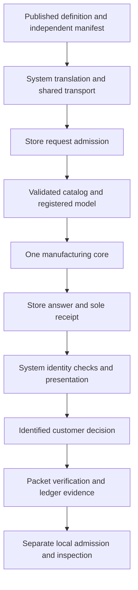

# Store Zero — Complete Technical, Manufacturing and Operational Reference

3D Solutions LLC · 12 October 2026

Store Zero connects a customer's defined woodwork to the material and processing a particular yard can supply. The customer changes dimensions, material and identified features in System. System preserves that definition, identifies every required component and feature, and sends one complete manufacturing inquiry. Store evaluates it afresh against its own catalog, available quantities, registered processing model and economics. Its answer supplies selected parents, required operations, modeled occupied time, budgetary total Q, or the reasons the whole job cannot be supported.

The architecture joins **a bounded, pre-registered machine configuration to the customer's definition**. Project geometry is resolved in the definition; machine geometry, tools, permitted operations, feeds and constraints are registered separately. Software combines those identified facts. For supported work, a designer need not redraw the parts or prepare a separate CAD/CAM program for each order. The specialist work belongs in engineering, registering, validating and maintaining the reusable mappings. A new material, tool, geometry or operation must satisfy those mappings before it becomes an admitted capability.

The current working software makes that proposition inspectable. All three manufacturing definition classes reach one Store-owned engine. It searches complete feasible parent-stock plans, retains component and feature coverage, sequences declared work, accounts for handling and tool movement, and calculates Q from material, hardware, hourly service and separately charged panel cuts. A manifest independent of the translated demand prevents a dropped requirement from disappearing into a favorable answer. Receipts bind the answer to demand, manifest, Store release, catalog and model. Accepted packets preserve that same chain; verification reevaluates rather than trusting a saved amount.

Current machine evidence is a **modeled operation ledger**, schema `STB-MODELED-OPERATIONS-1`, with evidence class `PREDICTED_OCCUPANCY_ONLY`. Its replay checks identity, sequencing, dimensional moves, tool engagement and the time already priced by Store. It does not constitute a commissioned controller program. The preserved Project 1 package contains a separate, more detailed **45-command controller-oriented virtual sequence**, generated Structured Text and a locally executed reference model. Its original $11.09 answer and 85.5001-second Store time remain historical evidence. The adopted-core equivalent is a separate $10.81 evaluation with 86.46953628299116 seconds of modeled occupancy.

The commercial chain preserves the same identities through answer, seller offer, customer decision, order, financial state, material allocation, release, execution, inspection, staging and custody. These are separate source-owned decisions. The shared executable gate records and verifies simulated evidence; Job 1 explicitly enables a demo seller policy. A click or calculation does not establish physical inventory commitment, payment or inspected components.

The proposed supervised laboratory will establish the physical link: measured fence and support references, retained-face and kerf transforms, stock contact and restraint, actual movement, qualified tools, controller behavior, protective functions and independently inspected output. It will compare the complete service burden and operating cost with existing alternatives. The present software supplies defined inquiries, plans, numbers, identities and refusals against which that work can be tested. **Define it once; nobody downstream should have to redraw it.**

## Contents

<!-- TOC START -->
- [1. Source record and authority](#1-source-record-and-authority)
  - [1.1 Frozen repository revisions](#11-frozen-repository-revisions)
  - [1.2 Registered versions and identity rules](#12-registered-versions-and-identity-rules)
  - [1.3 Reading and verification basis](#13-reading-and-verification-basis)
  - [1.4 Owners and the single answer path](#14-owners-and-the-single-answer-path)
- [2. Invention and issued patents](#2-invention-and-issued-patents)
  - [2.1 The manufacturing architecture](#21-the-manufacturing-architecture)
  - [2.2 Figures and disclosed machine modes](#22-figures-and-disclosed-machine-modes)
  - [2.3 Evidence configurations compared](#23-evidence-configurations-compared)
  - [2.4 Current correspondence evidence keys](#24-current-correspondence-evidence-keys)
  - [2.5 US 9720401 B2 claims 1 through 18](#25-us-9720401-b2-claims-1-through-18)
  - [2.6 US 10768609 B2 claims 1 through 15](#26-us-10768609-b2-claims-1-through-15)
  - [2.7 Registered engineering and per-order preparation](#27-registered-engineering-and-per-order-preparation)
- [3. The complete System-to-Store boundary](#3-the-complete-system-to-store-boundary)
  - [3.1 Idea Intent and Bench](#31-idea-intent-and-bench)
  - [3.2 Three definition classes and discovery](#32-three-definition-classes-and-discovery)
  - [3.3 Protocol 2 admission](#33-protocol-2-admission)
  - [3.4 Independent complete manifest](#34-independent-complete-manifest)
  - [3.5 Complete board request example](#35-complete-board-request-example)
  - [3.6 Cut and sheet contracts](#36-cut-and-sheet-contracts)
  - [3.7 Answer receipt and transport](#37-answer-receipt-and-transport)
  - [3.8 Revision custody and accepted packets](#38-revision-custody-and-accepted-packets)
- [4. Store-owned catalog and inventory](#4-store-owned-catalog-and-inventory)
  - [4.1 Catalog identity and provenance](#41-catalog-identity-and-provenance)
  - [4.2 Board material categories](#42-board-material-categories)
  - [4.3 Sheet and hardware categories](#43-sheet-and-hardware-categories)
  - [4.4 Eligibility and supply decisions](#44-eligibility-and-supply-decisions)
  - [4.5 Discovery and attribution](#45-discovery-and-attribution)
  - [4.6 Complete SKU register](#46-complete-sku-register)
- [5. Manufacturing engine from request to Q](#5-manufacturing-engine-from-request-to-q)
  - [5.1 Compilation and validation](#51-compilation-and-validation)
  - [5.2 Task grouping and operation requirements](#52-task-grouping-and-operation-requirements)
  - [5.3 Candidate eligibility](#53-candidate-eligibility)
  - [5.4 Parent patterns and whole-job search](#54-parent-patterns-and-whole-job-search)
  - [5.5 Ledger state and occupancy](#55-ledger-state-and-occupancy)
  - [5.6 Motion timing](#56-motion-timing)
  - [5.7 Reference and saw operations](#57-reference-and-saw-operations)
  - [5.8 Width preparation and profiles](#58-width-preparation-and-profiles)
  - [5.9 Spot geometry and timing](#59-spot-geometry-and-timing)
  - [5.10 Sheet geometry and compensation](#510-sheet-geometry-and-compensation)
  - [5.11 Retention tabs and split rules](#511-retention-tabs-and-split-rules)
  - [5.12 Panel cuts and returned pieces](#512-panel-cuts-and-returned-pieces)
  - [5.13 Sheet operation time](#513-sheet-operation-time)
  - [5.14 Hardware package selection](#514-hardware-package-selection)
  - [5.15 Whole-job economics and rounding](#515-whole-job-economics-and-rounding)
  - [5.16 Completion and calculation identity](#516-completion-and-calculation-identity)
  - [5.17 Worked calculations and sensitivities](#517-worked-calculations-and-sensitivities)
- [6. Registered machine functions](#6-registered-machine-functions)
  - [6.1 Registered model and units](#61-registered-model-and-units)
  - [6.2 Dimensional parameter register](#62-dimensional-parameter-register)
  - [6.3 Sheet parameter register](#63-sheet-parameter-register)
  - [6.4 Datums and controlled stock movement](#64-datums-and-controlled-stock-movement)
  - [6.5 Kerf faces and reference retention](#65-kerf-faces-and-reference-retention)
  - [6.6 Contact screens and physical restraint](#66-contact-screens-and-physical-restraint)
  - [6.7 Fixed tooling and local lowering](#67-fixed-tooling-and-local-lowering)
  - [6.8 Proposed physical apparatus and commissioning](#68-proposed-physical-apparatus-and-commissioning)
- [7. Complete historical Project 1 walkthrough](#7-complete-historical-project-1-walkthrough)
  - [7.1 Specimen sources and identities](#71-specimen-sources-and-identities)
  - [7.2 Customer geometry and System derivation](#72-customer-geometry-and-system-derivation)
  - [7.3 Historical material and parent decision](#73-historical-material-and-parent-decision)
  - [7.4 Historical Store route and Q](#74-historical-store-route-and-q)
  - [7.5 Neutral requirements and local coordinates](#75-neutral-requirements-and-local-coordinates)
  - [7.6 Every historical virtual command](#76-every-historical-virtual-command)
  - [7.7 Controller interpreter and state lifecycle](#77-controller-interpreter-and-state-lifecycle)
  - [7.8 Historical virtual timing reconciliation](#78-historical-virtual-timing-reconciliation)
  - [7.9 Contact face and stroke findings](#79-contact-face-and-stroke-findings)
  - [7.10 Reproduction and fourteen checks](#710-reproduction-and-fourteen-checks)
  - [7.11 Separate current adopted-core evaluation](#711-separate-current-adopted-core-evaluation)
  - [7.12 Transaction handoffs and resulting record](#712-transaction-handoffs-and-resulting-record)
- [8. Five current public project paths](#8-five-current-public-project-paths)
  - [8.1 Exact inquiry and evaluation basis](#81-exact-inquiry-and-evaluation-basis)
  - [8.2 Start Your Own](#82-start-your-own)
  - [8.3 Alcove](#83-alcove)
  - [8.4 Window Seat](#84-window-seat)
  - [8.5 Outdoor](#85-outdoor)
  - [8.6 Playhouse](#86-playhouse)
  - [8.7 Variations refusals and commercial scope](#87-variations-refusals-and-commercial-scope)
- [9. Lowering packets and virtual evidence](#9-lowering-packets-and-virtual-evidence)
  - [9.1 Accepted packet verification](#91-accepted-packet-verification)
  - [9.2 Current local job](#92-current-local-job)
  - [9.3 Modeled operation records](#93-modeled-operation-records)
  - [9.4 Independent virtual replay](#94-independent-virtual-replay)
  - [9.5 Evidence request and response](#95-evidence-request-and-response)
  - [9.6 Complete reproducible examples](#96-complete-reproducible-examples)
  - [9.7 Source digest and deployment verification](#97-source-digest-and-deployment-verification)
- [10. Commercial sequence and full transaction](#10-commercial-sequence-and-full-transaction)
  - [10.1 Contract ownership and installed scope](#101-contract-ownership-and-installed-scope)
  - [10.2 Event envelope and identity binding](#102-event-envelope-and-identity-binding)
  - [10.3 Answer offer decision and order](#103-answer-offer-decision-and-order)
  - [10.4 Finance reservation capacity and queue](#104-finance-reservation-capacity-and-queue)
  - [10.5 Allocation issue release and local admission](#105-allocation-issue-release-and-local-admission)
  - [10.6 Execution inspection staging and handoff](#106-execution-inspection-staging-and-handoff)
  - [10.7 Idempotency hash chains and concurrency](#107-idempotency-hash-chains-and-concurrency)
  - [10.8 Job 1 demo and other pending flows](#108-job-1-demo-and-other-pending-flows)
  - [10.9 Intended workflow and executable limits](#109-intended-workflow-and-executable-limits)
- [11. Refusal interruption and recovery](#11-refusal-interruption-and-recovery)
  - [11.1 Current result states](#111-current-result-states)
  - [11.2 Admission and manufacturing reason register](#112-admission-and-manufacturing-reason-register)
  - [11.3 Packet evidence and transport failures](#113-packet-evidence-and-transport-failures)
  - [11.4 Commercial holds and exceptions](#114-commercial-holds-and-exceptions)
  - [11.5 Physical interruption datum invalidation and recovery](#115-physical-interruption-datum-invalidation-and-recovery)
- [12. Acceptance inspection and evidence custody](#12-acceptance-inspection-and-evidence-custody)
  - [12.1 Test evidence and proof scope](#121-test-evidence-and-proof-scope)
  - [12.2 Physical component acceptance](#122-physical-component-acceptance)
  - [12.3 Identity labels and remnants](#123-identity-labels-and-remnants)
  - [12.4 Custody and historical reproduction](#124-custody-and-historical-reproduction)
  - [12.5 Release responsibility](#125-release-responsibility)
- [13. Economics and operating implications](#13-economics-and-operating-implications)
  - [13.1 Current declared cost pool](#131-current-declared-cost-pool)
  - [13.2 Productive utilization and service burden](#132-productive-utilization-and-service-burden)
  - [13.3 Complete customer amount and internal cost](#133-complete-customer-amount-and-internal-cost)
  - [13.4 Waste maintenance and alternatives](#134-waste-maintenance-and-alternatives)
  - [13.5 Laboratory and yard validation](#135-laboratory-and-yard-validation)
- [14. Exact source and verification register](#14-exact-source-and-verification-register)
  - [14.1 Store runtime source register](#141-store-runtime-source-register)
  - [14.2 System handoff source register](#142-system-handoff-source-register)
  - [14.3 Program and historical source register](#143-program-and-historical-source-register)
  - [14.4 Content identities](#144-content-identities)
  - [14.5 Reproduction commands and verification results](#145-reproduction-commands-and-verification-results)
- [15. Historical reconciliation and consolidation appendix](#15-historical-reconciliation-and-consolidation-appendix)
  - [15.1 Architectural migration](#151-architectural-migration)
  - [15.2 Audit issues and resolution status](#152-audit-issues-and-resolution-status)
  - [15.3 Additional source discrepancies](#153-additional-source-discrepancies)
  - [15.4 Protected evidence and future consolidation](#154-protected-evidence-and-future-consolidation)
  - [15.5 Master completion and navigation checks](#155-master-completion-and-navigation-checks)
<!-- TOC END -->

## 1. Source record and authority

### 1.1 Frozen repository revisions

This reference describes the following source record. All three remote `main` heads were read before authoring; none had moved from the audit's revisions. Subsequent commits in Store add this document only. They do not replace the executable baseline or System's operating pin.

| Owner | Repository | Frozen source revision | Movement since audit |
| --- | --- | --- | --- |
| Store | [GeorgePlattDemo/store-zero](https://github.com/GeorgePlattDemo/store-zero/tree/f7123a73c1ca60aa7eb180a86a1c365eaffe95db) | `f7123a73c1ca60aa7eb180a86a1c365eaffe95db` | None before writing |
| System | [GeorgePlattDemo/new-system](https://github.com/GeorgePlattDemo/new-system/tree/ab09777d6f27d4b70a2193abc8564ebce611746f) | `ab09777d6f27d4b70a2193abc8564ebce611746f` | None |
| Program | [GeorgePlattDemo/3d-solutions-program](https://github.com/GeorgePlattDemo/3d-solutions-program/tree/04ec327df39a54e92aae65ef4b07d10f2c8a8985) | `04ec327df39a54e92aae65ef4b07d10f2c8a8985` | None |

The primary reconciliation input is *Scan-to-Build-Read-Only-Audit-2026-10-12(1).md*, including its 34-document inventory, all-claim correspondence, source checks and ten ordered repair groups. Its findings were checked against the frozen code and original evidence. A historical statement in the audit is not made current merely by appearing here.

This document is the consolidated explanation of the source record. Enforceable Store behavior remains in the [operative specification](https://github.com/GeorgePlattDemo/store-zero/blob/f7123a73c1ca60aa7eb180a86a1c365eaffe95db/docs/STORE-ZERO-SPECIFICATION.md), exact contracts and executable source. System owns [shared definitions](https://github.com/GeorgePlattDemo/new-system/blob/ab09777d6f27d4b70a2193abc8564ebce611746f/docs/DEFINITIONS.md). The [shared commercial contract](https://github.com/GeorgePlattDemo/store-zero/blob/f7123a73c1ca60aa7eb180a86a1c365eaffe95db/docs/commercial-sequence-template.md) retains its original custody; this reference explains the installed gate and identifies drift in that contract's prose. An unresolved disagreement is recorded, not silently settled by editorial authority.

### 1.2 Registered versions and identity rules

| Surface | Exact installed identifier | Source |
| --- | --- | --- |
| Request protocol | `STORE-ZERO-REQUEST-2` | [HTTP service](https://github.com/GeorgePlattDemo/store-zero/blob/f7123a73c1ca60aa7eb180a86a1c365eaffe95db/src/service/server.mjs) |
| Definition conversion shapes | `USER_DEFINED_BOARD_V1`, `CUT_PACKAGE_V1`, `SHEET_PACKAGE_V1` | [Definition contracts](https://github.com/GeorgePlattDemo/store-zero/blob/f7123a73c1ca60aa7eb180a86a1c365eaffe95db/src/contracts/definitions.mjs) |
| Neutral manufacturing job | `STORE-MANUFACTURING-JOB-1` | [Manufacturing core](https://github.com/GeorgePlattDemo/store-zero/blob/f7123a73c1ca60aa7eb180a86a1c365eaffe95db/src/evaluation/engine/store-manufacturing-core.mjs) |
| Manufacturing model | `STORE-MANUFACTURING-CORE-0.1` | Core `createModel`; [registered parameters](https://github.com/GeorgePlattDemo/store-zero/blob/f7123a73c1ca60aa7eb180a86a1c365eaffe95db/data/machine/manufacturing-core-0.1.json) |
| Configuration execution class | `DECLARED_OCCUPANCY_EVENT_MODEL` | [Configuration reader](https://github.com/GeorgePlattDemo/store-zero/blob/f7123a73c1ca60aa7eb180a86a1c365eaffe95db/src/machine/configuration.mjs) |
| Catalog | `StoreZeroCallableCatalog`; declared clock `2026-09-10` | [Catalog](https://github.com/GeorgePlattDemo/store-zero/blob/f7123a73c1ca60aa7eb180a86a1c365eaffe95db/data/store-zero-catalog.json) |
| Freshness rule | `STB-STORE-FRESH-EVALUATION-0.1` | [Request and receipt owner](https://github.com/GeorgePlattDemo/store-zero/blob/f7123a73c1ca60aa7eb180a86a1c365eaffe95db/src/requests/store-request.mjs) |
| Accepted packet | `STB-ACCEPTED-JOB-PACKET-2` | [Packet contract](https://github.com/GeorgePlattDemo/store-zero/blob/f7123a73c1ca60aa7eb180a86a1c365eaffe95db/src/contracts/job-packet.mjs) |
| Local job | `STB-LOCAL-MANUFACTURING-JOB-1` | [Lowering](https://github.com/GeorgePlattDemo/store-zero/blob/f7123a73c1ca60aa7eb180a86a1c365eaffe95db/src/machine/lowering.mjs) |
| Operation records | `STB-MODELED-OPERATIONS-1` | [Machine-record contracts](https://github.com/GeorgePlattDemo/store-zero/blob/f7123a73c1ca60aa7eb180a86a1c365eaffe95db/src/contracts/machine-records.mjs) |
| Virtual model | `STB-VIRTUAL-OCCUPANCY-MODEL-1` | [Replay](https://github.com/GeorgePlattDemo/store-zero/blob/f7123a73c1ca60aa7eb180a86a1c365eaffe95db/src/machine/virtual-run.mjs) |
| Evidence protocol | `STORE-ZERO-MACHINE-EVIDENCE-2` | [Evidence entry point](https://github.com/GeorgePlattDemo/store-zero/blob/f7123a73c1ca60aa7eb180a86a1c365eaffe95db/src/machine/evidence.mjs) |
| Commercial record | `STB-COMMERCIAL-EVENT-1` | [Shared executable gate](https://github.com/GeorgePlattDemo/store-zero/blob/f7123a73c1ca60aa7eb180a86a1c365eaffe95db/src/contracts/commercial-sequence.js) |
| Commercial transport | `STORE-ZERO-COMMERCIAL-EVIDENCE-1` | [Commercial request boundary](https://github.com/GeorgePlattDemo/store-zero/blob/f7123a73c1ca60aa7eb180a86a1c365eaffe95db/src/requests/commercial-request.mjs) |
| System owner record | `STB-SYSTEM-RECORD-2` | [System source/pin record](https://github.com/GeorgePlattDemo/new-system/blob/ab09777d6f27d4b70a2193abc8564ebce611746f/src/system/store-candidate.ts) |
| Historical review | `D001 PROJECT1 DIGITAL TRAIL REVIEW 0.2` | [Preserved manuscript](https://github.com/GeorgePlattDemo/store-zero/blob/f7123a73c1ca60aa7eb180a86a1c365eaffe95db/docs/project-1-digital-trail/D001_Project1_Review.md) |
| Historical virtual IR | `D001-VIRTUAL-IR-0.2` | Evidence ZIP `generated/motion-ir.json` |

Version labels identify a declared surface; content hashes establish which bytes or canonical object it contained. The registered model hash covers the full object returned by `createModel(parameters)`. The configuration hash covers the loaded configuration **including that expanded model**. It is not the SHA-256 of the 315-byte JSON parameter file. System records configuration hash `87542b1d56d7e5624d6d85557a0d213b226b9ffc4454d561fd8616379c1e6884` for this baseline. File-byte SHA-256 and Git blob identities are registered in Chapter 14.

### 1.3 Reading and verification basis

The source base includes the current operative specification; the complete 31,684-word archived specification; issued grants, claim sets and all nine drawing sheets; the Project 1 manuscript and Word presentation; the ZIP source identities, generator, controller reference and generated records; current engine and independent checks; catalog and source sheets; request, packet, machine and commercial contracts; service transport; fixtures and acceptance records. Corresponding System translation, manifest, interpretation, acceptance and public definition generators supply the cross-repository explanation. Program's current evidence and laboratory trial supply the research and physical-validation context.

The preserved Word review has 158 paragraphs and 20 tables. Its manuscript, publication identities and rendered 22-page presentation were available for comparison. The original evidence is preserved; running reproduction occurs only in an extracted working copy. Both issued patent checksums pass. Baseline catalog validation and all 87 Store tests pass on **Node 22.23.3**. Detailed final verification and numerical rechecks are recorded in Chapter 14.

### 1.4 Owners and the single answer path

| Owner | Adds authoritative facts | Does not acquire authority by receiving a record |
| --- | --- | --- |
| Customer and System | Controlling requirements, part/feature identities, derivations, revisions, complete manifest, application and owner custody | Store pricing, stock, machine economics or physical readiness |
| Store | Catalog, offered/available material, parent plans, processing constraints, modeled work/time, Q and refusal | Permission to reinterpret customer geometry |
| Responsible seller and financial source | Offer, policy, order acceptance and attributable financial records | Local machine admission or inspected conformance |
| Local implementation | Registered physical configuration, tooling, transforms, material readiness, local permission, controller execution | Customer design changes or substitute Store prices |
| Inspection and fulfillment | Measurements, conformance disposition, physical labels, package inventory and transfer | Proof from model completion alone |
| Program | Investigation, proposed engineering, trials, findings and development rationale | Runtime capability, source-owned commercial acts or operating release |

The current answering path is:



Only Store's request layer issues the receipt. Discovery has its own bounded retrieval path and supplies no job Q. Historical source copies are reproduction inputs, never a fallback for the current answering path. Source digest checks cover shipped `package.json`, `src/` and `data/`; documentation changes do not alter that shipped byte set.

## 2. Invention and issued patents

### 2.1 The manufacturing architecture

[US 9,720,401 B2](https://github.com/GeorgePlattDemo/store-zero/blob/f7123a73c1ca60aa7eb180a86a1c365eaffe95db/docs/patents/US9720401B2.pdf), issued 1 August 2017, and [US 10,768,609 B2](https://github.com/GeorgePlattDemo/store-zero/blob/f7123a73c1ca60aa7eb180a86a1c365eaffe95db/docs/patents/US10768609B2.pdf), issued 8 September 2020, share the title *Method and System for Consumer Home Projects Ordering and Fabrication*. The latter identifies itself as a continuation of application 14/094,074 filed 2 December 2013, which became the first grant. Each issued claim set is read independently; a common disclosure does not make the claims identical.

The disclosed integration begins with a customer's project inquiry. A customer selects or modifies a database project, or uses the design interface to develop requirements. Material, features, machining time and optional services inform an estimated price. The chosen project is converted into component requirements, material lists and instructions. Local stock is loaded into the appropriate dimensional or sheet machine. Additional components, secondary work, finishing, labels, assembly instructions, staging and pickup complete the described service.

Dimensional and sheet processing form two cooperating material streams. A particular order may need only one. Dimensional stock moves along a fence between known operations. The sheet architecture supports direct straight cuts, sheet movement under a fixed longitudinal tooling station, and a separate mode in which a fixed workpiece receives two-axis tool-platform movement. Material retrieval and loading can remain human tasks while positioning and processing follow generated instructions.

The patent disclosure also discusses custom tools, supplier or special-order merchants, optional delivery and assembly, contractor use and local service economics. Those are disclosed possibilities. Store's current fixed tool, declared inventory and bounded operation vocabulary determine what this implementation actually answers. A patent's examples of savings or commercial benefit are propositions; current Q is a declared calculation and the laboratory trial will measure the complete service.

### 2.2 Figures and disclosed machine modes

The drawings in both grants are schematic and explicitly not a dimensioned fabrication drawing. The figure numbers are the drawing-sheet labels, not PDF page indices.

| Figure | Subject | Relevance to this reference |
| --- | --- | --- |
| 1 | Customer input, retailer/project data, controller, tandem machine, raw material and finished components | The complete information-to-component chain |
| 2 | Store interface, mobile/home access, supplier/merchant, stock, operator, tandem cell, secondary work, finishing, labeler and staging | Source-owned transaction and fulfillment responsibilities |
| 3 | Production cell within retail inventory bays | Footprint, manual handling and phased investment proposition |
| 4 | Conveyor, spray and drying arrangement | A separately engineered finishing service, absent from the current core |
| 5 | Dimensional support, fence, manipulating and clamping rollers, saw stations and tooling ways | Datum and station architecture; illustrated three manipulating rollers differ from the two-roller model |
| 6 | Sheet backing plates, bottom/top rollers, rotating yokes, guide rails and tooling platform | Particular physical structure included in independent claims |
| 7 | Tool platform, receiver and pressure-sensing plate | Physical depth reference and tooling interface |
| 8 | Interchangeable tool attachment and contour tooling | Tooling embodiments; no automatic adoption into Store |
| 9 | Computer, communication, I/O and storage | Computer implementation and stored instruction aspects |

In disclosed sheet **mode 1**, operator panel settings control straight cuts. In **mode 2**, the sheet supplies X movement and the tool supplies Y movement at a fixed longitudinal centerline; attachment bridges retain routed shapes for later separation. In **mode 3**, components are pinned/clamped to backing or carrier plates and the tool platform moves in both planar axes for finishing or other precision work. S-001 currently evaluates a bounded routed field and occupancy; it does not implement every one of those physical modes or their protective systems.

### 2.3 Evidence configurations compared

| Configuration | Dimensional arrangement | Sheet arrangement | Evidence stage |
| --- | --- | --- | --- |
| Issued disclosure and claims | Support/fence, manipulating and clamping rollers, saw(s), rigid ways and tool heads; illustrated preferred arrangement has three manipulating rollers | Backing/support, rollers, yokes, rails and moveable tooling platform with disclosed modes | Issued text and schematic disclosure |
| Historical Project 1 review | Nominal saw X=0, spot X=36, rollers X=24/48, measuring wheel X=30; controller-oriented A/S/X/Y/Z sequence | No sheet specimen in this package | Reproduced original Q and executed Node virtual sequence; uncompiled Structured Text |
| Adopted Store core | One nominal saw station X=0, tool X=36, roller screen X=24/48; A/S/C/Y/Z/RZ timing state | Center 48×36 routed field in 96×48 sheet; separate manual full cuts | Implemented declared occupancy/economics model; current replay |
| Program laboratory proposal | Two downstroke saw stations, two manipulating rollers, up to three routing functions, one initial spot station; second spot added if justified | Added when demonstrated demand warrants it | Proposed apparatus and measured acceptance work |

These arrangements cannot be exchanged merely because they use similar tooling words. The adopted core does not have the archived separate right-saw batch path. The laboratory's future station locations and signed-angle transforms must come from its released engineering record. The patents do not supply the core's hourly rate, feed constants, 24-inch screen or tab policy.

### 2.4 Current correspondence evidence keys

The matrices below describe engineering correspondence to issued functions. Each dependent claim includes its inherited limitations. A successful price or hardware test demonstrates that function under its proof scope; it does not establish the full inherited apparatus or method. The issued PDF controls the claim wording.

| Key | Current code and evidence |
| --- | --- |
| I | System [published translator](https://github.com/GeorgePlattDemo/new-system/blob/ab09777d6f27d4b70a2193abc8564ebce611746f/src/system/store/published-wire.ts), [compiler](https://github.com/GeorgePlattDemo/new-system/blob/ab09777d6f27d4b70a2193abc8564ebce611746f/src/system/compile.ts), [manifest](https://github.com/GeorgePlattDemo/new-system/blob/ab09777d6f27d4b70a2193abc8564ebce611746f/src/system/manifest.ts); published-wire and [HTTP integration checks](https://github.com/GeorgePlattDemo/new-system/blob/ab09777d6f27d4b70a2193abc8564ebce611746f/src/system/store/http.integration.test.ts) |
| Q | Store [manufacturing core](https://github.com/GeorgePlattDemo/store-zero/blob/f7123a73c1ca60aa7eb180a86a1c365eaffe95db/src/evaluation/engine/store-manufacturing-core.mjs), [catalog reader](https://github.com/GeorgePlattDemo/store-zero/blob/f7123a73c1ca60aa7eb180a86a1c365eaffe95db/src/evaluation/catalog.mjs), catalog/model data; [21 self-checks](https://github.com/GeorgePlattDemo/store-zero/blob/f7123a73c1ca60aa7eb180a86a1c365eaffe95db/tests/core-self-checks.mjs) and manufacturing test |
| R | [Request/receipt layer](https://github.com/GeorgePlattDemo/store-zero/blob/f7123a73c1ca60aa7eb180a86a1c365eaffe95db/src/requests/store-request.mjs), [definition contract](https://github.com/GeorgePlattDemo/store-zero/blob/f7123a73c1ca60aa7eb180a86a1c365eaffe95db/src/contracts/definitions.mjs), [packet verifier](https://github.com/GeorgePlattDemo/store-zero/blob/f7123a73c1ca60aa7eb180a86a1c365eaffe95db/src/contracts/job-packet.mjs); [protocol 2 tests](https://github.com/GeorgePlattDemo/store-zero/blob/f7123a73c1ca60aa7eb180a86a1c365eaffe95db/tests/protocol2.test.mjs) and contract acceptance |
| V | [Lowering](https://github.com/GeorgePlattDemo/store-zero/blob/f7123a73c1ca60aa7eb180a86a1c365eaffe95db/src/machine/lowering.mjs), [record validation](https://github.com/GeorgePlattDemo/store-zero/blob/f7123a73c1ca60aa7eb180a86a1c365eaffe95db/src/contracts/machine-records.mjs), [virtual replay](https://github.com/GeorgePlattDemo/store-zero/blob/f7123a73c1ca60aa7eb180a86a1c365eaffe95db/src/machine/virtual-run.mjs), [evidence boundary](https://github.com/GeorgePlattDemo/store-zero/blob/f7123a73c1ca60aa7eb180a86a1c365eaffe95db/src/machine/evidence.mjs); current protocol/contract examples |
| C | [Shared commercial gate](https://github.com/GeorgePlattDemo/store-zero/blob/f7123a73c1ca60aa7eb180a86a1c365eaffe95db/src/contracts/commercial-sequence.js), [commercial tests](https://github.com/GeorgePlattDemo/store-zero/blob/f7123a73c1ca60aa7eb180a86a1c365eaffe95db/tests/commercial-sequence.test.mjs); System's byte-identical gate and explicitly simulated source adapters |
| H | [Original Project 1 manuscript](https://github.com/GeorgePlattDemo/store-zero/blob/f7123a73c1ca60aa7eb180a86a1c365eaffe95db/docs/project-1-digital-trail/D001_Project1_Review.md), DOCX, ZIP, seven pinned sources and fourteen reference checks; [historical acceptance](https://github.com/GeorgePlattDemo/store-zero/blob/f7123a73c1ca60aa7eb180a86a1c365eaffe95db/acceptance/project-1/project-1.test.mjs) |

### 2.5 US 9720401 B2 claims 1 through 18

Claim text appears on PDF pages 30–33, printed columns 40–46. Parent is the **immediate** dependency.

| Claim | Parent | Issued function or combination in plain language | Current correspondence | Physical requirement and evidence stage |
| --- | --- | --- | --- | --- |
| 1 | Independent | Customer project/database-or-CAD interface; instructions control tandem dimensional/sheet fabrication; detailed sheet support, plates, rollers, yokes, rails and platform | I/Q/R/V implement selected information and model functions | Claimed physical tandem and sheet structure not established |
| 2 | 1 | Control panel for each machine; manual and computer-controlled modes | Local operating target | No installed panel/mode validation |
| 3 | 1 | Tooling platform accepts selectively installed heads | Registered fixed tool models only | Physical attachment/interface absent from current implementation |
| 4 | 1 | Dimensional support surface, fence, clamp roller, servo manipulation and servo saw | Q/V positioning, saw and contact screens | Installed mechanism/restraint not established |
| 5 | 4 | Fixed rigid vertical/horizontal ways with servo-positioned tool heads | Program candidate engineering | Complete physical ways/tool assembly unbuilt |
| 6 | 5 | Rigid metal base with predrilled element mounting holes | Proposed structural registration | No base manufacture or mounting inspection |
| 7 | 1 | Prefinishing/finishing station | Optional service/disposition context in C | No installed or executed finishing process |
| 8 | 1 | Manual secondary-operations station | C can retain responsibility and disposition | No commissioned physical secondary station |
| 9 | 1 | Component labels and printed assembly instructions | Q identity/label records; source project information in I | Complete print/affix/instruction station absent |
| 10 | Independent | Project interface, price and instructions; tandem structure; home-improvement retail location; CAD/CAM; operator loading and tool-head changes | I/Q/R/V are partial software correspondence | Full physical/retail/method combination and tool changes not demonstrated |
| 11 | 10 | Customer variation produces recalculated estimate | I/Q/R fresh evaluation of changed revisions | Implemented and tested information function; claim 10 inheritance remains |
| 12 | 10 | Acceptance followed by material list and machining instructions | C/R/V simulated decision, material selection and bound ledger | Full actual accepted-order fabrication chain absent |
| 13 | 12 | Transmit instructions to tandem machine | V/H generated virtual artifacts | No commissioned controller transmission |
| 14 | 13 | Labels associated with components and assembly instructions | Q/H identity and label intent | Complete actual print/affix and assembly chain absent |
| 15 | 14 | List additional components not fabricated by either machine | Q hardware selection and I presentation | Implemented tested listing; inherited manufacture/label chain absent |
| 16 | 13 | Remove machined component; label, finish, secondary work and/or package fabricated/additional components | C simulated execution/inspection/custody records | Actual post-machine work not demonstrated |
| 17 | 10 | Claim 10 implemented as stored computer-readable instructions | Software and H artifacts exist | Existence of software does not establish full inherited method |
| 18 | 10 | Estimated price uses pricing database at Store with tandem machine | Q/R Store-owned catalog pricing | Tested price function; real co-located tandem arrangement absent |

### 2.6 US 10768609 B2 claims 1 through 15

Claim text appears on PDF pages 31–33, printed columns 40–44. Claim 1 includes both manufacturing families, fore/aft dimensional end work, sheet curvilinear work and the detailed sheet apparatus.

| Claim | Parent | Issued function or combination in plain language | Current correspondence | Physical requirement and evidence stage |
| --- | --- | --- | --- | --- |
| 1 | Independent | Project/database-or-CAD interaction; estimate and instructions; curvilinear sheet work; dimensional end operations by fore/aft stock movement; detailed sheet apparatus | I/Q/R/V information, stock and modeled processing functions | Complete physical combination not established |
| 2 | 1 | Implementation by retail business entity | Declared reference yard | Operational retailer implementation absent |
| 3 | 1 | Customer variation and revised estimate | I/Q/R fresh changed-definition evaluations | Implemented/tested function; parent apparatus/method absent |
| 4 | 1 | Acceptance, material list and machining instructions | C/R/V simulated decision and bound plan | Complete actual production chain absent |
| 5 | 4 | Transmit instructions; display appropriate stock-loading request and component machining instructions | V/H identified component/material artifacts | Commissioned loading, transmission and execution absent |
| 6 | 5 | Component labels and printed assembly instructions | Q/H identity/label modeling | Full physical label/instruction chain absent |
| 7 | 6 | Listing additional nonfabricated components | Q hardware requirements and I presentation | Tested listing; inherited chain absent |
| 8 | 7 | CAD includes CAM; generated instructions; sequential loading and tool-head changes | Bounded generated/model artifacts | Ordinary per-order head changes outside current fixed-tool model |
| 9 | 8 | Interface permits interaction with both project database and CAD design module | I library and user-defined paths | Claim-wide CAD/CAM and inherited physical combination not established |
| 10 | 5 | Remove component and label/finish/secondary-process/package it | C explicit simulated lifecycle | No observed physical post-machine workflow |
| 11 | 1 | Method embodied in stored computer-readable instructions | Software artifacts exist | Complete inherited method not established by storage |
| 12 | 1 | Pricing database at Store where tandem machine is located | Q/R Store pricing | Physical co-location/tandem requirement absent |
| 13 | 1 | Tandem machine in home-improvement retail store | Proposed local service setting | No installed retail tandem machine |
| 14 | 1 | CAD includes CAM and generates tandem instructions | V/H bounded generated sequence/model | General commissioned CAD/CAM-to-machine path absent |
| 15 | 14 | Operator sequentially loads stock and changes head attachments from CAD/CAM instructions | Proposed loading records and H reference | Actual loading/tool-change execution absent |

### 2.7 Registered engineering and per-order preparation

The disclosed dimensional embodiment places drilling and routing heads on known ways so moving stock can bring features to those tools without installing different heads for routine work. This supports the engineering rationale for reusable station registration. Some issued combinations separately include tool-head changes. Current fixed-tool capability is a chosen narrower operating model, not a reinterpretation of those limitations.

A supported definition provides part geometry, operation and feature identities. Store supplies stock and the evaluated processing plan. Local registration supplies actual machine references, tools, signs, offsets, travel limits, controller mapping and readiness. When those mappings are qualified, software can generate per-job instructions from the definition. Eliminating a professional's ordinary per-order preparation does not eliminate the professional work of building and qualifying the mapping. Unknown capture geometry, unsupported features and invalid physical references must still be resolved or refused.

## 3. The complete System-to-Store boundary

### 3.1 Idea Intent and Bench

Idea carries source material, observations and the customer's intended result. Intent establishes which facts control the job and which wood/tools or requirements are selected. The Bench changes identified values under a project rule and exposes their resulting components and features. The six customer steps begin at Intent; Idea is intake. Those UI steps are System-owned, not Store request types.

A project may use a named derivation such as the X-brace rule, the Window Seat elevation rule, or a published plan's part list. That derivation turns customer values into an identified definition. It must preserve provenance and unresolved facts. A visual layout is not itself manufacturing demand. The Store inquiry contains typed values and a complete expected manifest. Store never derives a project by its title or by reading a picture.

System's public pages use an outer `stb-store-zero-http/1` page wire carrying attempt, project, revision, scope and payload identities. The server [published-wire translator](https://github.com/GeorgePlattDemo/new-system/blob/ab09777d6f27d4b70a2193abc8564ebce611746f/src/system/store/published-wire.ts) maps that wire to Store's protocol 2 request. These are distinct protocol layers. The server's [inspected Store pin](https://github.com/GeorgePlattDemo/new-system/blob/ab09777d6f27d4b70a2193abc8564ebce611746f/src/system/store-candidate.ts) governs; a caller-supplied different pin is rejected with `CALLER_PIN_DOES_NOT_GOVERN`.

### 3.2 Three definition classes and discovery

| Store request type | Meaning and conversion | Important constraints |
| --- | --- | --- |
| `USER_DEFINED_BOARD_V1` | One identified workpiece demand with ordered parts and spots becomes one atomic board group | Explicit material, angle, parallel long-long miter-face geometry, reference cut, counts and required operations; parent minimum retained separately |
| `CUT_PACKAGE_V1` | Neutral dimensional packages and sourced item lines become board and item tasks | Every part identified; angle numeric; angled end meaning explicit; optional width preparation, spot and through-profile requirements |
| `SHEET_PACKAGE_V1` | One sheet and features become a sheet task | Exact sheet dimensions, identified features, retention and all-pieces-returned requirement |
| `OFFERING_LOOKUP` | Deterministic catalog search or exact lookup | No manifest, fabrication plan, machine time, Q or quotation receipt |

`BOARD_SQUARE_V1` and Store-native `ALCOVE_INSERT_V1` are retired and refused. The public Alcove still uses a System-facing insert label; System converts it to `CUT_PACKAGE_V1`. This is not a fourth Store evaluator. The engine's `compileDefinition` preserves the conversion request as `job.source`, adds neutral `boards`, `sheets` and `items`, and validates expected coverage before evaluation.

### 3.3 Protocol 2 admission

The formal job request has exactly four top-level fields: `requestType`, `requestId`, `demand`, `manifest`. Request type and inquiry identity must be valid. Machine-local `spline`, `toolpath`, `gcode`, `controller` or `servoSteps` in the demand are refused. Unknown fields are not ignored. A prior answer, receipt, release or evaluation timestamp cannot be submitted as authority.

The [shape checker](https://github.com/GeorgePlattDemo/store-zero/blob/f7123a73c1ca60aa7eb180a86a1c365eaffe95db/src/contracts/shape.mjs) checks declared JSON types and unknown nested fields. It treats null or absent values as unsupplied; completeness is checked in the core. A numeric-looking string from a UI may be explicitly converted by System before Store submission; Store's contract does not accept that string as a finite number. The same distinction applies to whole quantities.

A missing independent manifest fails before engine execution: `UNRESOLVED`, `INDEPENDENT_SYSTEM_MANIFEST_REQUIRED`, `freshEvaluation:false`, null calculation identity and null receipt. A clean request that reaches the engine can still receive a refusal, unresolved result or unavailable result with a **fresh evaluation receipt**. The receipt identifies that evaluation; it does not guarantee supportability.

### 3.4 Independent complete manifest

System constructs the manifest from the controlling definition before published-wire translation. Store does not create it from whatever happens to arrive after translation. The core checks coverage again after planning. These two comparisons connect original requirements to consumed demand and fulfilled work.

| Manifest field | Required content and check |
| --- | --- |
| `jobId`, `revision` | Exactly equal demand `configurationId`, `configurationVersion` |
| `boardPartIds` | Unique nonblank set of every dimensional part ID |
| `sheetPackageIds` | Unique nonblank set of sheet package IDs; one sheet conversion uses its configuration ID |
| `featureIds` | Every required spot, profile or sheet feature ID, with no duplicate or missing identity |
| `items` | Every sourced `lineId` and positive integer requested quantity; quantities must match |
| `unresolvedRequirements` | Optional array; must be empty for a complete Q |

Set equality ignores list order but rejects duplicated identities; meaningful part order is retained elsewhere. Board and sheet package IDs are checked for uniqueness. The result exposes `manifestCoverage` for parts, sheet packages, features and item lines. `FEATURE_ANSWERED` or `FEATURE_COVERED_BY_PARENT_EDGE_PREPARATION` events carry the feature coverage witness. Hardware grouping preserves the assignments to each source item line.

A manifest proves coverage of what System listed. It cannot prove that System identified every physical installation requirement correctly. For Alcove, a spot summary contradictory to component spots is retained as an unresolved requirement. For Outdoor, the datum correspondence remains a source-meaning issue even when the transmitted manifest is complete.

### 3.5 Complete board request example

The following runnable protocol 2 example states the Start Your Own 16-inch SPF demand. Its inquiry identity `MASTER-SYO-16` is an example identity; dimensions and required operations reproduce the current declared calculation. System remains the runtime issuer of the manifest. This example uses the public-page geometry and omits the redundant end-identity string.

```json
{
  "requestType": "USER_DEFINED_BOARD_V1",
  "requestId": "MASTER-SYO-16",
  "demand": {
    "title": "Start your own",
    "configurationId": "SYO-USER1-XBRACE",
    "configurationVersion": "0.1",
    "classId": "user_defined_board",
    "materialDemand": {"species":"spf","form":"board","nominalT":2,"nominalW":4},
    "definedWorkpieceLengthIn": 60,
    "requiredOps": ["MITER_LIMITED","SPOT_ON_LOCATION"],
    "sawAngleDeg": 30,
    "cutPlane": "miter-face",
    "datumCMethod": "REFERENCE_CUT",
    "endRelation": "parallel",
    "lengthDatum": "long-long-outer-edge",
    "declaredSawCuts": 3,
    "declaredSpotCount": 2,
    "unresolvedConditions": [],
    "parts": [
      {"partId":"PART-1","lengthIn":16,"features":[{"featureId":"SPOT-1","kind":"SPOT_ON_LOCATION","xIn":8,"locationRule":"CENTERED_ON_PART","acrossWidthRule":"CENTERED_ON_WIDE_FACE"}]},
      {"partId":"PART-2","lengthIn":16,"features":[{"featureId":"SPOT-2","kind":"SPOT_ON_LOCATION","xIn":8,"locationRule":"CENTERED_ON_PART","acrossWidthRule":"CENTERED_ON_WIDE_FACE"}]}
    ]
  },
  "manifest": {
    "jobId":"SYO-USER1-XBRACE","revision":"0.1",
    "boardPartIds":["PART-1","PART-2"],"sheetPackageIds":[],
    "featureIds":["SPOT-1","SPOT-2"],"items":[],"unresolvedRequirements":[]
  }
}
```

This inquiry calls the registered core through the sole request layer and returns $8.62 on the baseline catalog. Changing request ID changes the retained source object and therefore calculation input identity even if geometry and Q remain equal. A reproducible example must preserve its whole request, not only the dollar amount.

### 3.6 Cut and sheet contracts

A cut package contains `packageId`, `material`, `endCut`, and nonempty `parts`. Material names species, form `board`, positive nominal thickness and width, and grade when required by offered choices. Square work states `angleDeg:0`; omission is not square. Angled work states angle 0–45, `endRelation:parallel`, `lengthDatum:long-long-outer-edge`, `plane:miter-face`. Finished width must be positive and compatible with actual stock. Two-edge preparation states both positive removals and finished width; Store validates their sum against actual width.

Each part names `partId`, positive `lengthIn`, and optional `spots` and `edgeProfiles`. Spots carry identity, longitudinal coordinate and centered/inset placement, with optional exact diameter/depth constraints. Profiles carry identity, `MILL_LONGITUDINAL_PROFILE`, path length, Y and total depth. A source-specific profile is fulfilled by whole-parent edge preparation only when its path, prepared width and through depth agree exactly under the code's tolerance.

Each item line carries `lineId`, positive integer `qty`, and exactly one selector: `storeSku`, `requirementId`, or structured `requirement`. An exact SKU quantity is a selling-unit/package quantity. A structured fastener requirement's quantity is a piece count; Store chooses enough complete packages. A functional requirement's quantity is the identified offered unit count.

A sheet demand contains `sheet` dimensions and optional species/grade, `features`, `returnAllPieces:true`, and optional Boolean exterior requirement. Current feature kinds are `ARCHED_APERTURE`, `STRAIGHT_SPLIT`, `CROSSCUT`, `RIP`, `PATTERN`. Each kind has its own allowed operands. PATTERN offsets one named aperture; it is not arbitrary controller code or a second priced profile. Custom tab positions remain literal. A custom split without positions remains `UNRESOLVED` with no complete Q.

Complete committed input examples are [cut package](https://github.com/GeorgePlattDemo/store-zero/blob/f7123a73c1ca60aa7eb180a86a1c365eaffe95db/contracts/examples/requests/cut-package.alcove-pine.json), [sheet package](https://github.com/GeorgePlattDemo/store-zero/blob/f7123a73c1ca60aa7eb180a86a1c365eaffe95db/contracts/examples/requests/sheet-package.playhouse.json), and [refused inputs](https://github.com/GeorgePlattDemo/store-zero/blob/f7123a73c1ca60aa7eb180a86a1c365eaffe95db/contracts/examples/requests/refused.json). Their identities and fixtures are distinct from the public starting definitions in Chapter 8.

### 3.7 Answer receipt and transport

A supportable current answer includes `status`, `complete`, `configurationId/version`, `jobId/revision`, `Q`, `totals`, `time`, `selectedStock`, `parents`, `operations`, `optimization`, `model`, physical release/admission fields, physical gaps, coverage, packages/items/pieces/components/labels, calculation identity, `freshEvaluation` and receipt. Aliases are presentation projections of the same evaluated plans, not competing calculations.

`totals` separates material, hardware, hourly `machine_service`, `manual_cut_service`, total Q, manual cut count and hourly rate. `time` carries total seconds/minutes/hours, hourly-billed seconds, fixed-price occupied seconds, category sums and `SERIAL_OCCUPANCY`. Selected stock carries requested quantities, declared available and remaining quantities, dimensions, unit price and offering capability labels. A selection is not an inventory mutation.

The receipt's exact fields are `freshnessRule`, `requestType`, `requestId`, `evaluatedAt`, `authority`, `demandHash`, `manifestHash`, `status`, `calculationIdentity`, `receiptHash`. Authority binds Store revision, canonical catalog hash, manufacturing model ID/hash and machine configuration ID/hash. The receipt hash is SHA-256 over canonical key-sorted JSON of the other receipt fields. Engine code reads no clock; the request boundary supplies the evaluation instant.

HTTP `POST /v1/requests` wraps the answer in `protocol`, `storeRelease`, raw-byte `payloadDigest`, `respondedAt`, `answer`. A business refusal is HTTP 200 with reasons. A transport failure is not a Store refusal or a zero-dollar quote. System verifies protocol, expected release, exact sent bytes, request ID/type, demand/manifest hashes, receipt shape/hash/status/time/authority and calculation identity before presentation. It carries Store numbers rather than recomputing them.

### 3.8 Revision custody and accepted packets

System retains supplied facts, derivation trace, revision, sent bytes, attempts, received response, decision and packet separately. Editing the definition invalidates current-answer use; the earlier answer remains history. Delayed replies must match their original attempt and revision. Reopening an owner record restores its definition and history, not a current price by assertion.

An accepted packet carries schema 2, packet/project identity, definition ID/revision/type/demand/**manifest**/requirements, unchanged Store answer, accepted simulated decision with offer/time identity, and false physical release. Packet definition revision is the owner-record revision; demand `configurationVersion` is the manufacturing configuration revision. They can differ and are carried as separate identities. Store checks demand-manifest configuration identity and receipt binding; System binds its saved decision to the owner revision.

Packet verification rejects malformed, altered, foreign or temporally inconsistent content, and freshly evaluates the same demand and manifest. An edited answer under an unchanged calculation identity is refused. An intact answer whose current calculation/authority changed is stale and must be requoted. Verification establishes consistency, not actor authentication. Detailed packet checks and replay are in Chapter 9; commercial offer/order authority is in Chapter 10.

